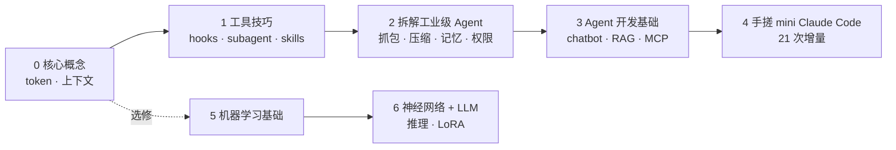

# AI 开发学习知识库

> **一句话**：LLM 只是「根据已有 token 预测下一个 token」的概率模型；Agent、Function Calling、MCP、Skills、压缩、记忆、Sub Agent、Harness，全都是**在有限上下文里尽可能准确高效完成任务的工程方法**。整个知识库只讲这一件事。

骨架借鉴 [labuladong 的 AI 开发教程](https://labuladong.online/zh/ai-coding/ai-guide/)（选题、章节划分、「先用起来再讲原理」的讲法）。
📖 是免费章节的**读书笔记**（请先读原文）；✍️ 是**独立原创课文**：会员章节全部重写（没有使用原站付费内容），另有 5 篇地基章虽然原文免费，也写成了自成一体的课文，原文作为延伸阅读。

## 学习路线（为你调整过的顺序）

你已经是 Claude Code 重度用户，所以顺序和原站不同：**先拆你每天在用的东西，再自己造一个**。机器学习部分是选修，和 Agent 主线相互独立。

| 部分 | 讲什么 | 建议 |
|---|---|---|
| [第 0 部分 · 核心概念](#p0-core) | 主线的起点：token、上下文、API，所有后续章节的地基 | ⭐ 必读，1 天 |
| [第 1 部分 · AI 工具使用技巧](#p1-tools) | 你天天在用的 Claude Code 能力，这次看清它们怎么实现 | ⭐ 只读付费 5 章 + 两篇模型文件，2 天 |
| [第 2 部分 · 拆解工业级 Agent](#p3-agent-internals) | 抓包、system prompt、压缩、记忆、权限——Claude Code / Codex 内部 | ⭐⭐ 重点，1 周 |
| [第 3 部分 · Agent 开发基础](#p2-agent-basics) | 从聊天机器人到 Coding Agent、RAG、MCP，亲手写一遍 | ⭐⭐ 重点，1 周 |
| [第 4 部分 · 手搓 mini Claude Code](#p4-mini-cc) | 一个工程从 0 长到 21 个能力，每章一次增量 | ⭐⭐⭐ 核心项目，2–3 周 |
| [第 5 部分 · 机器学习基础 + 经典算法](#p5-ml) | 想看懂 LLM 训练再来，从拟合、梯度下降讲起 | 选修 |
| [第 6 部分 · 神经网络 + LLM 开发基础](#p6-nn-llm) | 手写自动求导、优化器、推理全流程、LoRA 微调 | 选修 |

## 目录

勾选框用来跟踪进度（直接在编辑器里改 `[ ]` → `[x]`）。

### 第 0 部分 · 核心概念

主线的起点：token、上下文、API，所有后续章节的地基。

- [ ] [本章导读](p0-core/00-guide.md) · 📖 笔记 · [原文](https://labuladong.online/zh/ai-coding/ai-guide/)
- [ ] [LLM 和 Agent 的核心术语和原理](p0-core/01-llm-and-agent.md) · ✍️ 原创 · [原文](https://labuladong.online/zh/ai-coding/basics/llm-and-agent/)
- [ ] [如何调用 LLM 接口](p0-core/02-api-and-apikey.md) · ✍️ 原创 · [原文](https://labuladong.online/zh/ai-coding/basics/api-and-apikey/)
- [ ] [上下文是什么？token 怎么计费？](p0-core/03-messages-and-tokens.md) · ✍️ 原创 · [原文](https://labuladong.online/zh/ai-coding/basics/messages-and-tokens/)
- [ ] [LLM 是怎么预测下一个 token 的](p0-core/04-llm-token-prediction.md) · ✍️ 原创 · [原文](https://labuladong.online/zh/ai-coding/basics/llm-token-prediction/)

### 第 1 部分 · AI 工具使用技巧

你天天在用的 Claude Code 能力，这次看清它们怎么实现。

- [ ] [用 Codex 还是 Claude Code？](p1-tools/01-tools-landscape.md) · 📖 笔记 · [原文](https://labuladong.online/zh/ai-coding/basics/tools-landscape/)
- [ ] [安装使用 Claude Code](p1-tools/02-install-and-use.md) · 📖 笔记 · [原文](https://labuladong.online/zh/ai-coding/claude-code/install-and-use/)
- [ ] [安装使用 Codex](p1-tools/03-install-and-use.md) · 📖 笔记 · [原文](https://labuladong.online/zh/ai-coding/codex/install-and-use/)
- [ ] [安装使用 OpenClaw](p1-tools/04-install-and-use.md) · 📖 笔记 · [原文](https://labuladong.online/zh/ai-coding/openclaw/install-and-use/)
- [ ] [AI 编程的基本常识](p1-tools/05-ai-tips.md) · 📖 笔记 · [原文](https://labuladong.online/zh/ai-coding/basics/ai-tips/)
- [ ] [Claude Code 的常用技巧](p1-tools/06-useful-tips.md) · 📖 笔记 · [原文](https://labuladong.online/zh/ai-coding/claude-code/useful-tips/)
- [ ] [你的聊天记录存在哪](p1-tools/07-session-storage.md) · 📖 笔记 · [原文](https://labuladong.online/zh/ai-coding/claude-code/session-storage/)
- [ ] [用 Hooks 给 Claude Code 加规矩](p1-tools/08-hooks.md) · ✍️ 原创 · [原文](https://labuladong.online/zh/ai-coding/claude-code/hooks/)
- [ ] [/goal 命令：给 Agent 设定目标](p1-tools/09-goal-command.md) · ✍️ 原创 · [原文](https://labuladong.online/zh/ai-coding/claude-code/goal-command/)
- [ ] [Sub Agent：上下文管理的艺术](p1-tools/10-sub-agent.md) · ✍️ 原创 · [原文](https://labuladong.online/zh/ai-coding/basics/sub-agent/)
- [ ] [Fork Agent：共享上下文的艺术](p1-tools/11-fork-agent.md) · ✍️ 原创 · [原文](https://labuladong.online/zh/ai-coding/basics/fork-agent/)
- [ ] [用 Skills 定制你的 AI 工作流](p1-tools/12-skills.md) · ✍️ 原创 · [原文](https://labuladong.online/zh/ai-coding/claude-code/skills/)
- [ ] [用 Ollama 在本地运行大模型](p1-tools/13-local-llm-ollama.md) · 📖 笔记 · [原文](https://labuladong.online/zh/ai-coding/basics/local-llm-ollama/)
- [ ] [看懂 Hugging Face 和模型文件](p1-tools/14-hugging-face-model-files.md) · 📖 笔记 · [原文](https://labuladong.online/zh/ai-coding/basics/hugging-face-model-files/)

### 第 2 部分 · 拆解工业级 Agent

抓包、system prompt、压缩、记忆、权限——Claude Code / Codex 内部。

- [ ] [Claude Code 抓包分析工具](p3-agent-internals/01-http-analyzer.md) · ✍️ 原创 · [原文](https://labuladong.online/zh/ai-coding/claude-code/http-analyzer/)
- [ ] [给 Claude Code 发一句 Hi 会发生什么](p3-agent-internals/02-hi-request.md) · ✍️ 原创 · [原文](https://labuladong.online/zh/ai-coding/claude-code/hi-request/)
- [ ] [System Prompt 应该怎么写](p3-agent-internals/03-system-prompt.md) · ✍️ 原创 · [原文](https://labuladong.online/zh/ai-coding/claude-code/system-prompt/)
- [ ] [文件读写是怎么实现的](p3-agent-internals/04-file-read-write.md) · ✍️ 原创 · [原文](https://labuladong.online/zh/ai-coding/claude-code/file-read-write/)
- [ ] [如何实现上下文压缩](p3-agent-internals/05-context-compaction.md) · ✍️ 原创 · [原文](https://labuladong.online/zh/ai-coding/claude-code/context-compaction/)
- [ ] [Claude Code 自动记忆系统](p3-agent-internals/06-auto-memory.md) · ✍️ 原创 · [原文](https://labuladong.online/zh/ai-coding/claude-code/auto-memory/)
- [ ] [Codex 自动记忆系统](p3-agent-internals/07-auto-memory.md) · ✍️ 原创 · [原文](https://labuladong.online/zh/ai-coding/codex/auto-memory/)
- [ ] [mem0 记忆库的实现思路](p3-agent-internals/08-mem0-memory.md) · ✍️ 原创 · [原文](https://labuladong.online/zh/ai-coding/basics/mem0-memory/)
- [ ] [Zep 记忆系统的实现思路](p3-agent-internals/09-zep-memory.md) · ✍️ 原创 · [原文](https://labuladong.online/zh/ai-coding/basics/zep-memory/)
- [ ] [Claude Code 的权限检查是怎么实现的](p3-agent-internals/10-permission-check.md) · ✍️ 原创 · [原文](https://labuladong.online/zh/ai-coding/claude-code/permission-check/)
- [ ] [Plan Mode 是怎么实现的](p3-agent-internals/11-plan-mode.md) · ✍️ 原创 · [原文](https://labuladong.online/zh/ai-coding/claude-code/plan-mode/)
- [ ] [Harness Engineering 是什么](p3-agent-internals/12-harness-engineering.md) · ✍️ 原创 · [原文](https://labuladong.online/zh/ai-coding/basics/harness-engineering/)
- [ ] [Agent 构建指南：研发要素全景](p3-agent-internals/13-agent-build-guide.md) · ✍️ 原创
- [ ] [Agent 评测实践指南](p3-agent-internals/14-agent-eval-guide.md) · ✍️ 原创

### 第 3 部分 · Agent 开发基础

从聊天机器人到 Coding Agent、RAG、MCP，亲手写一遍。

- [ ] [动手实现一个 AI 聊天机器人](p2-agent-basics/01-ai-chatbot.md) · ✍️ 原创 · [原文](https://labuladong.online/zh/ai-coding/basics/ai-chatbot/)
- [ ] [动手实现一个 Coding Agent](p2-agent-basics/02-coding-agent.md) · ✍️ 原创 · [原文](https://labuladong.online/zh/ai-coding/basics/coding-agent/)
- [ ] [动手实现一个 RAG 问答机器人](p2-agent-basics/03-rag-qa-bot.md) · ✍️ 原创 · [原文](https://labuladong.online/zh/ai-coding/basics/rag-qa-bot/)
- [ ] [RAG 原理和使用场景](p2-agent-basics/04-rag-principles.md) · ✍️ 原创 · [原文](https://labuladong.online/zh/ai-coding/basics/rag-principles/)
- [ ] [Workflow 和 Agent](p2-agent-basics/05-workflow-vs-agent.md) · ✍️ 原创 · [原文](https://labuladong.online/zh/ai-coding/basics/workflow-vs-agent/)
- [ ] [用 Agent SDK 简化开发](p2-agent-basics/06-agent-sdk.md) · ✍️ 原创 · [原文](https://labuladong.online/zh/ai-coding/basics/agent-sdk/)
- [ ] [其他主流 Agent SDK 对比](p2-agent-basics/07-agent-sdk-comparison.md) · ✍️ 原创 · [原文](https://labuladong.online/zh/ai-coding/basics/agent-sdk-comparison/)
- [ ] [给 Agent 加上可观测性](p2-agent-basics/08-agent-observability.md) · ✍️ 原创 · [原文](https://labuladong.online/zh/ai-coding/basics/agent-observability/)
- [ ] [详解 LLM API 的流式响应模式](p2-agent-basics/09-streaming-response.md) · ✍️ 原创 · [原文](https://labuladong.online/zh/ai-coding/basics/streaming-response/)
- [ ] [动手开发 MCP 工具](p2-agent-basics/10-mcp-tool.md) · ✍️ 原创 · [原文](https://labuladong.online/zh/ai-coding/basics/mcp-tool/)
- [ ] [拆解 MCP 通信协议](p2-agent-basics/11-mcp-protocol.md) · ✍️ 原创 · [原文](https://labuladong.online/zh/ai-coding/basics/mcp-protocol/)

### 第 4 部分 · 手搓 mini Claude Code

一个工程从 0 长到 21 个能力，每章一次增量。

- [ ] [Coding Agent 的命令系统](p4-mini-cc/01-cli.md) · ✍️ 原创 · [原文](https://labuladong.online/zh/ai-coding/coding-agent/cli/)
- [ ] [Agent 循环的逐步输出](p4-mini-cc/02-realtime-output.md) · ✍️ 原创 · [原文](https://labuladong.online/zh/ai-coding/coding-agent/realtime-output/)
- [ ] [Agent 的错误处理与重试](p4-mini-cc/03-error-handling.md) · ✍️ 原创 · [原文](https://labuladong.online/zh/ai-coding/coding-agent/error-handling/)
- [ ] [持久化聊天记录](p4-mini-cc/04-resume.md) · ✍️ 原创 · [原文](https://labuladong.online/zh/ai-coding/coding-agent/resume/)
- [ ] [对工具调用进行权限审批](p4-mini-cc/05-permission.md) · ✍️ 原创 · [原文](https://labuladong.online/zh/ai-coding/coding-agent/permission/)
- [ ] [auto 模式自动进行权限审批](p4-mini-cc/06-auto-mode.md) · ✍️ 原创 · [原文](https://labuladong.online/zh/ai-coding/coding-agent/auto-mode/)
- [ ] [可靠的文件编辑工具](p4-mini-cc/07-file-edit.md) · ✍️ 原创 · [原文](https://labuladong.online/zh/ai-coding/coding-agent/file-edit/)
- [ ] [用 @ 引用文件](p4-mini-cc/08-file-mention.md) · ✍️ 原创 · [原文](https://labuladong.online/zh/ai-coding/coding-agent/file-mention/)
- [ ] [更灵活的上下文注入机制](p4-mini-cc/09-context-injection.md) · ✍️ 原创 · [原文](https://labuladong.online/zh/ai-coding/coding-agent/context-injection/)
- [ ] [让 Agent 主动向你提问](p4-mini-cc/10-ask-user-question.md) · ✍️ 原创 · [原文](https://labuladong.online/zh/ai-coding/coding-agent/ask-user-question/)
- [ ] [让 Agent 跟踪多步任务](p4-mini-cc/11-task-management.md) · ✍️ 原创 · [原文](https://labuladong.online/zh/ai-coding/coding-agent/task-management/)
- [ ] [给 Agent 加上长期记忆](p4-mini-cc/12-memory.md) · ✍️ 原创 · [原文](https://labuladong.online/zh/ai-coding/coding-agent/memory/)
- [ ] [支持 rewind 回退对话和代码](p4-mini-cc/13-rewind.md) · ✍️ 原创 · [原文](https://labuladong.online/zh/ai-coding/coding-agent/rewind/)
- [ ] [支持 compact 压缩上下文](p4-mini-cc/14-compact.md) · ✍️ 原创 · [原文](https://labuladong.online/zh/ai-coding/coding-agent/compact/)
- [ ] [给 Agent 注册 MCP server](p4-mini-cc/15-mcp.md) · ✍️ 原创 · [原文](https://labuladong.online/zh/ai-coding/coding-agent/mcp/)
- [ ] [让 Agent 在后台运行命令](p4-mini-cc/16-background.md) · ✍️ 原创 · [原文](https://labuladong.online/zh/ai-coding/coding-agent/background/)
- [ ] [实现 Sub Agent 机制](p4-mini-cc/17-subagent.md) · ✍️ 原创 · [原文](https://labuladong.online/zh/ai-coding/coding-agent/subagent/)
- [ ] [让 Agent 监听外部事件](p4-mini-cc/18-monitor.md) · ✍️ 原创 · [原文](https://labuladong.online/zh/ai-coding/coding-agent/monitor/)
- [ ] [支持图片输入](p4-mini-cc/19-image.md) · ✍️ 原创 · [原文](https://labuladong.online/zh/ai-coding/coding-agent/image/)
- [ ] [渐进式加载 Skills](p4-mini-cc/20-skill.md) · ✍️ 原创 · [原文](https://labuladong.online/zh/ai-coding/coding-agent/skill/)
- [ ] [让 Agent 先规划再动手](p4-mini-cc/21-plan.md) · ✍️ 原创 · [原文](https://labuladong.online/zh/ai-coding/coding-agent/plan/)

### 第 5 部分 · 机器学习基础 + 经典算法

想看懂 LLM 训练再来，从拟合、梯度下降讲起。

- [ ] [Tensor 的常用操作](p5-ml/01-pytorch-basics.md) · 📖 笔记 · [原文](https://labuladong.online/zh/ai-coding/basics/pytorch-basics/)
- [ ] [机器学习的基本概念](p5-ml/02-ml-basics.md) · 📖 笔记 · [原文](https://labuladong.online/zh/ai-coding/machine-learning/ml-basics/)
- [ ] [什么是拟合](p5-ml/03-ml-fitting.md) · 📖 笔记 · [原文](https://labuladong.online/zh/ai-coding/machine-learning/ml-fitting/)
- [ ] [最小二乘法](p5-ml/04-ml-least-squares.md) · ✍️ 原创 · [原文](https://labuladong.online/zh/ai-coding/machine-learning/ml-least-squares/)
- [ ] [梯度下降](p5-ml/05-ml-gradient-descent.md) · ✍️ 原创 · [原文](https://labuladong.online/zh/ai-coding/machine-learning/ml-gradient-descent/)
- [ ] [局部最优与全局最优](p5-ml/06-ml-local-global-optima.md) · ✍️ 原创 · [原文](https://labuladong.online/zh/ai-coding/machine-learning/ml-local-global-optima/)
- [ ] [过拟合与泛化](p5-ml/07-ml-overfitting.md) · ✍️ 原创 · [原文](https://labuladong.online/zh/ai-coding/machine-learning/ml-overfitting/)
- [ ] [二分类问题：逻辑回归](p5-ml/08-ml-logistic-regression.md) · ✍️ 原创 · [原文](https://labuladong.online/zh/ai-coding/machine-learning/ml-logistic-regression/)
- [ ] [实战：逻辑回归识别涂鸦](p5-ml/09-ml-logistic-regression-doodles.md) · ✍️ 原创 · [原文](https://labuladong.online/zh/ai-coding/machine-learning/ml-logistic-regression-doodles/)
- [ ] [分类模型的评估](p5-ml/10-ml-classification-metrics.md) · ✍️ 原创 · [原文](https://labuladong.online/zh/ai-coding/machine-learning/ml-classification-metrics/)
- [ ] [多分类问题：Softmax 回归](p5-ml/11-ml-softmax.md) · ✍️ 原创 · [原文](https://labuladong.online/zh/ai-coding/machine-learning/ml-softmax/)
- [ ] [K 近邻算法](p5-ml/12-ml-knn.md) · ✍️ 原创 · [原文](https://labuladong.online/zh/ai-coding/machine-learning/ml-knn/)
- [ ] [实战：KNN 识别手写数字](p5-ml/13-ml-knn-digits.md) · ✍️ 原创 · [原文](https://labuladong.online/zh/ai-coding/machine-learning/ml-knn-digits/)
- [ ] [决策树：用一连串问题做分类](p5-ml/14-ml-decision-tree.md) · ✍️ 原创 · [原文](https://labuladong.online/zh/ai-coding/machine-learning/ml-decision-tree/)
- [ ] [随机森林算法及实战](p5-ml/15-ml-random-forest.md) · ✍️ 原创 · [原文](https://labuladong.online/zh/ai-coding/machine-learning/ml-random-forest/)
- [ ] [K-Means 聚类算法](p5-ml/16-ml-kmeans.md) · ✍️ 原创 · [原文](https://labuladong.online/zh/ai-coding/machine-learning/ml-kmeans/)
- [ ] [实战：K-Means 颜色量化](p5-ml/17-ml-kmeans-color-quantization.md) · ✍️ 原创 · [原文](https://labuladong.online/zh/ai-coding/machine-learning/ml-kmeans-color-quantization/)
- [ ] [模拟退火算法](p5-ml/18-ml-simulated-annealing.md) · ✍️ 原创 · [原文](https://labuladong.online/zh/ai-coding/machine-learning/ml-simulated-annealing/)

### 第 6 部分 · 神经网络 + LLM 开发基础

手写自动求导、优化器、推理全流程、LoRA 微调。

- [ ] [手写神经网络：让模型自己学会特征](p6-nn-llm/01-ml-neural-network.md) · 📖 笔记 · [原文](https://labuladong.online/zh/ai-coding/machine-learning/ml-neural-network/)
- [ ] [实战：神经网络识别人体动作](p6-nn-llm/02-ml-activity-recognition.md) · ✍️ 原创 · [原文](https://labuladong.online/zh/ai-coding/machine-learning/ml-activity-recognition/)
- [ ] [反向传播：手写自动求导引擎](p6-nn-llm/03-ml-backpropagation.md) · ✍️ 原创 · [原文](https://labuladong.online/zh/ai-coding/machine-learning/ml-backpropagation/)
- [ ] [优化器：Momentum 和 Adam](p6-nn-llm/04-ml-optimizers.md) · ✍️ 原创 · [原文](https://labuladong.online/zh/ai-coding/machine-learning/ml-optimizers/)
- [ ] [动手跑通 LLM 推理的全流程](p6-nn-llm/05-inference-process.md) · ✍️ 原创 · [原文](https://labuladong.online/zh/ai-coding/llm/inference-process/)
- [ ] [动手用 LoRA 微调模型](p6-nn-llm/06-lora-fine-tuning.md) · ✍️ 原创 · [原文](https://labuladong.online/zh/ai-coding/llm/lora-fine-tuning/)

## 配套代码

第 0–4 部分的代码有 Node（TypeScript）和 Python 两版，逻辑一一对应，正文默认展示 Node 版，代码块上方的标签页可以切到 Python。
第 5–6 部分是 PyTorch 训练，只有 Python 版。

| 目录 | 内容 | 运行 |
|---|---|---|
| `code/agent-node/` | 第 0–3 部分的示例（Node 版）：hook 演示、chatbot、RAG、MCP server、抓包代理 | `cd code/agent-node && npm ci && npm test` |
| `code/mini_cc-node/` | 第 4 部分的 mini Claude Code（Node 版） | `cd code/mini_cc-node && npm ci && node mini_cc/cli.ts` |
| `code/agent/` | 同上，Python 版 | `cd code/agent && uv run pytest -q` |
| `code/mini_cc/` | 同上，Python 版；`CHANGELOG.md` 记录每章增量 | `cd code/mini_cc && uv run python -m mini_cc` |
| `code/ml/` | 第 5–6 部分的手写算法，均与 sklearn / torch 对拍 | `cd code/ml && uv run pytest -q` |

Node 版需要 Node 24 以上，直接运行 `.ts` 文件，没有构建步骤。

所有测试都跑离线 fake 模型，不消耗 API。要连真实模型，设置 `ANTHROPIC_API_KEY`（可选 `ANTHROPIC_BASE_URL`）。

## 维护

- 网页版预览：`cd .site && uv run mkdocs serve`，打开 http://127.0.0.1:8000（导航按 `curriculum.json` 自动生成，新章节写出来刷新就有；新增**部分目录**时先跑 `python3 tools/build_site.py`）
- 章节清单的唯一来源是 `curriculum.json`；改完重跑 `python3 tools/build_readme.py`
- 写作规范：`STYLE.md`
- 原站更新了新章节：重新抓 sitemap（`/sitemap.xml` 里 `/zh/ai-coding/` 开头的地址），在 `curriculum.json` 里追加
