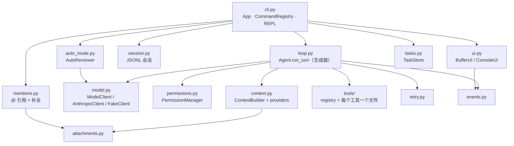
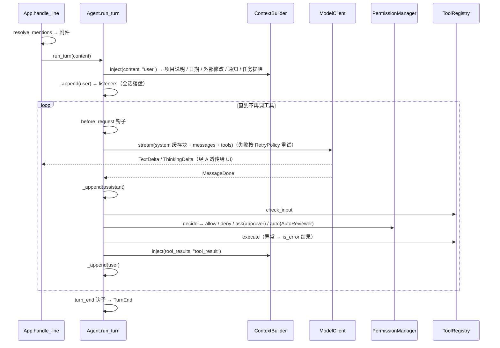

# mini_cc 架构

一个可以逐行读懂的 mini Claude Code。只依赖 `anthropic` SDK（外加 `rich` / `prompt_toolkit` 做终端），不用任何 agent 框架，agent 循环完全可见。

```
uv run python -m mini_cc                       # 真模型（ANTHROPIC_API_KEY / ANTHROPIC_BASE_URL）
uv run python -m mini_cc --fake examples/ch05.json   # 离线：按剧本回放，不发任何请求
uv run pytest -q                               # 全部测试用 FakeClient，不联网
```

## 模块与依赖方向



规则：**`loop.py` 不认识 UI、磁盘、SDK**。它只通过协议（`ModelClient`）、回调（`approver`、`listeners`、钩子）和事件（`events.py`）与外界交互。`cli.py:App` 是唯一把它们粘在一起的地方。

| 文件 | 职责 | 引入章节 |
|---|---|---|
| `config.py` | `Settings`：所有可调旋钮 | 1 |
| `model.py` | `ModelRequest`、流式事件 `TextDelta/ThinkingDelta/MessageDone`、`ModelClient` 协议、`complete()`、`ModelError`/`to_model_error()`、`AnthropicClient`（`messages.stream`、fallback beta、顶层 cache_control）、`FakeClient`（剧本回放、记录请求、`fail_after`、`responder`、`from_json`） | 1–3, 6, 9 |
| `loop.py` | `Agent`：`run_turn()` 生成器 = 安全网外壳 → `_loop()`/`_steps()` → `_call_model()`（重试）→ `_run_tools()`（校验 → `_authorize()` 权限 → 执行）；`_append()` 历史唯一写入口；`_append_user()` 注入点；`repair_history()` | 1–5, 9, 11 |
| `events.py` | `ToolStart/ToolEnd/Notice/PermissionDecision/ContextInjected/TasksUpdated/TurnEnd` | 2, 5, 9, 11 |
| `retry.py` | `RetryPolicy`：指数退避 + 抖动 + `retry-after` | 3 |
| `session.py` | `SessionStore/Session`：`<home>/projects/<slug>/<id>.jsonl`，每条消息一行，`uuid/parentUuid` 链；读取时从叶子沿链回走（`branch()`），`Session.chain` 与 `Agent.messages` 一一对应 | 4, 11, 13 |
| `rewind.py` | `FileHistory`：每条用户提示词一个检查点，`write_hooks` 写前备份（`<home>/file-history/<session>/<hash>@v<n>`）；`restore/truncate` | 13 |
| `permissions.py` | 模式、`decide()` 判定链、会话规则、`extra_checks`、`classifier` | 5, 6 |
| `auto_mode.py` | `AutoReviewer`：独立请求、只看用户原话 + 动作、json_schema 结构化输出、fail closed | 6 |
| `tools/` | `base.py`（`Tool`、`ToolResult`、`ToolContext`）、`registry.py`（两道防线）、`validate.py`、`file_state.py`、`read/write/edit/bash/ask_user/task_tools/memory_tool.py` | 1, 3, 5, 7, 10–12 |
| `attachments.py` | `Attachment` + `<system-reminder>` 渲染 | 8 |
| `mentions.py` | `@` 解析、附件、`git ls-files` + 模糊补全 | 8 |
| `context.py` | `ContextBuilder`：静态 system（带 cache_control）+ providers（项目说明、日期、外部修改、通知） | 9 |
| `tasks.py` | `TaskStore`（`<id>.tasks.json`）+ 任务提醒 provider | 11 |
| `ui.py` | 事件 → 终端；`ask()`、`ask_permission()`、`ask_questions()` | 1, 2, 5, 10, 11 |
| `memory.py` | `MemoryStore`：`MEMORY.md` 索引 + 主题文件；索引截断后进 system | 12 |
| `cli.py` | `App`、`CommandRegistry`（`/help /new /status /model /resume /mode /context /todos /memory /rewind /exit`）、REPL（Shift+Tab、补全）、`main()` | 1, 4–6, 8, 9, 11, 12 |

## 一轮对话的数据流



## 四条不变量（后续章节请保持）

1. **历史只追加、不修改**。所有写入都经 `Agent._append()`；注入只往「即将追加、尚未发出」的 user 消息里加块。这条保证了会话落盘是纯追加、prompt cache 前缀稳定、`claude-opus-5-5` 的 thinking 块不因历史被编辑而失效。
   **分支点**（第 13 章补充）：`Agent.load_history()` 是唯一允许整体换掉历史的入口，只用于「从某个起点重新开始」——`/resume`（磁盘上的原样历史）、`/rewind`（当前历史的一个**前缀**）、第 14 章压缩（摘要作为新起点）。它们都不改写任何一条已有消息；会话文件那边只追加一条标记记录（`rewind` / `compact_boundary`）。
2. **历史只在 `MessageDone` 之后写 assistant**。流到一半失败时历史干净，重试安全。
3. **每个 `tool_use` 都有 `tool_result`**。任何中断路径都经 `repair_history()` 补齐。
4. **循环不抛异常**。`run_turn` 是安全网；工具异常是结果，不是控制流。

## 给第 12–21 章预留的扩展点

| 章节 | 用哪个扩展点 | 现状 |
|---|---|---|
| 12 长期记忆 | `ContextBuilder.system_sections`（记忆索引放 system，会话内稳定）或新的 provider（按需注入相关记忆）；`Agent.turn_end` 钩子（一轮结束后提取记忆）；新工具注册进 `ToolRegistry`；落盘位置 `settings.home / "projects" / slug / "memory"` | **已实现**：`system_sections` + `Memory` 工具；slug 按 git 根算；`turn_end` 未使用（留作练习） |
| 13 rewind（**已实现**） | `Agent.listeners`（每条消息的回调，已用于会话落盘）；JSONL 记录的 `uuid/parentUuid` 链；`ToolContext.write_hooks` / `before_write(path)`（Write/Edit/Edit 新建文件在写盘前调用，用于拍文件快照）；`Agent.load_history()` 回退到某个前缀；`SessionStore.load` 会忽略未知 `type` 的记录（可写入 `file-history-snapshot` 之类） | **已实现**：`App._on_message`（listener）开检查点、`write_hooks` 备份、`branch()` 沿链读取 + `rewind` 记录、`/rewind [n] [both\|conversation\|code]`；Bash 改文件不跟踪（同 Claude Code） |
| 14 compact | `Agent.before_request` 钩子（看 `agent.usage.last_input` 决定是否压缩）；`complete(client, req)` 做一次摘要请求；`Agent.load_history()` 换成「摘要 + 尾部」；会话里写一条 `{"type": "compact_boundary"}` 之类的记录并让 `SessionStore.load` 识别；压缩后 providers 会**自动重新注入**项目说明与任务清单（它们扫描历史判断，不记标志位） | `before_request` 已有测试；`instructions_provider`、`task_reminder_provider` 的「历史里看不见就重注入」已有测试 |
| 15 MCP | `ToolRegistry.register()` 运行时注册（`mcp__server__tool` 命名）；`Tool.read_only/kind/self_check` 决定权限；`ContextBuilder.system_sections` 放 server instructions；新命令 `@COMMANDS.register("/mcp", ...)`。注意 MCP Python SDK 是 async 的，而循环是同步生成器：可以在后台线程跑一个事件循环，用 `asyncio.run_coroutine_threadsafe` 调用 | 运行时注册工具已有测试 |
| 16 后台命令 | `Agent.notify(text)`（线程安全队列）→ `notifications_provider` 在下一次追加 user 消息时送达；`ToolContext.emit(event)` 向 UI 报进度；`/tasks` 命令名已预留（任务清单用的是 `/todos`）；`BashTool` 加 `run_in_background` 参数 | 跨线程通知已有测试 |
| 17 sub agent | `Agent` 没有全局状态：用独立的 `ToolRegistry`（只读工具子集）、独立的 `ContextBuilder`（不同 system）、同一个或另一个 `ModelClient` 新建一个 `Agent` 即可；结果经父 Agent 的 `notify()` 回来；`PermissionManager` 可共享或另建 | 构造参数已解耦 |
| 18 监听事件 | 同 16：持续运行的监听线程每匹配一行就 `agent.notify(...)` | 同上 |
| 19 图片 | `ToolResult.content` 已支持 `list[dict]`（可放 image 块）；`mentions.resolve_mentions` 遇到图片扩展名时可返回 image 块（`build_user_content` 接受任意块）；`ui.preview` 对非文本内容显示 `[non-text content]` | 类型已留口 |
| 20 skills | `ContextBuilder.system_sections`（skills 目录，只放名字 + 一句描述）；新增 `Skill` 工具按需读取 SKILL.md；`CommandRegistry` 支持 prompt 型命令（handler 里调用 `app.handle_line(展开后的 prompt)` 即可） | 同上 |
| 21 plan 模式 | `permissions.PLAN` 常量已存在（`--permission-mode plan` 可选，但目前等同 default）；`PermissionManager.extra_checks`（排在 bypass 之前，plan 模式「只许写 plan 文件」挂这里）；`PermissionManager.cycle` 加入 `PLAN`；`set_mode()` + `on_mode_change`（记录进会话）；provider 扫描历史里最近一条 plan 提醒与当前模式比对，发完整/精简/退出提醒；`AskUserQuestion` 已有（plan 里用来澄清）；`TaskCreate` 已有（批准后拆任务）；审批 UI 可复用 `BufferUI.ask()` | `extra_checks` 已有测试 |

## 测试约定

- `tests/conftest.py`：`settings`（`tmp_path` 下的项目目录和 home）、`make_app(*script, reviewer_client=None)` 返回 `(App, FakeClient)`；`BufferUI.answers` 预置交互答案（用完默认回答 `"1"`）。
- `tests/sdk_stub.py`：假 SDK 对象，用来测 `AnthropicClient` 的参数与事件转换而不联网。
- 每章一个 `tests/test_chNN_*.py`；`tests/test_extension_points.py` 守住上表的扩展点。
- 断言「模型看到了什么」用 `client.requests[i].messages / .system / .tools`；会话级注入用 `conftest.without_session_context()` 过滤。
