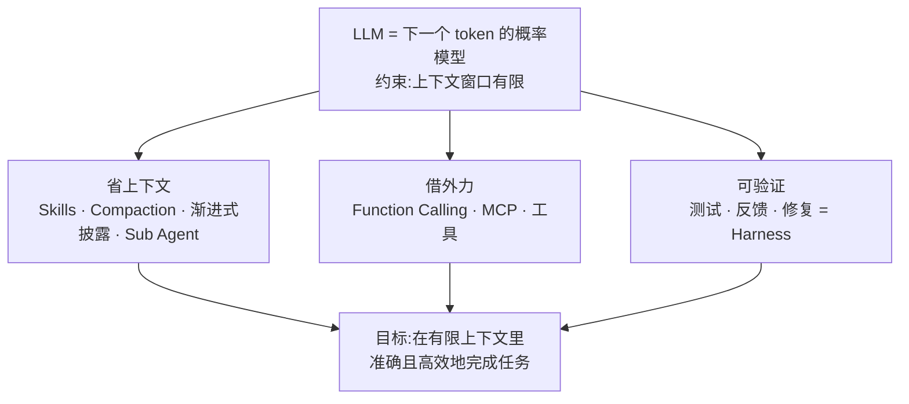
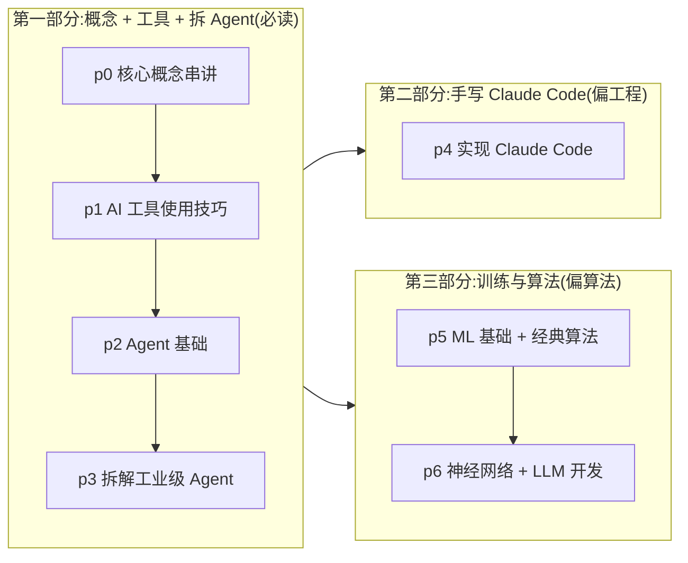

# 本章导读：一条主线读完整个知识库

> 原文（免费）：[本章导读](https://labuladong.online/zh/ai-coding/ai-guide/) —— 建议先读原文，本页是我的笔记

**一句话结论**：LLM 就是一个「按已有 token 预测下一个 token」的概率模型，而且它的上下文有上限；Agent、Function Calling、MCP、Skills、压缩、记忆、Sub Agent、Harness 都是同一件事的不同招式：**在有限的上下文里，尽可能准确、高效地完成任务**。

## 核心要点

1. **名词会一直变，本质不变。** Vibe Coding、Spec Coding、Harness Engineering，名字每半年换一批。作者借用他讲算法时的「框架思维」（算法的本质是穷举，技巧都是穷举的优化）：先抓住不变的本质，新名词就只是同一问题的新解法。
2. **基座是 LLM，本质是概率模型。** 给定前文，输出下一个 token 的概率分布。后面所有工程都建在这一层上。细节见 [LLM 是怎么预测下一个 token 的](04-llm-token-prediction.md)。
3. **约束是上下文有限。** 作者把上下文比作 LLM 的「脑容量」，超出上限的信息它处理不了。原文的定位是：开发者「唯一需要做的事情就是在 LLM 有限的上下文中，尽可能准确高效的完成目标任务」。
4. **第一类招式：省上下文。** Skills、压缩（Compaction）、渐进式披露（Progressive Disclosure）都在让同样大小的窗口装进更多有用信息。原文的说法是「在有限的上下文中雕花」。
5. **第二类招式：用工具代替自己生成。** 让模型自己写代码造轮子，费 token，也不一定对；给它可靠的工具去调用更划算。这就引出了 Function Calling 和 MCP。
6. **第三类招式：让结果可验证。** 大仓库里模型很难一次就写对，修一个 bug 可能冒出新 bug。所以需要一套面向 AI 的测试、反馈、修复回路，也就是 Harness Engineering。
7. **学习顺序：先用工具，再学原理。** 工具用熟了，自然会好奇底层怎么做的，那时再看实现，会发现「竟是这么朴实无华」。
8. **三大部分里，后两部分互相独立。** 第一部分是概念加工具技巧（必读）；第二部分自己手写一个简化版 Claude Code（偏工程）；第三部分讲训练、微调和数学基础（偏算法）。只关心 Agent 开发就读到第二部分；只关心算法可以跳过第二部分。



原文的三部分和本知识库目录的对应关系：



### 📝 作者是怎么讲的

- **先讲自己的经历，再引出问题。** 开头是他 2022 年用 GPT-3.5 硬搓工作流做多语言翻译的经历，接着写「以为大家都熟，其实读者问题里满是混淆」，这就自然引出了开这一章的理由。借用法：你写团队文档时，也可以从「我自己踩过 / 被问过」切入，比直接下定义更有说服力。
- **借自己的旧框架做类比。** 他拿算法教程里的「本质是穷举」来类比 AI 的「本质是有限上下文」。读者已经认同那套框架，新框架就能直接搭在上面。类比也有不成立的地方：穷举是确定性的，LLM 是概率性的，这一点原文没展开。
- **用一串问题推出概念。** 原文没有罗列名词，而是一路追问：上下文有限，怎么办？让模型造轮子太费 token，那就给它工具；大仓库里一次写不对，那就要能验证。Skills、MCP、Harness 依次登场，每个概念都是对上一个问题的回答。
- **名词换代，本质不变。** 他先承认术语「本来就在不断演进」，再给出不变的锚点。这样读者遇到新词就不慌。你给新人讲 webapp 的那一堆 skill 时，可以照搬这个两步。
- **先演示，后讲原理。** 学习顺序那段主张先用工具、再学原理。后半段的「特色」展示，也是先给聊天编辑器、Agent 运行日志、可拖动图、在线 notebook 这些「能看见的效果」，再说背后会讲什么。
- **用「朴实无华」收束。** 他提前告诉读者，等看到实现会发现「竟是这么朴实无华」。这既降低了心理门槛，也立下了全书承诺：神奇能力的背后都是简单的工程。

> ⚠️ 补充：原文说第二部分用 **pydantic-ai** SDK 实现。本知识库的 `code/mini_cc/` 用的是 **anthropic** 官方 SDK 加可注入的 fake client（见 [STYLE.md](../STYLE.md)「代码目录」一节），所以思路照搬，代码不会和原站一一对应。

## 回到主线

这一页**就是**主线本身。之后每章都可以用同一个问题来读：**它往上下文里放了什么、拿走了什么，换来了什么（省 token、提高可靠性、扩展能力边界）？** 读不出这一点，说明还停在名词层面。

## 对照你的环境

你的日常配置已经把三类招式都用上了，可以拿来当本知识库的「标本」：

| 招式 | 你环境里对应的东西 | 在上下文上做了什么 |
|---|---|---|
| 省上下文 | `~/.claude/skills/` 下约 45 个 skill（`feat-spec`、`doc-narrative`、`webapp-bugfix`……），平时只有 name 和 description 常驻 | 渐进式披露：用到时才加载正文 |
| 省上下文 | `~/.claude/CLAUDE.md` 里写的「常驻层是稀缺资源」「多步流程一律进 skill」 | 主动给常驻上下文做减法 |
| 省上下文 | `inject-guardrails.sh` 按 cwd 分层注入护栏 | 只放进当前项目需要的规则 |
| 省上下文 | 日常用 subagent / fork / `codex-review` 后台单臂 | 把大段搜索和 review 输出挡在主上下文外面，只收结论 |
| 借外力 | MCP：Linear / Notion / 研发平台 / chrome-devtools；CLI：运维与日志 CLI | 用确定性的工具结果代替模型自己猜 |
| 可验证 | CLAUDE.md 里保留的三条铁律（TDD、根因调查后再修、完成前贴真实输出）；`doctor.sh` 跑真实注入探针 | 把「做对了吗」交给可执行的反馈回路 |
| 可验证 | settings.json 里配置的 10 类 hook（PreToolUse / PostToolUse / Stop……） | 在 harness 层强制执行规则，不靠模型自觉 |

CLAUDE.md 第一条原则「工具链能强制的就别写进上下文」，其实就是这条主线的工程化表述：能交给 lint、类型或 hook 去保证的，就别占用上下文。

原文末尾的练习题「特征标准化」，我在 `code/ml` 里用 torch 实跑过（总体标准差用 `unbiased=False`，std 为 0 的列置 0），两个示例的输出和题面一致：

```text
tensor([[-1.2247, -1.2247],
        [ 0.0000,  0.0000],
        [ 1.2247,  1.2247]])
tensor([[ 0.0000, -1.2247],
        [ 0.0000,  0.0000],
        [ 0.0000,  1.2247]])
```

## 自测题

1. 用一句话说出全库主线。为什么说 Skills 和 MCP 是「同一件事的两种招式」？
2. 你的 `webapp-bugfix` skill 要求「真机复现 → 定性 → 改完真机验证 → 留痕」，它主要属于三类招式里的哪一类？它和 Harness Engineering 是什么关系？
3. 如果明天出现一个新名词「XYZ Agent」，按本页的框架，你应该先问哪几个问题来判断它到底新在哪？

<details>
<summary>参考答案</summary>

1. 主线：LLM 是预测下一个 token 的概率模型，上下文有限，所有 Agent 工程都在有限上下文里尽量准确高效地完成任务。Skills 是**少放**：按需加载，省掉常驻 token。MCP 是**换个方式放**：把模型自己推理或生成的过程，换成工具返回的确定结果，既省 token 又更可靠。目标相同，手段不同。
2. 主要属于「可验证」。它在流程层面给模型套上反馈回路，复现和验证都依赖真实环境的信号，不依赖模型的自我判断。这正是 Harness 的核心：用测试、反馈、修复回路约束模型的产出。它也带一点「省上下文」：没复现就不出方案，避免在错误假设上烧 token。
3. 至少问三个：(a) 它往上下文里放了什么、拿走了什么？(b) 它用什么替代了模型自己生成（新工具或协议）？(c) 它怎么验证结果、怎么反馈修复？三个都答不出新东西的话，它多半只是旧方法换了个名字。

</details>

## 相关章节

- 下一篇：[LLM 和 Agent 的核心术语和原理](01-llm-and-agent.md)
- 上下文与计费：[上下文是什么？token 怎么计费？](03-messages-and-tokens.md)
- 省上下文：[Sub Agent](../p1-tools/10-sub-agent.md) · [Skills](../p1-tools/12-skills.md) · [上下文压缩](../p3-agent-internals/05-context-compaction.md)
- 借外力：[动手开发 MCP 工具](../p2-agent-basics/10-mcp-tool.md)
- 可验证：[用 Hooks 给 Claude Code 加规矩](../p1-tools/08-hooks.md) · [Harness Engineering 是什么](../p3-agent-internals/12-harness-engineering.md)
- 第二部分起点：[Coding Agent 的命令系统](../p4-mini-cc/01-cli.md)
- 第三部分起点：[Tensor 的常用操作](../p5-ml/01-pytorch-basics.md)
