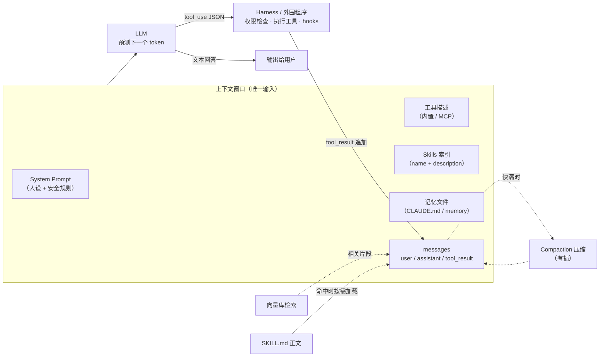

# LLM 和 Agent 的核心术语和原理

> 原文（免费）：[LLM 和 Agent 的核心术语和原理](https://labuladong.online/zh/ai-coding/basics/llm-and-agent/) —— 建议先读原文，本页是我的笔记

**一句话结论**：LLM 只是一个「看着上下文猜下一个 token」的概率模型；Instruct、CoT、System Prompt、Tool Use、MCP、Agent 循环、Skills、RAG、记忆、Harness，全部是「往上下文里放什么、什么时候放、放多少」的工程手段——Agent = Model + Harness。

---

## 核心要点

### 1. 两件事决定 AI 干活的效果：引擎 + 整车

原文用汽车打比方：LLM 是引擎，Agent 工程是其余所有部件。我自己的理解是：**模型决定「上限」，Agent 决定「能逼近上限多少」**。同一个 Claude 模型，在 Claude Code 和第三方编辑器里表现不同，差异全在 Agent 层（上下文怎么组织、工具怎么设计、愿意花多少 token 让模型看清楚再动手）。

### 2. LLM = 自回归的概率预测

输入一段 token，输出「下一个 token 的概率分布」，抽一个拼回去，循环。原文的关键一句：「LLM 本质上就是一个概率模型，一个字一个字地往外蹦」。流式输出不是 UI 特效，就是它的真实工作方式。temperature 只是改变「抽签」的随机程度（详见 [04 预测下一个 token](./04-llm-token-prediction.md)）。

### 3. 上下文 = 模型唯一能看到的东西

模型没有记忆，「记得你叫小明」只是因为那句话还在本次请求的上下文里。窗口有上限，超了就要压缩（Compaction）——压缩必然丢信息，这就是长会话「失忆」的来源。推论：**一个会话只干一件事**，新问题开新会话。

### 4. 从 Base 到 Instruct：补全引擎变成对话助手

Base 模型只会续写；Instruct 模型经过「指令-回答」微调 + RLHF，学会了把输入当成要响应的指令。日常用的都是 Instruct 模型。

### 5. 思维链（CoT）与思考强度

让模型先把推理写出来，等于给自己打草稿——中间结果也进了上下文，成为后续预测的依据。原文提到行业已经收敛到「单一模型 + 思考强度参数」。

> ⚠️ 补充（Claude 侧现状，核对自 `claude-api` skill 2026-10 缓存文档）：Anthropic 这边的参数叫 `output_config.effort`（`low`/`medium`/`high`/`xhigh`/`max`），配合 `thinking: {type: "adaptive"}`。在 `claude-opus-5-5` 上 thinking **不能关闭**（`{type:"disabled"}` 返回 400），默认 effort 是 `medium`；旧的 `budget_tokens` 写法在当前一代模型上已被拒绝。你 `~/.claude/settings.json` 里的 `effortLevel` 就是 Claude Code 对这个参数的封装。

### 6. System Prompt：拼在最前面的「人设说明书」

它本质是上下文最前面的一段文本，靠训练时学到的「system 角色权重更高」获得优先级——但这是概率性的，不是硬隔离，所以有越狱。服务商把可调的安全策略放进 System Prompt，因为「改一行文本就能生效」比重训便宜。

### 7. Function Calling：模型只输出「调用意图」

模型从不真正调用 API，它只是输出一段结构化 JSON；**外围程序**执行、再把结果追加回上下文。原文的关键一句：「全部都是文本，全部在上下文窗口里，没有任何魔法」。它考验的是模型的指令遵从能力（能否稳定输出合法 JSON、参数是否正确）。

### 8. MCP：把「工具怎么描述、怎么调用」标准化

各家 Tool Use 的 schema 字段不同（OpenAI 的 `function.parameters` vs Anthropic 的 `input_schema`），MCP 相当于 USB-C：写一次，所有支持 MCP 的 Agent 都能接。**MCP 没有新增任何 AI 能力**，底层仍是 Tool Use。

> ⚠️ 勘误：原文示例 `from mcp.server.fastmcp import FastMCP` 在 **mcp 2.x** 已失效。本机 `code/agent` 装的是 mcp 2.3.0，实测报错 `No module named 'mcp.server.fastmcp'`，提示 FastMCP 已改名为 `MCPServer`。实测可用写法：
>
> ```python
> from mcp.server.mcpserver import MCPServer
> mcp = MCPServer("weather-server")
>
> @mcp.tool()
> def get_weather(city: str) -> str:
>     """查询指定城市的当前天气"""
>     return f"{city}：8°C，多云"
> ```
>
> （本机 `uv run` 实测：工具注册成功。要跑原文 v1 代码需 `mcp<2`。另外原文说「fastmcp 库」不准确——那是官方 `mcp` SDK 内置的模块；独立的 `fastmcp` 包是另一个项目。）

### 9. Agent = LLM + Tool Use + while 循环（ReAct）

思考 → 行动 → 观察 → 再思考。副作用是**每一轮都往上下文追加内容**，上下文单调增长。所以窗口大小和工具调用准确率都直接决定 Agent 能跑多久：一次无关的大输出工具调用，就能把上下文撑爆。

### 10. Skills / RAG / 记忆 / Harness：四种「往上下文放东西」的策略

| 技术 | 放进上下文的是什么 | 省/换来了什么 |
|---|---|---|
| Skills | 先放名字+一句描述，命中再加载正文（渐进式披露） | 省 token；预写脚本换可靠性 |
| RAG | 按语义向量检索出来的少量片段 | 让私有知识进得来，又不塞爆窗口 |
| Auto Memory | 跨会话有价值的偏好/项目知识 | 新会话不用重新教 |
| Harness | 不放东西，而是用确定性程序约束/反馈 | 用工程兜底概率模型的出错 |

Harness 的核心原则（原文）：「能用确定性程序检测的事情，就不要依赖模型自己判断」。事前约束（如 Edit 工具要求先 Read）+ 事后反馈（如 Stop hook 跑测试）。

### 机制总图



图注：实线是 Agent 循环的主路径，虚线是各种「按需往上下文搬东西」的策略。所有箭头最终都汇入同一个上下文窗口。

### 11. OpenClaw 的定位：换交互界面，不换 Agent 内核

它的创新在「把 Agent 接到 IM」，而不是 Agent 本身；还能通过 ACP 或 CLI 调起 Claude Code/Codex 干活，自己只当传声筒。原文作者判断热度已在 2026 年中消退（官方 App 有了 Remote Control）。详见 [安装使用 OpenClaw](../p1-tools/04-install-and-use.md)。

---

### 📝 作者是怎么讲的

- **用读者真有的疑问开场。** 第一句不讲定义，问的是「编辑器里也能选 Claude，为什么 Claude Code 配 Claude 效果最好」。接着点破：会这么问，说明还没分清 LLM 和 Agent。读者带着问题读，后面每节都在给这个问题补一块拼图。你写 skill 的 README 或方案也可以这样起头，用使用者真正踩过的困惑当第一句。
- **一个概念配一个类比。** 引擎和整车讲 LLM 和 Agent；背棋谱的人讲「不理解但很准」；关在房间里没手脚的大脑讲为什么需要工具；照公司流程办事的新员工讲 Skills。每个类比只负责一个概念，而且都会补一句它在哪里不成立，比如棋谱之后马上说「它并不真的理解」，不让类比带偏。
- **用「你可能会问」往前推。** 全文像一条问题链：猜下一个字怎么能这么流畅？用户说「忽略之前的指令」模型听谁的？Agent 能自主解决问题，为什么还要 Skills？每个追问都顺着上一节的结论生出来，所以十几个概念串成了一条演进线（补全 → 对话 → 推理 → 工具 → MCP → 循环 → Skills → 记忆 → Harness），不是一张术语表。
- **每层都用「说穿了」收束。** Function Calling 讲完落一句「全部都是文本，全部在上下文窗口里」，Agent 讲完落一句「就这么简单」，就是循环加工具。把神秘感拆成一个 while 循环加一个 messages 数组，正是这条主线的写法。
- **结尾回到开头，并给出观点。** 最后一节就叫「回到开头的问题」，用全文结论回答开场的疑问，并亮出作者自己的判断：原厂 Agent 打磨更到位，而且舍得塞上下文；第三方受 API 成本制约，倾向少塞。他把理由一条条讲清，不只说「我觉得」。

## 回到主线

这一章就是整条主线的「总纲」：它把后面所有章节要讲的技术先排了一遍队，并给出唯一的判断标准——**它往上下文里放了什么、拿走了什么**。

- 思维链：放入草稿 → 用 token 换准确率
- Tool Use / MCP：放入工具描述和结果 → 扩展能力边界
- Skills 渐进式披露、RAG：只放相关部分 → 省 token
- 压缩：拿走旧细节 → 换续航，代价是信息损失
- Harness：不靠上下文，用确定性程序兜底 → 换可靠性

以后遇到新名词（比如某个新的 Agent 框架），先用这张表套一下，大多数「新概念」都能被归到其中一格。

---

## 对照你的环境

你的环境几乎就是本章每个概念的一个实例：

| 本章概念 | 你机器上的对应物 |
|---|---|
| System Prompt 的「用户可追加部分」 | `~/.claude/CLAUDE.md`（全局行为准则）——跟 ChatGPT「自定义指令」是同一性质：每次会话被注入上下文 |
| 按场景注入上下文 | `~/.claude/bin/inject-guardrails.sh`：SessionStart hook 按 cwd 把 `refs/*-guardrails.md` 注入——本质是「有条件地往上下文开头放文本」 |
| Skills 渐进式披露 | `~/.claude/skills/` 下 40+ 个 skill（`feat-spec`、`webapp-bugfix`、`codex-review`…）。启动时上下文里只有每个 skill 的一行描述；你在 CLAUDE.md 里写「常驻层只回答走哪条轨，多步流程一律进 skill」，就是在手动执行渐进式披露 |
| MCP | Linear / Notion / 内部平台 / chrome-devtools 等 MCP server，它们的工具描述同样占上下文（大量工具在本 session 里以 deferred 形式出现，靠 ToolSearch 按需加载 schema——又一个渐进式披露） |
| Auto Memory | `~/.claude/projects/<项目>/memory/`（如 `-Users-me-work/memory`），CLAUDE.md 里引用的 `verify-before-asserting-facts` 等就是 memory 条目 |
| Harness 事前约束 | `settings.json` 里的 `permissions.allow`（27 条）+ PreToolUse hook（5 组） |
| Harness 事后反馈 | Stop / SubagentStop / PostToolUse hook |
| 思考强度参数 | `settings.json` 的 `effortLevel` |

你 CLAUDE.md 里的那句「**工具链能强制的就别写进上下文**——该写成 lint / CI / 类型，而不是多一条规则」，和原文 Harness 一节的结论是同一个原则：确定性检查 > 概率性服从。

亲手验证：在 Claude Code 里跑 `/context`，能看到 System prompt / System tools / MCP tools / Custom agents / Memory files / Skills / Messages / Free space 各占多少 token——这就是本章「一切都是上下文」的仪表盘。

---

## 自测题

**1.** 同样接入 Claude 模型，为什么 Claude Code 和某第三方编辑器的编程效果可能不同？请用「上下文」这个词回答。

<details>
<summary>参考答案</summary>

模型一样，但两者给模型的上下文不同：System Prompt 写法、工具集设计、愿意塞多少文件内容/探索结果、怎么压缩历史、有没有确定性的 harness 兜底。原厂 Agent 自己掌握模型、成本约束小，更舍得「让模型看清楚再动手」；按 API 计费的第三方倾向少塞上下文、尽快出答案，复杂问题就容易欠考虑。

</details>

**2.** 「模型调用了 get_weather 工具」这句话哪里不准确？准确的流程是什么？

<details>
<summary>参考答案</summary>

模型从不调用任何东西，它只输出一段描述调用意图的结构化文本（Anthropic 是 `tool_use` content block）。外围程序解析它、执行真实函数、把结果作为 `tool_result` 追加回 messages，再发起下一次请求，模型基于结果生成最终回答。整个过程都是上下文里的文本。

</details>

**3.** 你的 `~/.claude/skills/` 里有 40+ 个 skill。如果把每个 SKILL.md 全文都在启动时注入，会出现什么问题？Claude Code 实际是怎么做的？

<details>
<summary>参考答案</summary>

会把大量和当前任务无关的文本塞进上下文：浪费 token 和费用、挤占可用窗口（Agent 能跑的轮数变少、更早触发有损压缩），无关内容还会干扰模型注意力。实际做法是渐进式披露：启动时只放每个 skill 的 name + description，模型判断相关时（或用户 `/skill名` 调用时）才加载 SKILL.md 正文，正文里再引用的 reference/scripts 也是按需读取或直接执行而不进上下文。

</details>

---

## 相关章节

- 下一篇：[如何调用 LLM 接口](./02-api-and-apikey.md)
- [上下文是什么？token 怎么计费？](./03-messages-and-tokens.md)
- [LLM 是怎么预测下一个 token 的](./04-llm-token-prediction.md)
- [System Prompt 应该怎么写](../p3-agent-internals/03-system-prompt.md)
- [动手实现一个 Coding Agent](../p2-agent-basics/02-coding-agent.md)
- [动手开发 MCP 工具](../p2-agent-basics/10-mcp-tool.md)
- [用 Skills 定制你的 AI 工作流](../p1-tools/12-skills.md)
- [RAG 原理和使用场景](../p2-agent-basics/04-rag-principles.md)
- [如何实现上下文压缩](../p3-agent-internals/05-context-compaction.md)
- [Claude Code 自动记忆系统](../p3-agent-internals/06-auto-memory.md)
- [Harness Engineering 是什么](../p3-agent-internals/12-harness-engineering.md)
- [用 Hooks 给 Claude Code 加规矩](../p1-tools/08-hooks.md)
- [安装使用 OpenClaw](../p1-tools/04-install-and-use.md)
