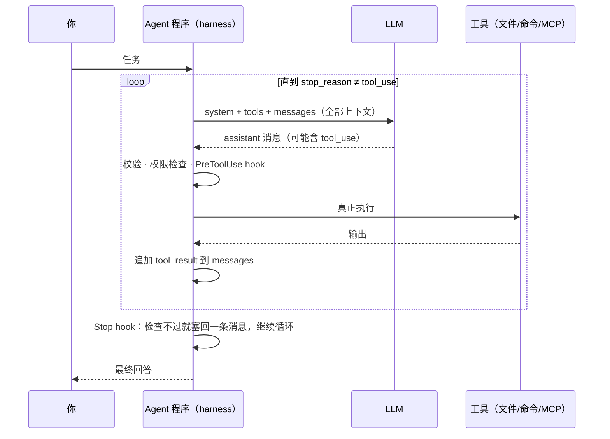

# LLM 和 Agent 的核心术语和原理

> 对应原站：[LLM 和 Agent 的核心术语和原理](https://labuladong.online/zh/ai-coding/basics/llm-and-agent/)（免费文章，推荐配合阅读；本章为独立原创课文）

> **一句话结论**：LLM 只会做一件事——看着这次请求里的全部文本，猜下一个 token；Agent 是包在它外面的那段确定性程序（循环、工具、规则、检查）。效果好不好，一半看模型，一半看外面这段程序往上下文里放了什么。

## 同一个模型，为什么一挂 Stop hook 就老实了

先说一个你多半遇到过的场景。

你在 `~/.claude/CLAUDE.md` 里写了铁律：「完成前跑命令贴真实输出」。大部分时候 Claude 照做，但偶尔它改完代码，直接一句「已完成，测试应该能通过」就收工了。

后来你给它配了 Stop hook：它想结束时，hook 先跑一遍检查，不过就把结果塞回去让它接着干。从那以后，这种「嘴上完成」就少多了。

模型没换，权重没变，为什么行为变了？

有这个疑问，说明还没把两样东西分开：**LLM**（Large Language Model，大语言模型）和 **Agent**（智能体）。CLAUDE.md 里那句话是写给 LLM 看的，它**大概率**会遵守；Stop hook 是 Agent 程序里的一段代码，它**一定**会执行。这一章就把这两层拆开讲清楚。

## LLM：一个只会续写的函数

把 LLM 当成一个函数最省事：

```text
f(到目前为止的所有 token) → 下一个 token 的概率分布
```

token 是模型处理文本的最小单位，大白话就是「一小段字」，可能是一个汉字、半个英文单词，或者一个标点。模型从分布里抽出一个 token，拼到末尾，再调用一次 f，如此往复。你在终端里看到字一个个往外冒，这不是 UI 动画，模型本来就是这么一个一个算出来的（具体怎么算，见 [第 4 章](./04-llm-token-prediction.md)）。

举个前端的例子。你在 VS Code 里敲 `useEff`，补全弹出 `useEffect`。LLM 做的事和它是同一类：根据前文猜后文。

但这个类比只能用到这里。补全插件只看光标附近几十个字符和一个本地索引，LLM 看的是这次请求里的**全部**文本，可能是几十万 token。另外，它从海量文本里学到的「续写规律」细到能续写出一个完整的 React 组件，甚至一段推理过程。

你可能会问：一个只会续写的东西，怎么就能跟我对话、听我的指令了？

靠的是训练阶段的两步加工：

- **Base 模型**：只做过「文字接龙」训练，你给它一句话，它往下接，不会把这句话当成问题来回答。
- **Instruct 模型**：在 Base 模型之上，再用大量「指令 → 回答」的样本微调，并用人类反馈强化学习（RLHF）校准。于是它学会了一种更具体的续写方式：看到一段 user 发言，就续写出一段 assistant 应该说的话。

我们平时用的都是 Instruct 模型。所谓「对话」，其实就是一段带角色标记的文本，模型负责续写其中 assistant 那一段。

**System Prompt**（系统提示）也就不神秘了。它就是拼在最前面的一段文本，训练时模型被教会「这一段的话分量更重」。注意，「分量更重」是统计意义上的。它没有任何硬隔离，所以越狱攻击才会存在，你写在 CLAUDE.md 里的规则也才会偶尔被违反。

**思维链**（Chain of Thought，CoT）同理。让模型先把推理过程写出来，这些中间文字也进了上下文，后面预测答案时就能「看着草稿」算。思维链本质上是用更多 token 换更高的准确率。

## 上下文：模型唯一的输入

上面反复出现一个词：**上下文**（context），指这一次请求里模型能看到的全部 token。

再强调一遍：模型的参数在推理时是只读的，它不会因为你跟它聊过天就记住你。它「记得」三轮之前说过的话，唯一的原因是那段话这一次还在请求里（第 3 章会用你自己的会话日志验证这一点）。

这里有个类比很贴切：**上下文像一次 Code Review 的 diff 窗口**。你只给 reviewer 看了 diff，他就只能基于 diff 判断；diff 之外的文件，在他眼里根本不存在。

类比在一个地方不成立：人类 reviewer 看过一次你的仓库，下次还会记得；模型没有「下次」，每次请求都从零开始读。窗口也有上限，超出就得压缩，压缩一定会丢信息。

所以后面所有的「AI 工程技巧」，都可以先问同一个问题：**它往上下文里放了什么，又拿走了什么？**

## Function Calling：模型只负责「说出意图」

光会说话不够，写代码得读文件、跑测试。

你可能会问：模型能直接执行 `cat vitest.config.ts` 吗？

不能。模型能做的只有输出文本。**Function Calling**（Anthropic 叫 Tool Use，工具调用）的做法是：在请求里附上一份工具清单（名字、描述、参数的 JSON Schema），模型想用工具时，就输出一段结构化的「调用意图」，比如 `{"name": "read_file", "input": {"path": "..."}}`。真正去读文件的，是**外面的程序**。读完以后，程序把结果作为一条 `tool_result` 追加进上下文，再请求一次模型。

对前端来说，有个现成的类比：**Redux 的 action**。组件从不直接改 store，它只 `dispatch` 一个描述意图的普通对象，真正干活的是 middleware 和 reducer。`tool_use` 就是模型 dispatch 出来的 action，Agent 程序就是那个 reducer。

类比不成立的地方恰恰是重点：你的组件 dispatch 的 action，TypeScript 能保证它的形状；模型给出的 action 可能参数写错、路径越界，甚至编出一个根本不存在的工具名。所以 Agent 程序必须把模型的输出当成**不可信输入**来校验。

**MCP**（Model Context Protocol）在这里只做了一件事：把「工具怎么描述、怎么调用、结果怎么返回」做成标准协议。工具按 MCP 写一次，Claude Code、Codex 等支持 MCP 的 Agent 都能接上。它**没有给模型增加任何新能力**，底层依旧是 tool use，依旧是往上下文里放工具描述、放结果。

## Agent：给模型套一个 while 循环

把上面几件事拼起来，Agent 的骨架就出来了：



图注：模型只出现在一个箭头上，其余全是普通程序。所谓「Agent 自主完成任务」，就是程序根据模型每轮的输出决定要不要再转一圈。

这个「想 → 做 → 看结果 → 再想」的模式，文献里叫 **ReAct**（Reasoning + Acting）。它有个直接后果：每转一圈，上下文就长一截，而且只增不减。一次 `cat` 出 5000 行日志，就能把窗口吃掉一大块。

所以人们常说 **Agent = Model + Harness**。harness 原意是「马具」，这里指包在模型外面、约束和引导它的那整套程序。往 harness 里加东西，有几种典型做法，每一种都可以用「放了什么、拿走了什么」来归类：

| 做法 | 往上下文里放了什么 / 拿走了什么 | 换来什么 |
|---|---|---|
| **Skills** | 启动时只放每个 skill 的一行描述，用到时才加载正文 | 省 token，并把流程固化成可靠的步骤 |
| **RAG**（检索增强生成） | 按语义从知识库检索出的少量片段 | 让私有知识进得来，又不撑爆窗口 |
| **记忆** | 跨会话值得保留的事实，开局注入 | 新会话不用重新教一遍 |
| **压缩** | 拿走旧的细节，换成一段摘要 | 续航变长，代价是丢信息 |
| **hooks / 权限** | 不靠上下文，用确定性代码拦截或反馈 | 用工程手段兜住概率模型的失误 |

最后一行就是开头那个问题的答案。

**回到主线**：这一章给出了全库唯一的判断标准。LLM 是「根据已有 token 预测下一个 token」的概率模型，它能看到的只有上下文。Agent 的一切工程手段，要么在决定往上下文里放什么（工具描述、skill、检索片段、记忆），要么在上下文之外用确定性程序兜底（hook、权限、测试）。以后遇到新名词，先问它属于哪一类。

## 动手：30 行的 Agent 循环

说穿了，Agent 就是一个 while 循环加一个不断变长的 `messages` 数组。代码在 [`code/agent-node/core/agent_loop.ts`](../code/agent-node/core/agent_loop.ts)（Python 版 [`agent_loop.py`](../code/agent/core/agent_loop.py)），用的是知识库里现成的离线 fake 模型（`FakeAnthropic`，响应形状与 SDK 的真实 `Message` 一致）。先看效果：

=== "Node"

    ```text
    $ cd code/agent-node && node core/agent_loop.ts
    ❯ webapp 的 vitest 单测超时设的是多少？
    ⏺ read_file({"path":"apps/web/vitest.config.ts"})
    ✔ export default defineConfig({ test: { environment: 'jsdom', testTimeout: 15000 }
    ⏺ webapp 的 vitest 单测超时是 15000ms（15 秒），环境是 jsdom。

    [离线 fake 模型] 共请求模型 2 次；第 2 次请求里 messages 的角色序列：["user","assistant","user"]
    ```

=== "Python"

    ```text
    $ cd code/agent && uv run python -m core.agent_loop
    ❯ webapp 的 vitest 单测超时设的是多少？
    ⏺ read_file({'path': 'apps/web/vitest.config.ts'})
    ✔ export default defineConfig({ test: { environment: 'jsdom', testTimeout: 15000 }
    ⏺ webapp 的 vitest 单测超时是 15000ms（15 秒），环境是 jsdom。

    [离线 fake 模型] 共请求模型 2 次；第 2 次请求里 messages 的角色序列：['user', 'assistant', 'user']
    ```

（离线 fake 模型，配置文件内容是演示用的假仓库，数字是编的。）

核心就是这一个函数：

=== "Node"

    ```ts
    async function runAgent(client: LLMClient, task: string, tools: Anthropic.Tool[], handlers: Record<string, Handler>,
      { system = "", maxTurns = 10, log = console.log } = {}): Promise<string> {
      const messages: Anthropic.MessageParam[] = [{ role: "user", content: task }];
      for (let i = 0; i < maxTurns; i++) {
        const resp = await client.messages.create({ model: MODEL, max_tokens: 16000, system, tools, messages });
        messages.push({ role: "assistant", content: resp.content }); // 原样追加，别只留文字
        if (resp.stop_reason !== "tool_use") {
          // 模型不再要工具 → 这一轮就是最终回答
          return resp.content.map((b) => (b.type === "text" ? b.text : "")).join("");
        }
        const results: Anthropic.ToolResultBlockParam[] = [];
        for (const block of resp.content) {
          if (block.type !== "tool_use") continue;
          log(`⏺ ${block.name}(${JSON.stringify(block.input)})`);
          let out: string, isError: boolean;
          try {
            [out, isError] = [await handlers[block.name](block.input), false];
          } catch (e) {
            // 工具失败也要回给模型，而不是让循环崩掉
            [out, isError] = [`${(e as Error).name}: ${(e as Error).message}`, true];
          }
          log(`✔ ${out.slice(0, 80)}`);
          results.push({ type: "tool_result", tool_use_id: block.id, content: out, is_error: isError });
        }
        messages.push({ role: "user", content: results }); // 所有结果放进同一条 user 消息
      }
      throw new Error(`超过 ${maxTurns} 轮仍未结束`);
    }
    ```

=== "Python"

    ```python
    def run_agent(client, task: str, tools: list[dict], handlers: dict[str, Callable[..., str]],
                  *, system: str = "", max_turns: int = 10, log: Callable[[str], None] = print) -> str:
        messages: list[dict[str, Any]] = [{"role": "user", "content": task}]
        for _ in range(max_turns):
            resp = client.messages.create(model=MODEL, max_tokens=16000, system=system,
                                          tools=tools, messages=messages)
            messages.append({"role": "assistant", "content": resp.content})  # 原样追加，别只留文字
            if resp.stop_reason != "tool_use":  # 模型不再要工具 → 这一轮就是最终回答
                return "".join(b.text for b in resp.content if b.type == "text")
            results = []
            for block in resp.content:
                if block.type != "tool_use":
                    continue
                log(f"⏺ {block.name}({block.input})")
                try:
                    out, err = handlers[block.name](**block.input), False
                except Exception as e:  # 工具失败也要回给模型，而不是让循环崩掉
                    out, err = f"{type(e).__name__}: {e}", True
                log(f"✔ {out[:80]}")
                results.append({"type": "tool_result", "tool_use_id": block.id,
                                "content": out, "is_error": err})
            messages.append({"role": "user", "content": results})  # 所有结果放进同一条 user 消息
        raise RuntimeError(f"超过 {max_turns} 轮仍未结束")
    ```

逐段看：

- **循环出口只有一个判断**：`stop_reason` 是不是 `tool_use`。模型说「我要用工具」，程序就转下一圈；否则就把这轮的文字当最终回答。
- **`assistant` 消息原样追加**。只存文字会丢掉 `tool_use` 块，下一轮的 `tool_result` 就对不上 `tool_use_id`，API 会报错。
- **工具报错也回给模型**（`is_error: true`）。模型看到 `FileNotFoundError` 往往会自己换个路径重试，这比让整个循环崩掉有用得多。
- **`maxTurns`（Python 版 `max_turns`）是最朴素的 harness**：模型可能永远想再调一次工具，循环上限必须由程序来定。

真实运行时，只要把 `new FakeAnthropic([...])` 换成 `new Anthropic()`（Python 版是 `anthropic.Anthropic()`），它会自动读 `ANTHROPIC_API_KEY` 和 `ANTHROPIC_BASE_URL`，`runAgent` 一行不用改。这个骨架后面会一路长大：[动手实现一个 Coding Agent](../p2-agent-basics/02-coding-agent.md) 的 `coding_agent/agent.ts`（`agent.py`）给它加上读写文件和跑命令的工具，[p4 的 mini Claude Code](../p4-mini-cc/01-cli.md) 再往上加流式输出、权限、恢复会话。

> ⚠️ 两条和当前 API 有关的事实（核对自 `claude-api` skill，模型表缓存于 2026-10-06）：
> - **思考强度**：Claude 这边控制「想多深」的参数是 `output_config.effort`（`low` / `medium` / `high` / `xhigh` / `max`），配合 `thinking: {type: "adaptive"}`。在 `claude-opus-5-5` 上思考**关不掉**：`{type: "disabled"}` 返回 400，默认 effort 是 `medium`。旧的 `budget_tokens` 写法在当前一代模型上也会返回 400。你 `settings.json` 里的 `effortLevel`（当前是 `high`）就是 Claude Code 对这个参数的封装。
> - **MCP Python SDK 2.x 改了名**：很多教程里的 `from mcp.server.fastmcp import FastMCP`，在本机 `code/agent` 装的 mcp 2.3.0 上会报 `No module named 'mcp.server.fastmcp'`。报错信息本身就说明 FastMCP 改名成了 `MCPServer`，要改成 `from mcp.server.mcpserver import MCPServer`（本机实测可导入）。要跑 v1 的老代码，就固定 `mcp<2`。Node 版用的 `@modelcontextprotocol/sdk`（本机 1.32.1）没有这次改名，服务端类一直是 `McpServer`（`@modelcontextprotocol/sdk/server/mcp.js`）。另外，FastMCP 是官方 `mcp` SDK 里的模块；名叫 `fastmcp` 的独立 pip 包是另一个项目，别混了。

## 对照你的环境

你的 Claude Code 配置，几乎每一项都能在上面那张表里找到位置：

| 本章概念 | 你机器上的对应物 |
|---|---|
| System Prompt 里用户能写的那部分 | `~/.claude/CLAUDE.md`，每个会话开局注入 |
| 按条件往上下文开头放文本 | `~/.claude/bin/inject-guardrails.sh`：SessionStart hook 按仓库身份（git origin）把 `refs/*-guardrails.md` 注入 |
| Skills 按需加载 | `~/.claude/skills/` 下 40 多个 skill，开局只放 name + description。你在 CLAUDE.md 里写的「常驻层只回答走哪条轨」，就是在手动执行这条原则 |
| MCP | Linear / Notion / 内部平台 / chrome-devtools。很多工具以 deferred 形式出现，要靠 ToolSearch 按需拉取 schema，这也是在省上下文 |
| 记忆 | `~/.claude/projects/<项目>/memory/` |
| 确定性兜底 | `settings.json` 里 27 条 `permissions.allow`，再加上 10 类 hook（PreToolUse / Stop / SubagentStop …） |

CLAUDE.md 里那句「工具链能强制的就别写进上下文」，和本章的结论是同一件事：写进上下文的规则只会让模型**更可能**照做，hook 和 lint 则**保证**它照做。

想亲眼看「一切都是上下文」，在 Claude Code 里跑 `/context`，它会按 system prompt、工具、MCP 工具、记忆文件、skills、消息等分类，列出各自占了多少 token。

## 常见坑

1. **把「模型调用了工具」当成字面意思**。调用工具的永远是程序。排查「工具为什么没执行」时，要去看 harness 的日志（权限、hook、工具路由），不是去改提示词。
2. **assistant 消息只存文字**。下一轮的 `tool_result` 找不到对应的 `tool_use`，API 直接报 400。
3. **工具一出错就抛异常、终止循环**。把错误当成 `is_error` 结果还给模型，它通常能自己纠正。
4. **想靠规则文本拦住危险动作**。上下文里的规则是概率性的，`rm -rf` 这类动作要用 PreToolUse hook 或权限规则来拦。
5. **没设循环上限**。模型不保证会主动停下来，`max_turns`、超时和预算都得由程序设。

## 练习

**1.** 「Claude 调用了 `read_file`」这句话哪里不准确？请按时间顺序说出真正发生了哪几步。

<details>
<summary>参考答案</summary>

模型只输出了一个 `tool_use` 块，也就是描述调用意图的结构化文本，`stop_reason` 为 `tool_use`。之后的步骤都由 Agent 程序完成：解析这个块，做校验和权限检查（会经过 PreToolUse hook），执行真实函数，把输出包成 `tool_result`（带上同一个 `tool_use_id`）追加到 messages，再带着完整上下文请求一次模型。模型基于这个结果写出回答。整个过程里模型只做了「读文本、写文本」。

</details>

**2.** 你有 40 多个 skill。假设 Claude Code 开局就把每个 SKILL.md 全文塞进上下文，会出什么问题？它实际是怎么做的？

<details>
<summary>参考答案</summary>

大量与当前任务无关的文本会占掉窗口：每轮请求都要为它们付输入费（即便命中缓存也要付读取费，见第 3 章），留给对话和工具结果的空间变小，压缩会提前到来，无关指令还会干扰模型的注意力。实际做法是渐进式披露：开局只放每个 skill 的 name + description，模型判断相关或你用 `/名字` 显式调用时才加载正文，正文里引用的脚本和参考文件也是用到时才读取或直接执行。

</details>

**3.** 把第 1 章的 `run_agent` 改一下：在模型想结束时（`stop_reason != "tool_use"`），先调用一个 `check()` 函数（比如跑 `pnpm vitest run`）。检查不通过，就把失败输出作为一条 user 消息追加进去，继续循环。这就是一个最小的 Stop hook。

<details>
<summary>提示</summary>

在 `return` 之前插入：`ok, report = check()`。如果 `not ok`，就 `messages.append({"role": "user", "content": f"检查未通过：\n{report}"})`，然后 `continue`。注意这一圈也要算进 `max_turns`，否则检查永远不过时就会死循环。真实 Claude Code 的 Stop hook 是用 `decision: "block"` 加一段 reason 把模型拉回去的，思路相同。

</details>

**4.**（开放题）`stop_reason` 告诉你模型「想」结束了，可它真的完成任务了吗？在你的 webapp 工作流里，哪些「完成」能用确定性程序判定（类型检查、单测、lint、像素比对），哪些只能靠人或另一个模型判断？对后者，你会怎么设计 harness？

## 延伸阅读

- 原站文章：[LLM 和 Agent 的核心术语和原理](https://labuladong.online/zh/ai-coding/basics/llm-and-agent/)
- Anthropic 文档：[Tool use 概览](https://docs.claude.com/en/docs/agents-and-tools/tool-use/overview)
- Claude Code 文档：[Hooks](https://code.claude.com/docs/en/hooks)
- [MCP 规范](https://modelcontextprotocol.io/)、[MCP Python SDK v2 迁移指南（FastMCP → MCPServer）](https://py.sdk.modelcontextprotocol.io/v2/migration/#fastmcp-renamed-to-mcpserver)
- ReAct 论文：Yao et al., *ReAct: Synergizing Reasoning and Acting in Language Models*（2022）

## 相关章节

- 下一篇：[如何调用 LLM 接口](./02-api-and-apikey.md)
- [上下文是什么？token 怎么计费？](./03-messages-and-tokens.md)
- [LLM 是怎么预测下一个 token 的](./04-llm-token-prediction.md)
- [System Prompt 应该怎么写](../p3-agent-internals/03-system-prompt.md)
- [动手实现一个 Coding Agent](../p2-agent-basics/02-coding-agent.md)
- [动手开发 MCP 工具](../p2-agent-basics/10-mcp-tool.md)
- [用 Skills 定制你的 AI 工作流](../p1-tools/12-skills.md)
- [RAG 原理和使用场景](../p2-agent-basics/04-rag-principles.md)
- [如何实现上下文压缩](../p3-agent-internals/05-context-compaction.md)
- [Claude Code 自动记忆系统](../p3-agent-internals/06-auto-memory.md)
- [Harness Engineering 是什么](../p3-agent-internals/12-harness-engineering.md)
- [用 Hooks 给 Claude Code 加规矩](../p1-tools/08-hooks.md)
- [安装使用 OpenClaw](../p1-tools/04-install-and-use.md)
