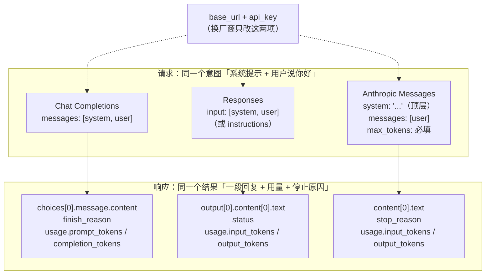
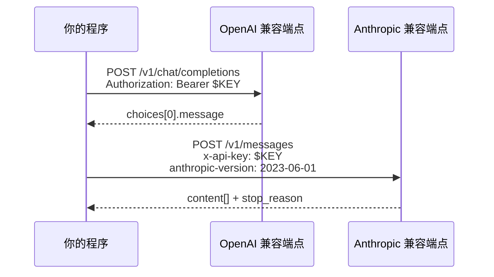

# 如何调用 LLM 接口

> 原文（免费）：[如何调用 LLM 接口](https://labuladong.online/zh/ai-coding/basics/api-and-apikey/) —— 建议先读原文，本页是我的笔记

**一句话结论**：调用 LLM 就是发一个 HTTP POST：带上 API Key 证明身份，发一个消息数组，拿回一条回复 + token 用量 + 结束原因；三种主流格式（OpenAI Chat Completions / OpenAI Responses / Anthropic Messages）只是字段名和嵌套不同的同一件事，换 `base_url` + `api_key` 就能切厂商。

---

## 核心要点

1. **为什么走 API**：大模型参数量太大，本地跑不动（小模型例外，见 [Ollama](../p1-tools/13-local-llm-ollama.md)），所以由服务商托管、按 token 计费，开发者远程调用。
2. **API Key = 计费身份**：每次请求带上，服务商据此鉴权和扣费。它等价于密码——**只放环境变量，永不进代码仓库**。
3. **各家流程一样**：注册 → 建 Key → 充值 → 调用。差别在模型能力、价格、控制台好不好用。原文选 DeepSeek 做教程模型，理由是便宜、Key 好拿、同时兼容 OpenAI 和 Anthropic 两套格式。
4. **OpenAI Chat Completions**：`POST /v1/chat/completions`，`messages` 数组里 system/user 都是消息；回答在 `choices[0].message.content`，结束原因 `finish_reason`，用量 `usage.prompt_tokens / completion_tokens`。最早的事实标准。
5. **OpenAI Responses**：`POST /v1/responses`，输入字段叫 `input`，输出是 `output[]` 里的 `message`，文字在 `content[].type == "output_text"`；可选 `instructions` 单独放系统提示，`store: false` 表示不让服务端保存。OpenAI 官方建议新项目用它。
6. **Anthropic Messages**：`POST /v1/messages`，鉴权头是 `x-api-key`（不是 `Authorization: Bearer`），还要 `anthropic-version` 头；**`system` 是顶层字段而不在 messages 里**；`max_tokens` 必填；回答在 `content[0].text`，结束原因 `stop_reason`（如 `end_turn`）。
7. **格式即约定**：原文的总结很到位——「接口格式其实只是一种约定，最大程度方便你切换模型的提供商」。很多厂商为了能被 Claude Code 用，专门提供 Anthropic 兼容端点（如 DeepSeek 的 `/anthropic` 路径）。

### 三种格式的映射

### 鉴权的位置也不同

> ⚠️ 勘误/补充：
> - 原文表格里 Anthropic 的控制台地址写的是 `console.anthropic.com`。实测该地址已 **301 重定向到 `platform.claude.com`**（2026-10-21 WebFetch 验证）。
> - 原文 Anthropic 示例里的 `"thinking": {"type": "disabled"}` 发给 DeepSeek 没问题，但如果你把同一个请求的 model 换成 `claude-opus-5-5`，会得到 **400**：Opus 5.5 不允许关闭思考，只能用 `output_config.effort: "low"` 降低思考强度（核对自 `claude-api` skill）。也就是说「兼容 Anthropic 格式」≠「参数语义完全一致」，切厂商时要回查每个参数在目标模型上的约束。
> - 原文说「以 DeepSeek 的 deepseek-flash 为例」：2026-10-21 查 DeepSeek 官方定价页，`deepseek-flash` 确为现行模型名（对应 DeepSeek-V4.1-Flash），与原文一致。

---

### 📝 作者是怎么讲的

- **先消除顾虑，再讲操作。** 刚选定 DeepSeek，作者就先回答读者心里那句「会不会被锁死在一家」：接口兼容，换地址换 Key 就行。先把会让人犹豫的问题解决掉，读者才愿意往下跟。你写接入文档时也可以先列「换掉它的代价」。
- **用一个反问引出要讲的东西。** 「这么多服务商，是不是每家都要单独适配？」接着答「其实不用」，自然引出三种接口格式。这比直接写「本节介绍三种格式」更有动机。
- **同一个请求跑三遍，并排对比。** 不讲规范条文，直接用同一个 DeepSeek 后端跑三条 curl，分别是 Chat Completions、Responses 和 Anthropic Messages，让读者亲眼看到字段的差异。变量只有格式一个，差异一眼就看清。
- **先只盯一个字段，其余以后再说。** 每个响应只指出「回答在哪个字段」，其他字段明说「后面章节再讲」。这是在控制读者每一步的认知负担。
- **用一句话把本质收拢。** 三种格式看完，落到「本质都是一样的事」：发消息、拿回复，附带 usage 和结束原因，所以格式只是一种约定。形式各异，内核相同，这正是框架思维的用法。

## 回到主线

这一章是整条主线的「物理层」：后面所有上下文工程，最终落地都是在拼这一个 HTTP 请求体。看清楚请求里有几块——`system`、`messages`、（后面会加的）`tools`——就知道 Agent 能操作的「上下文」到底由哪几段组成。三种格式的差异只是**表示层**的差异，上下文这件事本身不变。

---

## 对照你的环境

- **你的 Claude Code 不是直接打 `api.anthropic.com`**：`~/.claude/settings.json` 的 `env` 里设了 `CLAUDE_CODE_USE_VERTEX=1`、`CLAUDE_CODE_SKIP_VERTEX_AUTH=1`，以及 `ANTHROPIC_VERTEX_BASE_URL` / `ANTHROPIC_VERTEX_PROJECT_ID`——也就是走 Google Vertex AI 的 Claude（经一个自定义 base URL 转发，跳过本机 GCP 鉴权）。这正是本章「换 base_url 就能换提供方」在你机器上的样子。（具体 URL 和密钥值不在此记录。）
- **你写自己的 Agent 时**：知识库约定用 `ANTHROPIC_API_KEY` + 可选 `ANTHROPIC_BASE_URL`（中转站）。官方 Python SDK 会自动读这两个环境变量，所以代码里 `Anthropic()` 零参数即可，Key 永远不出现在源码里。
- **Vertex 和第一方 API 的细微差别**：Vertex 上用 `AnthropicVertex(project_id, region)` 客户端、靠 GCP ADC 鉴权，不用 Anthropic API Key；模型 ID 与第一方相同（如 `claude-opus-5-5`）。部分功能在 Vertex 上不可用或版本不同（例如 web fetch），写 SDK 代码前查 `claude-api` skill 里的平台可用性表。
- **安全提醒呼应你的 CLAUDE.md**：「env / apikey / secret 仅 session 内用，绝不写文件 / 绝不 commit」——和原文对 API Key 的告诫一致。

---

## 自测题

**1.** 把一段 OpenAI Chat Completions 请求改写成 Anthropic Messages 格式，至少要改哪几处？

参考答案

① 路径 `/v1/chat/completions` → `/v1/messages`；② 鉴权头 `Authorization: Bearer` → `x-api-key`，并加 `anthropic-version`；③ 把 `role: system` 那条消息从 messages 里拿出来，放到顶层 `system` 字段；④ 补上必填的 `max_tokens`；⑤ 读回答从 `choices[0].message.content` 改成遍历 `content[]` 取 `type=="text"` 的块，结束原因看 `stop_reason` 而不是 `finish_reason`。

**2.** 「某厂商兼容 Anthropic 格式」，是否意味着同一个请求体换个 model 名就一定能在 Claude 上跑通？举一个反例。

参考答案

不一定。格式兼容只保证字段结构一致，不保证每个参数在每个模型上都被接受。反例：`"thinking": {"type": "disabled"}` 在 DeepSeek 上合法，在 `claude-opus-5-5` 上返回 400（只能用 effort 调低）；另外 `temperature`/`top_p` 在当前一代 Claude 模型上也已不再接受非默认值。

**3.** 你的 Claude Code 走的是 Vertex。如果某天要临时切回 Anthropic 第一方 API 或某个中转站，需要改哪些配置？为什么不需要改任何 skill / CLAUDE.md？

参考答案

改的是 `settings.json` 的 `env`：去掉/置空 `CLAUDE_CODE_USE_VERTEX` 等 Vertex 变量，改为提供 `ANTHROPIC_API_KEY`（及中转站需要的 `ANTHROPIC_BASE_URL`）。skill 和 CLAUDE.md 是**上下文内容**，与「请求发到哪、用什么鉴权」这一**传输层**无关——这正是「格式只是约定、上下文才是本质」的体现。

---

## 相关章节

- 上一篇：[LLM 和 Agent 的核心术语和原理](./01-llm-and-agent.md)
- 下一篇：[上下文是什么？token 怎么计费？](./03-messages-and-tokens.md)
- [动手实现一个 AI 聊天机器人](../p2-agent-basics/01-ai-chatbot.md)
- [详解 LLM API 的流式响应模式](../p2-agent-basics/09-streaming-response.md)
- [用 Agent SDK 简化开发](../p2-agent-basics/06-agent-sdk.md)
- [用 Ollama 在本地运行大模型](../p1-tools/13-local-llm-ollama.md)
- [安装使用 Claude Code](../p1-tools/02-install-and-use.md)
