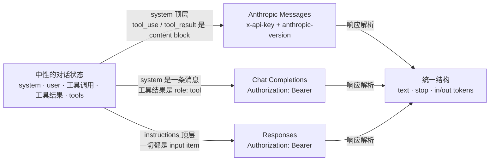

# 如何调用 LLM 接口

> 对应原站：[如何调用 LLM 接口](https://labuladong.online/zh/ai-coding/basics/api-and-apikey/)（免费文章，推荐配合阅读；本章为独立原创课文）

> **一句话结论**：调用 LLM 就是发一个 HTTP POST，带上证明身份的 key，再带上「系统提示 + 消息 + 工具」三块上下文。Anthropic Messages、OpenAI Chat Completions、OpenAI Responses 是同一件事的三种 JSON 写法；格式能用适配器抹平，参数语义却抹不平。

## 「兼容 Anthropic 格式」这句话里藏了几个假设

很多模型厂商和中转站都会写一句：「兼容 Anthropic 格式，把 `ANTHROPIC_BASE_URL` 指过来，Claude Code 直接能用。」

这句话大体是真的，但它里面藏着三个假设：

1. 请求发到哪、怎么证明身份，只由几个配置项决定；
2. 不同厂商的请求体能一一对应上；
3. 字段对上了，意思也一样。

前两个基本成立，第三个经常不成立。这一章就是要让你能自己判断：一个「兼容」承诺，到底兼容到哪一层。

## 为什么是 HTTP，而不是本地跑

先回答一个更基础的问题：为什么调模型要走网络？

前沿模型的参数量太大，一台笔记本既装不下，也算不动。所以服务商把模型托管在 GPU 集群上，按 token 收费，开发者远程调用。小模型可以本地跑（见 [Ollama](../p1-tools/13-local-llm-ollama.md)），但那是另一个量级的能力。

远程调用就要回答「你是谁、这钱记在谁账上」。答案是 **API Key**：控制台生成的一串密钥，每个请求都带着它。它就是计费身份，等同于密码。

你其实天天在用同一套机制：不少团队服务（比如文档上传接口）也是靠请求头里的 `x-api-key` 鉴权。Anthropic 的接口也用这个头名。

拿 key 的流程各家都差不多：注册、建 key、充值、调用。Anthropic 的控制台现在在 `platform.claude.com`，老地址 `console.anthropic.com` 会 301 跳转过去（2026-10-21 实测）。

## 三份 JSON 契约，同一个业务

你在 webapp 里对接过不止一个后端：Agent 后端发 WebSocket 帧，产物服务管 artifact，字段命名、嵌套方式、错误码各有一套。你的做法是在前端写一层 adapter，把它们转成组件需要的统一形状。

LLM 接口也是这样。主流格式有三种：

- **OpenAI Chat Completions**（`POST /v1/chat/completions`）：最早的事实标准，几乎所有厂商都兼容。
- **OpenAI Responses**（`POST /v1/responses`）：OpenAI 较新的接口，官方推荐新项目用它。
- **Anthropic Messages**（`POST /v1/messages`）：Claude 的原生格式，Claude Code 说的就是它。

三家要表达的东西完全一样：一段系统提示、一串对话、一份工具清单，外加「最多生成多少 token」。差别只在 JSON 怎么排。



图注：左边那一份状态是「业务」，中间三条箭头是「序列化」，右边又汇成一份结构。adapter 能做的，就是这两头的转换。

你可能会问：既然只是序列化，那「兼容」不就是 100% 的吗？

不是。adapter 只管字段**结构**，管不了字段的**语义**，这正是第三个假设失效的地方：

- 同样写 `"thinking": {"type": "disabled"}`，有的厂商的模型接受；发给 `claude-opus-5-5` 会返回 **400**。这个模型不允许关闭思考，只能用 `output_config.effort: "low"` 把思考强度调低。
- 同样写 `temperature: 0`，开源模型照单全收；当前一代 Claude 不收：`claude-opus-5-5` 传 `temperature`、`top_p`、`top_k` 都返回 400，Sonnet 5.5 和 Haiku 5.5 只接受默认值。

（这两条都核对自 `claude-api` skill。）

所以切换厂商时，结构交给 adapter，语义要逐个参数回查目标模型的文档。

**回到主线**：这一章是主线的物理层。后面所有「上下文工程」最终都落在这一个请求体里，而它只有三块：`system`、`messages`、`tools`。三种格式的差别只是表示层的差别，模型看到的上下文本身不变。下一章会看到，这个请求体每一轮都会被**完整地**重发一遍，计费就从这里来。

## 动手：同一段对话，三种写法

光看文档容易漏细节，最可靠的是抓下真正发出去的字节。代码在 [`code/agent-node/core/api_formats.ts`](../code/agent-node/core/api_formats.ts)（Python 版 [`api_formats.py`](../code/agent/core/api_formats.py)）。思路是这样的：

1. 定义一份和厂商无关的对话状态：用户问 webapp 的 vitest 超时，模型调了一次 `read_file`，工具返回了结果。
2. 写三个函数，把这份状态分别序列化成三种请求体。
3. 用一个假的 `fetch`（Python 版是 httpx 的 `MockTransport`）拦截 HTTP。拦截器把请求记录下来，再按各家文档的形状返回一个假响应，**不发任何真实请求**。
4. Anthropic 那一路用官方 SDK 发，好看清 SDK 实际替你加了哪些头；OpenAI 两路用手写的 `fetch` 请求（Python 版用 httpx；本项目没装 openai SDK）。

跑一下（离线拦截，`--compact` 让每个 body 打印成一行，这里只截取头部和解析结果）：

=== "Node"

    ```text
    $ node core/api_formats.ts --compact
    ===== POST /v1/messages
    headers: {"anthropic-version":"2026-10-21","authorization":"Bearer sk-fa…","content-type":"application/json"}
    ===== POST /v1/chat/completions
    headers: {"authorization":"Bearer sk-fa…","content-type":"application/json"}
    ===== POST /v1/responses
    headers: {"authorization":"Bearer sk-fa…","content-type":"application/json"}
    ===== 三种响应解析回统一结构（离线假 fetch，无真实请求）
    anthropic         text="超时是 15000ms。" stop="end_turn" in=120 out=12
    chat_completions  text="超时是 15000ms。" stop="stop" in=120 out=12
    responses         text="超时是 15000ms。" stop="completed" in=120 out=12
    ```

=== "Python"

    ```text
    $ uv run python -m core.api_formats --compact
    ===== POST /v1/messages
    headers: {"content-type": "application/json", "x-api-key": "sk-fake-not-…", "anthropic-version": "2023-06-01"}
    ===== POST /v1/chat/completions
    headers: {"authorization": "Bearer sk-fa…", "content-type": "application/json"}
    ===== POST /v1/responses
    headers: {"authorization": "Bearer sk-fa…", "content-type": "application/json"}
    ===== 三种响应解析回统一结构（离线 MockTransport，无真实请求）
    anthropic         text='超时是 15000ms。' stop='end_turn' in=120 out=12
    chat_completions  text='超时是 15000ms。' stop='stop' in=120 out=12
    responses         text='超时是 15000ms。' stop='completed' in=120 out=12
    ```

两版有一处真实差异：Node 的 `@anthropic-ai/sdk`（本机 1.1.0）把 `apiKey` 放在 `Authorization: Bearer` 里发，`anthropic-version` 也是新的 `2026-10-21`；Python 的 `anthropic` 1.17.0 发的是 `x-api-key` + `2023-06-01`。这是从 SDK 源码和抓到的头确认的，下面的表按 Python 版和官方文档写。

不加 `--compact` 能看到完整的缩进 JSON。下面摘出三份 body 里最能说明差异的片段，都取自实际输出（Python 版；Node 的 `JSON.stringify` 不加空格，`arguments` 是 `{"path":"apps/web/vitest.config.ts"}`，其余字段一致）。

Anthropic Messages：`system` 在顶层；工具调用和工具结果都是 content block，结果放在一条 `user` 消息里。

```json
{"max_tokens": 1024, "model": "claude-opus-5-5", "system": "你是 webapp 前端仓库的助手，回答要短。",
 "tools": [{"name": "read_file", "description": "读取仓库里的一个文件", "input_schema": {"type": "object", "...": "..."}}],
 "messages": [
  {"role": "user", "content": "webapp 的 vitest 超时是多少？"},
  {"role": "assistant", "content": [{"type": "tool_use", "id": "call_001", "name": "read_file",
                                     "input": {"path": "apps/web/vitest.config.ts"}}]},
  {"role": "user", "content": [{"type": "tool_result", "tool_use_id": "call_001", "content": "testTimeout: 15000"}]}]}
```

Chat Completions：`system` 是第一条消息；工具定义多包了一层 `function`；参数 `arguments` 是一个 **JSON 字符串**；工具结果有专门的 `role: "tool"`。

```json
{"model": "your-openai-model", "max_completion_tokens": 1024,
 "tools": [{"type": "function", "function": {"name": "read_file", "description": "…", "parameters": {"...": "..."}}}],
 "messages": [
  {"role": "system", "content": "你是 webapp 前端仓库的助手，回答要短。"},
  {"role": "user", "content": "webapp 的 vitest 超时是多少？"},
  {"role": "assistant", "content": null, "tool_calls": [{"id": "call_001", "type": "function",
     "function": {"name": "read_file", "arguments": "{\"path\": \"apps/web/vitest.config.ts\"}"}}]},
  {"role": "tool", "tool_call_id": "call_001", "content": "testTimeout: 15000"}]}
```

Responses：不叫 `messages`，叫 `input`，里面的元素是一个个 item；工具调用和工具结果是**独立的 item**，不挂在某条消息下面。

```json
{"model": "your-openai-model", "instructions": "你是 webapp 前端仓库的助手，回答要短。",
 "max_output_tokens": 1024, "store": false,
 "tools": [{"type": "function", "name": "read_file", "description": "…", "parameters": {"...": "..."}}],
 "input": [
  {"role": "user", "content": "webapp 的 vitest 超时是多少？"},
  {"type": "function_call", "call_id": "call_001", "name": "read_file", "arguments": "{\"path\": \"apps/web/vitest.config.ts\"}"},
  {"type": "function_call_output", "call_id": "call_001", "output": "testTimeout: 15000"}]}
```

把差异对齐成一张表（请求侧以抓到的 body 为准，响应侧以三家文档的形状为准）：

| 维度 | Anthropic Messages | OpenAI Chat Completions | OpenAI Responses |
|---|---|---|---|
| 路径 | `/v1/messages` | `/v1/chat/completions` | `/v1/responses` |
| 鉴权头 | `x-api-key` + `anthropic-version` | `Authorization: Bearer` | `Authorization: Bearer` |
| 系统提示 | 顶层 `system` | `messages[0]`，`role: system` | 顶层 `instructions` |
| 对话容器 | `messages` | `messages` | `input`（item 列表） |
| 输出上限 | `max_tokens`（**必填**） | `max_completion_tokens` | `max_output_tokens` |
| 工具定义 | `{name, description, input_schema}` | `{type: function, function: {name, description, parameters}}` | `{type: function, name, description, parameters}` |
| 模型发起调用 | assistant 的 `tool_use` block，`input` 是**对象** | assistant 的 `tool_calls[]`，`arguments` 是**字符串** | `function_call` item，`arguments` 是字符串 |
| 工具结果 | user 消息里的 `tool_result` block | `role: tool` 消息 | `function_call_output` item |
| 关联 id | `tool_use_id` | `tool_call_id` | `call_id` |
| 回答文字 | `content[].text`（type=text） | `choices[0].message.content` | `output[]` → message → `content[].text`（type=output_text） |
| 结束原因 | `stop_reason`（`end_turn` / `tool_use` / `max_tokens` …） | `finish_reason`（`stop` / `tool_calls` / `length`） | `status`（`completed` …） |
| 用量 | `usage.input_tokens` / `output_tokens` | `usage.prompt_tokens` / `completion_tokens` | `usage.input_tokens` / `output_tokens` |

有两个细节，不抓包很容易漏：

- **参数一个是对象，一个是字符串**。在 OpenAI 两种格式里，模型给的 `arguments` 是一段需要你再 `JSON.parse` 的字符串；Anthropic 给的直接是对象。写 adapter 时这里最容易出 bug。
- **SDK 替你加的头比你想的多**。表里只列了和格式有关的头。实际抓到的 Anthropic 请求有 19 个头（Node SDK 是 13 个），除了鉴权头和 `anthropic-version`，还有 `user-agent` 和一串 `x-stainless-*`（SDK 版本、运行时、重试次数、超时）。你在 [Claude Code 抓包分析工具](../p3-agent-internals/01-http-analyzer.md) 看 Claude Code 的请求时也会遇到它们。

> ⚠️ 一个真实踩到的坑：本机 `anthropic` 是 1.17.0，它的 HTTP 层已经换成了 httpx 的维护分支 **httpx2**。传 `http_client=httpx.Client(transport=httpx.MockTransport(...))` 会直接 `TypeError: ... this SDK uses httpx2`。解决办法是把传给 SDK 的对象都换成 `httpx2` 的（`import httpx2 as httpx`，API 完全一致）。凡是靠 patch `httpx` 来 mock 或打点的库，比如 respx、OpenTelemetry 的 httpx instrumentor，在 1.x 上都会**静默**地看不到 SDK 的流量。Node 的 SDK 走标准 `fetch`，构造时传 `fetch` 选项就能拦截，没有这个坑。

## 对照你的环境

- **Claude Code 怎么找到 key**：官方 SDK 和 Claude Code 都会读 `ANTHROPIC_API_KEY`，以及可选的 `ANTHROPIC_BASE_URL`（中转站）。按 `claude-api` skill 的说明，SDK 的凭据查找顺序是：`ANTHROPIC_API_KEY` → `ANTHROPIC_AUTH_TOKEN` → `ant auth login` 存下的 OAuth profile → 其他。所以「环境变量没设」不等于「没有凭据」。
- **你的 settings.json 现状**（只看了键名，没看值）：`env` 现在是空的；`CLAUDE_CODE_USE_VERTEX`、`CLAUDE_CODE_SKIP_VERTEX_AUTH`、`ANTHROPIC_VERTEX_BASE_URL`、`ANTHROPIC_VERTEX_PROJECT_ID` 这组 Vertex 变量（连同一个 `ANTHROPIC_API_KEY`）被挪到了一个叫 `env2` 的键下。据我所知 `env2` 不是 Claude Code 认识的设置项，所以推测你是有意把 Vertex 通道停用了。要切回去，把它们移回 `env` 即可。这正好说明了本章的结论：**换通道只动传输层配置**，skill 和 CLAUDE.md 这些上下文内容一个字都不用改。
- **Vertex 和第一方 API 的区别**：Vertex 用 `AnthropicVertex(project_id, region)` 客户端，靠 GCP ADC 鉴权，不用 Anthropic key；当前一代模型的 ID 与第一方相同（如 `claude-opus-5-5`）。部分功能在 Vertex 上没有，比如 web fetch。价格也由合作方另定。
- **密钥纪律**：和你 CLAUDE.md 的规定一致，key 只放环境变量，绝不进文件、绝不 commit。本章代码里的 `sk-fake-not-a-real-key` 是故意写成一眼能认出的假值。

## 常见坑

1. **把 Chat Completions 的 system 消息原样塞进 Anthropic 的 `messages`**。Anthropic 的 system 在顶层；`messages` 里的 `role: "system"` 是新模型的另一种用法（会话中途追加的系统消息），而且不能放在第一位。
2. **漏了 `max_tokens`**。Anthropic 接口里它是必填项，OpenAI 那边可以省略。
3. **工具参数不 parse 或者 parse 两次**。OpenAI 给的是字符串，Anthropic 给的是对象。
4. **只看结构不看语义**。`thinking: disabled`、`temperature`、强制 `tool_choice`（`any` / `tool` 在 Opus 5.5 上返回 400），这些都是「格式兼容、模型不收」。
5. **给 1.x 的 SDK 传老 `httpx` 对象**。见上面的 httpx2 提示。

## 练习

**1.** 把一段 Chat Completions 的请求改写成 Anthropic Messages，至少要改哪几处？对照上面的表格逐行说。

<details>
<summary>参考答案</summary>

至少六处：① 路径改成 `/v1/messages`；② 鉴权头从 `Authorization: Bearer` 改成 `x-api-key`，并加上 `anthropic-version`；③ 把 `role: system` 那条消息拿出来，放到顶层 `system`；④ 补上必填的 `max_tokens`；⑤ 工具定义去掉 `function` 那层，把 `parameters` 改名成 `input_schema`；⑥ 历史里的 `tool_calls` 改成 assistant 的 `tool_use` block（`arguments` 字符串要 parse 成对象），`role: tool` 改成 user 消息里的 `tool_result` block。读响应时，从 `choices[0].message.content` 改成遍历 `content[]` 取 type 为 text 的块，结束原因看 `stop_reason`。

</details>

**2.** 某中转站「兼容 Anthropic 格式」。你把 `core/api_formats.ts` 里的 `anthropicBody()`（Python 版 `anthropic_body()`）加上 `"temperature": 0`，model 设成 `claude-opus-5-5` 发过去，可能出现哪几种结果？各自说明了什么？

<details>
<summary>参考答案</summary>

① 返回 400：中转站把请求原样转给了 Anthropic，模型拒绝采样参数。这说明中转只做了透传。② 返回 200：中转站可能在转发前悄悄删掉了不支持的字段，也可能背后根本不是这个模型。这时可以看响应的 `model` 字段和 usage 形状，再结合 `stop_reason` 等细节来交叉判断。③ 返回中转站自己的错误格式：说明它只兼容了「结构」的一个子集。无论哪种结果，结论都一样：兼容承诺要拿具体参数去测。

</details>

**3.** 给 `core/api_formats.ts` 加一个反方向的适配：写一个 `fromChatCompletions(body)`，返回 Anthropic 格式的 body，用 `node:test` 断言它对上面那份 Chat Completions body 的输出，与 `anthropicBody()` 逐字段相等（Python 版：`from_chat_completions`、pytest、`anthropic_body()`）。

**4.**（开放题）如果你要在 webapp 里接入一个 LLM 能力（比如文档摘要），前端和后端之间应该传哪种格式？还是应该定义自己的中性格式，由后端做 adapter？说说你会怎么权衡锁定成本、流式支持和工具调用。

## 延伸阅读

- 原站文章：[如何调用 LLM 接口](https://labuladong.online/zh/ai-coding/basics/api-and-apikey/)
- Anthropic：[Messages API 参考](https://docs.claude.com/en/api/messages)、[控制台](https://platform.claude.com)
- OpenAI：[Chat Completions](https://platform.openai.com/docs/api-reference/chat)、[Responses](https://platform.openai.com/docs/api-reference/responses)
- [anthropic-sdk-python](https://github.com/anthropics/anthropic-sdk-python)（1.x 切换到 httpx2 的说明在 CHANGELOG）

## 相关章节

- 上一篇：[LLM 和 Agent 的核心术语和原理](./01-llm-and-agent.md)
- 下一篇：[上下文是什么？token 怎么计费？](./03-messages-and-tokens.md)
- [动手实现一个 AI 聊天机器人](../p2-agent-basics/01-ai-chatbot.md)
- [详解 LLM API 的流式响应模式](../p2-agent-basics/09-streaming-response.md)
- [用 Agent SDK 简化开发](../p2-agent-basics/06-agent-sdk.md)
- [Claude Code 抓包分析工具](../p3-agent-internals/01-http-analyzer.md)
- [用 Ollama 在本地运行大模型](../p1-tools/13-local-llm-ollama.md)
- [安装使用 Claude Code](../p1-tools/02-install-and-use.md)
