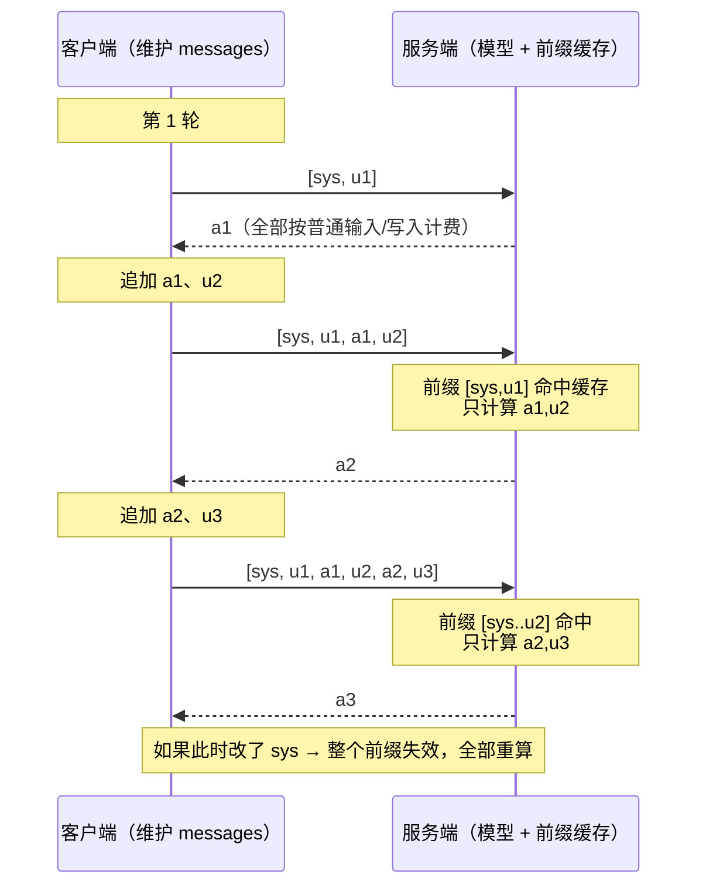
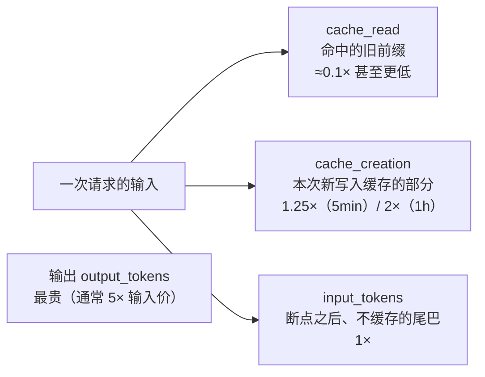

# 上下文是什么？token 怎么计费？

> 原文（免费）：[上下文是什么？token 怎么计费？](https://labuladong.online/zh/ai-coding/basics/messages-and-tokens/) —— 建议先读原文，本页是我的笔记

**一句话结论**：上下文就是你每次请求重发的那个 messages 数组——模型无状态，「记忆」全靠客户端把历史重新拼进去；所以对话越长输入 token 越多，而 Prompt Cache 让「前缀不变、只往尾部追加」的请求便宜一个数量级，这也是所有 Agent 都要「保持前缀稳定」的经济原因。

---

## 核心要点

1. **一次调用 = 一个 messages 数组进，一条 message 出**。数组里 `user` 是你说的，响应里 `assistant` 是模型说的；后面还会出现 `system`、`tool`。整个数组就是 Prompt 的载体。
2. **模型是无状态的**。原文实验很干脆：第一次说「我叫小明」，第二次单独问「我叫什么」，模型答不上来——两次请求对模型毫无关系。
3. **多轮对话 = 每次重发全部历史**。user/assistant 交替排列，末尾追加新问题。ChatGPT「记得你」只是客户端在背后维护这个数组，原文的说法是「所有 AI 产品都是这样，没有例外」。
4. **结束原因是控制流信号**：`stop`（说完了）、`length`（被 max_tokens 截断）、`tool_calls`（要调工具）。Agent 循环就是靠这个字段决定「继续还是退出」。（Anthropic 侧对应 `stop_reason`：`end_turn` / `max_tokens` / `tool_use` 等。）
5. **一切按 token 计费，输入输出分开定价，输出更贵**。原因：输入可以并行 prefill，输出只能逐个 decode（机制见 [04](./04-llm-token-prediction.md)）。
6. **对话越长越贵**：同样问「我叫什么」，不带历史 7 个输入 token，带 5 条历史就是 63 个。成本随历史长度线性增长。
7. **Prompt Cache：缓存公共前缀**。相邻请求的前缀几乎完全相同，服务商把前缀的计算结果存起来，命中部分按低价计费、响应也更快。有最小长度门槛（太短不缓存），有过期时间。
8. **缓存写入也收钱**：输入价格其实有三档——普通输入（1×）、缓存写入（Claude：5 分钟 1.25×、1 小时 2×）、缓存命中（最便宜）。写入多花的钱要靠后续命中摊平；Agent 场景前缀稳定、命中率高，几乎总是划算。
9. **破坏前缀 = 缓存全废**：中途改系统提示、往历史中间插消息，从改动点往后全部按未命中计价，费用翻几倍。

### messages 数组如何增长、缓存如何命中



### 一次请求的输入 token 拆成三块



> ⚠️ 勘误/补充（Anthropic 侧，核对自 `claude-api` skill 2026-10 文档）：
> - 原文说「Anthropic 的 Claude 模型需要调用方主动标记缓存断点」，**已不完全准确**：现在除了在 content block 上放 `cache_control` 的显式断点，还支持**请求顶层的自动缓存**（顶层 `cache_control: {type: "ephemeral"}`，服务端自动把断点放在最后一个可缓存块并随对话前移）。最多 4 个断点。
> - 「缓存命中 ≈ 0.1×」是一般情况；`claude-opus-5-5` 的缓存读是 $0.20/MTok，相对 $4 的输入价只有 **0.05×**。
> - 最小可缓存前缀随模型不同（512–4096 token），低于门槛**静默不缓存**、不报错——原文实验里「重发多次也不命中」就是这个原因。
> - Anthropic 的用量字段名是 `cache_creation_input_tokens`（写入）和 `cache_read_input_tokens`（命中），`input_tokens` 只统计最后一个断点之后未缓存的部分——和 OpenAI/DeepSeek 的 `prompt_tokens` 含义不同，别直接相加比较。
> - 原文示例中的 `"model": "claude-sonnet-4-6"` 仍可用，但当前一代是 `claude-sonnet-5-5` / `claude-opus-5-5`。
> - 原文关于「GPT 5.6 起缓存写入按 1.25× 收费」我未能核实，暂按原文记录。
> - DeepSeek 价格（原文：输入未命中 1 元/M、命中 0.02 元/M、输出 4 元/M，高峰翻倍）：2026-10-21 查官方英文定价页为美元标价 $0.15 / $0.003 / $0.60（off-peak），命中价同样约为未命中的 1/50，高峰时段 UTC 01–04、06–10 即北京时间 9–12、14–18，与原文一致。

---

### 📝 作者是怎么讲的

- **开篇先把结论说白。** 上下文「其实很简单，就是一个 messages 数组」，开头就把抽象的「上下文」落到一个具体的数据结构上，后面全文都在验证这句话。
- **先做实验制造矛盾，再解释。** 先自我介绍「我叫小明」，再单独问「我叫什么」，模型答不上来。作者顺势替读者问一句「刚才不是说过了吗」，然后把历史拼回 messages 数组再问一遍，模型就答对了。先让读者看到反常现象，再给出解释，「模型无状态」这一点就记得特别牢。
- **用真实数字做证据。** 拿 usage 里的 prompt_tokens 从 7 涨到 63 证明「每次都重发全部历史」，再用一张小表把两次请求并排。结论有可核对的数字撑着，不靠作者断言。你写回归报告、性能对比也是这个路数。
- **问题链逐层深入。** 历史全量重发会很贵吗？于是引出前缀缓存。缓存写入为什么比普通输入还贵？因为要占存储，保留越久越贵。那到底划不划算？看命中次数能不能摊平写入费。每个答案都引出下一个问题，最后落到一笔算出来的账：有缓存和没缓存差近 4 倍。
- **结尾回扣主线。** 收尾说和 LLM 交互「就是这么朴实无华」，全靠一个 messages 数组，Agent 的任务就是组织好它，并回链到上一篇「LLM 是基座、Agent 是工程」的结论。

## 回到主线

本章把「上下文」这个抽象词落到了一个具体的数据结构：**messages 数组**。主线上的每一项技术，此后都可以翻译成对这个数组的操作：

- Agent 循环 = 往数组尾部不断追加 `assistant`（tool_use）和 `tool_result`
- 压缩 = 把数组前半段替换成一段摘要（省 token，但会让缓存从替换点失效）
- Sub Agent = 另开一个新数组干活，只把结论带回主数组
- Prompt Cache 给出了一条**经济学上的硬约束**：只追加、不修改前缀。很多 Agent 设计（system-reminder 放在尾部而不是改 system、记忆在会话开头一次性注入）都是被这条约束塑造的。

---

## 对照你的环境

**你的每一轮 Claude Code 请求都在吃缓存**。从本机 `~/.claude/projects/-Users-liz-liz-agent-learn/*.jsonl` 会话记录里抽一条 assistant 消息的 `usage`（真实数据）：

```text
input_tokens: 2   cache_creation_input_tokens: 2458   cache_read_input_tokens: 65710   output_tokens: 82
```

读法：本轮约 6.8 万输入 token 里，6.57 万是命中的旧前缀，2458 是新追加并写入缓存的内容，只有 2 个 token 走普通输入。按第一方 `claude-sonnet-5-5` 标价（$2 输入 / $10 输出 / 读 $0.20 / 5 分钟写 1.25×）粗算：

| 计法 | 本轮费用 |
|---|---|
| 有缓存 | ≈ $0.0201 |
| 假设全部按普通输入 | ≈ $0.1372（约 6.8 倍） |

（你走的是 Vertex，合作方定价另计，这里只看相对比例。）

几个和你配置直接相关的推论：

- **SessionStart hook 注入的内容在前缀里**：`inject-guardrails.sh` 注入的 guardrails 在会话开头、之后不变，所以只在首轮付一次写入费，后面每轮都是命中价。反过来，如果某个 hook 每轮往**前缀**里塞带时间戳的内容，会让缓存每轮失效——注入的动态内容应当追加在尾部（UserPromptSubmit hook 的 additionalContext 就是追加到当轮）。
- **新开会话第一条消息慢、贵**：首轮整个系统提示 + 工具描述 + CLAUDE.md 都要写缓存；你 CLAUDE.md 里说的「常驻层是稀缺资源」，从计费角度看就是每个新会话都要为常驻层付一次 1.25× 的写入费、之后每轮再付读取费。
- 想自己算：用 `jq` 或几行 Python 扫 jsonl 里的 `message.usage`，按上面四个字段汇总一个会话的命中率。

---

## 自测题

**1.** 为什么说「模型记得我叫小明」是一个错觉？要让第二次请求答出名字，最少需要做什么？

<details>
<summary>参考答案</summary>

模型无状态，每次请求互相独立，参数在推理时只读。要答出名字，必须在第二次请求的 messages 里带上包含「我叫小明」的那条历史（以及通常配套的 assistant 回复），即客户端自己维护并重发历史。

</details>

**2.** 一个 Agent 每轮都把「当前时间」写进 system prompt 开头。这会带来什么费用后果？怎么改？

<details>
<summary>参考答案</summary>

system 在前缀最前面，每轮内容不同 → 从第一个字节起前缀就变了 → 每轮缓存全部失效，所有历史都按普通输入（甚至按写入价）重新计费，费用可能翻数倍、首字延迟也变长。改法：system 保持字节级不变，把时间等动态信息作为尾部消息追加（例如最新一条 user 消息里的 reminder，或 Claude 新模型支持的 messages 内 `role: "system"` 消息），并把缓存断点放在稳定前缀之后。

</details>

**3.** Claude 的缓存写入 5 分钟 TTL 是 1.25×、命中约 0.1×。一段前缀至少要被用几次，开缓存才比不开便宜？1 小时 TTL（2×）呢？

<details>
<summary>参考答案</summary>

5 分钟：用 2 次时，开缓存 = 1.25 + 0.1 = 1.35×，不开 = 2×，已经划算；只用 1 次则 1.25× > 1×，亏。1 小时：用 2 次为 2 + 0.1 = 2.1× > 2×，仍亏；用 3 次为 2 + 0.2 = 2.2× < 3×，开始划算。所以 1 小时 TTL 只适合「间隔超过 5 分钟、但会被反复命中」的前缀。

</details>

---

## 相关章节

- 上一篇：[如何调用 LLM 接口](./02-api-and-apikey.md)
- 下一篇：[LLM 是怎么预测下一个 token 的](./04-llm-token-prediction.md)（KV cache 才是 Prompt Cache 的真身）
- [LLM 和 Agent 的核心术语和原理](./01-llm-and-agent.md)
- [AI 编程的基本常识](../p1-tools/05-ai-tips.md)
- [动手实现一个 AI 聊天机器人](../p2-agent-basics/01-ai-chatbot.md)
- [给 Claude Code 发一句 Hi 会发生什么](../p3-agent-internals/02-hi-request.md)
- [如何实现上下文压缩](../p3-agent-internals/05-context-compaction.md)
- [你的聊天记录存在哪](../p1-tools/07-session-storage.md)
- [Sub Agent：上下文管理的艺术](../p1-tools/10-sub-agent.md)
