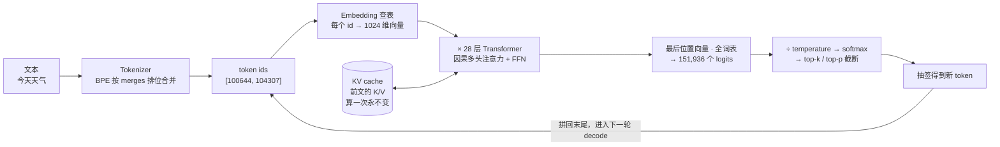
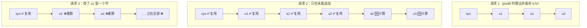

# LLM 是怎么预测下一个 token 的

> 原文（免费）：[LLM 是怎么预测下一个 token 的](https://labuladong.online/zh/ai-coding/basics/llm-token-prediction/) —— 建议先读原文，本页是我的笔记

**一句话结论**：文本 → BPE 切成 token id → 查 embedding 表得向量 → 几十层因果注意力让每个 token 吸收前文 → 对整个词表打分（logits）→ softmax + temperature/top-p 抽一个 token → 拼回去再来一轮；而「因果注意力下每个 token 的 K/V 一旦算出就不变」这一个性质，同时解释了 KV cache、Prompt Cache 为什么要求前缀完全一致、以及缓存命中为什么便宜。

---

## 核心要点

1. **先分清训练和推理**：训练会修改参数，产物是词表 + embedding 矩阵 + 各层权重；推理时参数**只读**。所以模型不会因为和你聊天而改变，「记忆」只能靠 messages 重发（[03](./03-messages-and-tokens.md)）。
2. **词表是 BPE 统计出来的**：从单字符起步，每轮把语料里最高频的相邻对合并成新片段，新片段参与下一轮统计。每次合并留下一条规则（按顺序存 `merges.txt`）和一个新词表项（`vocab.json`）。Qwen3 有 151,387 条合并规则、151,936 个 token。
3. **tokenizer 不是拿词表做字符串匹配**，而是把词打散成字符，再按 `merges.txt` 的**排位**（不是从左到右）依次套规则合并，直到没规则可用。低频长词（如 `unbelievably`）被拆成几段，只是因为「合并到某一步没规则了」。`Ġ` 标记词首空格，保证可无损还原。
4. **中文为什么可能更费 token**：取决于训练语料。英文语料占大头 → 英文合并规则多 → 常见英文词一个 token；中文规则少 → 一个汉字常占 1–2 个 token。中文语料充足的模型（Qwen/DeepSeek）则省得多。
5. **embedding 矩阵 = 词表大小 × 隐藏维度**（Qwen3-0.6B 为 151,936 × 1,024）。「语义相近的向量也相近」不是设计出来的，是反复做文字接龙训练出的副产品。
6. **注意力解决「同一个词在不同语境含义不同」**：每个 token 产生 Q（我在找什么）、K（我有什么特征）、V（我能提供什么）；拿自己的 Q 去匹配自己及前文所有 K，按匹配度加权吸收 V。生成模型是**因果注意力**——只能看前面，不能看后面。多头并行 → 拼接 → 线性压回 → FFN，构成一层；Qwen3-0.6B 叠 28 层。
7. **打分与抽签**：最后一个位置的向量和全词表算匹配度得 logits，softmax 归一化成概率。贪心解码死板易复读，所以按概率抽签；temperature 是「softmax 前把 logits 除以 T」，T<1 拉尖、T>1 抹平、T=0 约定走贪心；top-p 按累计概率截长尾，top-k 只留前 k 个。
8. **prefill vs decode**：输入 token 是现成的，可以一次性并行算（prefill，GPU 利用率高）；输出必须一个个串行生成（decode），而且每轮都要把全部权重从显存搬进计算单元一趟，只为算一个 token——GPU 大部分时间在等搬运。这就是**输出单价更贵**的根因。
9. **KV cache**：因果注意力保证前文 token 的 K/V 永远不变，所以 decode 每轮只算新 token 的 Q/K/V，前文的 K/V 从缓存读。代价是内存：Qwen3-0.6B 每 token 需 2（K,V）× 28 层 × 8 组（GQA）× 128 维 × 2 字节 ≈ 115KB，32K 上下文约 3.7GB——「上下文越长越吃内存」吃的就是它。
10. **Prompt Cache 的真身 = 跨请求保存的 KV cache**。前缀一字不差 → K/V 一模一样 → 可直接复用，跳过前缀 prefill；中间改一个字 → 从那里往后的 K/V 全变 → 缓存作废。命中部分把成本从「计算」变成「存储+读取」，所以便宜；写入要占存储、存得越久越贵，所以 1h TTL 比 5min 贵。

### 一次 token 生成的完整链路



### 为什么前缀必须完全一致才能命中缓存



图注：K/V 只由「自己 + 前面所有 token」决定，所以改动点之前的 K/V 依然有效，之后的全部失效。

### 动手：temperature 和 top-p 到底做了什么

一个零依赖的小脚本（logits 是我编的 5 个候选，只为看形状变化）：

```python
import math
logits = {"晴": 3.0, "预报": 2.2, "多": 1.0, "热": 0.6, "是": 0.0}

def probs(logits, T=1.0, top_p=1.0):
    if T == 0:  # 约定：T=0 走贪心
        best = max(logits, key=logits.get)
        return {k: float(k == best) for k in logits}
    ex = {k: math.exp(v / T) for k, v in logits.items()}
    z = sum(ex.values())
    p = sorted(((k, v / z) for k, v in ex.items()), key=lambda x: -x[1])
    kept, acc = [], 0.0
    for k, v in p:          # top-p：累加到 p 就截断
        kept.append((k, v)); acc += v
        if acc >= top_p: break
    s = sum(v for _, v in kept)
    return {k: round(v / s, 3) for k, v in kept}

for T in (0, 0.6, 1.0, 1.5):
    print(f"T={T}:", probs(logits, T))
print("T=1.0, top_p=0.9:", probs(logits, 1.0, 0.9))
```

本机 `python3` 实跑输出：

```text
T=0: {'晴': 1.0, '预报': 0.0, '多': 0.0, '热': 0.0, '是': 0.0}
T=0.6: {'晴': 0.755, '预报': 0.199, '多': 0.027, '热': 0.014, '是': 0.005}
T=1.0: {'晴': 0.58, '预报': 0.26, '多': 0.078, '热': 0.053, '是': 0.029}
T=1.5: {'晴': 0.457, '预报': 0.268, '多': 0.121, '热': 0.092, '是': 0.062}
T=1.0, top_p=0.9: {'晴': 0.631, '预报': 0.284, '多': 0.085}
```

能看到：T 越小分布越尖；top_p=0.9 直接把「热」「是」两个长尾砍掉后重新归一化。

> ⚠️ 补充：
> - 原文（和 [01](./01-llm-and-agent.md)）说「编程场景把温度设为 0」，这对开源模型/本地推理成立；但**当前一代 Claude 模型的 API 已不接受自定义采样参数**——`claude-opus-5-5` 上传 `temperature`/`top_p`/`top_k` 会返回 400，`claude-sonnet-5-5` / `claude-haiku-5-5` 只接受默认值（核对自 `claude-api` skill 2026-10 文档）。在 Claude 上控制「稳不稳」的手段换成了 effort 和提示词本身。
> - 原文说命中缓存的 token「不消耗 GPU 算力」，更准确的说法是：跳过了前缀的 **prefill 计算**，但新 token 在 decode 时仍要对这些缓存的 K/V 做注意力计算，只是这部分开销远小于重算前缀。
> - KV cache 数字核对：2 × 28 × 8 × 128 = 57,344 个数，×2 字节 = 114,688 字节 ≈ 115KB/token；× 32,768 ≈ 3.76×10⁹ 字节（≈3.5 GiB），与原文「≈3.7GB」一致。

---

### 📝 作者是怎么讲的

- **从上一篇留下的疑问接着讲。** 先复述上一篇「预测下一个 token」的结论，再坦白「这个解释够理解本质，但具体怎么算的？」，然后列出读者带着的三个问题：30% 怎么来的、输出为什么更贵、缓存为什么便宜。全文就是在逐个兑现这三个问题，读者始终知道自己读到了哪里。
- **流水线式拆解，每一步都有真实数据。** 按 token → embedding → 注意力 → 概率 → 采样的顺序推进，每一步都用 Qwen3-0.6B 的真实数据：「今天天气」的两个 token ID、151,936×1,024 的 embedding 表、merges.txt 的规则排位。读者手里始终有一个具体的样本，不会在抽象里迷路。
- **手算一个小例子。** BPE 不只讲规则，而是带读者数 a+t 合计出现 31 次、h+a 出现 16 次，再用 hello 演示「按规则排位而不是从左到右合并」。读者自己算一遍，比读十句定义更容易懂。你给同事讲算法时，也可以先挑一个能手算的最小输入。
- **类比之后马上回到具体例子。** Q/K/V 用搜索引擎类比：搜索词、网页标题、正文。紧接着拿「训练语言模型」和「拼飞机模型」里同一个「模型」说明注意力在区分什么。类比降低理解门槛，例子防止类比被理解歪。
- **用「你可能会问」补漏洞。** 「为什么只缓存 K、V，不缓存 Q？」这种是读者读到一半会卡住的地方，作者提前替读者问出来并回答。
- **结尾用一个概念串起全文。** 收尾把 KV cache 当钥匙：decode 不重算、长上下文吃内存、Prompt Cache 跨请求复用，都是它，于是「API 价格表上的数字就都能对上了」，又回到了开头关于计费的那两个问题。

## 回到主线

这一章把主线的第一句话「根据已有 token 预测下一个 token」从口号变成了机制，并且给后面所有「上下文工程」找到了**物理依据**：

- 上下文长度 ↔ KV cache 内存 ↔ 服务端成本：窗口不是无限的，根本上是显存账。
- 输出贵于输入 ↔ decode 串行：让模型「少说多看」（比如工具结果直接进上下文、让模型只输出关键动作）在经济上是对的。
- 前缀稳定 ↔ 因果注意力：Agent 设计里「只追加、不改前缀」不是代码风格偏好，而是由 Transformer 结构决定的硬约束。

---

## 对照你的环境

- **你感受到的「新会话第一句慢、之后快」**：就是首轮整段前缀（系统提示 + 工具描述 + CLAUDE.md + SessionStart 注入的 guardrails）要做完整 prefill 并写缓存；后续轮次命中前缀缓存，只 prefill 新增部分，首字更快。你在 [03 的笔记](./03-messages-and-tokens.md#对照你的环境) 里看到的 `cache_read_input_tokens: 65710` 就是这套机制的账单体现。
- **`/compact` 和手动改历史的代价**：压缩会把历史前段替换成摘要，替换点之后的 KV 全部失效，下一轮要重新 prefill 并写入新缓存——压缩省了窗口，但会付一次「缓存重建」的钱。
- **想亲手看 tokenizer**：本知识库 `code/ml` 项目有 torch；后面 [看懂 Hugging Face 和模型文件](../p1-tools/14-hugging-face-model-files.md) 会下载 Qwen3-0.6B，到时可以直接打开它的 `merges.txt` / `vocab.json` / `config.json`，核对本章的 151,936 / 28 层 / 8 组 KV 等数字。
- 你的主力是 TypeScript：可以把 BPE 想成「按优先级表反复做 reduce 的字符串折叠」，merges 的排位就是优先级。

---

## 自测题

**1.** 为什么同样 1000 个 token，输出比输入贵？请从 GPU 的角度解释。

<details>
<summary>参考答案</summary>

输入在 prefill 阶段是现成的，1000 个 token 可以拼成大矩阵一次算完，每搬一趟权重就服务 1000 个 token，算力利用充分。输出在 decode 阶段只能一个一个生成（第 n 个依赖第 n−1 个），每生成 1 个 token 都要把全部权重从显存搬进计算单元一趟，GPU 大量时间在等数据搬运。同样 token 数，decode 占用 GPU 的时间远长于 prefill，所以单价更高。

</details>

**2.** 为什么 KV cache 只缓存 K 和 V，不缓存 Q？

<details>
<summary>参考答案</summary>

注意力是「当前 token 的 Q」去匹配「前文所有 token 的 K」并加权汇总它们的 V。历史 token 的 Q 只在它自己那一轮被用过一次，之后的轮次不会再用到；而历史 token 的 K、V 在之后每一轮都要被新 token 查询，且由于因果注意力它们永远不变，所以缓存 K/V 有意义，缓存 Q 没有。

</details>

**3.** 用本章知识解释：Agent 在第 20 轮时把 system prompt 里的一行规则改了，会发生什么？如果它改的是第 19 轮某个 tool_result 里的一个字呢？

<details>
<summary>参考答案</summary>

system 在前缀最前面：改一行 → 从 system 那个位置起往后所有 token 的 K/V 都变 → 整个前缀缓存失效，20 轮历史全部重新 prefill（并按写入价重新写缓存），费用和首字延迟都大幅上升。改第 19 轮的 tool_result：第 1–18 轮及第 19 轮改动点之前的前缀仍能命中，只有改动点之后的部分失效——损失小得多，但仍然违反了「只追加」原则。这也是为什么 Claude 新模型提供「在 messages 里追加 `role: system` 消息」的方式来中途插入指令，而不是修改顶层 system。

</details>

---

## 相关章节

- 上一篇：[上下文是什么？token 怎么计费？](./03-messages-and-tokens.md)
- 下一篇：[用 Codex 还是 Claude Code？](../p1-tools/01-tools-landscape.md)
- [LLM 和 Agent 的核心术语和原理](./01-llm-and-agent.md)
- [用 Ollama 在本地运行大模型](../p1-tools/13-local-llm-ollama.md)
- [看懂 Hugging Face 和模型文件](../p1-tools/14-hugging-face-model-files.md)
- [Tensor 的常用操作](../p5-ml/01-pytorch-basics.md)
- [多分类问题：Softmax 回归](../p5-ml/11-ml-softmax.md)
- [动手跑通 LLM 推理的全流程](../p6-nn-llm/05-inference-process.md)
- [如何实现上下文压缩](../p3-agent-internals/05-context-compaction.md)
