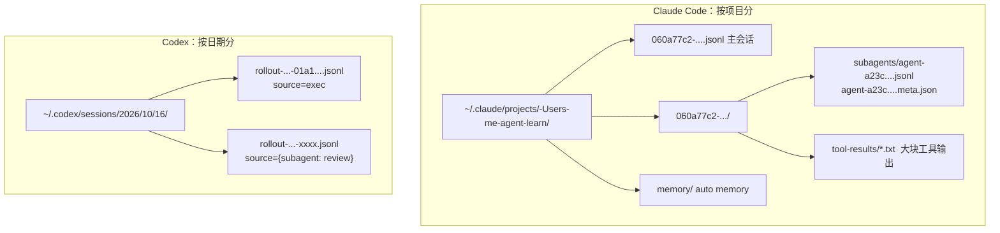
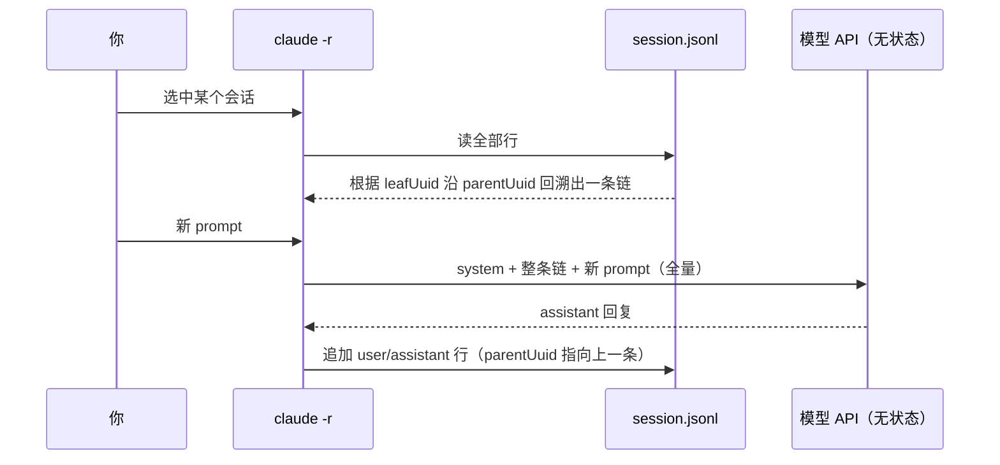

# 你的聊天记录存在哪

> 原文（免费）：[你的聊天记录存在哪](https://labuladong.online/zh/ai-coding/claude-code/session-storage/) —— 建议先读原文，本页是我的笔记

**一句话结论**：模型本身不存状态，「会话」只是你本地的一个 jsonl 文件，每次请求都会把它重新组装成 messages 发出去。所以换账号、换网关、换模型都不会丢记录。真正会让记录「不见」的只有两种情况：**索引键变了**（Claude Code 用的是项目路径，Codex 用的是 provider）和**文件被删了**。

## 核心要点

1. **jsonl 就是一行一个 JSON 对象，只追加不改写**。新消息直接追加到文件末尾，不用读出整个文件再写回去，写坏一行也不影响其他行。这种格式天然适合用作日志或事件流。
2. **Claude Code 按项目分目录存**：`~/.claude/projects/<编码后的路径>/<sessionId>.jsonl`。路径编码规则是把绝对路径里的非字母数字字符换成 `-`。这和 auto memory 用的是同一套目录。
3. **消息靠 `uuid` 和 `parentUuid` 串成链**（严格说是一棵树）。resume 的过程就是从某个叶子节点沿着父指针往回走，还原出一条对话。rewind 或分叉之后，同一个文件里可以同时存在多条分支。
4. **Sub Agent 的记录单独存放**：放在 `<sessionId>/subagents/agent-<id>.jsonl`，旁边有一个 `.meta.json` 记着 agent 类型和任务描述。主会话里只留一条「调用了它」的记录，所以子任务的上下文不会污染主会话。
5. **Codex 按日期分目录存**：`~/.codex/sessions/YYYY/MM/DD/rollout-<时间>-<id>.jsonl`。第一行是 `session_meta`，记着 cwd、model_provider、source 等信息，之后的行才是对话。它没有父指针，按行的顺序就是对话顺序。
6. **Codex 的子 agent 和主会话放在同一层目录**，靠 `session_meta.source` 字段区分来源。所以光看目录看不出主从关系，得读文件头才知道。
7. **Codex 的「记录丢了」其实是被过滤掉了**：列表默认只显示 `model_provider` 和当前配置一致的会话。解决办法有两种：换中转站时只改 base_url，不改 provider 的名字；或者批量把旧会话文件头里的 provider 字段改成新值，原文给了一个支持 dry-run 的脚本。
8. **备份和迁移就是复制目录**。真正的风险只有两个：改了项目路径（Claude Code 会找不到），或者手动删了文件。

### 📝 作者是怎么讲的

- **用读者真实遇到的困惑开场。** 第一段连问三句：记录存在哪？换网关、换账号、换 provider 会不会丢？这正是读者心里本来就有的问题，不是先给定义。为什么有效：读者带着问题读，每一节都在回答自己关心的事。借用：你写排障类文档时，开头用用户的原话提问，比如「为什么我切了 provider，Codex 历史全没了？」
- **先补前置概念，再进正题。** 讲存储位置之前，先花一小节讲 jsonl 和普通 JSON 的区别，并点出追加写的效率优势，说明聊天记录为什么天然适合这种格式。为什么有效：后文看字段和 parentUuid 链时，读者不会卡在格式上。借用：写讲解时先问自己「读者缺哪块砖」，把它放在最前面。
- **把现象挂回已讲过的原理。** 换接口不影响记录，作者没有单独解释，而是回扣前文「模型无状态、每次全量发送历史」这个认知，一句话把现象讲通。为什么有效：读者学到的是一个可以反复用的心智模型，而不是一条孤立的事实。借用：你的文档可以多链回 [上下文与 token](../p0-core/03-messages-and-tokens.md) 这类原理页，让结论有出处。
- **两个工具并排比，说清各自的取舍。** Claude Code 按项目分目录、用 uuid 链串消息、子 agent 收进子目录；Codex 按日期分目录、靠行序、子 agent 平级放、用 source 字段区分。为什么有效：两边对照着看，差异一眼就清楚，也顺带解释了各自的设计取舍。
- **按「现象 → 原理 → 修复 → 安全验证」的顺序推进。** 「记录丢了」一节先描述症状，再定位到 model_provider 过滤，然后给出两种修法，脚本默认只统计不修改，加 `--apply` 才真改，最后补上 .zst 压缩文件的例外。为什么有效：这本身就是一次排障示范，也示范了怎样写安全的批量修改脚本。借用：你写 bugfix 记录或 SRE 工单时，可以直接套这个顺序。
- **结尾把恐慌降级成一句话，并划清真正的风险边界。** 「多半只是列表过滤规则藏起来了」，真正会丢记录的情况只有两种。为什么有效：读者记住的是判断方法，而不是一堆细节。

## ⚠️ 勘误 / 补充

以下都是本机实测：Claude Code 2.1.306、codex-cli 0.153.4，只看了字段名和类型，没有读对话内容。

- **路径编码不只是替换 `/`**：本机有一个目录叫 `-Users-me--claude`，对应 `/Users/me/.claude`，可以看出 `.` 也被换成了 `-`，所以才出现双横线。原文说的「`/` 之类字符全换成 `-`」是对的，但只记「把 `/` 换成 `-`」的话，碰到隐藏目录或者带点号的 worktree 路径就会算错。
- **一个会话文件里不只有 user 和 assistant 两种行**。本机一个会话文件里的 `type` 分布大致是：`assistant`、`user`、`attachment`（hook 注入的上下文等附件）、`api-request` / `api-request-blob` / `api-request-shape`（请求的形态和缓存信息）、`ai-title`（自动生成的标题）、`last-prompt`（带 `leafUuid`，指向最后一个叶子节点）、`permission-mode`、`mode`、`file-history-snapshot` / `file-history-delta`（rewind 用的文件快照索引）、`queue-operation`、`system`。原文的示例是精简版。所以「resume 等于按顺序把消息读出来」不准确，真实过程是从 `leafUuid` 开始沿 `parentUuid` 回溯。
- **子 agent 文件里的 `sessionId` 是父会话的 ID**。原文说「同一个文件里所有行的 sessionId 都一样，就是文件名里那个会话 ID」，这对主会话成立。但实测 `subagents/agent-*.jsonl` 里每一行的 `sessionId` 都等于父会话的 ID，另外多了 `agentId` 字段和 `isSidechain: true`。区分子 agent 的依据是这两个字段，不是 sessionId。
- **还有一个原文没提到的 `tool-results/` 目录**：在 `<sessionId>/` 下，存着放不进上下文的大块工具输出。
- **`.meta.json` 的字段比原文说的多**：实测有 `agentType`、`description`、`toolUseId`、`spawnDepth`、`requestShape`（比如 `background`）等字段。
- **全局输入历史在另一个文件里**：`~/.claude/history.jsonl` 每一行的字段是 `display`、`pastedContents`、`project`、`sessionId`、`timestamp`，这是你按 ↑ 翻历史输入时用的数据，和会话 transcript 是两回事。本机这个文件有 13,918 行。
- **transcript 会被自动清理**：清理周期由 settings 里的 `cleanupPeriodDays` 控制（默认 30 天）。原文说「真正会让记录消失的只有两种情况」，其实还漏了这第三种。想长期保留就调大这个值，或者自己备份。
- **Codex 的 `source` 字段形态**：本机 177 个 rollout 文件里，`source` 取值有 `"exec"`（126）、`{"subagent":"review"}`（44）、`"cli"`（4）、`"vscode"`（3）。可以看到子 agent 的 source 是一个对象，不是字符串。本机暂时还没有 `.jsonl.zst` 压缩文件。

## 回到主线

这一章讲的是上下文的**持久化层**。模型那边什么都不记，「记忆」全靠客户端每轮把历史重新拼进上下文。理解了这一点，就能解释几件事：为什么 resume 之后的第一条请求依然很贵（prompt cache 可能已经过期，要整段重算）；为什么 Sub Agent 要单独存一个文件（让主链路的上下文保持干净）；为什么压缩是必须的（链只会越来越长）。后面的 [持久化聊天记录](../p4-mini-cc/04-resume.md) 会自己实现这一层。

## 对照你的环境

- **你踩过 provider 过滤的坑，只是可能没发现**。本机 Codex 会话里，`model_provider` 为 `llm_proxy` 的有 172 个，`llm_proxy_v2` 有 2 个，`openai` 有 3 个。你当前的 `~/.codex/config.toml` 是 `model_provider = "llm_proxy"`，所以那 5 个非 `llm_proxy` 的会话在 Codex 的历史列表里大概率看不到。想找回来的话，用原文的脚本先 dry-run：`uv run flip.py openai llm_proxy`。
- **`codex-review` 留下的痕迹**：那 44 个 `source={"subagent":"review"}` 的会话，基本就是你的 `codex-review` 和 `codex-cross-review` skill 在后台调用 `codex review` 时产生的。想统计「Codex 异源 review 跑了多少次」，直接数这个字段就行，不用另外打点。
- **`session-audit` 和 `/insights`**：你的 `session-audit` skill、内置的 `/insights`、`~/.claude/stats-cache.json`，读的都是 `~/.claude/projects/*/*.jsonl` 这一层数据。自己写分析脚本时，按 `type` 过滤出 `user` 和 `assistant`，再按 `isSidechain` 区分主会话和子会话。
- **worktree 和项目路径的关系**：本机 `~/.claude/projects/` 下有一批 `-private-tmp-ab-wt-*` 目录。这说明每个 worktree 路径都算一个独立的「项目」，它的 memory 和会话都不会跟回主仓库。你 CLAUDE.md 里规定「默认走 worktree」，那么跨 worktree 想留下来的经验，就应该写进 skill 或用户级 memory，不能指望项目级 memory。

## 自测题

1. 为什么聊天记录适合用 jsonl 而不是 JSON 数组存？给出两个理由。
2. 你在 Codex 里把 provider 从 `openai` 换成了自建网关，历史列表空了。不改任何文件的话，最快怎么确认记录还在？要改的话，改哪个字段？
3. 写一个脚本统计「某个项目下，主会话里调用了多少次 sub agent」，应该读哪些文件、看哪些字段？

参考答案

1. 一是追加写的成本是 O(1)，不用读入整个文件再改写；二是坏一行不会让整个文件解析失败，而且可以流式地逐行读取。
2. 用 `ls ~/.codex/sessions/` 看看日期目录还在不在，或者把 provider 临时切回 `openai`，列表就回来了。要改的话，改每个 rollout 文件第一行 `session_meta.payload.model_provider` 的值，正文不用动。
3. 读 `~/.claude/projects/<编码路径>/` 下的子目录 `<sessionId>/subagents/*.meta.json`，数文件个数，并按 `agentType` 分组。也可以在主会话 jsonl 里数 assistant 消息中调用 Agent 工具的 `tool_use` 块。子 agent 文件的 `sessionId` 是父会话的 ID，所以可以靠它把子 agent 归回所属的主会话。

## 相关章节

- [上下文是什么？token 怎么计费？](../p0-core/03-messages-and-tokens.md)：为什么模型是无状态的
- [Claude Code 的常用技巧](./06-useful-tips.md)：resume、rewind、memory 目录
- [Sub Agent：上下文管理的艺术](./10-sub-agent.md)
- [安装使用 Codex](./03-install-and-use.md)
- [持久化聊天记录](../p4-mini-cc/04-resume.md) · [支持 rewind 回退对话和代码](../p4-mini-cc/13-rewind.md)
- [Claude Code 自动记忆系统](../p3-agent-internals/06-auto-memory.md) · [Codex 自动记忆系统](../p3-agent-internals/07-auto-memory.md)
