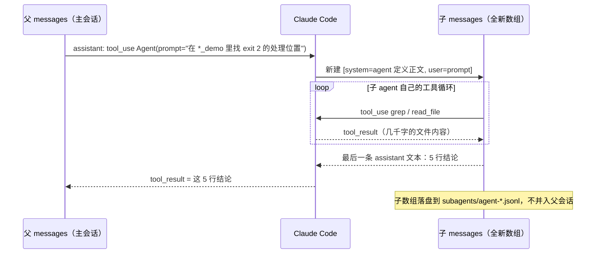

# Sub Agent：上下文管理的艺术

> 对应原站：[Sub Agent：上下文管理的艺术](https://labuladong.online/zh/ai-coding/basics/sub-agent/)（会员内容；本章为独立原创重写）

> **一句话结论**：Sub Agent 是一个新开的 messages 数组。父 agent 只往里放一条任务描述；子 agent 在里面跑完自己的工具循环，最后只把一段结论作为 tool_result 交回父数组。探索过程留在子数组里，父上下文只增加了「一次调用 + 一段结论」。

## 一个反直觉的观察

你让 Explore 去仓库里翻了二三十个文件，主会话的上下文几乎没涨。

可有时候你让 general-purpose 子 agent 去改个东西，它会问一些你们五分钟前刚讨论过的事，好像完全不知道前情。

你可能会问：这两个现象是一回事吗？

是一回事。子 agent 根本看不到父会话的历史，这一个事实同时解释了两个现象：

- 它读的东西不会进入你的上下文，所以主会话不变重。
- 你说过的话也不会进入它的上下文，所以它不知道前情。

隔离是双向的。

## 为什么需要隔离

[AI 编程的基本常识](05-ai-tips.md)里讲过，对话越长，效果越差：无关的历史不只费钱，还会参与每一个后续 token 的概率计算，分散注意力。

可编程任务天然就会产生大量中间产物：grep 的结果、读进来的整个文件、跑失败的测试日志。你真正需要的往往只有一句话：「exit 2 是在 `hook_runner.py` 的 `dispatch()` 里处理的」。

打个比方：你派实习生去图书馆查一个问题。他翻了二十本书，回来只交给你一页摘要。你的桌面上只多了这一页纸，那二十本书留在了图书馆。

这个比方有一处不成立：真实的实习生会旁听你们的会议，子 agent 不会。你在派活时没写进任务描述的背景，它一概不知。所以**任务描述必须自足**，这是写子 agent prompt 时第一条要记住的。

## 两个数组，一次交接



官方 sub-agents 文档（<https://code.claude.com/docs/en/sub-agents>）对「子 agent 一开始能看到什么」写得很具体。非 fork 的子 agent 启动时只有下面这些：

- **system prompt**：agent 定义文件的 markdown 正文，加上工作目录等基础环境信息。注意，**不包含 Claude Code 自己那份很长的系统提示词**。
- **任务消息**：父 agent 写的委派 prompt。
- **CLAUDE.md**：完整的层级都会加载。Explore 和 Plan 例外，设置了 `omitClaudeMd: true` 的也例外。
- **git status 快照**：同样，Explore 和 Plan 会跳过。
- **`skills` 字段里列出的 skill 全文**：启动时预加载。

父会话里的这些东西，子 agent **看不到**：对话历史、已经调用过的 skill、Claude 已经读过的文件、output style、auto memory。

交还的时候，只有子 agent 的最终报告回到主会话，它中间的工具调用全部留在外面。如果子 agent 触到了 `maxTurns` 上限，返回的结果会被标成 partial，之后还可以恢复它继续跑。

**回到主线**：上下文窗口是有限的，每个 token 都会参与下一个 token 的预测。Sub Agent 是一道「上下文防火墙」：探索阶段产生的大量 token 被关在一个用完就扔的数组里，主线只保留结论。它省掉了主会话的 token，也保住了主会话的注意力。代价是一次有损的交接：子 agent 没写进结论的东西，父 agent 永远看不到。

## 先跑起来：同一个问题，两种做法

`code/agent/subagent_demo/subagent.py` 用一个剧本式的 fake client，把同一个问题按两种方式各跑一遍：

- **inline**：父 agent 自己 grep，再读 3 个文件。
- **subagent**：父 agent 只调用一次 `agent` 工具，让子 agent 去 grep 和读文件。

两种方式读的都是本仓库里的真实文件。运行 `uv run python subagent_demo/subagent.py`（离线 fake 模型，真实输出）：

```text
[inline]   父 messages =  11517 字符  (父请求 3 次, 工具 4 次)
[subagent] 父 messages =    636 字符  (父请求 2 次, 工具 1 次)
           子 messages =  11524 字符  (子请求 3 次, 工具 4 次，用完即弃)
父上下文缩小到 inline 的 5.5%
```

总工作量没有变，子 agent 照样调用了 4 次工具、读了一万多字符。变化在于这一万多字符**住在哪里**。inline 模式下，它们会一直跟着父会话，后面每一轮请求都要重发一遍；subagent 模式下，它们跟着子数组一起被扔掉了。

实现的关键只有三行，在 `make_agent_tool()` 里：

```python
def agent(description: str, prompt: str) -> str:
    child_messages = [{"role": "user", "content": prompt}]   # ← 全新数组，看不到父历史
    result = run_agent(client, child_system, child_messages, CHILD_TOOLS, child_stats)
    return result                                            # ← 父亲只拿到这一段
```

说穿了，子 agent 就是「在一次工具调用的内部，又跑了一遍完整的 agent 循环」。`run_agent` 是同一个函数，父 agent 和子 agent 共用，区别只在于传进去的 messages 是哪个数组。

测试：`uv run pytest -q subagent_demo`，结果 `2 passed`。其中一条用 spy 断言：子 agent 第一次请求的 messages 里**只有**任务描述，没有父亲最初的提问。

## 在真实 transcript 里看这道墙

这一节只看数据结构，不看内容。

我看了本次会话目录下的 `subagents/` 文件夹，每个子 agent 对应两个文件：

- `agent-<id>.jsonl`：子 agent 自己的对话记录。每一行都带 `"isSidechain": true` 和 `agentId`。
- `agent-<id>.meta.json`：字段有 `agentType`（例如 `general-purpose`）、`description`、`toolUseId`、`spawnDepth`。

`toolUseId` 就是父会话里那次 `Agent` 工具调用的 ID，两边靠它对上号。

父会话那一侧，`Agent` 调用的 `toolUseResult` 里有这些键：`isAsync`、`status`、`agentId`、`outputFile`、`canReadOutputFile`、`canContinueAgent`。

其中有两个字段值得多看一眼：

- `isAsync`：对应文档里说的「主会话里 Claude 发起的子 agent，默认在后台运行」。
- `canContinueAgent`：对应「用 `SendMessage` 恢复一个子 agent，它会带着自己的完整历史继续跑」。Explore 和 Plan 是一次性的，不返回可以恢复的 ID。

## 对照你的环境

- **你的 `~/.claude/agents/codex-review.md`** 只声明了 `tools: Bash, Read`，正文就是它的 system prompt。按文档，它启动时拿到的是这份正文、委派 prompt、CLAUDE.md 层级和 git status，不会拿到 Claude Code 的主系统提示词。所以正文里那句「你不修改任何代码」不是客套话，它就是这个 agent 的全部人设。
- **这个 agent 的 description 里写着**「日常请优先用后台非阻塞的 `codex-review` skill（子 agent 会阻塞父会话到整轮结束）」。这正好说明了子 agent 的取舍：隔离上下文是它的优点，但前台子 agent 跑完之前，父会话只能等着。
- **嵌套深度。** 文档说子 agent 最多可以往下嵌套三层，可以用 `CLAUDE_CODE_MAX_SUBAGENT_SPAWN_DEPTH` 调整，设成 `1` 就禁止嵌套。meta.json 里的 `spawnDepth` 记录的就是这个层数。你的 `codex-cross-review` 是「主会话并行起两个子 agent」，只有一层，离上限很远。
- **缓存。** 官方 prompt caching 文档说，子 agent 有自己的 system prompt 和工具集，前缀和父会话不同，所以**第一次请求读不到父会话的缓存**，要自己从头预热。而且它属于「main conversation 以外」这一档，即使用订阅，默认 TTL 也是 5 分钟。也就是说，起一个子 agent 本身有固定的冷启动成本。下一章的 Fork 就是冲着这个成本去的。

我的观点：**子 agent 不是用来提速的，是用来保护主会话上下文的。** 判断要不要用它，只看一个比例：探索过程的体积和结论的体积之比。读 20 个文件得出一句话，就该派出去。改一个你们刚讨论过细节的函数，就别派，因为光是把背景写进 prompt，花的力气可能比自己改还多。

## 常见坑

1. **委派 prompt 不自足。** 写了「按刚才说的方案改」，子 agent 不知道「刚才」指什么。要把文件路径、约束条件、期望的产出格式都写进去。
2. **让子 agent 返回原始材料。** 「把这 10 个文件的内容给我」等于把墙拆了，上下文照样涨。要让它返回结论和 `文件:行号` 这样的定位。
3. **以为子 agent 继承了父会话已调用的 skill。** 它不继承。需要的 skill 要在 agent 定义里用 `skills` 字段预加载。
4. **把对子 agent 的权限限制当作安全边界。** `tools` 只是一个工具白名单。子 agent 里的 Bash 照样能执行任何命令，真正的边界在权限规则和 hook。
5. **依赖 Explore 读你的 CLAUDE.md 规则。** Explore 和 Plan 都跳过 CLAUDE.md，你写在里面的约定它们看不到。

## 练习

1. 在 `subagent.py` 里加一个场景：子 agent 返回的不是 5 行结论，而是 3 个文件的全文拼接。重新对比父上下文的字符数，验证常见坑第 2 条。
2. 给 `make_agent_tool` 加一个 `max_turns` 参数：子循环超过 N 次请求就停下，返回 `[partial] ` 前缀加上目前为止最后一段文字，模拟文档里说的 partial 结果。
3. （开放题）你的 `feishu-bug-intake` 流程要求「图和视频必须下载看完」。如果把「看图定性」派给子 agent，结论里要包含哪些字段，父 agent 才能放心地基于它建单？请设计一个结构化的返回格式。

## 延伸阅读

- 官方 Subagents：<https://code.claude.com/docs/en/sub-agents>
- 官方 Prompt caching：Subagents and the cache：<https://code.claude.com/docs/en/prompt-caching>
- 本库：[Fork Agent](11-fork-agent.md)（反过来：完整继承上下文）、[AI 编程的基本常识](05-ai-tips.md)、[mini Claude Code：子 agent](../p4-mini-cc/17-subagent.md)
