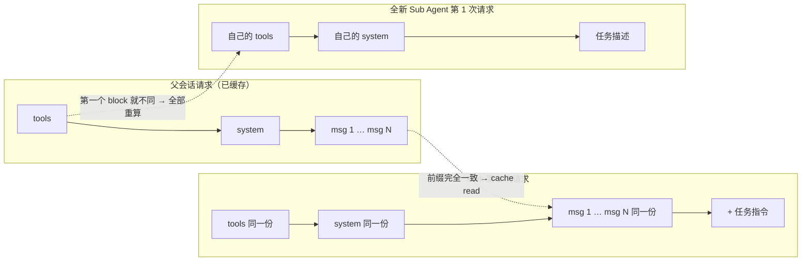

# Fork Agent：共享上下文的艺术

> 对应原站：[Fork Agent：共享上下文的艺术](https://labuladong.online/zh/ai-coding/basics/fork-agent/)（会员内容；本章为独立原创重写）

> **一句话结论**：Fork 会原样复制父会话的 tools、system 和 messages，只在末尾追加一条任务指令。这样它的第一次请求就能整段命中父会话已经预热好的 Prompt Cache。代价是 fork 出去的分支不能改工具定义、不能改 system prompt，否则前缀一变缓存就全部失效。所以对分支的限制，只能放到工具调用时去检查。

## 两个问题，背后是同一个答案

用 `/btw` 问一句「刚才那个配置文件叫什么」，几乎马上就有回答，还不怎么花钱。派一个子 agent 去问同样的问题，它却一无所知，得从头读起。

再看另一个现象：Claude Code 允许 fork，却不允许你给 fork 换一套更小的工具。官方文档说 fork「skip both filters and receive the main conversation's exact tool pool」。

你可能会问：给分支只配只读工具，不是更安全吗？为什么偏偏不让？

两个问题的答案都在 Prompt Cache 上。

## 先回忆：缓存认的是前缀

[messages 数组和 token](../p0-core/03-messages-and-tokens.md) 那章讲过：模型本身没有记忆，每一轮都要把完整上下文重新发一遍。Prompt Cache 让服务端可以复用「上次已经算过的那一段」。

它的匹配规则很死板，Anthropic 的 prompt caching 文档写得很清楚：

- 请求按 `tools → system → messages` 的顺序渲染。
- 缓存按**前缀精确匹配**。哪一层变了，那一层和它之后的所有内容都要重算。
- 改动 tool 定义，三层全部失效；改动 `tool_choice`，messages 层失效。

所以对一个已经聊了很久的会话来说，「便宜」只有一种情况：新请求和上一次请求的**开头完全一样**，区别只出现在末尾。

## Fork：从 HEAD 拉一个分支

打个比方：fork 很像 `git checkout -b` 从 HEAD 拉一个分支。所有历史都是共享的，不需要复制；新的提交只落在分支上，main 不受影响。

这个比方在合并时不成立。git 分支可以把全部提交 merge 回来，fork 只能交回**一段最终结果**，相当于把整个分支 squash 成一行再带回 main。



官方 sub-agents 文档对 fork 的描述是：继承「the entire conversation so far」，和主会话用同一份 system prompt、同一套工具、同一个模型、同一段消息历史。它自己的工具调用不会写回主会话，回来的只有最终结果。

prompt caching 文档在「Subagents and the cache」一节把两者放在一起对比：

- 子 agent 的前缀和父会话不同，第一次请求读不到父会话的缓存。
- fork「inherits the parent's system prompt, tools, and conversation history exactly, so its first request reads the parent's cache」。

**回到主线**：Sub Agent 用「换一个干净的数组」来保护主会话的注意力，Fork 用「原样复用前缀」来省掉重读历史的钱。两者都是在有限的上下文里做取舍，只是方向相反：Sub Agent 宁可丢掉历史，也要隔离；Fork 宁可背上全部历史，也要复用缓存。

## 先跑起来：一个前缀缓存模拟器

[`code/agent-node/fork_demo/prefix_cache.ts`](../code/agent-node/fork_demo/prefix_cache.ts)（Python 版 [`prefix_cache.py`](../code/agent/fork_demo/prefix_cache.py)）把一次请求拆成一串 block：tools、system、每条消息各算一个 block。每个 block 边界处计算一个累计 hash 存进 cache。新请求从头开始比对，命中的最长前缀算作 cache_read。token 数用「字符数 / 4」粗略估计，只看相对大小。

主会话先跑 30 轮把缓存预热，然后依次模拟几种「分支」。真实输出（两版的 JSON 序列化分隔符不同，token 粗估值差几十，比例一样）：

=== "Node"

    ```text
    $ node fork_demo/prefix_cache.ts
    场景                                         cache_read  uncached     命中率
    主会话第 N 轮（预热）                                        0      9121    0.0%
    Fork：同 tools/system/历史 + 追加任务                    9121        14   99.8%
    Fork 但删掉 Bash 工具定义                                  0      9117    0.0%
    Fork 但改了 system prompt                             76      9060    0.8%
    全新 Sub Agent（自己的 system+tools，空历史）                  0        36    0.0%
    /btw：同前缀 + 追加问题（推测实现）                            9121        14   99.8%
    ```

=== "Python"

    ```text
    $ uv run python fork_demo/prefix_cache.py
    场景                                         cache_read  uncached     命中率
    主会话第 N 轮（预热）                                        0      9178    0.0%
    Fork：同 tools/system/历史 + 追加任务                    9178        15   99.8%
    Fork 但删掉 Bash 工具定义                                  0      9173    0.0%
    Fork 但改了 system prompt                             83      9111    0.9%
    全新 Sub Agent（自己的 system+tools，空历史）                  0        38    0.0%
    /btw：同前缀 + 追加问题（推测实现）                            9178        14   99.8%
    ```

第三行就是开头那个问题的答案。只是把 Bash 从工具列表里删掉，tools 这第一个 block 就变了，后面的 9,000 多 token 全部重算。

第四行也值得看：只在 system 末尾加了一句「只读模式」，就只剩 tools 那一小段还能命中。

第五行「全新 Sub Agent」的 uncached 只有 38（Node 版 36），那是因为 demo 里它的 system 只有一行。真实的子 agent 有自己的系统提示词、CLAUDE.md 和工具定义，冷启动的成本要高得多。

核心判断就是一个循环：

=== "Node"

    ```ts
    for (const b of blocksOf(tools, system, messages)) {
      h.update(b);
      const d = h.copy().digest("hex");  // digest() 会结束 hash，先 copy() 再取累计值
      if (matched && this.entries.has(d)) {
        read = total;                    // 前缀还连着，继续算命中
      } else {
        matched = false;                 // 一旦断开，后面再一样也不算
      }
    }
    ```

=== "Python"

    ```python
    for b in blocks_of(tools, system, messages):
        h.update(b.encode())
        if matched and h.hexdigest() in self.entries:
            read = total                 # 前缀还连着，继续算命中
        else:
            matched = False              # 一旦断开，后面再一样也不算
    ```

测试：`node --test 'fork_demo/*.test.ts'`，结果 `ℹ pass 1`（Python 版 `uv run pytest -q fork_demo`，结果 `1 passed`）。

## 这对分支的权限意味着什么

既然工具定义和 system prompt 都不能动，「这个分支只许读、不许写」这种约束就只能挪到**调用时**去检查。

官方文档里正好有一个例子能看出这个思路。嵌套深度到达上限时，Claude Code 会把 `Agent` 工具从所有子 agent 里拿掉，**只有 fork 例外**：「A fork at the limit keeps `Agent` in its inherited tool list, but the tool returns an error instead of spawning」。

工具定义保留着，调用时返回错误。文档没有解释为什么要这样设计。我**推测**原因就是保护前缀：如果把定义删掉，fork 的缓存就没了。

prompt caching 文档还给出了另一条线索：作用于具体参数的 deny 规则（比如 `Bash(rm *)`）以及所有 allow / ask 规则，都不会改变模型看到的工具列表，它们是「when Claude attempts a call」时才检查的，所以前缀保持不变。

所以，想约束一个 fork，可以用这几种手段：

- **权限规则**：作用于参数的 deny，在调用时检查，不改变前缀。
- **PreToolUse hook**：见 [Hooks](08-hooks.md)，同样是调用时检查。
- **在追加的任务指令里写明「只读」**：这属于软约束，靠模型自觉。

不能用的手段：删掉工具定义、改 system prompt、换模型。每个模型有独立的缓存，换模型等于从头算。文档也说，即使设置了 `CLAUDE_CODE_SUBAGENT_MODEL_FORCE`，fork 仍然跑在主会话的模型上。

说穿了，所有「复用缓存」的功能都在遵守同一条纪律：**差异只能追加在末尾，不能插在中间**。文档里还有好几处遵守这条纪律的例子：

- 用 `/fork` 复制会话时，那条「你是副本」的隔离指令是作为一条消息追加在末尾的。
- `/compact` 的摘要请求，是在原有前缀后面追加一条「请总结」的 user 消息。
- skill 被调用时，正文作为一条消息追加到对话末尾。
- workflow 并行派出多个同前缀的 agent 时，除了第一个，其余的会先等最多 5 秒，好让它们读到第一个 agent 刚写进去的缓存。

## /btw 和 /subtask

这是 Claude Code 暴露给用户的两个 fork 入口，按官方文档（interactive-mode、sub-agents 两页）：

| | `/btw <问题>` | `/subtask <任务>` |
|---|---|---|
| 看得到什么 | 完整对话，外加最近 20 次 side question | 完整对话 |
| 能用工具吗 | 不能，只凭上下文里已有的内容回答 | 能，用的是主会话那一整套工具 |
| 结果去哪 | 显示在一个可关闭的浮层里，**不进**对话历史 | 最终结果回到主会话 |
| 轮数 | 单次回答；在浮层里按 `f` 可以把它转成一个后台 fork 继续干 | 多轮，直到完成 |
| 成本 | 缓存热的时候，基本只花回答本身的钱 | 第一次请求读父会话的缓存 |

`/btw` 怎么做到「不能用工具」又「不破坏缓存」，文档没有说。我的**推测**是：请求里的 tools 和 `tool_choice` 都原样保留，只是 harness 不执行模型发出的任何工具调用。

推测的依据有两条。第一，改 tools 会让整个缓存失效，改 `tool_choice` 会让 messages 层失效，而长会话的大头恰恰在 messages 层，任何一种改法都撑不起「低成本」。第二，文档提到，如果模型硬是写出了工具调用，回答末尾会附一句「什么都没执行」，说明模型确实可能发出调用，只是没有被执行。

原站提到 Codex 有类似的侧边会话（CLI 里是 `/side`），我没有在 Codex 的文档里核实过，这里不展开比较。

## 对照你的环境

- **你常用的 fork 场景**，比如「从当前讨论里拆出一个子任务，后台去写单测」，正是 fork 最划算的情况：任务强依赖已有的讨论，又不想把中间过程写回主线。按文档，fork mode 默认是开着的，可以用 `CLAUDE_CODE_FORK_SUBAGENT=0` 关掉。
- **你的 skills 里如果出现 `context: fork`，名字是有误导性的。** skills 文档特别说明：「Despite the name, a skill with `context: fork` doesn't run in a fork of the current conversation」。它实际上新起了一个 `agent` 字段指定类型的子 agent，把 skill 正文作为 prompt，看不到对话历史。也就是说，它是 [Sub Agent](10-sub-agent.md)，不是本章讲的 Fork。
- **想限制 fork 时，首选 `enforce-worktree.py` 这类 PreToolUse hook。** 它在调用时检查，不碰前缀，fork 会继承这个 hook 的约束，缓存也不受影响。

我的观点：**Fork 和 Sub Agent 不是谁替代谁，选哪个看任务对历史的依赖程度。** 任务需要你们刚才讨论的内容，就用 fork，背着全部历史出发，还能享受缓存。任务只需要一段自足的描述，就用 sub agent，轻装上阵，也不会把一大段无关历史塞给子任务分散注意力。

还有一点：fork 背着的历史越长，它自己的工具循环每一轮要重发的内容也越多。所以在一个快满的会话里 fork，不一定比开一个干净的子 agent 更便宜。

## 常见坑

1. **想给 fork「换一套只读工具」。** 一改定义，缓存就全部失效。约束要用权限规则或 hook 来做。
2. **把 `context: fork` 的 skill 当成 fork。** 它是全新的子 agent，看不到你的对话。
3. **以为 `/btw` 能去查文件。** 它没有工具，只能回答上下文里已经有的东西。要查就按 `f` 转成 fork。
4. **隔了很久才 fork。** 缓存有 TTL，过期之后 fork 的第一次请求一样是全价。官方 caching 文档说，fork 和子 agent 都属于「main conversation 以外」这一档，默认 TTL 是 5 分钟。
5. **在会话里途中切模型或改 effort 之后马上 fork。** 前缀的模型变了，fork 能命中的是新模型的缓存，而新模型的缓存还没有预热。

## 练习

1. 在 `prefix_cache.ts`（`prefix_cache.py`）里加一个场景：只改变 tools 列表的**顺序**，不增也不删。预测命中率，然后跑一下验证。想一想：为什么真实的 harness 要保证工具列表的顺序稳定？
2. 加一个「工具保留、调用时拒绝」的场景：fork 的请求和父会话完全一致，另写一个 `execute(toolName)`（`execute(tool_name)`）对 Edit 返回错误。证明它的命中率和普通 fork 一样，同时 Edit 也被拦住了。
3. （开放题）mini Claude Code 要实现 `/btw`，你会怎么设计请求的形状：tools 带不带、`tool_choice` 设不设、回答写不写进 messages？请分别估算每一种设计的缓存命中情况，再和本章的推测做对比。

## 延伸阅读

- 官方 Prompt caching（Claude Code）：<https://code.claude.com/docs/en/prompt-caching>
- 官方 Subagents（Fork the current conversation）：<https://code.claude.com/docs/en/sub-agents>
- 官方 Interactive mode（Side questions with /btw）：<https://code.claude.com/docs/en/interactive-mode>
- Anthropic API Prompt caching（失效层级表）：<https://platform.claude.com/docs/en/build-with-claude/prompt-caching>
- 本库：[Sub Agent](10-sub-agent.md)、[上下文压缩](../p3-agent-internals/05-context-compaction.md)
