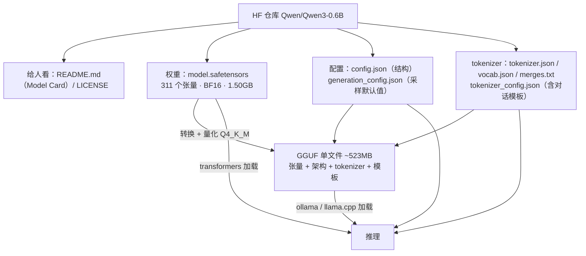
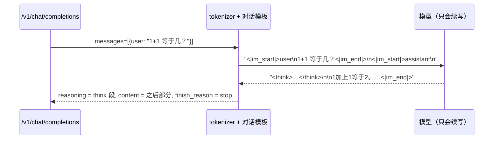

# 看懂 Hugging Face 和模型文件

> 原文（免费）：[看懂 Hugging Face 和模型文件](https://labuladong.online/zh/ai-coding/basics/hugging-face-model-files/) —— 建议先读原文，本页是我的笔记

**一句话结论**：一个 LLM 仓库就是三类文件：**权重**（学到的数字）、**配置**（怎么把数字搭成网络）、**tokenizer**（文字和 token 互相转换，外加对话模板）。剩下那些新名词，checkpoint、BF16、Q4_K_M、Safetensors、GGUF，都是从不同角度在描述权重：**哪个时刻存的、每个数用几 bit、怎么装进文件**。

## 核心要点

1. **Hugging Face Hub 可以理解成「模型版的 GitHub」**：有仓库、版本（revision）、README（也就是 Model Card）和 License。拿到一个模型，先读 Model Card，确认它是 Base 还是 Instruct、支持哪些语言、许可证是什么、推荐用什么推理框架。
2. **Base 和 Instruct 的区别**：Base 模型只会接着往下写，Instruct 模型做过指令对齐，会把输入当问题来回答。聊天和 Agent 场景要选 Instruct（或 Chat）版本。
3. **权重文件就是一堆有名字、有形状的张量**。`model.safetensors` 开头是一份清单（张量名、形状、dtype），后面才是具体数字。比如 `embed_tokens.weight [151936, 1024]` 就是一张「词表大小 × 隐藏维度」的查找表，光这一张按 BF16 存就占 311MB。权重太大时会拆成多个分片，再由一个 index 文件记录每个张量在哪个分片里。
4. **config.json 是网络结构的说明书**：层数、头数、hidden_size、vocab_size、最大位置数。推理框架按它搭好骨架，再把同名的权重填进去。`generation_config.json` 是作者调好的默认采样参数（temperature、top_p、top_k），Ollama 转换模型时会一起带过去。
5. **tokenizer 由四个文件组成**：`vocab.json`（词表）、`merges.txt`（BPE 合并规则）、`tokenizer.json`（把前两者合并后的新格式，现在的库实际读的是它）、`tokenizer_config.json`（特殊 token 和**对话模板**）。
6. **对话模板揭示了「多轮对话」和「思考」的本质**：都是一串特殊标记拼起来的文本。模型只负责往下续写，推理框架负责在 `</think>` 处切开，前一段放进 `reasoning`，后一段放进 `content`，遇到 `<|im_end|>` 就停。不同模型的标记不一样，所以每个仓库都要自带模板。
7. **精度和量化**：FP32 每个数 4 字节；FP16 和 BF16 都是 2 字节，但 BF16 的数值范围接近 FP32。量化是把权重近似成 8 bit 或 4 bit，好处是文件小、加载快；代价是有误差，可能「降智」；速度不一定更快。实际体积会比理论值大一些，因为要存缩放系数，而且有些张量会保留高精度。
8. **两种文件格式**：Safetensors 只存张量和清单，加载时不执行任何代码，用来替代旧的 pickle `.bin` 格式（pickle 可能夹带代码）；GGUF 把张量、架构、tokenizer 等元数据打包成一个文件，并且原生支持量化，是 llama.cpp、Ollama、LM Studio 使用的格式。

### 📝 作者是怎么讲的

- **开场承认「新词很多」，并给出拆解路线。** 先列出 Model Card、checkpoint、BF16、Q4_K_M、Safetensors、GGUF 这一串词，然后承诺：先看清仓库里有哪几类文件，再把每个词「挂到对应的文件上」。为什么有效：读者知道接下来怎么读，零散的术语也有了归处。借用：概念多的文档，先给一个「挂钩框架」，再逐个挂上去。
- **一个类比定位整个平台。** 「面向 AI 模型的 GitHub」，Model Card 对应 README，Files 对应真正的交付物。为什么有效：你熟悉 GitHub，仓库、版本、许可证这些概念可以直接对上。类比的局限：作者也提醒了，下载下来的不是能双击运行的程序，而是要交给推理框架一起解释的一组文件。
- **从一个具体的矛盾切入。** 名字写 0.6B，页面却显示 0.8B，先说「两个数都没错，只是数法不同」，把悬念留到后文。为什么有效：用矛盾吸引注意力，比直接给定义更容易记住。
- **打开真实文件看，从小例子过渡到真实数据。** 先用 1D、2D、3D 的小数组讲清 shape，再打开 safetensors 的张量清单，把 embedding 矩阵铺开，算出 151936×1024×2 byte ≈ 311MB。为什么有效：抽象的「权重」变成了能看、能算的数字，这正是「朴实无华」的落点。借用：你讲 jsonl 结构、hook 输入这类东西时，也可以直接打开真实文件逐行看。
- **从一个常见疑问讲出模板的本质。** 「模型只会续写，多轮对话和思考是怎么冒出来的？」作者把模板拼接后的字符串原样展示出来，再说明推理框架按 `</think>` 切一刀就分出了两个字段。为什么有效：一句「模型自己并不区分这两者，它只是在续写」就把神秘感拆掉了，并且回到了全库主线。
- **结尾用一张分层表收束，并能读懂真实标签。** checkpoint、精度、格式分别回答不同的问题，最后拿「7B · Q4_K_M · GGUF」这个标签示范逐段读懂。为什么有效：读者带走的是一个解读框架，而不是一堆名词。借用：术语多的文档，结尾都可以放一张「术语 → 它回答什么问题」的表。

## ⚠️ 勘误 / 补充

- **「名字写 0.6B、页面显示 0.8B」的原因，原文说得比较笼统**。原文的解释是「名字按不重复的参数数，页面按文件里实际存了多少个数」，方向是对的，但没有说清楚重复的是哪部分。我按原文给出的数字推了一下：
  - 文件大小 1.50GB ÷ 2 byte（BF16）≈ 7.5 亿个数。Ollama 的 `show` 显示 751.63M，HF 页面四舍五入成 0.8B。
  - 原文说有 311 个张量。按 Qwen3 每层 11 个张量（q/k/v/o、q_norm/k_norm、gate/up/down、两个 layernorm）计算，28 层 × 11 = 308，再加上 `embed_tokens`、最终的 `norm`、`lm_head` 正好是 311。也就是说，文件里**单独存了一份 `lm_head`**。
  - Qwen3-0.6B 的输入 embedding 和输出 lm_head 是共享权重的（tie_word_embeddings），逻辑上只算一份 151936 × 1024 ≈ 1.56 亿个参数。0.75B − 0.16B ≈ 0.6B，对上了。

  结论：**多出来的约 0.16B 就是共享的 embedding 和 lm_head 在文件里多存的那一份**。以上是根据原文的数字和 Qwen3 公开的结构推出来的，本机没有下载权重来验证。
- **原文漏了一点**：Safetensors 文件开头的清单其实是一段 **JSON header**（前 8 字节是 header 的长度，之后是 JSON，再之后是连续的原始字节），所以可以只读 header 拿到所有张量的形状，不用加载 1.5GB 的数据。HF 页面上的「Model size」就是这样算出来的。

## 回到主线

上下文的长度和成本最终都落在这几个文件上：`config.json` 里的 `max_position_embeddings` 定了上下文的上限；`vocab_size` 和 tokenizer 决定同一段中文会被切成多少个 token，也就是要付多少钱；对话模板说明了 system、user、assistant、tool 这些「角色」本质上都只是拼进上下文的普通 token。往后看 Function Calling、MCP、Skills 时都可以这样拆：它们最终都会被模板拼成一段文本，交给模型续写。

## 对照你的环境

- **对照你写 webapp 的心智模型**：权重相当于构建产物（bundle），config 相当于 `package.json` 和路由表（告诉运行时怎么组装），tokenizer 相当于序列化协议。GGUF 则像是把这三者打成一个可以直接部署的单文件产物。
- **你在 Claude Code 里看到的「thinking」是同样的机制**：`~/.claude/projects/*/*.jsonl` 的 assistant 行里能看到 `thinkingDisplay`、`thinkingDurationMs` 这类字段，你的 `effortLevel: high` 控制的也是思考的预算。只是 Anthropic 在服务端已经把思考段和正文切好，以独立的 content block 返回，和 Ollama 返回 `reasoning` 字段是同一个思路。
- 读到 [LoRA 微调](../p6-nn-llm/06-lora-fine-tuning.md) 时，这章的文件结构会再次出现：LoRA 的产物就是一个只包含少量增量张量的 safetensors 文件。

## 自测题

1. 一个仓库里有 `model-00001-of-00004.safetensors` 到 `00004` 和一个 `model.safetensors.index.json`，这些文件分别是干什么的？
2. 为什么 BF16 的 1.50GB 权重量化成 Q4_K_M 之后是 523MB，而不是理论上的 375MB？
3. 同一句话分别发给 Qwen3 和 DeepSeek-R1，模型实际看到的输入字符串一样吗？为什么 OpenAI 兼容 API 的调用方感觉不到这个区别？

参考答案

1. 前四个是同一套权重拆出来的分片，`index.json` 记录每个张量名对应哪个分片。四个文件合在一起才是完整的权重。
2. 量化要额外存缩放系数（比如每块权重一个 scale），而且部分对精度敏感的张量会保留更高的位数，K_M 方案里有的层用到了 6 bit。所以平均下来每个参数约 5.6 bit，比 4 bit 多。
3. 不一样。Qwen 用 `<|im_start|>`、`<|im_end|>`，DeepSeek-R1 用 `<｜User｜>`、`<｜Assistant｜>`。推理服务在服务端用各自仓库里的对话模板，把 messages 渲染成对应的字符串，所以调用方只需要看到统一的 messages 结构。

## 相关章节

- [用 Ollama 在本地运行大模型](./13-local-llm-ollama.md)
- [LLM 是怎么预测下一个 token 的](../p0-core/04-llm-token-prediction.md)：embedding、BPE、KV cache
- [LLM 和 Agent 的核心术语和原理](../p0-core/01-llm-and-agent.md)：Base 和 Instruct 的区别
- [Tensor 的常用操作](../p5-ml/01-pytorch-basics.md)
- [动手跑通 LLM 推理的全流程](../p6-nn-llm/05-inference-process.md) · [动手用 LoRA 微调模型](../p6-nn-llm/06-lora-fine-tuning.md)
