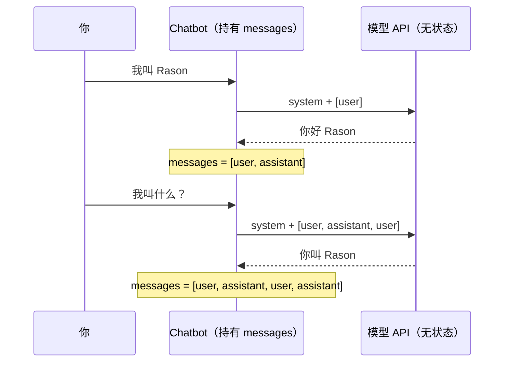

# 动手实现一个 AI 聊天机器人

> 对应原站：[动手实现一个 AI 聊天机器人](https://labuladong.online/zh/ai-coding/basics/ai-chatbot/)（会员内容；本章为独立原创重写）

> **一句话结论**：模型本身不记得任何事，「记忆」就是你每次都完整重发的 `messages` 数组，「人设」就是每次都重发的 `system`。聊天机器人 = 一个往数组里追加消息的 `while` 循环。

你每天在 Claude Code 里聊几十轮，它总能接上前文。那你有没有想过：如果把同一个会话的 jsonl 删掉一半，它还能接上吗？

答案是不能。因为接上前文的不是模型，而是 Claude Code 每一轮都把历史重新塞给了模型。这一章我们自己写一个聊天机器人，亲手维护这个数组，看清「记忆」到底住在哪。

## 先跑起来看看

代码在 [`code/agent/chatbot/bot.py`](../code/agent/chatbot/bot.py)，一共 80 行。离线跑一下（离线 fake 模型，回复和 token 数都是脚本预设的）：

```text
$ uv run python -m chatbot.bot --fake
❯ 你好，我叫 Rason，是前端工程师
⏺ 你好 Rason！有什么可以帮你？   [in=30 out=20 历史条数=2]
❯ 我叫什么？
⏺ 你叫 Rason，是前端工程师。   [in=62 out=20 历史条数=4]
❯ /system 你是一只傲娇的猫，句尾带喵
（人设已切换为：你是一只傲娇的猫，句尾带喵）
❯ 我叫什么？
⏺ 喵～本猫不认识你，你是谁喵？   [in=28 out=20 历史条数=2]
```

注意右边那一栏。第二轮的「历史条数」是 4，说明发给模型的已经是两问一答再加一问。切换人设时我们顺手清空了数组，于是条数回到 2，它也就「忘了」你是谁。

设了 `ANTHROPIC_API_KEY`（中转站再加 `ANTHROPIC_BASE_URL`）后去掉 `--fake`，就是和真模型聊天，你会看到类似的行为，只是回复和 token 数换成真实值。

## 记忆：一个不断变长的数组

核心就这几行：

```python
class Chatbot:
    def __init__(self, client, system="你是一个简洁的中文助手。", max_tokens=2048):
        self.client = client
        self.system = system
        self.messages = []          # ← 这就是「记忆」的全部

    def send(self, user_text):
        self.messages.append({"role": "user", "content": user_text})
        resp = self.client.messages.create(
            model="claude-opus-5-5",
            max_tokens=self.max_tokens,
            system=self.system,         # 人设：每次请求都重新发一遍
            messages=self.messages,     # 历史：每次请求都完整发一遍
        )
        reply = "".join(b.text for b in resp.content if b.type == "text")
        self.messages.append({"role": "assistant", "content": resp.content})
        return reply
```

你可能会问：为什么回复也要 `append` 回去？我只关心用户说了什么。

因为模型下一轮要预测的是「在这段对话之后，assistant 接下来说什么」。如果数组里只有用户的话，在模型眼里就是一个人自言自语了好几句，它不知道自己之前答过什么，很容易前后矛盾。

一个类比：模型像一位每次进门都失忆的客服，你得把整本聊天记录递给他，他读完再接话。记录本由你保管，他什么都不带走。

这个类比不成立的地方在于：真人读长记录会累，模型读长记录是**按 token 收钱**的。每轮都重发全部历史，意味着第 N 轮的输入成本大致和 N 成正比，整段对话的总成本接近 N²。这就是为什么长会话需要压缩（compaction），见 [如何实现上下文压缩](../p3-agent-internals/05-context-compaction.md)。



图里有一件事值得盯着看：模型那一列从头到尾没有任何状态。所有箭头上的数据都是 `Chatbot` 这一侧现拼的。

## 人设：每次都重发的 system

`system` 是请求里一个独立的顶层字段，不在 `messages` 里。它的作用是给整段对话定基调：身份、语气、规则。

你可能会问：既然每次都发，那我直接把人设写成第一条 user 消息，效果一样吗？

不完全一样。`system` 是专门留给「运营方」（写程序的你）的通道，模型被训练成把它当作整段对话的设定，而 user 消息是「用户」说的话。把规则放进 user 消息，等于让规则和用户输入同级，更容易被一句「忽略之前的设定」带偏。另外它的位置固定在最前面，配合 prompt caching（提示词缓存）能稳定命中缓存。

说穿了，聊天机器人的全部状态就两个变量：一个字符串 `system`，一个列表 `messages`。切换人设 = 换字符串；「失忆」= 清空列表。

## 测试替身：不调用真模型怎么验证

这个教程有个约束：不主动调用 Anthropic API。所以所有 agent 代码都接受一个**可注入的 client**，测试里换成 [`fake_llm.FakeAnthropic`](../code/agent/fake_llm/__init__.py)：它有一个 `.messages.create()` 方法，按脚本依次返回预设的响应，返回值是 SDK 真实的 `anthropic.types.Message` 对象，所以业务代码一行不改。

更有用的是它把每次调用的入参都记在 `client.calls` 里，测试就能断言「模型这一轮到底看到了什么」：

```python
def test_memory_is_the_messages_array():
    client = FakeAnthropic([text("你好 Rason"), text("你叫 Rason")])
    bot = Chatbot(client, system="S")
    bot.send("我叫 Rason")
    bot.send("我叫什么？")
    second = client.calls[1]
    assert [m["role"] for m in second["messages"]] == ["user", "assistant", "user"]
```

```text
$ uv run pytest -q chatbot
..                                                                       [100%]
2 passed in 0.56s
```

这个「看模型看到了什么」的思路后面每一章都会用到。调 agent 的 bug，十有八九是上下文拼错了，而不是模型笨。

**回到主线**：LLM 只会根据已有 token 预测下一个 token，它没有记忆这个器官。聊天机器人做的事，就是在有限的上下文窗口里，替模型保管并重放「已有 token」。后面所有的压缩、记忆、RAG，都是在优化这个数组里该放什么。

## 对照你的环境

- 你的 Claude Code 会话存在 `~/.claude/projects/<项目>/<session>.jsonl`，每行一条消息。`claude --resume` 做的事，本质就是把这个文件读回 `messages` 数组。我在本机最新的 jsonl 里看到 assistant 行的 `message.usage` 有 `cache_read_input_tokens: 26594`，这就是历史被重发、但大部分命中了缓存。
- 你的 SessionStart hook `~/.claude/bin/inject-guardrails.sh` 按 cwd 注入护栏，它往上下文里加的东西，和这里的 `system` 是同一类：每一轮都在，都要付 token。所以你在 CLAUDE.md 里写「常驻层是稀缺资源」，用本章的话说就是：它是每次都重发的那段前缀。

## 常见坑

1. **只存了回复文本**。很多示例代码把 `resp.content` 简化成字符串存回去。纯聊天没问题，一旦有工具调用，`tool_use` 块就丢了，下一轮 API 会报 `tool_result` 找不到对应的 `tool_use`。养成习惯：存 `resp.content` 原样。
2. **第一条消息必须是 user**。数组以 assistant 开头会被拒绝。清空记忆后别留下孤零零的 assistant。
3. **把时间戳写进 system**。`f"现在是 {datetime.now()}"` 让 system 每次都变，缓存永远不命中，账单翻倍还查不出原因。
4. **忘了历史会无限增长**。不设上限的聊天机器人，聊到第几百轮会撞上上下文窗口，或者贵到离谱。

## 练习

1. 给 `Chatbot` 加一个 `/history` 命令，打印当前数组的角色序列和每条的字数。
2. 实现「只保留最近 N 轮」的滑动窗口，并写测试断言第 N+1 轮时最早的一问一答被丢掉了。注意别让数组以 assistant 开头。
3. 开放题：滑动窗口会丢掉开头的「我叫 Rason」。有什么办法既控制长度、又不丢关键事实？（提示：想想 Claude Code 的 compact 和 memory 分别是怎么做的。）

## 延伸阅读

- Messages API 多轮对话：<https://platform.claude.com/docs/en/build-with-claude/working-with-messages>
- System prompts：<https://platform.claude.com/docs/en/build-with-claude/prompt-engineering/system-prompts>
- 本库：[上下文是什么？token 怎么计费？](../p0-core/03-messages-and-tokens.md) · 下一章 [动手实现一个 Coding Agent](./02-coding-agent.md)

回到开头的问题：删掉半个 jsonl，Claude Code 还能接上前文吗？不能，因为那个 jsonl 就是它的 `messages` 数组。模型从来没记住过你。
