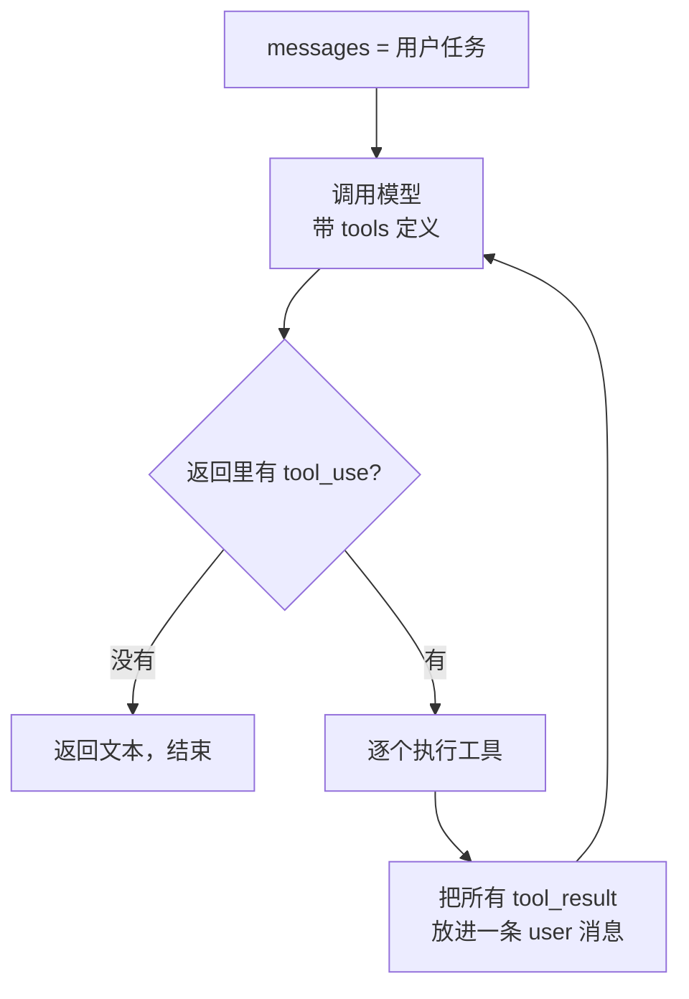

# 动手实现一个 Coding Agent

> 对应原站：[动手实现一个 Coding Agent](https://labuladong.online/zh/ai-coding/basics/coding-agent/)（会员内容；本章为独立原创重写）

> **一句话结论**：Agent = 把模型调用放进一个 `while` 循环：模型返回 `tool_use` 就执行工具、把结果作为 `tool_result` 追加回 `messages`，再问一次模型；直到它不再要工具。给它读文件、写文件、跑命令三个工具，它就能自己修 bug。

你用 Claude Code 修 bug 时，经常看到它连着跑了十几步：读文件、改、跑测试、看报错、再改。你只说了一句话。

你可能会问：上一章的聊天机器人也能调工具，它和 Claude Code 差在哪？

差在「谁来决定下一步」。聊天机器人每轮都要等你开口；Agent 拿到工具结果后，**自己再问一次模型**，让模型决定接下来干什么。改动其实就是在内层再套一个循环。

## 先跑起来看看

代码在 [`code/agent-node/coding_agent/agent.ts`](../code/agent-node/coding_agent/agent.ts)（Python 版 [`agent.py`](../code/agent/coding_agent/agent.py)），核心 ~100 行。演示脚本 [`demo.ts`](../code/agent-node/coding_agent/demo.ts)（[`demo.py`](../code/agent/coding_agent/demo.py)）在临时目录放一个把加法写成减法的 `calc` 模块和一个测试：

=== "Node"

    ```text
    $ node coding_agent/demo.ts                 # 离线 fake 模型；工具是真的在执行
    ❯ test_calc.mjs 挂了，帮我修好
    ⏺ run_command(command="node test_calc.mjs")
      ✔ AssertionError: -1
    ⏺ read_file(path="calc.mjs")
      ✔ export const add = (a, b) => a - b;
    ⏺ write_file(path="calc.mjs", content="export const add = (a, b) => a + b…)
      ✔ 已写入 calc.mjs（36 字符）
    ⏺ run_command(command="node test_calc.mjs")
      ✔ ok
    ⏺ 修复完成：calc.add 把 `a - b` 改成了 `a + b`，test_calc.mjs 通过。
    ---- 第 2 次请求时 messages 的角色序列 ----
    [ 'user', 'assistant', 'user' ]
    ---- calc.mjs 现在的内容 ----
    export const add = (a, b) => a + b;
    ```

=== "Python"

    ```text
    $ uv run python -m coding_agent.demo        # 离线 fake 模型；工具是真的在执行
    ❯ test_calc.py 挂了，帮我修好
    ⏺ run_command(command='python test_calc.py')
      ✔ AssertionError: -1
    ⏺ read_file(path='calc.py')
      ✔     return a - b
    ⏺ write_file(path='calc.py', content='def add(a, b):\n    return a + b\n')
      ✔ 已写入 calc.py（32 字符）
    ⏺ run_command(command='python test_calc.py')
      ✔ ok
    ⏺ 修复完成：calc.add 把 `a - b` 改成了 `a + b`，test_calc.py 通过。
    ---- 第 2 次请求时 messages 的角色序列 ----
    ['user', 'assistant', 'user']
    ---- calc.py 现在的内容 ----
    def add(a, b):
        return a + b
    ```

这里要说清楚哪些是真的：**「模型决定调哪个工具」是脚本预设的**（离线 fake 模型），但工具真的在临时目录里读写了文件、真的跑了测试脚本，`AssertionError: -1` 和 `ok` 都是真实输出。换成真 client（`node coding_agent/agent.ts "修好测试" ./项目`，Python 版 `uv run python -m coding_agent.agent "修好测试" ./项目`），决策就交给 Claude。

## Agent：给 LLM 套上循环



对应的代码几乎一行对一个方框：

=== "Node"

    ```ts
    async function runAgent(client, task, cwd, {
      tools = makeTools(cwd), toolSpecs = TOOLS,
      system = SYSTEM(cwd), maxTurns = 20, log = console.log,
    } = {}) {
      const messages: Anthropic.MessageParam[] = [{ role: "user", content: task }];

      for (let turn = 1; turn <= maxTurns; turn++) {
        const resp = await client.messages.create({
          model: "claude-opus-5-5", max_tokens: 16000,
          system, tools: toolSpecs, messages,
        });
        messages.push({ role: "assistant", content: resp.content });

        const calls = resp.content.filter((b) => b.type === "tool_use");
        if (calls.length === 0)                 // 模型不再要工具 → 任务结束
          return resp.content.map((b) => (b.type === "text" ? b.text : "")).join("");

        const results = [];
        for (const call of calls) {             // 一轮可能有多个并行 tool_use
          let out, isError;
          try {
            [out, isError] = [tools[call.name](call.input), false];
          } catch (e) {                         // 工具出错也要回报给模型
            [out, isError] = [`${e.name}: ${e.message}`, true];
          }
          results.push({ type: "tool_result", tool_use_id: call.id,
                         content: out, is_error: isError });
        }
        messages.push({ role: "user", content: results });
      }
      return `（达到 maxTurns=${maxTurns}，强制停止）`;
    }
    ```

=== "Python"

    ```python
    def run_agent(client, task, cwd, *, tools=None, tool_specs=None, system=None, max_turns=20, log=print):
        tools = tools or make_tools(cwd)
        messages = [{"role": "user", "content": task}]

        for turn in range(1, max_turns + 1):
            resp = client.messages.create(
                model="claude-opus-5-5", max_tokens=16000,
                system=system or SYSTEM.format(cwd=cwd),
                tools=tool_specs or TOOLS,
                messages=messages,
            )
            messages.append({"role": "assistant", "content": resp.content})

            calls = [b for b in resp.content if b.type == "tool_use"]
            if not calls:                       # 模型不再要工具 → 任务结束
                return "".join(b.text for b in resp.content if b.type == "text")

            results = []
            for call in calls:                  # 一轮可能有多个并行 tool_use
                try:
                    out, is_error = tools[call.name](**call.input), False
                except Exception as e:          # 工具出错也要回报给模型
                    out, is_error = f"{type(e).__name__}: {e}", True
                results.append({"type": "tool_result", "tool_use_id": call.id,
                                "content": out, "is_error": is_error})
            messages.append({"role": "user", "content": results})

        return f"（达到 max_turns={max_turns}，强制停止）"
    ```

你可能会问：`tool_result` 为什么是 `role: "user"`？明明是我的程序执行的，又不是用户说的。

因为 Messages API 只有 user 和 assistant 两个角色在轮流说话。从模型的视角看，工具结果是「外界」给它的反馈，所以挂在 user 这一侧。`tool_use_id` 负责把每个结果和模型发起的那次调用对上号。

再问一句：模型怎么知道有哪些工具？靠请求里的 `tools` 字段，每个工具一段 JSON Schema：

=== "Node"

    ```ts
    {
      name: "run_command",
      description: "在工作目录执行一条 shell 命令，返回退出码和输出（超时 60 秒）。",
      input_schema: {
        type: "object",
        properties: { command: { type: "string" } },
        required: ["command"],
      },
    }
    ```

=== "Python"

    ```python
    {
        "name": "run_command",
        "description": "在工作目录执行一条 shell 命令，返回退出码和输出（超时 60 秒）。",
        "input_schema": {
            "type": "object",
            "properties": {"command": {"type": "string"}},
            "required": ["command"],
        },
    }
    ```

这三个字段最终都会被渲染进模型的上下文。所以 `description` 不是写给人看的注释，是写给模型看的说明书。模型选错工具，第一个要查的就是描述写得清不清楚。

一个类比：模型像一位远程指导你修车的老师傅，他看不见车，只能说「把左边那颗螺丝拧下来给我看看」。你照做，把看到的告诉他，他再说下一步。循环本身很笨，聪明的是那位师傅。

这个类比在一处不成立：师傅能记住刚才看过什么，模型不能。每次「再问一次」，都要把从头到现在的所有步骤原样重发。第 2 次请求的角色序列是 `['user', 'assistant', 'user']`，第 5 次就变成 9 条了。说穿了，Agent 就是上一章那个数组，只不过这次往里追加消息的不是你，是循环本身。

## 三个工具，安全边界在哪

[`makeTools()`](../code/agent-node/coding_agent/agent.ts)（Python 版 [`make_tools()`](../code/agent/coding_agent/agent.py)）里三个工具都只有几行，值得看的是边界处理：

- **路径校验**：模型给的 `path` 是不可信输入。`safe()` 把路径 `resolve()` 后检查它是否还在 `root` 下面（Node 用 `path.relative()` 看是否以 `..` 开头，Python 用 `is_relative_to(root)`），`../../etc/passwd` 会直接抛错。
- **输出截尾**：`run_command` 只回最后 4000 字符。一个打印了十万行日志的命令，不截断就能把上下文撑爆。
- **错误也是结果**：工具抛异常时我们不让程序崩，而是把异常文本作为 `is_error: true` 的 `tool_result` 回给模型。模型看到 `ENOENT`（Python 里是 `FileNotFoundError`）自己会换个路径再试。

还有一个我写 Python 版 demo 时真踩到的坑。最初测试偶尔失败，修好的 `calc.py` 跑出来还是 `-1`。原因是 Python 的 `.pyc` 缓存按「源文件 mtime + 大小」判断是否过期：Agent 在同一秒内把 `a - b` 改成 `a + b`，长度没变，Python 就用了旧缓存。修法是跑命令时设 `PYTHONDONTWRITEBYTECODE=1`。人手改代码很少在一秒内完成，Agent 会。Node 版的测试每次都起新进程重新读源文件，没有落盘的字节码缓存，不受影响。

=== "Node"

    ```text
    $ node --test coding_agent/*.test.ts
    ✔ agent 按脚本修好 bug
    ✔ 工具出错被回报而不是抛出
    ✔ 路径越界被拦下
    ✔ maxTurns 拦住失控循环
    ℹ pass 4
    ```

=== "Python"

    ```text
    $ uv run pytest -q coding_agent
    ....                                                                     [100%]
    4 passed in 0.45s
    ```

四个测试分别覆盖：完整修 bug 流程、工具报错回传、路径越界、`maxTurns`（`max_turns`）防止失控循环。

**回到主线**：模型只会预测下一个 token，它不能真的去读文件。Function Calling 让它「预测」出一段结构化的调用请求，循环负责把真实世界的结果塞回上下文。Agent 用多轮请求换来了能力边界的扩展，代价是上下文随步数线性膨胀，这正是第 8 章要观测、p3 要压缩的东西。

## 对照你的环境

- Claude Code 的内层循环和这里是同一个形状。区别在工程量：它的 Read 工具带行号和分页，Edit 工具是精确字符串替换而不是整文件覆盖，Bash 有权限审批和超时，这些在 [p4 mini Claude Code](../p4-mini-cc/07-file-edit.md) 里会一个个补上。
- 你的 PreToolUse hook `enforce-worktree.py`（matcher 是 `Bash`）就插在本章流程图里「逐个执行工具」那一步之前。用这一章的代码类比：它相当于在 `tools[call.name](**call.input)` 前面加了一个 `if not allowed: out, is_error = "拒绝…", True`。

## 常见坑

1. **只看 `stop_reason == "end_turn"` 判断结束**。还可能是 `max_tokens`（输出被截断，`tool_use` 的参数可能不完整）或 `refusal`。我们用「有没有 `tool_use` 块」来判断，再配合 `max_turns` 兜底；生产代码还要显式处理 `max_tokens`。
2. **并行工具结果分多条消息回**。模型一次可能发多个 `tool_use`，所有 `tool_result` 必须放在**同一条** user 消息里。拆开发会让模型逐渐不再并行调用。
3. **工具异常直接抛出**。程序崩了，模型也没机会纠错。异常要变成 `is_error` 结果。
4. **没有 `max_turns`**。模型陷入「跑测试→失败→同样的修改」的死循环时，没有上限就会一直烧钱。
5. **`run_command` 不设超时**。一个 `npm run dev` 就能让 Agent 永远等下去。

## 练习

1. 加一个 `list_dir` 工具，并在 demo 脚本里让 fake 模型先 `list_dir` 再读文件。
2. 把 `write_file` 换成 `edit_file(path, old, new)`：`old` 在文件里必须恰好出现一次，否则返回错误。写测试覆盖「出现 0 次」和「出现 2 次」。
3. 开放题：`run_command` 现在能执行任何命令。你会怎么设计权限审批？是白名单、黑名单，还是让另一个模型判断？参考 Claude Code 的 permission mode 说说各自的取舍。

## 延伸阅读

- Tool use 概览：<https://platform.claude.com/docs/en/agents-and-tools/tool-use/overview>
- 本库：上一章 [聊天机器人](./01-ai-chatbot.md) · [Hooks](../p1-tools/08-hooks.md) · 下一章 [RAG 问答机器人](./03-rag-qa-bot.md) · 用 SDK 重写见 [第 6 章](./06-agent-sdk.md)

回到开头的问题：Claude Code 连跑十几步而你只说了一句话，是因为它的循环在「模型还想要工具」时不会停下来等你。它聪明的部分在模型里，坚持不懈的部分只是一个 `for` 循环。
