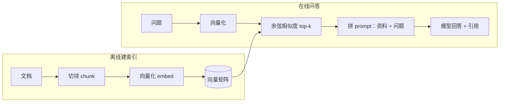

# 动手实现一个 RAG 问答机器人

> 对应原站：[动手实现一个 RAG 问答机器人](https://labuladong.online/zh/ai-coding/basics/rag-qa-bot/)（会员内容；本章为独立原创重写）

> **一句话结论**：RAG（Retrieval-Augmented Generation，检索增强生成）就是先从一堆文档里挑出和问题最相关的几段，只把这几段塞进 prompt，让模型「照着资料答」。四步：切块 → 向量化 → 检索 → 拼 prompt。

假设产品经理丢给你一份 300 页的帮助中心，让你做一个客服机器人，用户问「会员多少钱」。

你可能会问：现在模型上下文都 1M token 了，直接把 300 页全塞进去不行吗？

能塞，但每个问题都要为 300 页付费，而用户只关心其中一段。更麻烦的是，资料越长，模型越容易在中间那堆无关内容里分心。所以真正的问题是：**怎么在问模型之前，先把那一段找出来**。

## 先跑起来看看

代码在 [`code/agent/rag/rag.py`](../code/agent/rag/rag.py)，资料是 [`rag/docs/`](../code/agent/rag/docs/) 下 6 篇虚构产品「闪记」的帮助文档。整套检索用纯 numpy 实现，不下载任何模型：

```text
$ uv run python -m rag.rag --fake "会员多少钱？学生有优惠吗？"
共 18 个块，向量维度 16384

问题：会员多少钱？学生有优惠吗？
检索结果：
  0.161  membership.md#会员与价格           【会员与价格】学生认证后购买年付 Pro 可享五折，认证需上传有效期内的学生证照…
  0.068  membership.md#会员与价格           【会员与价格】Pro 会员月付 39 元，年付 299 元（约合每月 25 元）…
  0.050  membership.md#会员与价格           【会员与价格】闪记提供免费版和 Pro 会员两档。免费版每月可转写 300 分钟…

---- 发给模型的 user 消息 ----
<docs>
<doc id="1" source="membership.md#会员与价格">【会员与价格】学生认证后购买年付 Pro 可享五折，认证需上传有效期内的学生证照片，审核时间一般为 1 个工作日。</doc>
<doc id="2" source="membership.md#会员与价格">【会员与价格】Pro 会员月付 39 元，年付 299 元（约合每月 25 元）。Pro 会员每月可转写 3000 分钟，云端文件永久保留，并解锁 AI 摘要模板和多人协作。</doc>
<doc id="3" source="membership.md#会员与价格">【会员与价格】闪记提供免费版和 Pro 会员两档。免费版每月可转写 300 分钟录音，云端保留最近 30 天的文件。</doc>
</docs>

问题：会员多少钱？学生有优惠吗？

回答（离线 fake 模型）：Pro 会员月付 39 元、年付 299 元 [1]；学生认证后年付可享五折 [2]。
```

检索分数和 user 消息都是真实计算出来的；只有最后一行回答是 fake 模型的预设文本。注意 fake 回答里的 `[1]` `[2]` 编号其实标错了（价格在 doc 2，学生优惠在 doc 1），这恰好提醒你：引用编号是模型生成的，不是检索系统保证的，上线前要抽查。

## 四步流水线



左边只在文档更新时跑一次，右边每个问题跑一次。下面一步步拆。

### 切块：一段话说清一件事

```python
def chunk_markdown(path, max_chars=200):
    raw = path.read_text()
    title = raw.splitlines()[0].lstrip("# ").strip()
    for para in re.split(r"\n\s*\n", raw):          # 先按空行分段
        ...
        for sent in re.split(r"(?<=[。！？])", para):  # 太长再按句号切
            ...
            chunks.append(Chunk(f"{path.name}#{title}", f"【{title}】{buf}"))
```

你可能会问：为什么每块前面都要加 `【会员与价格】` 这个标题？

因为切开之后，「Pro 会员月付 39 元」这一段里并没有「价格」两个字。用户问「具体价格是多少」，没有标题的块就匹配不上。这招叫**上下文补全**，第 4 章会用实验证明它的效果。

### 向量化：把文本变成一串数字

真实的 RAG 会调用一个 embedding 模型，把文本变成一串浮点数（向量），意思相近的文本向量也相近。Anthropic 自己不提供 embedding 模型，官方文档推荐的是 Voyage AI，比如 `voyage-4` 默认输出 1024 维。这里为了离线，用了一个朴素得多的方法：

```python
def _ngrams(text):
    """中文没有空格分词：直接取字符 1-gram 和 2-gram；英文/数字按词切。"""
    ...
class HashingTfidf:
    def transform(self, texts):
        m = np.zeros((len(texts), DIM))
        for i, t in enumerate(texts):
            for g in _ngrams(t):
                m[i, zlib.crc32(g.encode()) % DIM] += 1   # 哈希到 16384 个桶里计数
        m = np.log1p(m) * self.idf                         # 常见字降权
        return m / np.linalg.norm(m, axis=1, keepdims=True)  # 归一化
```

拆开看就三件事：

1. **数字**：把「会员多少钱」拆成「会」「员」「会员」「员多」……每个片段哈希到一个桶里计数。这叫哈希技巧（hashing trick），省掉了维护词表。
2. **降权**：IDF（逆文档频率）让「的」「是」这种到处都有的字权重变低，「退款」「蓝牙」这种只在少数块出现的字权重变高。
3. **归一化**：每个向量除以自己的长度，之后两个向量的点积就是余弦相似度。

一个类比：这像图书管理员靠「书里出现了哪些关键字」来找书。你问「蓝牙连不上」，他翻出所有提到「蓝牙」的页。

这个类比也正是它的局限：它只认**字面**，不懂**意思**。真 embedding 模型更像一个读过很多书的人，你说「登不上去了、口令想不起来」，他知道你在说「忘记密码」。我们的哈希 TF-IDF 做不到，第 4 章有实测。

### 检索：一次矩阵乘法

```python
def search(self, query, k=3):
    q = self.vec.transform([query])[0]
    scores = self.matrix @ q            # 18 个块 × 16384 维，一次点积全算完
    top = np.argsort(-scores)[:k]
    return [(float(scores[i]), self.chunks[i]) for i in top]
```

18 个块的规模，暴力算就够了。到百万级才需要 HNSW 这类近似最近邻索引，那是向量数据库的活。说穿了，向量检索的核心就是 `matrix @ q` 这一行。

### 拼 prompt：让模型只看资料

```python
SYSTEM = ("你是「闪记」的客服。只根据 <docs> 里的资料回答，并在句末用 [编号] 标注出处。"
          "资料里没有的信息，直接说「资料中没有相关说明」，不要猜。")
```

这句 system 有两个关键约束：**只根据资料**（防止模型用训练知识编），**没有就说没有**（给模型一个合法的「不知道」出口）。少了第二句，模型面对不相关的资料时往往会硬凑一个答案。

几个不同问法的实测 top-1，全都命中正确文档：

```text
$ uv run pytest -q rag
...                                                                      [100%]
3 passed in 0.46s
```

（`test_retrieval_top1` 覆盖了「能不能导出我的数据」「忘记密码怎么办」「蓝牙连不上」「可以退钱吗」「支持日语吗」等 6 个问法。）

**回到主线**：上下文有限且按 token 计费，RAG 就是在调用模型之前先做一次「上下文筛选」，只把最可能有用的几百个 token 放进去。它用一个检索步骤换来了省 token 和更少的干扰，代价是检索一旦漏掉，模型就再也看不到那段资料。

## 对照你的环境

你在 webapp 里接内部平台的 i18n、查 Linear 单、翻 Notion 知识库，都是「先找资料再回答」。区别在于你让 Claude Code 自己去搜（MCP 工具 + grep），而不是预先建好向量索引。这两条路线各适合什么场景，是下一章的主题。

## 常见坑

1. **块切得太碎或太大**。太碎丢上下文（「它」指谁？），太大一块里混了好几件事，相似度被稀释。按语义边界（段落、标题）切，再控制长度。
2. **不给块补标题**。切开后很多块缺少主题词，检索不到。
3. **不让模型说「不知道」**。检索结果不相关时模型会编，答案看起来还特别像回事。
4. **相信引用编号**。编号是模型生成的，可能错位，见上面 fake 输出。
5. **索引和文档不同步**。文档改了索引没重建，模型会自信地引用旧价格。

## 练习

1. 把 `k` 从 3 改成 1 和 6，各问三个问题，观察回答质量和 prompt 长度的变化。
2. 给 `search` 加一个分数阈值：最高分低于 0.05 时直接回「资料中没有相关说明」，不调用模型。用「你们 CEO 是谁」测试。
3. 开放题：如果帮助文档有中英两个版本，用户用英文问中文文档里才有的内容，我们的哈希 TF-IDF 会怎样？真 embedding 模型会怎样？你会怎么设计？

## 延伸阅读

- Anthropic：Contextual Retrieval（给块补上下文的系统化做法）：<https://www.anthropic.com/news/contextual-retrieval>
- Embeddings 文档：<https://platform.claude.com/docs/en/build-with-claude/embeddings>
- 本库：下一章 [RAG 原理和使用场景](./04-rag-principles.md)

回到开头的问题：300 页帮助中心不必全塞进去。先花一次矩阵乘法找到那三段，再让模型照着读。
