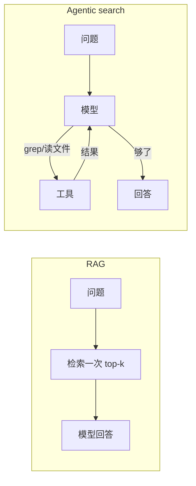

# RAG 原理和使用场景

> 对应原站：[RAG 原理和使用场景](https://labuladong.online/zh/ai-coding/basics/rag-principles/)（会员内容；本章为独立原创重写）

> **一句话结论**：向量检索靠的是「意思相近的文本，向量也相近」，所以它擅长在大量自然语言里找「说法不同但意思一样」的段落；代码这种要精确匹配标识符、而且随时在变的东西，让 Agent 自己 grep 更准、更省事。长上下文没有消灭 RAG，只是把「需要 RAG 的门槛」往上抬了。

上一章的 RAG 跑通了，但你可能马上会有几个疑问：

- 为什么 Claude Code 这么强的编程 Agent，却不给你的仓库建向量索引，而是一遍遍 `grep`？
- 模型上下文都 1M 了，RAG 还有必要吗？
- 上一章那个哈希 TF-IDF，和「真正的 embedding」差在哪？

这一章不写新功能，用三个小实验把这些问题讲清楚，最后给一张选型表。

## Embedding：把「意思」变成坐标

先说直觉。想象一张巨大的地图，每段文本都是地图上的一个点。embedding 模型做的事，就是给每段文本算一个坐标，让「意思相近」的文本落得近：「忘记密码」和「账号找回」离得很近，「忘记密码」和「蓝牙配对」离得很远。

你可能会问：模型怎么知道两句话意思相近？它又没学过「同义词词典」。

靠的是训练数据里的统计规律：经常出现在相似上下文里的词，意思也相近。「密码」和「口令」前后总跟着「输入」「修改」「忘记」，模型在训练中被迫给它们分配相近的坐标，才能把预测任务做好。这和 LLM 预测下一个 token 是同一套思路，只是 embedding 模型输出的不是下一个词，而是一个代表整段话的向量。

类比在这里有一处不成立：真实的「地图」不是二维的，而是上千维。人脑没法想象，但「近」的计算方式不变：两个向量的夹角越小（余弦相似度越接近 1），意思越像。

我们上一章用的哈希 TF-IDF 也会给文本算坐标，但它的「坐标轴」是字面片段（「会员」「退款」），只认字面，不认意思。用它做实验，恰好能把「字面检索」的能力边界看得一清二楚。

## 三个实验

代码在 [`code/agent/rag/experiments.py`](../code/agent/rag/experiments.py)，全部离线、真实输出：

```text
$ uv run python -m rag.experiments
实验 1：给每块加不加文档标题（上下文补全）
 [加标题]
  Q: 具体价格是多少
     0.074  membership.md#会员与价格      【会员与价格】Pro 会员月付 39 元，年付 299 …
     0.066  membership.md#会员与价格      【会员与价格】闪记提供免费版和 Pro 会员两档。免费版…
 [不加标题]
  Q: 具体价格是多少
     0.043  transcription.md#转写与语言   转写速度大约是录音时长的 1/10，一小时的录音约 6 …
     0.018  account.md#账号与安全         同一个账号最多可以同时在 3 台设备上登录，超过后最早登…

实验 2：换个说法（同义改写，几乎不共享字）
  Q: 忘记密码怎么办
     0.219  account.md#账号与安全         【账号与安全】如果忘记了登录密码，可以在登录页点击「账号…
     0.013  membership.md#会员与价格      【会员与价格】闪记提供免费版和 Pro 会员两档。免费版…
  Q: 登不上去了口令想不起来
     0.046  account.md#账号与安全         【账号与安全】同一个账号最多可以同时在 3 台设备上登录…
     0.043  account.md#账号与安全         【账号与安全】如果忘记了登录密码，可以在登录页点击「账号…

实验 3：在代码里找 `useRecordingStore` 的所有引用
  grep -w: ['src/store/recording.ts', 'src/hooks/useRecorder.ts']
  向量检索（子词切分）top-4：
     0.669  src/hooks/useRecorder.ts
     0.414  src/store/recording.ts
     0.235  src/pages/Home.tsx
     0.000  src/utils/record.ts
```

### 实验 1：切块会把主题切丢

「Pro 会员月付 39 元」这一段里没有「价格」两个字。不加标题时，检索直接跑偏到「转写速度」那段（它和问题只共享了一个「是」字，分数低到 0.043，但别的块连这点都没有）。加上 `【会员与价格】` 后，正确的块回到第一。

这就是切块的根本矛盾：**块要小，检索才精准；块一小，就丢了它属于哪篇、在讲什么。** 业界的解法从简单到复杂：给块加标题和路径；块之间留重叠；用模型给每块写一句上下文说明再嵌入（Anthropic 的 Contextual Retrieval，官方数据是把 top-20 检索失败率从 5.7% 降到 2.9%）。

### 实验 2：字面检索的天花板

「忘记密码怎么办」和原文共享「忘记」「密码」，分数 0.219，稳稳第一。

换成「登不上去了口令想不起来」，意思一样，字几乎不重叠。分数掉到 0.046，而且第一名变成了「最多 3 台设备登录」那段，只因为它也有「登」字。

真 embedding 模型正是为这种情况设计的，它通常能把这两种说法对上（本机没有跑真 embedding，因为规定不下载模型、不调外部 API，这句是基于 embedding 的训练原理和常见经验的判断）。这也是 RAG 适合客服、知识库的原因：用户永远不会按文档的措辞提问。

### 实验 3：代码检索要的是「全」和「准」

在代码里找 `useRecordingStore` 的引用，`grep -w` 给出的答案是**确定的完整集合**：两个文件，一个不多一个不少。

向量检索给的是一个**排序**。它把两个真引用排在前面，但 `Home.tsx` 也拿了 0.235 分，因为它用的是 `useRecordStore`，子词和目标高度重合。可这是**另一个 store**。如果 Agent 据此去改 `Home.tsx`，就是一个真实的 bug。

更要命的是：向量检索没有「到此为止」的信号。top-3 还是 top-5？分数 0.2 算不算相关？你没法从排序里知道「已经找全了」。

## 为什么 Claude Code 用 grep，不用向量库

把实验 3 推广一下，就能理解编程 Agent 的选择：

1. **代码要精确匹配**。函数名、变量名、错误码，差一个字母就是另一个东西。grep 的「全且准」正好对上。
2. **代码一直在变**。你每改一行，向量索引就过期一点。重建索引要时间、要算力；不重建，Agent 就会读到旧代码。grep 每次都读磁盘上的当前版本，永远不过期。
3. **Agent 可以多搜几次**。RAG 是「一次检索定生死」，漏了就漏了。Agent 搜一次不满意，可以换关键词、换目录、顺着 import 一路读下去。这种做法常被叫作 agentic search（智能体式搜索）：检索策略由模型在循环里自己决定。
4. **不用建索引**。clone 下来就能用，没有额外的服务、存储和隐私问题（把代码发去做 embedding 本身就是一个数据出境决策）。

Claude Code 团队在公开访谈里提到过，早期试过本地向量检索，后来发现让模型自己搜效果更好（**推测**：这一点来自公开分享的转述，我没有找到官方文档的明确说明）。不管出处如何，上面四条理由本身是成立的。

说实话，我认为这件事的本质不是「grep 比向量好」，而是**谁来做检索决策**。RAG 把检索放在模型之外、一次性完成；agentic search 把检索放进循环、交给模型。模型越强，后者的优势越大。



## 长上下文之后，RAG 还有用吗

有用，但门槛变了。

资料只有几十页（几万 token）时，直接全塞进去往往是最简单也最好的方案：没有检索，就不会漏检；配上 prompt caching，重复提问的成本也不高。

资料到了几百万 token，或者每个问题都只需要其中一小块，RAG 依然划算：每次只付几百 token，延迟也低。而且「把资料全塞进去」也不是没代价：上下文越长，模型越容易漏看中间的内容，就像读一本厚书，开头结尾记得清，中间容易糊。

所以选型可以这样想：

| 场景 | 推荐 | 理由 |
|---|---|---|
| 资料 < 几万 token，问题多样 | 全塞进上下文 + 缓存 | 不会漏检，最简单 |
| 大量自然语言文档（客服、知识库、制度） | RAG（embedding + 关键词混合，最好加 rerank） | 用户措辞和文档不同，需要语义匹配 |
| 代码库、配置、日志 | Agent 自己 grep / 读文件 | 要精确、要最新、要能多轮追查 |
| 结构化数据（订单、指标） | 给 Agent 一个查询工具（SQL / API） | 向量检索算不了「上个月退款总额」 |

**回到主线**：上下文窗口有限，RAG 和 agentic search 都在回答同一个问题：「下一次调用模型前，往上下文里放哪几段？」RAG 用离线索引做一次性筛选，省 token、快；agentic search 用多轮工具调用逐步筛选，准、新，但更费轮次。它们是同一件事的两种工程取舍。

## 对照你的环境

- 你在 webapp 里让 Claude Code 找某个组件的用法，它跑的就是实验 3 的 grep 路线。如果你看到它搜了三次都没找到，往往是名字拼写不同（`Recording` vs `Record`），给它一个准确的标识符比任何检索技术都管用。
- 你的 Notion / Linear MCP 搜索是另一类：服务端自己有搜索引擎，Agent 只发一个查询。这相当于把「检索」外包了，Agent 拿到的是别人排好序的结果。

## 常见坑

1. **把 RAG 当成「给模型加知识」的通用方案**。结构化数据、需要计算的问题，RAG 帮不上忙。
2. **只用向量，不用关键词**。产品型号、错误码这类精确词，纯 embedding 反而容易丢。混合检索（BM25 + 向量）是更稳的默认。
3. **只看 top-1 是否命中来评估**。真正要看的是「需要的那段有没有进 top-k」（召回率），以及模型最后答对没有。
4. **给代码库建向量索引却不处理更新**。索引一过期，Agent 就会基于旧代码自信地胡说。

## 练习

1. 在 `experiments.py` 里给实验 2 再加三个同义改写，统计哈希 TF-IDF 的 top-1 命中率。
2. 实现一个最简单的混合检索：`score = 0.5 * tfidf + 0.5 * bm25`（BM25 可以自己用 numpy 写），对比实验 2 的结果。
3. 开放题：如果你要给 webapp 做一个「问代码库问题」的内部工具，你会用 RAG、agentic search，还是两者结合？说说你会怎么处理「代码每天都在变」这件事。

## 延伸阅读

- Anthropic：Introducing Contextual Retrieval：<https://www.anthropic.com/news/contextual-retrieval>
- Embeddings（Voyage AI）文档：<https://platform.claude.com/docs/en/build-with-claude/embeddings>
- 本库：上一章 [RAG 问答机器人](./03-rag-qa-bot.md) · [LLM 是怎么预测下一个 token 的](../p0-core/04-llm-token-prediction.md) · 下一章 [Workflow 和 Agent](./05-workflow-vs-agent.md)

回到开头的问题：Claude Code 不给仓库建向量索引，是因为代码要的是「全且准、永远最新」，而它手里有一个能反复搜索的循环。向量检索擅长的是另一类问题：用户说法千奇百怪的自然语言文档。
