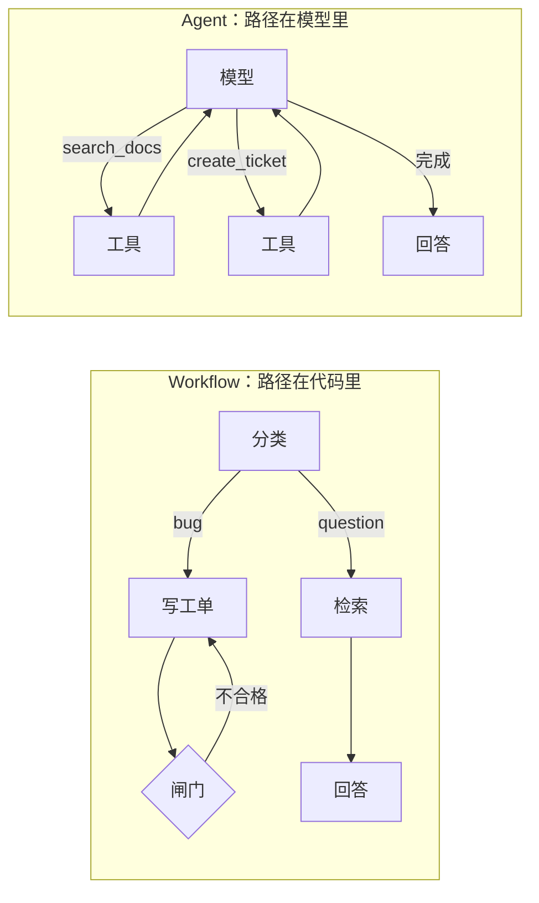

# Workflow 和 Agent

> 对应原站：[Workflow 和 Agent](https://labuladong.online/zh/ai-coding/basics/workflow-vs-agent/)（会员内容；本章为独立原创重写）

> **一句话结论**：区别只有一个：**控制流由谁决定**。Workflow 的每一步写死在代码里，模型只负责填空；Agent 把「下一步做什么」交给模型。能提前写死的就用 Workflow，稳定、便宜、好调试；步数和路径都没法预知时，才用 Agent。

假设你的 Linear 状态推送是定时跑的：拉单、分层、生成摘要、推送，每天都按这个顺序来。你会叫它 Agent 吗？

再看 Claude Code 修 bug：读哪个文件、跑不跑测试、要不要再改一次，全是它自己定的。

两者都用了 LLM，也都可能调工具。你可能会问：那到底什么算 Agent？还是说「Agent」只是一个营销词？

不是营销词，有一条很清楚的分界线。Anthropic 在 [Building effective agents](https://www.anthropic.com/engineering/building-effective-agents) 里给的定义是：Workflow 是「LLM 和工具通过**预先定义的代码路径**编排起来」的系统；Agent 是「LLM **动态地主导自己的流程和工具使用**」的系统。说白了，就看 `if` 写在你的代码里，还是写在模型的脑子里。

## 同一个任务，两种写法

任务：收到一条用户反馈，分诊。bug 就整理成工单草稿，咨询就查资料回答。代码在 [`code/agent-node/workflow/triage.ts`](../code/agent-node/workflow/triage.ts)（Python 版 [`triage.py`](../code/agent/workflow/triage.py)），复用了第 2 章的 `runAgent`（Python 版 `run_agent`）和第 3 章的检索。

=== "Node"

    ```text
    $ node workflow/triage.ts                 # 离线 fake 模型
    === Workflow：代码写死 classify → route → gate ===
    trace: classify → bug | gate ✗ → retry | gate ✓
    LLM 调用 3 次；输出："## 复现步骤\n1. 设置-数据管理-导出\n## 期望\n收到下载链接\n## 实际\n一直转圈"

    === Agent：模型自己决定先查资料、再建工单 ===
    trace:
      ⏺ search_docs(query="Pro 导出次数")
        ✔ 【数据导出】所有用户都可以导出自己的数据。在「设置 - 数据管理 - 导出」中选择导出范围，系统会打包成 zip 文件。
      ⏺ create_ticket(title="Pro 用户导出卡在转圈", body="复现步骤…期望…实际…")
        ✔ 已创建工单 #101：Pro 用户导出卡在转圈
    LLM 调用 3 次；输出："Pro 会员导出不限次数；转圈的问题已建工单 #101 跟进。"
    ```

=== "Python"

    ```text
    $ uv run python -m workflow.triage        # 离线 fake 模型
    === Workflow：代码写死 classify → route → gate ===
    trace: classify → bug | gate ✗ → retry | gate ✓
    LLM 调用 3 次；输出：'## 复现步骤\n1. 设置-数据管理-导出\n## 期望\n收到下载链接\n## 实际\n一直转圈'

    === Agent：模型自己决定先查资料、再建工单 ===
    trace:
      ⏺ search_docs(query='Pro 导出次数')
        ✔ 【数据导出】所有用户都可以导出自己的数据。在「设置 - 数据管理 - 导出」中选择导出范围，系统会打包成 zip 文件。
      ⏺ create_ticket(title='Pro 用户导出卡在转圈', body='复现步骤…期望…实际…')
        ✔ 已创建工单 #101：Pro 用户导出卡在转圈
    LLM 调用 3 次；输出：'Pro 会员导出不限次数；转圈的问题已建工单 #101 跟进。'
    ```

反馈是「我是 Pro 会员，导出时一直转圈，到底 Pro 能导出几次？」，它**既是 bug 又是咨询**。

Workflow 版的分类器只能输出一个标签，于是走了 bug 分支，咨询那一半被丢掉了。Agent 版自己判断出两件事都要做，先查资料再建单。

你可能会问：那 Agent 岂不是全面更好？

不是。看 Workflow 那条 trace 里的 `gate ✗ → retry`：第二步的输出缺了「复现步骤」小节，被**代码**校验出来，自动重试了一次。这个保证在 Agent 版里是没有的，Agent 建单时 body 写成什么样，只能靠 system prompt 里一句「body 需包含复现步骤」去祈祷。

### Workflow 的骨架

=== "Node"

    ```ts
    async function workflow(client, index, feedback, trace) {
      const label = JSON.parse(textOf(await classify(feedback))).label;  // 步骤 1：LLM 分类，代码解析
      if (label === "bug") {                                             // 步骤 2：路由写在代码里
        let draft = textOf(await writeBug(feedback));
        if (!["复现步骤", "期望", "实际"].every((k) => draft.includes(k)))  // 步骤 3：代码闸门
          draft = textOf(await retry(feedback, draft));
        return draft;
      }
      if (label === "question") {
        const hits = index.search(feedback, 2);                          // 检索是固定步骤，不是模型选的
        return textOf(await answer(hits, feedback));
      }
      return "感谢反馈，我们已记录。";
    }
    ```

=== "Python"

    ```python
    def workflow(client, index, feedback, trace):
        label = json.loads(_text(classify(feedback)))["label"]     # 步骤 1：LLM 分类，代码解析
        if label == "bug":                                          # 步骤 2：路由写在代码里
            draft = _text(write_bug(feedback))
            if not all(k in draft for k in ("复现步骤", "期望", "实际")):   # 步骤 3：代码闸门
                draft = _text(retry(feedback, draft))
            return draft
        if label == "question":
            hits = index.search(feedback, 2)                        # 检索是固定步骤，不是模型选的
            return _text(answer(hits, feedback))
        return "感谢反馈，我们已记录。"
    ```

（为了可读性这里把三次 `client.messages.create` 写成了 `classify` / `writeBug`（Python 版 `write_bug`）/ `answer`，实际代码是展开的。）

注意 Workflow 的每次模型调用都**不带 `tools`**。模型只负责「把这段文字分个类」「把这段文字改写成工单」，不负责决定流程。

### Agent 的骨架

=== "Node"

    ```ts
    async function agent(client, index, feedback, trace) {
      const tools = { search_docs: searchDocs, create_ticket: createTicket };
      return runAgent(client, `处理这条用户反馈：${feedback}`, ".",
                      { tools, toolSpecs: AGENT_TOOLS, system: AGENT_SYSTEM, log: (s) => trace.push(s) });
    }
    ```

=== "Python"

    ```python
    def agent(client, index, feedback, trace):
        tools = {"search_docs": search_docs, "create_ticket": create_ticket}
        return run_agent(client, f"处理这条用户反馈：{feedback}", cwd=None,
                         tools=tools, tool_specs=AGENT_TOOLS, system=AGENT_SYSTEM, log=trace.append)
    ```

一行。所有的「先做什么、后做什么、做几次」都交给模型了。



一个类比：Workflow 像流水线，每个工位只做一件事，工位顺序是车间主任排好的；Agent 像请了一位全能师傅，你只告诉他「把车修好」。流水线出错容易定位（第三工位次品率高），师傅出错你得翻他的工作日志。

类比在这里不成立：真实流水线的工人不会「理解错题意」，而 Workflow 里每个工位都是一次 LLM 调用，单步依然可能出错。所以 Workflow 的稳定性不是来自模型，而是来自**代码能插入的校验和重试**。

## 五种常见的 Workflow 模式

Building effective agents 总结了五种模式，用这一章的例子各对应一下：

| 模式 | 一句话 | 本章例子里对应 |
|---|---|---|
| Prompt chaining（提示链） | 上一步的输出作为下一步的输入，中间可加闸门 | 写工单 → 闸门校验 → 重试 |
| Routing（路由） | 先分类，再走不同分支 | `classify` → bug / question |
| Parallelization（并行） | 拆成独立子任务同时跑，或同一任务跑多次投票 | 可以同时跑「分类」和「情绪检测」 |
| Orchestrator-workers（编排者-工人） | 一个 LLM 动态拆任务，派给多个 worker | 接近 Agent 了，像 Claude Code 派 subagent |
| Evaluator-optimizer（评估-优化） | 一个生成、一个打分，循环到合格 | 把闸门换成另一个 LLM 打分 |

你会发现越往下越接近 Agent：前三种的路径完全固定，后两种开始让模型参与决定流程。所以 Workflow 和 Agent 不是二选一，而是一条光谱。

## 怎么选

这篇文章里我最认同的一句话是：先找最简单的方案，只在必要时才增加复杂度。它对 Agent 的适用场景也说得很克制：步数难以预测的开放式问题。

我自己的判断顺序是：

1. **一次 LLM 调用能不能搞定？** 分类、摘要、抽取，大多数能。
2. **步骤能不能提前写成流程图？** 能，就写 Workflow。每一步可以单独测、单独换模型、单独加校验。
3. **画不出流程图，或者分支多到画不完？** 才用 Agent，并且要给它配上兜底：`max_turns`、权限审批、关键输出的程序化校验。

还有一个常被忽略的折中：**Workflow 的某一步是 Agent**。比如固定流程「拉 PR diff → 让 Agent 自由审查 → 用代码校验输出格式 → 发评论」，自由度只开放在最需要的那一步。

**回到主线**：Workflow 和 Agent 都是在有限上下文里组织多次模型调用。Workflow 让每次调用的上下文都很小、很专一（分类那一步只需要看反馈原文），换来可靠和便宜；Agent 让一个不断变长的上下文承载整个任务，换来灵活。选型的本质，是你愿意为灵活性付多少上下文和不确定性。

## 对照你的环境

- 你在 CLAUDE.md 里定下「不走 7 步 SDD 编排」，保留「定位 → 失败测试 → 实现 → 跑 suite → PR」：这本身就是一个**粗粒度的 Workflow**，每一步内部再让 Claude Code 当 Agent 自由发挥。这正是上面说的「Workflow 的某一步是 Agent」。
- `~/.claude/bin/linear-push-cron.sh` 这类定时推送（**推测**：我只看了文件名和 `linear-status-push` skill 的描述，没读脚本内容）应该是典型 Workflow：步骤固定、可重入、出错容易定位。把它改成 Agent 只会变贵、变得不可预测。
- `codex-cross-review` 的「并行起两个 reviewer → 主进程交叉比对」是 Parallelization（sectioning/voting）的变体。

## 常见坑

1. **把能写死的流程交给 Agent**。每次多花几轮 token，结果还时好时坏。
2. **Workflow 里不做校验**。Workflow 的价值就在于每一步之间能插代码检查，不插就浪费了。
3. **分类器只能输出单标签**。像本章的反馈，既是 bug 又是咨询；要么允许多标签，要么给一个「复合」分支。
4. **Agent 不设任何程序化兜底**。全靠 prompt 约束输出格式，迟早会遇到格式不对的那一次。

## 练习

1. 改造 `CLASSIFY` 让它输出标签列表（`["bug", "question"]`），并让 Workflow 两个分支都走，写测试覆盖本章的那条反馈。
2. 给 Agent 版的 `create_ticket` 工具加上和 Workflow 一样的校验：body 缺小节就返回 `is_error`，让模型自己重写。对比这和 Workflow 闸门的区别。
3. 开放题：你的周报生成（拉 GitHub / Linear / Notion 数据 → 写周报）应该做成 Workflow 还是 Agent？哪一步值得开放给模型自由发挥？

## 延伸阅读

- Anthropic：Building effective agents：<https://www.anthropic.com/engineering/building-effective-agents>
- 本库：[动手实现一个 Coding Agent](./02-coding-agent.md) · [Sub Agent：上下文管理的艺术](../p1-tools/10-sub-agent.md) · 下一章 [用 Agent SDK 简化开发](./06-agent-sdk.md)

回到开头的问题：那个按固定顺序跑的 Linear 推送是 Workflow，因为它的每一步都是你写死的；Claude Code 修 bug 是 Agent，因为下一步读哪个文件是模型说了算。判断标准就一个：`if` 写在哪。
