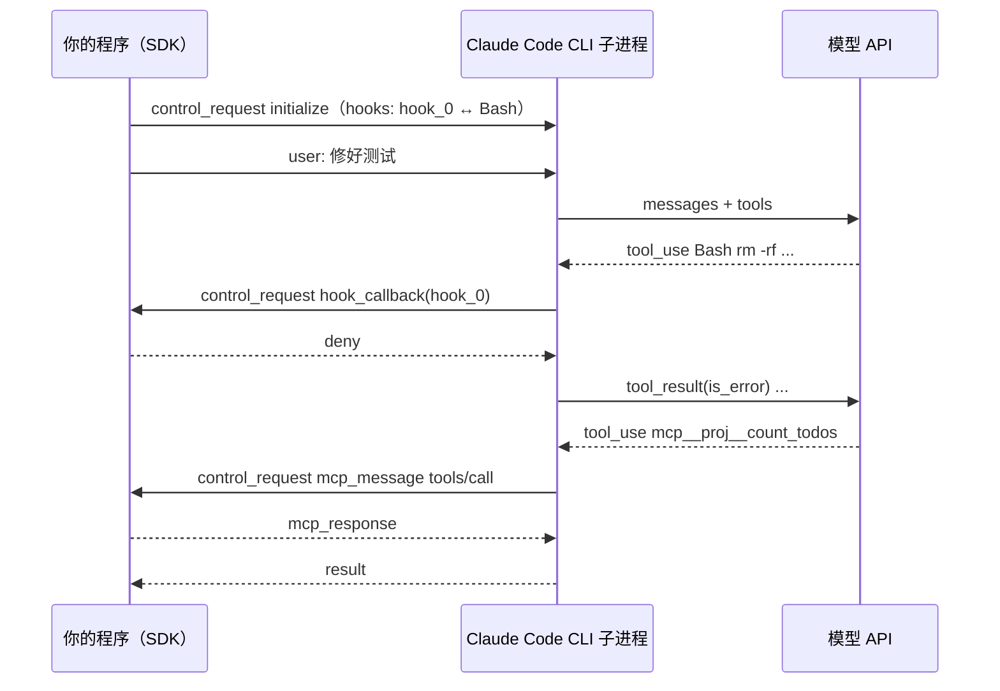

# 用 Agent SDK 简化开发

> 对应原站：[用 Agent SDK 简化开发](https://labuladong.online/zh/ai-coding/basics/agent-sdk/)（会员内容；本章为独立原创重写）

> **一句话结论**：Claude Agent SDK（Python 包 `claude-agent-sdk`）就是**把 Claude Code 当成一个库来调**：它在子进程里启动 Claude Code CLI，用 stdin/stdout 上一行一个 JSON 跟它对话。循环、内置工具、上下文管理全部白送；你只写 prompt、options，以及想插进去的 hook 和自定义工具。

第 2 章我们手写了 ~120 行的 Coding Agent。真要拿去用，你很快会想要：精确编辑而不是整文件覆盖、权限审批、上下文快满时自动压缩、subagent、MCP……这些 Claude Code 全都有。

你可能会问：能不能直接把 Claude Code 的这套能力搬进我自己的程序？

能，这就是 Claude Agent SDK。先说清它和另一个容易混的东西的区别：

- **Anthropic SDK**（`anthropic` 包）的 Tool Runner：只帮你跑「请求 → 执行你定义的工具 → 再请求」的循环，**没有任何内置工具**。
- **Claude Agent SDK**（`claude-agent-sdk` 包）：完整的 Claude Code，自带 Read / Write / Edit / Bash / Grep / WebSearch 等工具、hooks、subagent、权限、会话。

两者都只给 harness（循环 + 上下文管理），都要你自己部署。本章讲后者。

## 先跑起来看看

我在 `code/agent` 里装了包（`uv add claude-agent-sdk`，装上的是 0.2.170，自带一个 `claude` 可执行文件，`_cli_version.py` 里写的版本是 2.1.306，和本机 `claude --version` 一致）。Node 版在 `code/agent-node` 里装的是 npm 包 `@anthropic-ai/claude-agent-sdk` 0.3.308，`claude` 可执行文件放在按平台拆出的可选依赖里（本机是 `@anthropic-ai/claude-agent-sdk-darwin-arm64`，`manifest.json` 里写的 CLI 版本是 2.1.308）。

代码在 [`code/agent-node/agent_sdk/sdk_agent.ts`](../code/agent-node/agent_sdk/sdk_agent.ts)（Python 版 [`sdk_agent.py`](../code/agent/agent_sdk/sdk_agent.py)）。真实运行会启动 Claude Code 并调用模型；本教程不发真实请求，所以我写了一个**假的 CLI 传输层** [`fake_cli.ts`](../code/agent-node/agent_sdk/fake_cli.ts)（[`fake_cli.py`](../code/agent/agent_sdk/fake_cli.py)），让真实的 `query()` 对着它跑。Python SDK 可以直接传一个 Transport 对象顶替子进程；Node SDK 没有公开这个参数，所以 Node 版的假 CLI 是一个真的子进程：`options.pathToClaudeCodeExecutable` 指向 `fake_cli.ts`，SDK 就会用 `node fake_cli.ts --output-format stream-json ...` 启动它：

=== "Node"

    ```text
    $ node agent_sdk/demo.ts                 # 真实 SDK + 假 CLI（脚本回放，不调用模型，不执行内置工具）
    ⏺ Bash({"command":"rm -rf build && python test_calc.py"})
      ✘ 禁止执行危险命令：rm -rf build && python test_calc.py
    ⏺ Bash({"command":"python test_calc.py"})
      ✔ AssertionError: -1
    ⏺ mcp__proj__count_todos({"glob":"*.md"})
      ✔ *.md 中共有 0 个 TODO
    ⏺ 危险命令被 hook 拦下后，我改用了安全命令；测试失败原因已定位。
    ■ result: turns=4 cost=$0 stop=end_turn
    ```

=== "Python"

    ```text
    $ uv run python -m agent_sdk.demo        # 真实 SDK + 假 CLI（脚本回放，不调用模型，不执行内置工具）
    ⏺ Bash({'command': 'rm -rf build && python test_calc.py'})
      ✘ 禁止执行危险命令：rm -rf build && python test_calc.py
    ⏺ Bash({'command': 'python test_calc.py'})
      ✔ AssertionError: -1
    ⏺ mcp__proj__count_todos({'glob': '*.md'})
      ✔ *.md 中共有 0 个 TODO
    ⏺ 危险命令被 hook 拦下后，我改用了安全命令；测试失败原因已定位。
    ■ result: turns=4 cost=$0.0 stop=end_turn
    ```

三件事是真的在 SDK 里发生的：第一条 Bash 被**我们写的 hook 函数** 拒绝了；`count_todos` 这个**自定义工具**真的在本进程里执行了（`*.md` 下确实没有 TODO）；最后拿到了一个 `ResultMessage`（Node 版是 `type: "result"` 的 `SDKResultMessage`）。假的只有「模型的决定」和「第二条 Bash 的输出」。

## 你要写的只剩三块

=== "Node"

    ```ts
    const countTodos = tool("count_todos", "统计项目里 TODO 注释的数量", { glob: z.string() }, async (args) => {
      const n = globSync(args.glob)
        .filter((p) => statSync(p).isFile())
        .reduce((sum, p) => sum + readFileSync(p, "utf8").split("TODO").length - 1, 0);
      return { content: [{ type: "text", text: `${args.glob} 中共有 ${n} 个 TODO` }] };
    });

    const TOOLS_SERVER = createSdkMcpServer({ name: "proj", version: "1.0.0", tools: [countTodos] });

    const blockDangerous: HookCallback = async (input) => {
      if (input.hook_event_name !== "PreToolUse") return {};
      const cmd = String((input.tool_input as { command?: string }).command ?? "");
      if (DANGEROUS.some((d) => cmd.includes(d))) {
        return { hookSpecificOutput: {
          hookEventName: input.hook_event_name,
          permissionDecision: "deny",
          permissionDecisionReason: `禁止执行危险命令：${cmd}`,
        } };
      }
      return {};
    };

    function makeOptions(cwd: string): Options {
      return {
        model: "claude-opus-5-5",
        cwd,
        systemPrompt: { type: "preset", preset: "claude_code", append: "改完代码必须跑测试验证。" },
        allowedTools: ["Read", "Edit", "Write", "Bash", "mcp__proj__count_todos"],
        permissionMode: "acceptEdits",
        mcpServers: { proj: TOOLS_SERVER },
        hooks: { PreToolUse: [{ matcher: "Bash", hooks: [blockDangerous] }] },
        maxTurns: 20,
      };
    }

    for await (const msg of query({ prompt, options: makeOptions(cwd) })) {
      // msg.type: "assistant" / "user" / "result" ...
    }
    ```

=== "Python"

    ```python
    @tool("count_todos", "统计项目里 TODO 注释的数量", {"glob": str})
    async def count_todos(args):
        n = sum(p.read_text(errors="ignore").count("TODO") for p in Path(".").glob(args["glob"]) if p.is_file())
        return {"content": [{"type": "text", "text": f"{args['glob']} 中共有 {n} 个 TODO"}]}

    TOOLS_SERVER = create_sdk_mcp_server(name="proj", version="1.0.0", tools=[count_todos])

    async def block_dangerous(input_data, tool_use_id, context):
        cmd = input_data["tool_input"].get("command", "")
        if any(d in cmd for d in DANGEROUS):
            return {"hookSpecificOutput": {
                "hookEventName": input_data["hook_event_name"],
                "permissionDecision": "deny",
                "permissionDecisionReason": f"禁止执行危险命令：{cmd}",
            }}
        return {}

    def make_options(cwd):
        return ClaudeAgentOptions(
            model="claude-opus-5-5",
            cwd=str(cwd),
            system_prompt={"type": "preset", "preset": "claude_code", "append": "改完代码必须跑测试验证。"},
            allowed_tools=["Read", "Edit", "Write", "Bash", "mcp__proj__count_todos"],
            permission_mode="acceptEdits",
            mcp_servers={"proj": TOOLS_SERVER},
            hooks={"PreToolUse": [HookMatcher(matcher="Bash", hooks=[block_dangerous])]},
            max_turns=20,
        )

    async for msg in query(prompt=prompt, options=make_options(cwd)):
        ...  # AssistantMessage / UserMessage / ResultMessage
    ```

对照第 2 章，消失的是：`while` 循环、`tools` 的 JSON Schema、工具执行、`tool_result` 拼装、路径校验、输出截断。剩下的三块：

1. **工具**：`@tool` 装饰器 + `create_sdk_mcp_server`（Node 版是 `tool()` 函数 + zod 参数表 + `createSdkMcpServer`）。注意它叫 MCP server，但不是另起进程，是**进程内**的。工具名按 `mcp__<server>__<tool>` 命名，所以是 `mcp__proj__count_todos`。
2. **Hook**：回调签名 `(input_data, tool_use_id, context)`（Node 版 `(input, toolUseID, { signal })`），返回值和 Claude Code 的 shell hook 输出格式完全一样，`permissionDecision: "deny"` 就能拦截。
3. **Options**（Node 版字段是 camelCase：`systemPrompt`、`allowedTools`、`disallowedTools`）：`system_prompt` 用 `{"type": "preset", "preset": "claude_code", "append": ...}` 是在 Claude Code 自带的 system prompt 后面追加；直接传字符串则是完全替换。`allowed_tools` 是「免审批」列表，**不是**「只能用这些」，要禁用工具得用 `disallowed_tools`。

以上 API 都按官方 Python SDK 参考和 hooks 文档核对过（链接见文末）；Node 版按 npm 包里的 `sdk.d.ts` 类型核对。

## SDK 和 CLI 之间到底在传什么

你可能会问：hook 是我在 Python / Node 里写的函数，可 Bash 是 CLI 子进程执行的，CLI 怎么回调到我的函数？

看一下线上的原始消息（`--wire`，下面是 demo 的真实输出，长消息被截断）：

=== "Node"

    ```text
    $ node agent_sdk/demo.ts --wire
    ...
    SDK→CLI  control_request initialize  hooks={"PreToolUse":[{"matcher":"Bash","hookCallbackIds":["hook_0"]}]}
    CLI→SDK  control_response 1d1d01rcj3m  {}
    SDK→CLI  user  [{"type":"text","text":"test_calc.py 挂了，帮我修好"}]
    CLI→SDK  system init
    CLI→SDK  assistant  [{"type":"tool_use","id":"toolu_00","name":"Bash","input":{"command":"rm -rf bui
    CLI→SDK  control_request hook_callback  hook_0 Bash {"command":"rm -rf build && python test_calc.py"}
    SDK→CLI  control_response cli_req_1  {"hookSpecificOutput":{"hookEventName":"PreToolUse","permissionDecision":"deny",
    CLI→SDK  user  [{"type":"tool_result","tool_use_id":"toolu_00","content":"禁止执行危险命令：rm -rf build
    ...
    CLI→SDK  control_request mcp_message  proj initialize id=1
    SDK→CLI  control_response cli_req_3  {"mcp_response":{"result":{"protocolVersion":"2025-11-25","capabilities":{"tools
    CLI→SDK  control_request mcp_message  proj notifications/initialized id=null
    SDK→CLI  control_response cli_req_4  {"mcp_response":{"jsonrpc":"2.0","result":{},"id":0}}
    CLI→SDK  control_request mcp_message  proj tools/call id=3
    SDK→CLI  control_response cli_req_5  {"mcp_response":{"result":{"content":[{"type":"text","text":"*.md 中共有 0 个 TODO"}
    ...
    CLI→SDK  result success
    ```

=== "Python"

    ```text
    $ uv run python -m agent_sdk.demo --wire
    ...
    SDK→CLI  control_request initialize  hooks={"PreToolUse": [{"matcher": "Bash", "hookCallbackIds": ["hook_0"]}]}
    CLI→SDK  control_response req_1_cb2b9492  {}
    SDK→CLI  user  "test_calc.py 挂了，帮我修好"
    CLI→SDK  system init
    CLI→SDK  assistant  [{"type": "tool_use", "id": "toolu_00", "name": "Bash", "input": {"command": "rm
    CLI→SDK  control_request hook_callback  hook_0 Bash {'command': 'rm -rf build && python test_calc.py'}
    SDK→CLI  control_response cli_req_1  {"hookSpecificOutput": {"hookEventName": "PreToolUse", "permissionDecision": "de
    CLI→SDK  user  [{"type": "tool_result", "tool_use_id": "toolu_00", "content": "禁止执行危险命令：rm -rf 
    ...
    CLI→SDK  control_request mcp_message  proj initialize id=1
    SDK→CLI  control_response cli_req_3  {"mcp_response": {"jsonrpc": "2.0", "id": 1, "result": {"capabilities": {"tools"
    CLI→SDK  control_request mcp_message  proj notifications/initialized id=None
    SDK→CLI  control_response cli_req_4  {"mcp_response": {"jsonrpc": "2.0", "result": {}}}
    CLI→SDK  control_request mcp_message  proj tools/call id=3
    SDK→CLI  control_response cli_req_5  {"mcp_response": {"jsonrpc": "2.0", "id": 3, "result": {"content": [{"text": "*.
    ...
    CLI→SDK  result success
    ```



真相很朴素：

- 初始化时，SDK 把每个 hook 函数编号（`hook_0`），只把**编号和 matcher** 告诉 CLI。函数本身留在你的进程里。
- CLI 执行 Bash 前，发一条 `control_request hook_callback` 反向问 SDK：「`hook_0` 对这个调用怎么看？」SDK 调用你的函数，把返回值包成 `control_response` 回去。
- 进程内 MCP 工具同理：CLI 把一条标准的 MCP JSON-RPC（先 `initialize`、`notifications/initialized`，再 `tools/call`）包在 `control_request mcp_message` 里发给 SDK。这和第 11 章手写的 MCP 报文是同一套。

SDK 侧的这些行为来自 `claude_agent_sdk/_internal/query.py` 源码，是真实执行的；CLI 侧的消息是我的假 CLI 按 SDK 源码里的解析逻辑构造的（**推测**：真实 CLI 发出的 `hook_callback.input` 字段可能比我构造的更多，比如 `permission_mode`，但 SDK 解析用到的字段已对齐）。SDK 启动真实 CLI 时用的参数可以在 `subprocess_cli.py` 里看到：`--output-format stream-json --verbose ... --input-format stream-json`。Node 版 SDK 侧的逻辑在打包后的 `sdk.mjs` 里，假 CLI 实测收到的参数是 `--output-format stream-json --verbose --input-format stream-json --model=claude-opus-5-5`（外加我们的 options 对应的参数）；还有一处差别：Node SDK 发出的 user 消息 content 是 `[{type: "text", ...}]` 数组，Python SDK 发的是字符串。

一个类比：SDK 像一个遥控器，CLI 是电视。你按「换台」，遥控器发红外信号，电视自己换。hook 则是电视在播某些节目前，反过来问遥控器「家长锁允许吗」。

这个类比不成立的地方是：真电视不会反过来问遥控器。正是这条**双向**通道，让你的进程既能下指令，又能在 CLI 的每个关键节点插手。说穿了，Agent SDK 就是「起一个子进程，按行收发 JSON」。

=== "Node"

    ```text
    $ node --test agent_sdk/*.test.ts
    ✔ hook 拦下危险的 Bash 命令
    ✔ SDK MCP 工具在进程内被调用
    ✔ options 的形状
    ✔ result 消息
    ℹ pass 4
    ```

=== "Python"

    ```text
    $ uv run pytest -q agent_sdk
    ....                                                                     [100%]
    4 passed in 0.30s
    ```

**回到主线**：Agent SDK 没有发明新能力，它把 Claude Code 这套「在有限上下文里跑好循环」的工程（压缩、工具结果截断、subagent 隔离上下文、权限）整包借给你。你省掉的是自己重写这些上下文管理代码的成本。

## 对照你的环境

- 本章的 `block_dangerous` 和你 `~/.claude/settings.json` 里的 PreToolUse hook `enforce-worktree.py`（matcher `Bash`）是同一个机制的两种写法：shell hook 读 stdin JSON、写 stdout JSON；SDK hook 是 Python 函数收 dict、回 dict。返回格式一模一样。
- 官方 hooks 文档的事件表里，Python SDK **不支持** `SessionStart` / `SessionEnd` 回调（TypeScript SDK 支持）。所以如果你想在 SDK 程序里复用 `inject-guardrails.sh` 这种 SessionStart 注入，要走 `setting_sources=["project"]` 加载 settings 里的 shell hook，而不是写 Python 回调。
- 你的 `codex-review` 后台单臂、`claude --bg`，如果哪天想用 Python 编排多个 Claude Code 实例，Agent SDK 的 `ClaudeSDKClient`（支持多轮、`interrupt()`）就是入口。

## 常见坑

1. **把 `allowed_tools` 当白名单**。它只是「这些工具不用问我」，模型仍能看到并请求其他工具。真要禁用，用 `disallowed_tools`。
2. **自定义工具名写错前缀**。进程内 MCP 工具在 `allowed_tools` 和 hook matcher 里都要写成 `mcp__<server key>__<tool>`，server key 是 `mcp_servers` 字典的键。
3. **以为 SDK 不需要 Claude Code**。它的底层就是 CLI 子进程，pip 包里自带了一个 200MB+ 的 `claude` 二进制（本机 `_bundled/claude` 约 273MB）。
4. **在 `receive_response()` 里 `break`**。官方文档提醒这可能导致 asyncio 清理问题，用标志位让循环自然结束。
5. **`system_prompt` 传字符串**。那会完全替换 Claude Code 的 system prompt，内置工具的使用说明也一起没了。想保留就用 preset + append。

## 练习

1. 给 options 加一个 `PostToolUse` hook，把每次工具调用的名字和耗时追加到一个列表里，在 `ResultMessage` 到来时打印。用假 CLI 验证（提示：`fake_cli.ts`（Python 版 `fake_cli.py`）目前只发 PreToolUse，你需要让它也发 PostToolUse）。
2. 用 `ClaudeSDKClient`（Node 版没有这个类，给 `query()` 的 `prompt` 传一个 `AsyncIterable` 消息流即可多轮）改写 `run()`，实现两轮对话：第一轮修 bug，第二轮「把刚才的修改写进 CHANGELOG」。
3. 开放题：你的 `enforce-worktree.py` 如果改写成 SDK 里的 Python hook，好处和坏处各是什么？什么情况下你会选 SDK hook 而不是 settings 里的 shell hook？

## 延伸阅读

- Agent SDK TypeScript 参考：<https://code.claude.com/docs/en/agent-sdk/typescript>
- Agent SDK Python 参考：<https://code.claude.com/docs/en/agent-sdk/python>
- Agent SDK hooks：<https://code.claude.com/docs/en/agent-sdk/hooks>
- 源码：`code/agent-node/node_modules/@anthropic-ai/claude-agent-sdk/sdk.d.ts`（Node 版类型，`pathToClaudeCodeExecutable` / `spawnClaudeCodeProcess` 都在这里）；`code/agent/.venv/lib/python3.12/site-packages/claude_agent_sdk/_internal/query.py`（control protocol）、`transport/subprocess_cli.py`（CLI 启动参数）
- 本库：[Hooks](../p1-tools/08-hooks.md) · 第 2 章 [手写 Coding Agent](./02-coding-agent.md) · 下一章 [其他主流 Agent SDK 对比](./07-agent-sdk-comparison.md)

回到开头的问题：能把 Claude Code 搬进自己的程序吗？能，而且搬法很朴素：起一个子进程，按行收发 JSON，再留一个反向通道让它回调你的 hook 和工具。
