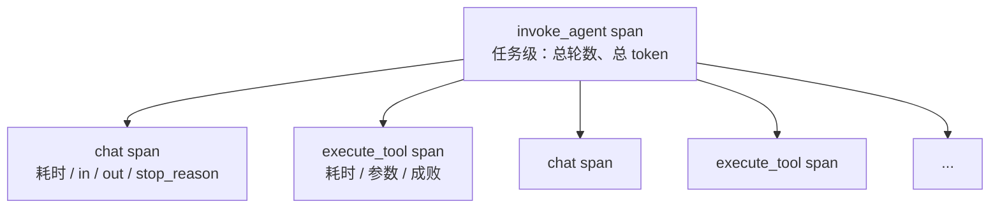

# 给 Agent 加上可观测性

> 对应原站：[给 Agent 加上可观测性](https://labuladong.online/zh/ai-coding/basics/agent-observability/)（会员内容；本章为独立原创重写）

> **一句话结论**：Agent 的可观测性（observability）就是给循环里的每一次「问模型」和每一次「跑工具」各套一个 span，记下耗时、token、参数和成败，再按父子关系挂到一个 trace 下。不改 agent 一行代码，包两层就够；导出成 OpenTelemetry 格式，任何后端都能看。

你一定遇到过这种情况：Claude Code 跑了三分钟，最后告诉你「完成了」。你想知道：这三分钟花在哪了？是模型在想，还是某个命令卡住了？这次为什么比上次贵一倍？

第 6 章的 SDK 把循环藏进了子进程，第 2 章的手写 Agent 只打印了几行 `⏺`。两者都回答不了这些问题。

你可能会问：多打点日志不就行了？

日志能告诉你「发生了什么」，但很难告诉你「谁是谁的一部分」。一次 Agent 运行里有 6 次模型调用、5 次工具调用，它们嵌套、交错。你要的不是一堆平铺的时间戳，而是一棵树：根是这次任务，叶子是每一步，每个节点上挂着耗时和成本。这棵树在工程上叫 trace，节点叫 span。

## 先跑起来看看

代码在 [`code/agent/observability/tracer.py`](../code/agent/observability/tracer.py)。它给第 2 章的 `run_agent` 套上 trace，fake 模型每次调用 sleep 80ms 模拟网络耗时，并且脚本让 `input_tokens` 逐轮增长，模拟真实的上下文膨胀：

```text
$ uv run python -m observability.tracer      # 离线 fake 模型；耗时是真实测量的，token 数是脚本预设的
invoke_agent coding_agent            553.8 ms  turns=6 total_in=6660 total_out=238
  chat claude-opus-5-5                85.5 ms  in=820 out=45 stop=tool_use
  execute_tool run_command            21.5 ms  ok
  chat claude-opus-5-5                86.1 ms  in=1010 out=30 stop=tool_use
  execute_tool read_file               0.3 ms  ok
  chat claude-opus-5-5                85.2 ms  in=1090 out=28 stop=tool_use
  execute_tool read_file               0.1 ms  ERROR FileNotFoundError: [Errno 2] No such fil…
  chat claude-opus-5-5                85.2 ms  in=1160 out=60 stop=tool_use
  execute_tool write_file              0.4 ms  ok
  chat claude-opus-5-5                82.1 ms  in=1250 out=40 stop=tool_use
  execute_tool run_command            21.4 ms  ok
  chat claude-opus-5-5                85.4 ms  in=1330 out=35 stop=end_turn

已写出 trace.json（12 个 span）。其中第一个 chat span：
{
  "traceId": "9ce05b5ce5475817796b3e5892becee6",
  "spanId": "17a41ba4eef52214",
  "name": "chat claude-opus-5-5",
  "kind": 3,
  "startTimeUnixNano": "1792582783962214000",
  "endTimeUnixNano": "1792582784047759000",
  "status": {
    "code": 1
  },
  "parentSpanId": "6f3d8ab1ff133916",
  "attributes(展平显示)": {
    "gen_ai.operation.name": "chat",
    "gen_ai.provider.name": "anthropic",
    "gen_ai.request.model": "claude-opus-5-5",
    "gen_ai.request.max_tokens": "16000",
    "agent.turn": "1",
    "agent.request.messages": "1",
    "gen_ai.response.id": "msg_fake_001",
    ...
```

一眼能读出三件事：

1. **时间几乎全花在模型上**。6 次 chat 约 510ms，工具加起来不到 45ms。真实场景里比例往往也是这样，除非某个工具在跑测试套件。
2. **输入 token 在单调上涨**：820 → 1330。每一轮都在重发越来越长的历史。总输入 6660，是单次的 8 倍。这就是第 1 章说的「N 轮对话成本接近 N²」在 trace 里的样子。
3. **第三次工具调用失败了**，但 Agent 没崩，下一轮模型拿到错误后继续推进。没有 trace，这次失败只会淹没在日志里。

## 两层包装



关键是**不改 agent 代码**。第 2 章的 `run_agent` 接受一个 `client` 和一个 `tools` 字典，我们就各包一层：

```python
class TracedClient:
    """包住任意有 .messages.create 的 client（真的 anthropic.Anthropic 或 FakeAnthropic）。"""
    def create(self, **kw):
        with self.tracer.span(f"chat {kw['model']}", kind=3, **{
            "gen_ai.operation.name": "chat",
            "gen_ai.request.model": kw["model"],
            "agent.request.messages": len(kw["messages"]),   # 上下文在膨胀：每轮多 2 条
        }) as s:
            resp = self.inner.messages.create(**kw)
            s.attrs.update({
                "gen_ai.response.finish_reasons": [resp.stop_reason],
                "gen_ai.usage.input_tokens": resp.usage.input_tokens,
                "gen_ai.usage.output_tokens": resp.usage.output_tokens,
            })
            return resp

def traced_tools(tools, tracer, client):
    def wrap(name, fn):
        def inner(**kwargs):
            with tracer.span(f"execute_tool {name}", **{"gen_ai.tool.name": name, ...}) as s:
                return fn(**kwargs)
        return inner
    return {n: wrap(n, f) for n, f in tools.items()}
```

你可能会问：父子关系是怎么串起来的？我没往函数里传任何 span。

靠 `contextvars`。`tracer.span()` 进入时把自己设成「当前 span」，退出时恢复。嵌套在里面创建的 span 自动以它为父。这和 React 的 Context 是同一个思路：不用一层层传 props，往上找最近的 Provider。

一个类比：trace 像快递的物流轨迹。整单是一个 trace，每个中转站是一个 span，每个 span 记着到站和离站时间。你看一眼就知道包裹卡在了哪个中转站。

类比不成立的地方：快递是串行的，一个站接一个站；Agent 的 span 可能并行（一轮里多个 `tool_use` 可以同时执行），也可能嵌套（subagent 里又有自己的一整棵子树）。所以 trace 是树，不是链。

还有一个小技巧：工具 span 上挂了 `gen_ai.tool.call.id`，值就是模型返回的 `tool_use.id`。`TracedClient` 在拿到响应时把每个 `tool_use.id` 按工具名排进队列，工具 wrapper 执行时取出来。这样在后端里能把「模型请求了这个调用」和「这个调用实际跑了多久」对上。

## 为什么用 OpenTelemetry 的格式

`tracer.to_otlp()` 输出的是 OTLP/JSON，也就是 OpenTelemetry 协议的线上格式：`resourceSpans → scopeSpans → spans`，ID 是 32/16 位十六进制，时间是纳秒字符串，属性是 `{key, value: {stringValue | intValue | ...}}`。

属性名用的是 OpenTelemetry 的 GenAI 语义约定（`gen_ai.*`）。Anthropic SDK 自带的 OpenTelemetry 支持（目前是 beta，通过 `Anthropic(open_telemetry=...)` 配置，会产出名为 `anthropic.messages.create` 的 span）也遵循这套约定。所以我们手写的 span 和官方 SDK 的 span 放进同一个后端，字段是对得上的。

用标准格式的好处是：你不用自己写可视化。本地起一个支持 OTLP 的后端（比如 Jaeger），把 `trace.json` POST 到它的 OTLP/HTTP 端点（惯例是 `http://localhost:4318/v1/traces`，`Content-Type: application/json`），就能看到瀑布图。我没有在本机起 Jaeger 验证这一步，这里是按 OTLP 规范的推断（**推测**）。

```text
$ uv run pytest -q observability
.                                                                        [100%]
1 passed in 0.37s
```

测试断言了：span 名字和顺序、所有子 span 的父都是根、根上的 token 合计、失败的工具 span `status.code == 2`、ID 长度合法。

**回到主线**：可观测性不改变上下文本身，但它让「上下文的成本」变得可见。`agent.request.messages` 和 `gen_ai.usage.input_tokens` 这两条曲线，就是你决定什么时候该压缩、该开 subagent、该截断工具输出的依据。

## 对照你的环境

- Claude Code 自己支持 OpenTelemetry：设 `CLAUDE_CODE_ENABLE_TELEMETRY=1`，再配 `OTEL_METRICS_EXPORTER` / `OTEL_LOGS_EXPORTER`，就会导出 `claude_code.token.usage`、`claude_code.cost.usage` 等指标和 `claude_code.api_request`、`claude_code.tool_result` 等事件；trace 导出是 beta，还需要 `CLAUDE_CODE_ENHANCED_TELEMETRY_BETA=1`（见官方 Monitoring 文档）。你在 webapp 里接过 Datadog，Datadog 能收 OTLP，所以理论上能把你自己的 Claude Code 用量也接进去。
- 不配任何东西，你也有一份「穷人版 trace」：`~/.claude/projects/*/*.jsonl` 里每条 assistant 消息都带 `message.usage`（我在本机看到的字段有 `input_tokens`、`cache_read_input_tokens`、`cache_creation_input_tokens`、`output_tokens`、`output_tokens_details.thinking_tokens`），还有 `timestamp` 和 `parentUuid`。按 `parentUuid` 串起来，就是一棵粗糙的 span 树。
- 你的 `session-audit` skill 做的就是事后读这些 jsonl。和本章的区别是：trace 是运行时埋点，jsonl 是事后回放。

## 常见坑

1. **只记 token 不记缓存**。真实响应里 `input_tokens` 不含缓存读写；成本分析要把 `cache_read_input_tokens` 和 `cache_creation_input_tokens` 一起看。注意 OpenTelemetry 的 `gen_ai.usage.input_tokens` 按约定是**包含**缓存的，和 API 响应的口径不同，两边对账时别加重了。
2. **把完整 prompt 记进 span**。prompt 里可能有用户数据和密钥，后端的保留策略未必合规。默认只记元数据，需要内容时显式开启。
3. **工具异常被吞掉，span 却标成功**。我们的 span 在 `with` 里捕获异常、记下 `error` 再抛出，`run_agent` 外层再把它转成 `is_error` 结果。顺序反了，span 就看不到失败。
4. **一个任务开多个 trace**。不同步骤用了不同的 trace_id，后端里就是一堆孤立的点，拼不成树。

## 练习

1. 给 `invoke_agent` 根 span 加一个 `agent.estimated_cost_usd` 属性，按 Opus 5.5 的 $4 / $20 每百万 token 计算。
2. 把 `print_tree` 改成按耗时画一个 ASCII 瀑布图（每个 span 一行，用 `█` 的长度表示耗时、用缩进表示开始时间）。
3. 开放题：如果一轮里有 3 个工具并行执行，现在的 `traced_tools` 和 `pending_tool_ids` 队列还对吗？你会怎么改？如果再加上 subagent，trace 树应该长什么样？

## 延伸阅读

- OpenTelemetry GenAI 语义约定：<https://opentelemetry.io/docs/specs/semconv/gen-ai/>
- OTLP 规范（JSON 编码）：<https://opentelemetry.io/docs/specs/otlp/>
- Claude Code 监控：<https://code.claude.com/docs/en/monitoring-usage>
- 本库：[你的聊天记录存在哪](../p1-tools/07-session-storage.md) · 上一章 [其他主流 Agent SDK 对比](./07-agent-sdk-comparison.md) · 下一章 [流式响应](./09-streaming-response.md)

回到开头的问题：那三分钟花在哪了？打开 trace，按耗时排序，最长的那几个 span 就是答案。至于为什么贵了一倍，看根 span 下 `input_tokens` 那一列是不是一路涨上去的。
