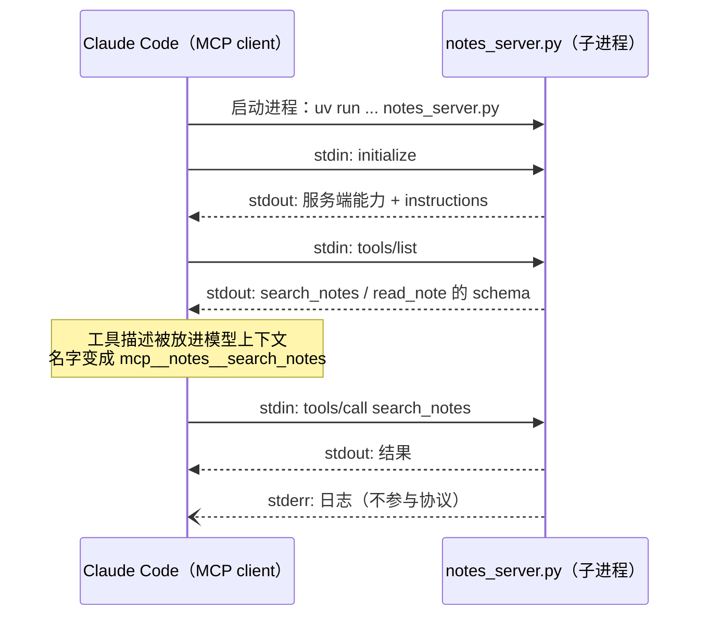

# 动手开发 MCP 工具

> 对应原站：[动手开发 MCP 工具](https://labuladong.online/zh/ai-coding/basics/mcp-tool/)（会员内容；本章为独立原创重写）

> **一句话结论**：MCP（Model Context Protocol）把「工具」做成一个独立进程或服务，任何支持 MCP 的 Agent 都能按同一套协议发现和调用它。用 Python `mcp` 包写一个 stdio server 只要几十行：函数签名就是工具的 schema，docstring 就是工具的说明（Node 版用 `@modelcontextprotocol/sdk`，schema 用 zod 写，说明写在 `description` 里）。只给自己用的小脚本不必上 MCP；要跨 Agent 复用、要分发给别人、要隔离凭证时，才值得。

你在 Claude Code 里用着 Linear、Notion、研发平台、chrome-devtools 四五个 MCP server。它们是别人写的，你只敲了一行 `claude mcp add`。

你可能会问：第 2 章我们给 Agent 加工具，就是一段 JSON Schema 加一个 Python 函数，十几行的事。为什么还要搞一个「协议」？

因为第 2 章的工具**焊死在那个 Agent 里**。你想让 Claude Code、Codex、你自己的 Agent 都能用同一个「查我笔记」的工具，就得写三遍，还得各自处理鉴权。MCP 的思路是：工具单独跑成一个服务，Agent 通过标准协议去问「你有哪些工具」「帮我调一下这个」。写一次，到处用。

## 什么时候值得用 MCP

先泼一盆冷水。如果你只是想让 Claude Code 在本地跑个查询，**直接写个脚本让它用 Bash 调**通常更简单：没有协议、没有进程管理，出了问题直接看脚本输出。你 `~/.claude/bin/` 下那些 `linear-status.py` 一类的脚本，看起来走的就是这个路子。

MCP 值得的场景：

- **多个 Agent 要用同一组工具**：Claude Code、Claude Desktop、Agent SDK 程序都能直接挂。
- **工具要分发给别人**：同事 `claude mcp add` 一下就能用，不用读你的脚本说明。
- **涉及凭证**：Token 留在 MCP server 进程里，Agent 只看到工具结果，看不到密钥。这是我认为 MCP 最实在的价值。
- **工具需要被动态发现**：Agent 连上后用 `tools/list` 拉清单，server 升级加了工具，Agent 不用改代码。

## 先跑起来看看

我们写一个查本地 markdown 笔记的 server：[`code/agent-node/mcp_tool/notes_server.ts`](../code/agent-node/mcp_tool/notes_server.ts)（Python 版 [`notes_server.py`](../code/agent/mcp_tool/notes_server.py)），两个工具 `search_notes` 和 `read_note`。示例笔记在 [`mcp_tool/sample_notes/`](../code/agent/mcp_tool/sample_notes/)，两版共用。

用官方 MCP 客户端（[`client_demo.ts`](../code/agent-node/mcp_tool/client_demo.ts)，Python 版 [`client_demo.py`](../code/agent/mcp_tool/client_demo.py)）把它当子进程拉起来调一下（真实运行，本地 stdio，不涉及任何模型）：

=== "Node"

    ```text
    $ node mcp_tool/client_demo.ts
    已连接：notes 0.1.0，协议 2025-11-25
    - search_notes: 在笔记里按关键词搜索（大小写不敏感，空格分隔的多个词需同时出…  参数=["query","limit"]
    - read_note: 读取一篇笔记的全文。path 是 search_notes …  参数=["path"]
    [notes] search "nginx" → 1 hits
    search_notes(nginx) → {"result":[{"path":"sse-streaming.md","line":3,"text":"- Nginx 默认会缓冲响应，流式接口要加 `X-Accel-Buffering: no`"}]}
    read_note(越界) → isError = true | 只能读取笔记目录下的 .md 文件：../../../etc/passwd
    ```

=== "Python"

    ```text
    $ uv run python -m mcp_tool.client_demo
    [notes] search 'nginx' → 1 hits
    [10/21/26 19:41:18] INFO     Tool 'read_note' failed: 'Error       server.py:453
                                 executing tool read_note:
                                 只能读取笔记目录下的 .md
                                 文件：../../../etc/passwd'
    已连接：notes 0.1.0，协议 2025-11-25
    - search_notes: 在笔记里按关键词搜索（大小写不敏感，空格分隔的多个词需同时出…  参数=['query', 'limit']
    - read_note: 读取一篇笔记的全文。path 是 search_notes …  参数=['path']
    search_notes(nginx) → {'result': [{'path': 'sse-streaming.md', 'line': 3, 'text': '- Nginx 默认会缓冲响应，流式接口要加 `X-Accel-Buffering: no`'}]}
    read_note(越界) → is_error = True | Error executing tool read_note: 只能读取笔记目录下的 .md 文件：../../../etc/passwd
    ```

`[notes] search ...` 那行（Python 版还有 `INFO Tool 'read_note' failed` 那几行）是 server 的 **stderr**（日志），其余是客户端打印的。两者混在终端里，但走的是不同的管道，这一点下面会讲为什么重要。

## 一个 MCP server 的全部代码

本机装的是 `mcp` 2.3.0。注意它是 2.x 大版本：1.x 里常见的 `from mcp.server.fastmcp import FastMCP` 已经改名了，在 2.x 里 import 会直接报错并提示改成 `MCPServer`（我在 `mcp/server/fastmcp.py` 里看到了这条迁移提示）。网上很多教程还是 1.x 写法，照抄会踩坑。Node 版用的是 `@modelcontextprotocol/sdk` 1.32.1 的 `McpServer`：注册工具用 `registerTool(name, { description, inputSchema, outputSchema }, handler)`，旧教程里的 `server.tool(...)` 还能用，但类型声明里已经标了 `@deprecated`。

=== "Node"

    ```ts
    import { McpServer } from "@modelcontextprotocol/sdk/server/mcp.js";
    import { StdioServerTransport } from "@modelcontextprotocol/sdk/server/stdio.js";
    import { z } from "zod";

    const NOTES_DIR = resolve(expandUser(process.env.NOTES_DIR ?? join(import.meta.dirname, "..", "..", "agent", "mcp_tool", "sample_notes")));

    const mcp = new McpServer(
      { name: "notes", version: "0.1.0" },
      { instructions: "查询用户本地的 markdown 笔记。先用 search_notes 找到文件，再用 read_note 读全文。" },
    );

    const Hit = z.object({ path: z.string(), line: z.number().int(), text: z.string() });

    mcp.registerTool("search_notes", {
      description: "在笔记里按关键词搜索（大小写不敏感，空格分隔的多个词需同时出现在一行）。返回命中的文件、行号和该行内容。",
      inputSchema: { query: z.string(), limit: z.number().int().default(5) },
      outputSchema: { result: z.array(Hit) },
    }, ({ query, limit }) => {
      ...
      console.error(`[notes] search ${JSON.stringify(query)} → ${hits.length} hits`);  // 日志走 stderr
      const result = hits.slice(0, limit);
      return { content: [{ type: "text", text: JSON.stringify(result) }], structuredContent: { result } };
    });

    mcp.registerTool("read_note", {
      description: "读取一篇笔记的全文。path 是 search_notes 返回的相对路径。",
      inputSchema: { path: z.string() },
    }, ({ path }) => {
      const p = resolve(NOTES_DIR, path);
      const rel = relative(NOTES_DIR, p);
      if (rel.startsWith("..") || isAbsolute(rel) || extname(p) !== ".md") {
        throw new Error(`只能读取笔记目录下的 .md 文件：${path}`);
      }
      return { content: [{ type: "text", text: readFileSync(p, "utf8") }] };
    });

    if (import.meta.main) {
      await mcp.connect(new StdioServerTransport());  // 对应 Python 的 mcp.run()（默认 stdio）
    }
    ```

=== "Python"

    ```python
    from pydantic import BaseModel
    from mcp.server.mcpserver import MCPServer
    from mcp.server.mcpserver.exceptions import ToolError

    NOTES_DIR = Path(os.environ.get("NOTES_DIR", Path(__file__).parent / "sample_notes")).expanduser().resolve()

    mcp = MCPServer(
        name="notes",
        version="0.1.0",
        instructions="查询用户本地的 markdown 笔记。先用 search_notes 找到文件，再用 read_note 读全文。",
    )

    class Hit(BaseModel):
        path: str
        line: int
        text: str

    @mcp.tool()
    def search_notes(query: str, limit: int = 5) -> list[Hit]:
        """在笔记里按关键词搜索（大小写不敏感，空格分隔的多个词需同时出现在一行）。返回命中的文件、行号和该行内容。"""
        ...
        print(f"[notes] search {query!r} → {len(hits)} hits", file=sys.stderr)  # 日志走 stderr
        return hits[:limit]

    @mcp.tool()
    def read_note(path: str) -> str:
        """读取一篇笔记的全文。path 是 search_notes 返回的相对路径。"""
        p = (NOTES_DIR / path).resolve()
        if not p.is_relative_to(NOTES_DIR) or p.suffix != ".md":
            raise ToolError(f"只能读取笔记目录下的 .md 文件：{path}")
        return p.read_text()

    if __name__ == "__main__":
        mcp.run()  # 默认 transport="stdio"
    ```

对照第 2 章，你会发现 schema 不用手写了（下面三条说的是 Python 的写法；Node 版对应的是 zod 的 `inputSchema` / `description` 字段 / `outputSchema`，SDK 把 zod 转成 JSON Schema。区别是 Node 版的 `outputSchema` 必须是对象，所以我们手动包了一层 `{ result: [...] }`，和 Python SDK 自动包的那层对齐）：

- **函数签名 → `inputSchema`**。`query: str, limit: int = 5` 变成 `{"query": {"type": "string"}, "limit": {"type": "integer", "default": 5}}`，`required` 只有 `query`。
- **docstring → `description`**。这是写给模型看的，要说清楚「什么时候用、参数什么意思、返回什么」。
- **返回类型 → `outputSchema`**。返回 `list[Hit]`，SDK 会自动生成输出 schema，并在结果里同时给出 `structuredContent`（结构化数据）和 `content`（文本形式）。

三个 MCP 特有的细节：

1. **stdout 是协议通道，不许 print**。stdio 传输下，client 读 server 的 stdout，每行一条 JSON-RPC 消息。你 `print("debug")` 一下，client 就会收到一行非法 JSON。所以日志一律写 stderr，上面的 `[notes] search ...` 和 `INFO Tool 'read_note' failed` 都是 stderr。
2. **想让模型看到错误原因，抛 `ToolError`**（这一条是 Python SDK 的行为；Node 版 `McpServer` 不区分，任何异常的 `message` 都会原样包成 `isError` 结果，所以上面直接 `throw new Error(...)`，也更要注意别把内部细节写进错误消息）。我第一版用的是 `ValueError`，结果客户端只收到 `Error executing tool read_note`，原因被藏了起来。看 SDK 源码（`mcpserver/tools/base.py`）才知道：普通异常被当作「崩溃」，细节留在服务端日志；`ToolError` 被当作「工具主动报错」，消息原样回给模型。这是个合理的安全默认（防止堆栈泄露内部信息），但不知道的话会以为模型「看不懂错误」。
3. **工具错误不是协议错误**。越界读取返回的是一个正常的结果，只是 `isError: true`。模型能读到它、换个路径重试。第 11 章会看到原始报文。



一个类比：MCP server 像一个 USB 设备，MCP 协议是 USB 标准。插上之后，电脑先问「你是什么设备、支持什么功能」（initialize + tools/list），再按标准格式收发数据。鼠标厂商不用关心你用的是 Mac 还是 Windows。

这个类比不成立的地方：USB 设备的功能是给操作系统用的，MCP 工具的描述最终是**给模型读的**。工具描述写得含糊，就像 USB 设备报了一个错误的型号，系统能识别，但用起来处处不对。

## 在 Claude Code 里注册

=== "Node"

    ```bash
    claude mcp add notes -e NOTES_DIR=$HOME/notes -- \
      node /Users/me/agent-learn/code/agent-node/mcp_tool/notes_server.ts
    ```

=== "Python"

    ```bash
    claude mcp add notes -e NOTES_DIR=$HOME/notes -- \
      uv run --directory /Users/me/agent-learn/code/agent python mcp_tool/notes_server.py
    ```

`--` 之前是 `claude mcp add` 自己的选项（`-e` 设环境变量，`-s/--scope` 选 `local`（默认）/ `user` / `project`），之后是启动 server 的完整命令。Node 版直接 `node <绝对路径>`：Node 按文件所在位置往上找 `node_modules`，和 cwd 无关。Python 版的 `uv run --directory` 让 uv 用 `code/agent` 这个项目的虚拟环境，不管你在哪个目录启动 Claude Code。

我在一个临时目录里用 `--scope project` 实际注册了一次（这样只写当前目录的 `.mcp.json`，不碰你的全局配置），真实输出：

=== "Node"

    ```text
    $ claude mcp add notes --scope project -e NOTES_DIR=/Users/me/agent-learn/code/agent/mcp_tool/sample_notes -- node /Users/me/agent-learn/code/agent-node/mcp_tool/notes_server.ts
    Added stdio MCP server notes with command: node /Users/me/agent-learn/code/agent-node/mcp_tool/notes_server.ts to project config

    $ claude mcp get notes
    notes:
      Scope: Project config (shared via .mcp.json)
      Status: ⏸ Pending approval (run `claude` to approve)
      Type: stdio
      Command: node
      Args: /Users/me/agent-learn/code/agent-node/mcp_tool/notes_server.ts
      Environment:
        NOTES_DIR=/Users/me/agent-learn/code/agent/mcp_tool/sample_notes
    ```

=== "Python"

    ```text
    $ claude mcp add notes --scope project -e NOTES_DIR=/Users/me/agent-learn/code/agent/mcp_tool/sample_notes -- uv run --directory /Users/me/agent-learn/code/agent python mcp_tool/notes_server.py
    Added stdio MCP server notes with command: uv run --directory /Users/me/agent-learn/code/agent python mcp_tool/notes_server.py to project config

    $ claude mcp get notes
    notes:
      Scope: Project config (shared via .mcp.json)
      Status: ⏸ Pending approval (run `claude` to approve)
      Type: stdio
      Command: uv
      Args: run --directory /Users/me/agent-learn/code/agent python mcp_tool/notes_server.py
      Environment:
        NOTES_DIR=/Users/me/agent-learn/code/agent/mcp_tool/sample_notes
    ```

生成的 `.mcp.json` 是：

=== "Node"

    ```json
    {
      "mcpServers": {
        "notes": {
          "type": "stdio",
          "command": "node",
          "args": ["/Users/me/agent-learn/code/agent-node/mcp_tool/notes_server.ts"],
          "env": {"NOTES_DIR": "/Users/me/agent-learn/code/agent/mcp_tool/sample_notes"}
        }
      }
    }
    ```

=== "Python"

    ```json
    {
      "mcpServers": {
        "notes": {
          "type": "stdio",
          "command": "uv",
          "args": ["run", "--directory", "/Users/me/agent-learn/code/agent", "python", "mcp_tool/notes_server.py"],
          "env": {"NOTES_DIR": "/Users/me/agent-learn/code/agent/mcp_tool/sample_notes"}
        }
      }
    }
    ```

注意 `Pending approval`：project 级的 server 来自仓库里的文件，Claude Code 要你确认一次才会启动它，防止 clone 一个恶意仓库就自动跑了别人的进程。注册后在 Claude Code 里，工具名会是 `mcp__notes__search_notes`。

=== "Node"

    ```text
    $ node --test 'mcp_tool/*.test.ts'
    [notes] search "permissionDecision" → 1 hits
    ✔ 真实 stdio 子进程往返
    ℹ pass 1
    ```

=== "Python"

    ```text
    $ uv run pytest -q mcp_tool
    .                                                                        [100%]
    1 passed in 0.52s
    ```

**回到主线**：MCP 没有让模型多会什么，它解决的是「工具描述怎么进上下文」的标准化：连上时拉一次清单，工具的 name / description / inputSchema 就被放进模型的上下文。也正因如此，**每多挂一个 MCP server，每一轮请求都要为它的工具描述付 token**。挂得越多，上下文越挤。

## 对照你的环境

- 你 `~/.claude.json` 里的用户级 MCP：`linear`、`notion` 和团队的发布平台是 `type: http`（远程服务），`chrome-devtools` 是 `type: stdio`（`npx -y chrome-devtools-mcp@latest --browserUrl=http://127.0.0.1:9222`，本地子进程）。本章写的就是后一种。
- 你的 PreToolUse hook 用 `mcp__deploy__release|mcp__deploy__rollback|...` 这样的名字做 matcher，这些名字就是「`mcp__` + server 名 + `__` + 工具名」的规则。你注册了 `notes` 之后，同样可以写 `mcp__notes__read_note` 的 hook。
- 关于 token 成本：Claude Code 有工具搜索（tool search）机制，MCP 工具多了以后可以按需加载描述，而不是全部常驻（**推测**：本机没有专门验证当前版本在什么阈值下启用）。不管怎样，你在 CLAUDE.md 里那句「常驻层是稀缺资源」对 MCP 也成立。

## 常见坑

1. **在 stdio server 里 print 到 stdout**。协议流被污染，client 报解析错误，而且错误信息往往和真正原因毫不相关。
2. **照抄 mcp 1.x 的教程**。2.x 里 `FastMCP` 改名为 `MCPServer`，import 路径也变了。先看 `uv pip list | grep mcp` 的版本（Node 版看 `npm ls @modelcontextprotocol/sdk`）。
3. **用普通异常报业务错误**（Python）。模型只能看到「Error executing tool」，不知道该怎么改。用 `ToolError`。
4. **注册时用相对路径**。Claude Code 启动 server 的 cwd 不一定是你以为的目录，`uv run --directory <绝对路径>`（Node 版 `node <绝对路径>`）最稳。
5. **工具 description 写得像函数注释**。「搜索笔记」不够，要写清楚匹配规则、返回什么、和其他工具怎么配合（我们在 server 的 `instructions` 里写了「先 search 再 read」）。

## 练习

1. 加一个 `list_tags` 工具：扫描所有笔记里的 `#标签`，返回标签和出现次数。
2. 把 `NOTES_DIR` 指向你真实的笔记目录，用 `--scope user` 注册，在 Claude Code 里问「我记过哪些关于 SSE 的坑」，观察它调了哪些工具。
3. 开放题：如果这个 server 要给团队用、笔记放在 Notion 里、需要每个人用自己的 Notion token，你会选 stdio 还是 HTTP 传输？token 放在哪？

## 延伸阅读

- MCP 官方文档与规范：<https://modelcontextprotocol.io/>
- TypeScript SDK：<https://github.com/modelcontextprotocol/typescript-sdk>
- Python SDK：<https://github.com/modelcontextprotocol/python-sdk>（2.x 迁移指南：<https://py.sdk.modelcontextprotocol.io/v2/migration/>）
- Claude Code MCP：<https://code.claude.com/docs/en/mcp>
- 本库：第 6 章 [进程内 MCP 工具](./06-agent-sdk.md) · [给 Agent 注册 MCP server](../p4-mini-cc/15-mcp.md) · 下一章 [拆解 MCP 通信协议](./11-mcp-protocol.md)

回到开头的问题：既然加工具只要十几行，为什么还要 MCP？因为那十几行只属于一个 Agent。MCP 让同一个工具能被任何 Agent 发现和调用，还能把凭证关在 server 进程里。代价是多一个进程，以及每一轮都要为工具描述付的上下文。
