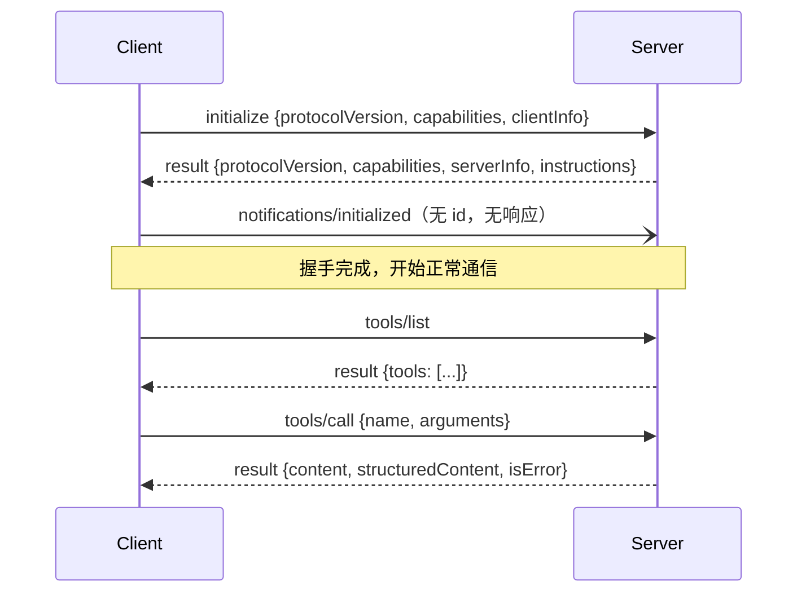

# 拆解 MCP 通信协议

> 对应原站：[拆解 MCP 通信协议](https://labuladong.online/zh/ai-coding/basics/mcp-protocol/)（会员内容；本章为独立原创重写）

> **一句话结论**：MCP 客户端和服务端之间传的全是 JSON-RPC 2.0 消息。stdio 传输下，一条消息就是一行 JSON。流程固定三步：`initialize` 握手交换版本和能力 → `notifications/initialized` 通知握手完成 → 之后用 `tools/list` 拉清单、`tools/call` 调工具。不用任何 MCP 库，几十行 Python 就能和一个 MCP server 对话。

上一章我们用官方库写了 server，也用官方库当 client 调通了。中间发生了什么，被库藏得严严实实。

你可能会问：我为什么要关心协议细节？库都帮我处理好了。

因为排查问题的时候你会需要它。比如你的 chrome-devtools MCP 突然在 Claude Code 里显示连接失败，是 server 没起来、握手版本不兼容、还是 server 往 stdout 打了一行日志？只看库的报错往往猜不出来，看一眼原始报文就清楚了。

这一章我们扔掉 MCP 库，直接 `subprocess.Popen` 起第 10 章的 server，手写每一条 JSON，把收发打印出来。

## 先跑起来看看

代码在 [`code/agent/mcp_protocol/raw_client.py`](../code/agent/mcp_protocol/raw_client.py)，下面是真实的完整输出（本地 stdio，不涉及任何模型；`→` 是我们发的，`←` 是 server 回的）：

```text
$ uv run python -m mcp_protocol.raw_client

## 1. initialize：客户端报协议版本和能力，服务端回它的版本、能力和简介
→ {"jsonrpc": "2.0", "id": 1, "method": "initialize", "params": {"protocolVersion": "2025-11-25", "capabilities": {}, "clientInfo": {"name": "raw-client", "version": "0.0.1"}}}
← {"jsonrpc":"2.0","id":1,"result":{"capabilities":{"prompts":{"listChanged":false},"resources":{"listChanged":false,"subscribe":false},"tools":{"listChanged":false}},"instructions":"查询用户本地的 markdown 笔记。先用 search_notes 找到文件，再用 read_note 读全文。","protocolVersion":"2025-11-25","serverInfo":{"name":"notes","version":"0.1.0"}}}

## 2. notifications/initialized：握手完成（通知，没有 id，也没有响应）
→ {"jsonrpc": "2.0", "method": "notifications/initialized"}

## 3. tools/list：动态拉取工具清单（含 JSON Schema）
→ {"jsonrpc": "2.0", "id": 2, "method": "tools/list"}
← {"jsonrpc":"2.0","id":2,"result":{"tools":[{"description":"在笔记里按关键词搜索（大小写不敏感，空格分隔的多个词需同时出现在一行）。返回命中的文件、行号和该行内容。","inputSchema":{"properties":{"query":{"title":"Query","type":"string"},"limit":{"default":5,"title":"Limit","type":"integer"}},"required":["query"],"type":"object","title":"search_notesArguments"},"name":"search_notes","outputSchema":{"properties":{"result":{"items":{"$ref":"#/$defs/Hit"},"title":"Result","type":"array"}},"required":["result"],"type":"object","$defs":{"Hit":{"properties":{"path":{"title":"Path","type":"string"},"line":{"title":"Line","type":"integer"},"text":{"title":"Text","type":"string"}},"required":["path","line","text"],"title":"Hit","type":"object"}},"title":"search_notesOutput"}},{"description":"读取一篇笔记的全文。path 是 search_notes 返回的相对路径。","inputSchema":{"properties":{"path":{"title":"Path","type":"string"}},"required":["path"],"type":"object","title":"read_noteArguments"},"name":"read_note","outputSchema":{"properties":{"result":{"title":"Result","type":"string"}},"required":["result"],"type":"object","title":"read_noteOutput"}}]}}

## 4. tools/call：调用工具
→ {"jsonrpc": "2.0", "id": 3, "method": "tools/call", "params": {"name": "search_notes", "arguments": {"query": "stop hook"}}}
← {"jsonrpc":"2.0","id":3,"result":{"content":[{"text":"{\n  \"path\": \"claude-hooks.md\",\n  \"line\": 5,\n  \"text\": \"- Stop hook 返回 decision: block 可以让 Claude 继续干活，注意别死循环\"\n}","type":"text"}],"isError":false,"structuredContent":{"result":[{"path":"claude-hooks.md","line":5,"text":"- Stop hook 返回 decision: block 可以让 Claude 继续干活，注意别死循环"}]}}}

## 5. 工具执行失败：不是 JSON-RPC error，而是 result.isError = true
→ {"jsonrpc": "2.0", "id": 4, "method": "tools/call", "params": {"name": "read_note", "arguments": {"path": "/etc/passwd"}}}
← {"jsonrpc":"2.0","id":4,"result":{"content":[{"text":"Error executing tool read_note: 只能读取笔记目录下的 .md 文件：/etc/passwd","type":"text"}],"isError":true}}

## 6. 协议层错误：调用不存在的方法 → JSON-RPC error 对象
→ {"jsonrpc": "2.0", "id": 5, "method": "resources/subscribe_everything"}
← {"jsonrpc":"2.0","id":5,"error":{"code":-32601,"message":"Method not found","data":"resources/subscribe_everything"}}

## 7. ping：保活
→ {"jsonrpc": "2.0", "id": 6, "method": "ping"}
← {"jsonrpc":"2.0","id":6,"result":{}}

## server 的 stderr（日志都在这里）
[notes] search 'stop hook' → 1 hits
[10/21/26 19:41:45] INFO     Tool 'read_note' failed: 'Error       server.py:453
                             executing tool read_note:
                             只能读取笔记目录下的 .md
                             文件：/etc/passwd'
```

这就是 MCP 的全部「魔法」。下面一层层拆。

## JSON-RPC 2.0：三种消息

MCP 没有发明新的消息格式，它用的是 JSON-RPC 2.0。这是一个很老、很小的规范，只有三种消息：

| 类型 | 长什么样 | 本章的例子 |
|---|---|---|
| 请求（request） | 有 `id`、有 `method` | `{"id": 2, "method": "tools/list"}` |
| 响应（response） | 有同一个 `id`，`result` 和 `error` 二选一 | `{"id": 2, "result": {...}}` |
| 通知（notification） | 有 `method`、**没有 `id`**，对方不回 | `{"method": "notifications/initialized"}` |

你可能会问：`id` 有什么用？我发一条收一条不就对上了吗？

在 stdio 上是一发一收没错，但协议允许**并发**：client 可以连发三个请求，server 按完成顺序回，靠 `id` 对号入座。而且 server 也可以主动给 client 发请求或通知（比如 `notifications/tools/list_changed` 告诉 client 工具清单变了）。所以我们的 `request()` 方法写成了「一直读，直到读到 id 对上、且不是请求的那条」：

```python
def request(self, method, params=None):
    self.next_id += 1
    msg = {"jsonrpc": "2.0", "id": self.next_id, "method": method}
    if params is not None:
        msg["params"] = params
    self._send(msg)
    while True:  # 等到 id 对上的那条响应；中途 server 发来的通知/请求先打印再跳过
        resp = self._recv()
        if resp.get("id") == self.next_id and "method" not in resp:
            return resp
```

分帧规则也极其朴素：

```python
def _send(self, msg):
    self.p.stdin.write(json.dumps(msg, ensure_ascii=False) + "\n")   # 一条消息 = 一行
    self.p.stdin.flush()

def _recv(self):
    return json.loads(self.p.stdout.readline())
```

一行一条，所以消息内部不能有裸换行（`json.dumps` 默认就会把换行转义成 `\n`）。这也解释了第 10 章那条铁律：server 往 stdout `print` 一行日志，client 就会读到一行不是 JSON 的东西。

## 握手：先互报家门



`initialize` 交换三样东西：

1. **协议版本**。client 报自己想用的版本，server 回它实际用的版本。我做了个实验：client 报一个不存在的 `1999-01-01`，server 没有报错，而是**还价**回了 `2025-11-25`（它支持的最新握手版本）。client 收到后如果不支持这个版本，应该自己断开。
2. **能力（capabilities）**。server 告诉 client：我有 `tools`、`resources`、`prompts`，`listChanged: false` 表示我的清单不会在运行中变化。client 也会报自己的能力（比如是否支持 `sampling`，让 server 反过来请求模型生成）。我们的 raw client 报了一个空对象，表示什么额外能力都没有。
3. **身份和说明**。`serverInfo` 是名字和版本；`instructions` 是我们在 `MCPServer(instructions=...)` 里写的那句话，client 可以把它放进模型的上下文，告诉模型这组工具该怎么配合使用。

那如果跳过握手直接调 `tools/list` 呢？真实结果：

```text
$ uv run python -m mcp_protocol.raw_client --edge

## 边界 A：不握手直接 tools/list
→ {"jsonrpc": "2.0", "id": 1, "method": "tools/list"}
← {"jsonrpc":"2.0","id":1,"error":{"code":-32602,"message":"Invalid request parameters","data":""}}

## 边界 B：客户端报一个服务端不认识的版本 → 服务端还价
→ {"jsonrpc": "2.0", "id": 1, "method": "initialize", "params": {"protocolVersion": "1999-01-01", ...}}
← {"jsonrpc":"2.0","id":1,"result":{..., "protocolVersion":"2025-11-25", ...}}
```

被拒了，而且错误信息不太直观（`Invalid request parameters`）。这就是「看原始报文」的价值：如果你自己写 client 忘了握手，库可能只给你一个模糊的错误，报文一看就知道第一条发的是什么。

一个类比：握手像打国际电话时先确认「你说英语还是中文」。双方确认了语言（协议版本）和对方能听懂什么（能力），才开始讲正事。

这个类比不成立的地方：打电话不用说「我确认完了」，而 MCP 要求 client 在收到 `initialize` 响应后，**显式地**发一条 `notifications/initialized`。这条通知把「server 回答了」和「client 准备好了」分开，server 在收到它之前不应该主动给 client 发请求。

## tools/list 和 tools/call：两个最常用的方法

`tools/list` 的响应里，每个工具有 `name`、`description`、`inputSchema`，我们的 server 还多了 `outputSchema`（因为 `search_notes` 返回的是 `list[Hit]`）。

把它和第 2 章我们手写的工具定义放在一起看：

```python
# 第 2 章：Anthropic API 的 tools 参数
{"name": "run_command", "description": "...", "input_schema": {...}}
# 本章：MCP 的 tools/list 结果
{"name": "search_notes", "description": "...", "inputSchema": {...}}
```

几乎一样，只是命名风格从 `input_schema` 变成了 `inputSchema`。说穿了，MCP client（比如 Claude Code）做的事就是：调 `tools/list`，把每个工具改个名字（加上 `mcp__notes__` 前缀）、转成 API 的格式，塞进请求的 `tools` 数组。模型调用 `mcp__notes__search_notes` 时，client 再把它翻译回 `tools/call`。

`tools/call` 的结果有两种形态，值得注意：

- `content`：一个内容块数组（文本、图片等），给模型读的。
- `structuredContent`：结构化数据，符合 `outputSchema`，给程序用的。我们的 SDK 两个都给了，`content` 里是 JSON 的文本形式。

然后是两种「错」的区别，这是本章最值得记住的细节：

| | 工具执行失败 | 协议错误 |
|---|---|---|
| 例子 | 读 `/etc/passwd` 被拒 | 调用不存在的方法 |
| 报文 | `result: {isError: true, content: [...]}` | `error: {code: -32601, message: ...}` |
| 谁该处理 | **模型**：读错误信息，换个参数重试 | **client 程序**：这是 bug 或版本不兼容 |
| 进不进上下文 | 进，作为 `tool_result(is_error)` | 通常不进，client 自己报错 |

为什么这样设计？因为工具失败是**任务的一部分**。文件不存在、参数不合法，模型都有能力自己纠正，所以要把错误原样交给它。协议错误则说明 client 和 server 之间的「对话规则」出了问题，模型帮不上忙。这和第 2 章我们把工具异常转成 `is_error` 结果，是同一个思想。

```text
$ uv run pytest -q mcp_protocol
..                                                                       [100%]
2 passed in 0.99s
```

测试断言了发出的 7 条消息的方法序列、通知没有 `id`、只收到 6 条响应，以及每条响应的关键字段。

一个顺带发现：`mcp` 2.3.0 的 `mcp_types/version.py` 里，除了 `2024-11-05` 到 `2025-11-25` 四个「通过 initialize 握手」的版本，还列了一个 `2026-07-28`，注释说它使用「无状态的逐请求信封」（stateless per-request envelope），探测方法叫 `server/discover`。我对本章的 stdio server 发了 `server/discover`，它回的是 `-32601 Method not found`。这个新版本的具体用法我没有深究（**推测**：可能只在 HTTP 传输或需要额外配置时启用）。本章讲的握手流程是 `2025-11-25` 版本下的真实行为。

**回到主线**：MCP 协议本身和上下文无关，它只是一根标准化的管子。但管子里流过的 `tools/list` 结果，会被 client 翻译成工具定义放进模型的上下文；`tools/call` 的结果会变成 `tool_result` 追加进 `messages`。所以 MCP 决定了「外部世界以什么格式进入上下文」。

## 对照你的环境

- 你的 `chrome-devtools` MCP 是 stdio（`npx -y chrome-devtools-mcp@latest ...`），走的就是本章这种一行一条的 JSON-RPC；`linear`、`notion`、`deploy`、`etp` 是 HTTP 传输，消息体同样是 JSON-RPC，只是装在 HTTP 请求里。
- 某个 stdio MCP 连不上时，最直接的排查办法就是本章的思路：在终端里手动运行它的启动命令，往 stdin 贴一行 `initialize`，看 stdout 回不回、回的是不是 JSON。我在第 10 章就是这样验证 `uv run --directory ... notes_server.py` 能正常启动的。
- 第 6 章 Agent SDK 的进程内 MCP 工具，CLI 发给 SDK 的 `mcp_message` 里装的也正是 `initialize` → `notifications/initialized` → `tools/call` 这串报文，只是外面多包了一层 `control_request`。

## 常见坑

1. **忘了发 `notifications/initialized`**。有的 server 会在收到它之前拒绝其他请求，或者行为不确定。
2. **给通知加了 `id`**。那它就变成了请求，server 会回一条响应，client 若不读，下一次 `readline` 就会读错消息。
3. **按「一发一收」写 client**。server 可能在响应之前插一条通知或日志通知（`notifications/message`），要按 `id` 匹配。
4. **把 `isError` 当协议错误处理**。直接抛异常会让模型失去纠错机会。
5. **消息里带裸换行**。手动拼字符串而不是 `json.dumps`，内容里的换行会把一条消息切成两行。

## 练习

1. 在 `raw_client.py` 里加一个 `tools/call`，故意传错参数类型（`{"query": 123}`），看 server 回的是 `isError` 还是 JSON-RPC error。
2. 写一个「MCP 抓包代理」：它自己作为 stdio server 被 Claude Code 启动，再把真正的 server 作为子进程启动，把双向的每一行都原样转发并写到一个日志文件里。用它挂在 `notes` 前面，看看 Claude Code 真实发了哪些消息。
3. 开放题：stdio 传输下，server 的生命周期和 client 绑定（client 关掉 stdin，server 就该退出）。HTTP 传输下没有这种天然绑定，你觉得会多出哪些问题需要协议来解决？

## 延伸阅读

- MCP 规范（生命周期、传输、tools）：<https://modelcontextprotocol.io/specification/>
- JSON-RPC 2.0 规范：<https://www.jsonrpc.org/specification>
- MCP Inspector（官方调试工具）：<https://github.com/modelcontextprotocol/inspector>
- 本库：上一章 [动手开发 MCP 工具](./10-mcp-tool.md) · [给 Agent 注册 MCP server](../p4-mini-cc/15-mcp.md) · [Claude Code 抓包分析工具](../p3-agent-internals/01-http-analyzer.md)

回到开头的问题：chrome-devtools MCP 连接失败时该看什么？看那几行原始报文：server 进程起来没有、`initialize` 有没有回、回的版本对不对、stdout 里有没有混进一行不是 JSON 的东西。MCP 再复杂，底下也就是一行一行的 JSON。
