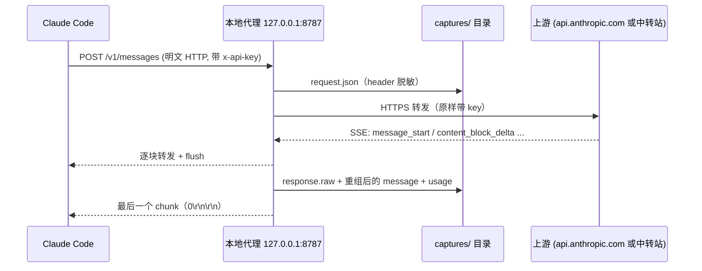

# Claude Code 抓包分析工具

> 对应原站：[Claude Code 抓包分析工具](https://labuladong.online/zh/ai-coding/claude-code/http-analyzer/)（会员内容；本章为独立原创重写）

> **一句话结论**：Claude Code 认 `ANTHROPIC_BASE_URL`，所以不用伪造证书：起一个本地反向代理，把每个请求和 SSE 响应原样转发，再脱敏落盘，就能逐个请求地看它到底给模型发了什么。

## 从一个说不清的问题开始

你给自己写了 `inject-guardrails.sh`，用 SessionStart hook 按仓库身份注入护栏。它确实生效了，Claude 也确实守规矩。

可你有没有想过：这几 KB 护栏到底落在请求的**哪个位置**？在 system 里，还是在第一条 user 消息里？它会不会每轮都打断 prompt cache？一个 session 里它会被重复发多少次？

这些问题看文档答不全，问 Claude 自己更不靠谱，因为它看到的就是上下文本身，说不清上下文是怎么拼出来的。

最实在的办法是抓包：站在 Claude Code 和 API 中间，把一来一回的 HTTP 全录下来。

你可能会问：抓 HTTPS 不是很麻烦吗？要装根证书、做中间人？

一般的程序确实要这样。但 Claude Code 给我们留了一扇正门。

## 正门：ANTHROPIC_BASE_URL

官方环境变量文档对 `ANTHROPIC_BASE_URL` 的说明就一句：覆盖 API endpoint，让请求走代理或网关。你平时用中转站，用的就是它。

这意味着 Claude Code 会**主动**把请求发给我们指定的地址。我们只要在本机起一个普通的 HTTP 服务，收到请求后：

1. 把请求体存下来（存之前抹掉 key）；
2. 用正常的 HTTPS 转发给真正的上游；
3. 上游一边吐 SSE，我们一边转给 Claude Code，同时自己也存一份。

打个比方，这就像在你家门口装了个收发室。快递员（Claude Code）本来就会把包裹送到你填的地址，收发室登记一下再转给真正的收件人。这和在快递车上做手脚的中间人（MITM）抓包完全是两回事：不用伪造任何证书，因为 Claude Code 到收发室这一段走的本来就是明文 HTTP。

类比不成立的地方也要说清：收发室能看到包裹内容，所以**抓包文件本身就是敏感物**。key 要脱敏，会话正文里也可能有你公司的代码，抓包目录绝对不能进 git。



图里有一个顺序上的小心机：代理**先落盘，再发结束块**。这样 Claude Code（或测试脚本）读完响应的那一刻，记录一定已经写好了，不会有竞态。

回到主线：LLM 只认上下文，而 Agent 工程的全部功夫都花在「往上下文里放什么」。抓包本身不省 token，但它让你第一次**看见**上下文，后面几章的拆解都靠它。

## 先跑起来看看

代码在 [`code/agent-node/http_analyzer/`](../code/agent-node/http_analyzer/)（Python 版 [`code/agent/http_analyzer/`](../code/agent/http_analyzer/)）。为了遵守「不主动调用 Anthropic」，仓库里带了一个离线假上游 [`fake_upstream.ts`](../code/agent-node/http_analyzer/fake_upstream.ts)（[`fake_upstream.py`](../code/agent/http_analyzer/fake_upstream.py)）：它会按 Messages API 的格式吐 SSE，还会粗糙地模拟 prompt cache。[`demo.ts`](../code/agent-node/http_analyzer/demo.ts)（[`demo.py`](../code/agent/http_analyzer/demo.py)）把假上游、代理、两轮请求串起来跑一遍：

=== "Node"

    ```text
    ❯ cd code/agent-node && node http_analyzer/demo.ts
    == proxy stdout
    {"id":"0001-POST-v1_messages","status":200,"secs":0.01,"model":"claude-sonnet-5-5","stream":true,"n_messages":1,"n_tools":2,"n_system_blocks":2,"usage":{"input_tokens":0,"cache_creation_input_tokens":396,"cache_read_input_tokens":0,"output_tokens":5}}
    {"id":"0002-POST-v1_messages","status":200,"secs":0,"model":"claude-sonnet-5-5","stream":true,"n_messages":3,"n_tools":2,"n_system_blocks":2,"usage":{"input_tokens":0,"cache_creation_input_tokens":19,"cache_read_input_tokens":396,"output_tokens":5}}

    == analyze --show 1
    POST /v1/messages  body=3371 bytes  model=claude-sonnet-5-5
    anthropic-beta: prompt-caching-demo
    -- system
      [0] 23 chars  "You are a coding agent."
      [1] 807 chars  "# 行为规范 规则……规则……规则……规则……规则……规则……规则……规则……规则……规则……规则……规则……规则……规"
    -- tools (2)
      Read: 330 bytes
      Bash: 323 bytes
    -- messages (1)
      [0] user: text:64
    -- cache_control breakpoints
      system[1] {"type":"ephemeral"}
      messages[0].content[0] {"type":"ephemeral"}
    -- usage {"input_tokens":0,"cache_creation_input_tokens":396,"cache_read_input_tokens":0,"output_tokens":5}

    == analyze --prefix 1 2
    shared prefix blocks: 5 / 5 / 7

    == request.json headers (redacted)
    {
     "host": "127.0.0.1:58155",
     "connection": "keep-alive",
     "x-api-key": "sk-ant…***REDACTED***",
     "anthropic-version": "2023-06-01",
     "anthropic-beta": "prompt-caching-demo",
     "content-type": "application/json",
     "accept": "*/*",
     "accept-language": "*",
     "sec-fetch-mode": "cors",
     "user-agent": "node",
     "accept-encoding": "gzip, deflate",
     "content-length": "3371"
    }
    ```

=== "Python"

    ```text
    ❯ cd code/agent && uv run python -m http_analyzer.demo
    == proxy stdout
    {"id": "0001-POST-v1_messages", "status": 200, "secs": 0.0, "model": "claude-sonnet-5-5", "stream": true, "n_messages": 1, "n_tools": 2, "n_system_blocks": 2, "usage": {"input_tokens": 0, "cache_creation_input_tokens": 405, "cache_read_input_tokens": 0, "output_tokens": 5}}
    {"id": "0002-POST-v1_messages", "status": 200, "secs": 0.0, "model": "claude-sonnet-5-5", "stream": true, "n_messages": 3, "n_tools": 2, "n_system_blocks": 2, "usage": {"input_tokens": 0, "cache_creation_input_tokens": 21, "cache_read_input_tokens": 405, "output_tokens": 5}}

    == analyze --show 1
    POST /v1/messages  body=3371 bytes  model=claude-sonnet-5-5
    anthropic-beta: prompt-caching-demo
    -- system
      [0] 23 chars  'You are a coding agent.'
      [1] 807 chars  '# 行为规范 规则……规则……规则……规则……规则……规则……规则……规则……规则……规则……规则……规则……规则……规'
    -- tools (2)
      Read: 342 bytes
      Bash: 335 bytes
    -- messages (1)
      [0] user: text:70
    -- cache_control breakpoints
      system[1] {'type': 'ephemeral'}
      messages[0].content[0] {'type': 'ephemeral'}
    -- usage {"input_tokens": 0, "cache_creation_input_tokens": 405, "cache_read_input_tokens": 0, "output_tokens": 5}

    == analyze --prefix 1 2
    shared prefix blocks: 5 / 5 / 7

    == request.json headers (redacted)
    {
     "Host": "127.0.0.1:55634",
     ...
     "x-api-key": "sk-ant…***REDACTED***",
    ```

（以上为离线 fake 上游的真实输出，Python 版中间的 header 省略了几行；token 数是假上游按字符数 / 4 估的，只用来演示字段关系。）

注意第二轮：`cache_read_input_tokens` 正好等于第一轮的 `cache_creation_input_tokens`（405；Node 版是 396，因为 `JSON.stringify` 不加空格，按字符数估出来的 token 少一点）。第一轮写进缓存的前缀，第二轮整段读回来了。下一章你会在真实会话的 usage 里看到一模一样的规律。

## 拆开代码

### 转发：边收边吐，不能攒

[`proxy.ts`](../code/agent-node/http_analyzer/proxy.ts) 用 `node:http` 收请求，内置 `fetch` 发上游（Python 版 [`proxy.py`](../code/agent/http_analyzer/proxy.py) 用标准库 `ThreadingHTTPServer` 收请求，`httpx` 发上游）。核心循环只有几行：

=== "Node"

    ```ts
    const r = await fetch(url, { method, headers: reqHeaders, body, redirect: "manual" });
    // ...
    res.writeHead(status, out);          // 不设 content-length，node:http 自动用 chunked
    for await (const chunk of r.body) {
      raw.push(Buffer.from(chunk));
      res.write(chunk);                  // 每块立刻写出，不攒
    }
    record(recorder, d, parsed, status, respHeaders, Buffer.concat(raw), t0);   // 先落盘
    res.end();                                                                  // 再结束
    ```

=== "Python"

    ```python
    with client.stream(self.command, url, headers=req_headers, content=body) as r:
        ...
        self.send_header("transfer-encoding", "chunked")
        self.end_headers()
        for chunk in r.iter_bytes():
            raw.extend(chunk)
            self.wfile.write(f"{len(chunk):x}\r\n".encode() + chunk + b"\r\n")
            self.wfile.flush()
        self._record(d, parsed, status, resp_headers, raw, t0)   # 先落盘
        self.wfile.write(b"0\r\n\r\n")                           # 再结束
    ```

为什么非得 chunked + 每块 flush？因为 SSE 就是一条不结束的长响应（见[流式响应](../p2-agent-basics/09-streaming-response.md)）。如果代理等上游说完再一次性转发，Claude Code 的界面会卡住几十秒，然后「啪」一下全出来，长任务里甚至可能触发客户端超时。

还有两个细节：

- **去掉 hop-by-hop header**（`connection`、`transfer-encoding`、`host`、`content-length` 等）。它们描述的是「这一跳」的连接，原样转发会让上游或客户端解析错。
- **去掉 `accept-encoding`**。不然上游可能回 gzip，落盘的就是一堆二进制。代价是多费一点带宽，本机抓包无所谓。（Node 版的 `fetch` 会自己协商压缩并自动解压，所以同时要把 `content-encoding` 从转给客户端的 header 里去掉。）

### 脱敏：两道闸

[`redact.ts`](../code/agent-node/http_analyzer/redact.ts)（[`redact.py`](../code/agent/http_analyzer/redact.py)）做两件事：header 按名字整值替换（`x-api-key`、`authorization`、`cookie` 等，只留前 6 个字符方便你认出是哪把 key）；所有落盘文本再用正则扫一遍 `sk-ant-…`、`Bearer …`。

注意脱敏只发生在**落盘**这一侧，转发给上游的必须是真 key，不然请求直接 401。测试里专门断言了这一点：上游收到的是原 key，磁盘上任何文件都找不到它。

你用 API key 还是订阅登录，凭证会出现在 `x-api-key` 或 `authorization` 里，两种都覆盖了。

### SSE 重组：把碎片拼回一条 message

[`sse.ts`](../code/agent-node/http_analyzer/sse.ts)（[`sse.py`](../code/agent/http_analyzer/sse.py)）先按空行切帧，再按事件类型拼：`message_start` 给出骨架和初始 usage，`content_block_delta` 往对应 index 的块里追加 `text_delta` / `thinking_delta` / `input_json_delta`，`content_block_stop` 时把攒起来的 `partial_json` 解析成工具入参，`message_delta` 补上 `stop_reason` 和最终的 `output_tokens`。

拼出来的 `message` 和非流式响应同形，后面分析就不用关心它原来是不是流式的。

### 分析：按缓存前缀的顺序看请求

[`analyze.ts`](../code/agent-node/http_analyzer/analyze.ts)（[`analyze.py`](../code/agent/http_analyzer/analyze.py)）的 `--show` 把一次请求拆成 system 块、tools、messages、cache 断点、usage。`--prefix` 更有意思：它按 API 规定的缓存前缀顺序 **tools → system → messages** 把请求展开成一串块，比较两次请求的公共前缀有多长。公共前缀越长，能读缓存的部分就越多。

## 自测：不碰真实 API

=== "Node"

    ```text
    ❯ node --test 'http_analyzer/**/*.test.ts'
    {"id":"0001-POST-v1_messages","status":200, ...}
    ▶ ProxyTest
      ✔ SSE 原样透传；上游拿到真 key，磁盘上脱敏 (31.197209ms)
    {"id":"0002-POST-v1_messages","status":200, ...}
    {"id":"0003-POST-v1_messages","status":200, ...}
      ✔ 同一前缀第二次请求读缓存 (13.562375ms)
    {"id":"0004-POST-v1_messages","status":401, ...}
      ✔ 上游的错误状态码原样透传 (4.689917ms)
    ✔ ProxyTest (67.517833ms)
    ▶ UnitTest
      ✔ 正则兜底抹掉 key 和 Bearer token (0.298416ms)
      ✔ tool_use 的分片 JSON 能拼回入参 (2.6235ms)
      ✔ 缓存断点定位和公共前缀 (0.735541ms)
    ✔ UnitTest (3.951917ms)
    ℹ tests 6
    ℹ suites 2
    ℹ pass 6
    ℹ fail 0
    ℹ cancelled 0
    ℹ skipped 0
    ℹ todo 0
    ℹ duration_ms 263.39525
    ```

=== "Python"

    ```text
    ❯ uv run python -m unittest discover -s http_analyzer/tests -t . -v
    test_cache_read_on_second_identical_prefix (...ProxyTest...) ... {"id": "0001-POST-v1_messages", ...}
    ok
    test_sse_passthrough_and_key_forwarded_but_redacted_on_disk (...ProxyTest...) ... {"id": "0003-POST-v1_messages", "status": 200, ...}
    ok
    test_upstream_error_status_is_passed_through (...ProxyTest...) ... {"id": "0004-POST-v1_messages", "status": 401, ...}
    ok
    test_breakpoints_and_prefix (...UnitTest...) ... ok
    test_redact_text_patterns (...UnitTest...) ... ok
    test_tool_use_json_reassembly (...UnitTest...) ... ok

    ----------------------------------------------------------------------
    Ran 6 tests in 1.034s

    OK
    ```

六个测试覆盖了：SSE 原样透传、key 转发但不落盘、上游 401 原样透传、`tool_use` 入参的分片 JSON 拼接、缓存断点定位。

## 你自己跑真实抓包的步骤

下面这几步需要你自己决定要不要跑，因为它会产生真实的 API 调用和费用：

=== "Node"

    ```bash
    # 终端 1：起代理。用中转站就把 --upstream 换成中转站地址
    cd ~/liz/agent-learn/code/agent-node
    node http_analyzer/proxy.ts --port 8787 --out ~/cc-captures

    # 终端 2：让一个新的 Claude Code 走代理，随便发一句 hi
    ANTHROPIC_BASE_URL=http://127.0.0.1:8787 claude

    # 看结果
    node http_analyzer/analyze.ts ~/cc-captures            # 每个请求一行
    node http_analyzer/analyze.ts ~/cc-captures --show 1   # 拆开第一个
    node http_analyzer/analyze.ts ~/cc-captures --prefix 1 2
    ```

=== "Python"

    ```bash
    # 终端 1：起代理。用中转站就把 --upstream 换成中转站地址
    cd ~/liz/agent-learn/code/agent
    uv run python -m http_analyzer.proxy --port 8787 --out ~/cc-captures

    # 终端 2：让一个新的 Claude Code 走代理，随便发一句 hi
    ANTHROPIC_BASE_URL=http://127.0.0.1:8787 claude

    # 看结果
    uv run python -m http_analyzer.analyze ~/cc-captures            # 每个请求一行
    uv run python -m http_analyzer.analyze ~/cc-captures --show 1   # 拆开第一个
    uv run python -m http_analyzer.analyze ~/cc-captures --prefix 1 2
    ```

几点提醒：

- 官方文档提到，`ANTHROPIC_BASE_URL` 指向非 `api.anthropic.com` 的主机时，Remote Control 会被禁用。抓包时别指望它。
- 我看了你的 `~/.claude/settings.json`：`env` 段目前是空的，所以命令行前缀的 `ANTHROPIC_BASE_URL` 不会和配置文件打架。旁边那个 `env2` 段存着一套 Vertex 相关变量，它不是 Claude Code 文档里的配置键，看起来是你停用的备份。如果哪天切回 Vertex（`CLAUDE_CODE_USE_VERTEX`），请求走的就是 Vertex 那套 endpoint，这个代理就抓不到了（推测，依据是变量名，未实测）。跑起来后先看代理终端有没有打印请求摘要，有就说明走通了。
- 抓到的请求除了 `/v1/messages`，还可能有别的路径（比如 token 计数）。代理是通用转发，所有路径都会落盘，`index.jsonl` 里一目了然。

## 不抓包也能看个大概：本机 jsonl

其实你本机已经有一份「半个抓包」。我在本机 Claude Code 2.1.306 的会话文件 `~/.claude/projects/*/*.jsonl` 里，看到了 `api-request`、`api-request-shape`、`api-request-blob` 三类记录：`api-request-shape` 存 system 块和工具定义的骨架，`api-request` 存模型名、beta 列表、cache_control 的位置，消息内容按哈希存在 `api-request-blob` 里。

[`session_stats.ts`](../code/agent-node/http_analyzer/session_stats.ts)（[`session_stats.py`](../code/agent/http_analyzer/session_stats.py)）只读这些记录的**结构**（长度、数量、usage），不输出正文：

=== "Node"

    ```text
    ❯ node http_analyzer/session_stats.ts shape
    version 2.1.306
    system[0] 57 chars
    system[1] 2699 chars
    system[2] 5331 chars
    tools: 29 total, 9 mcp__*, built-in: ["Agent","Artifact","AskUserQuestion","Bash","Edit","EnterWorktree","ExitWorktree","ListAgents","Read","ReportFindings","ScheduleWakeup","SendFeedback","ShareOnboardingGuide","Skill","TaskStop","ToolSearch","Workflow","Write","DeferredToolPlaceholder","advisor"]
    deferred: 14
    ```

=== "Python"

    ```text
    ❯ uv run python -m http_analyzer.session_stats shape
    version 2.1.306
    system[0] 57 chars
    system[1] 2699 chars
    system[2] 5331 chars
    tools: 29 total, 9 mcp__*, built-in: ['Agent', 'Artifact', 'AskUserQuestion', 'Bash', 'Edit', 'EnterWorktree', 'ExitWorktree', 'ListAgents', 'Read', 'ReportFindings', 'ScheduleWakeup', 'SendFeedback', 'ShareOnboardingGuide', 'Skill', 'TaskStop', 'ToolSearch', 'Workflow', 'Write', 'DeferredToolPlaceholder', 'advisor']
    deferred: 14
    ```

但要说清楚：这几种记录类型**没有官方文档**，是我在本机文件里看到的，字段随版本可能随时变。它也不是线上真实字节，比如 HTTP header、SSE 帧序列它就没有。所以想看「线上到底发了什么」，还是得抓包；jsonl 适合事后统计。

说实话，这两种手段我都会用：jsonl 便宜、零风险，适合回答「我平时的会话大概长什么样」；抓包精确，适合回答「这一次请求里某段文字到底在哪」。

## 回到开头的问题

你的护栏落在哪？抓一次包，`--show 1` 看 messages[0] 的各个 text 块就知道了。下一章会用本机 jsonl 给出一个答案：SessionStart hook 的输出和 CLAUDE.md 一样，是作为消息内容进上下文的，不在 system 里。

## 常见坑

1. **代理攒包不 flush**：SSE 看起来「卡住」，其实是代理在等上游结束。每个 chunk 都要立刻写出并 flush。
2. **忘了去 `accept-encoding`**：落盘全是 gzip 二进制，还容易把 `content-encoding: gzip` 原样转给客户端，客户端拿到的却是已解压的数据，直接解析失败。
3. **只脱 header 不脱 body**：key 偶尔会出现在 body 或错误信息里，正则兜底不能省。
4. **抓包目录放进了仓库**：里面有完整代码片段和对话。放到 `~` 下的独立目录，别放在任何 git 仓库里。
5. **经过网关时缓存行为变了**：官方 prompt caching 文档提到，网关可能原样转发 `cache_control`、拒绝它，或者悄悄去掉它。你的代理必须原样转发 body 和 `anthropic-beta` header，否则你看到的 cache 数字不代表真实情况。

## 练习

1. 给 `analyze.py` 加一个 `--grep 关键字` 参数：在所有请求里找某段文字出现在哪个请求的哪个块（比如找你的护栏标题）。
2. 给代理加一个「请求改写」钩子：转发前把 system 最后一块删掉，用假上游验证 `cache_read` 怎么变。想想这为什么能用来做 A/B 实验，又为什么危险。
3. 开放题：代理能看到所有流量，那它能不能当一个「外置 harness」？比如在代理层拦截含 `git push --force` 的 `tool_use`。和 PreToolUse hook 比，这样做好在哪、坏在哪？

## 延伸阅读

- Claude Code 环境变量：https://code.claude.com/docs/en/env-vars（`ANTHROPIC_BASE_URL`、`ANTHROPIC_CUSTOM_HEADERS`）
- 网关兼容性指南：https://code.claude.com/docs/en/llm-gateway-protocol
- Prompt caching（Claude Code 侧）：https://code.claude.com/docs/en/prompt-caching
- Messages API 流式事件：https://platform.claude.com/docs/en/build-with-claude/streaming
- 本库：[流式响应](../p2-agent-basics/09-streaming-response.md)、[聊天记录存在哪](../p1-tools/07-session-storage.md)、下一章[发一句 Hi 会发生什么](02-hi-request.md)
