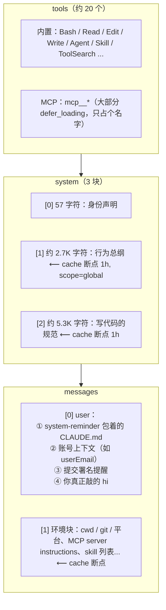

# 给 Claude Code 发一句 Hi 会发生什么

> 对应原站：[给 Claude Code 发一句 Hi 会发生什么](https://labuladong.online/zh/ai-coding/claude-code/hi-request/)（会员内容；本章为独立原创重写）

> **一句话结论**：你只敲了两个字母，Claude Code 却替你打包了几万 token 的身份、规则、工具和环境；这些内容几乎每轮都不变，所以被 prompt cache 写一次、读很多次，真正「按全价算」的往往只有个位数 token。

## 一个反直觉的账单

打开你本机任意一个会话的 jsonl，翻到第一条 assistant 记录，看它的 `usage`。我随手挑了三个最近的会话（数字是本机 jsonl 里的原值）：

| 会话 | 第 1 轮 input | cache_creation | cache_read | output |
|---|---|---|---|---|
| A | 2 | 78033 | 0 | 575 |
| B | 2 | 61002 | 0 | 240 |
| C | 2 | 39116 | 26594 | 395 |

`input_tokens` 永远是 2。可是第一轮就往缓存里写了六七万 token。

你可能会问：我就说了一句话，这六七万 token 是哪来的？为什么「正常计费」的 input 只有 2？

这一章就把这次请求拆开，一块一块看。

## 一次请求的三大件

先回忆一下[上下文和 token](../p0-core/03-messages-and-tokens.md)那一章：Messages API 的请求体里，真正进模型的就三样东西，**tools、system、messages**。API 文档写得很清楚，缓存前缀也是按这个顺序算的：先 tools，再 system，最后 messages。

Claude Code 所有的「聪明」，都得塞进这三个字段里。说白了，它就是一个特别会往 JSON 里塞东西的客户端。

我用上一章的 `session_stats.py` 读了本机 Claude Code 2.1.306 记录下来的请求骨架（只看长度，不看正文），一次主线程请求大致长这样：



上面每一块的位置和长度，都是本机记录里能直接数出来的。下面挨个说。

### tools：先占位，用到再加载

本机最近一次请求骨架里有 22 个工具，其中 7 个带 `defer_loading`。官方 tool search 文档对这个字段的解释很精确：`defer_loading` 控制的是**什么进入上下文窗口**，不是请求里发不发；被延迟的工具不进入前缀，模型搜索到它之后才把完整定义展开进来，而且不动前缀、不破坏缓存。

从模型这一侧看，效果就是你在会话里见过的那张「deferred tools 只列名字，用前先 `ToolSearch` 取 schema」的清单。Claude Code 的 `ToolSearch` 和 API 的服务端 tool search 是不是同一套实现，我没法从本机文件确认（推测两者思路一致）。

为什么要这样？因为你接了 Linear、Notion、内部平台、chrome-devtools 一堆 MCP，每个 server 十几个工具，全量 schema 塞进去能吃掉几万 token。先占位，按需加载，这是用「多一次工具调用」换「少几万 token」。

### system：短，而且几乎不动

system 只有三块，加起来不到 1 万字符。第 0 块是一句 57 字符的身份声明，第 1 块是行为总纲，第 2 块是写代码的规范。

注意 cache 断点打在 `system[1]` 和 `system[2]` 上，而 `system[1]` 的断点还带着 `scope: "global"`。

你可能会问：global 是什么意思？我在官方文档里没找到这个字段的说明，beta 列表里倒是有一个 `prompt-caching-scope-2026-01-05`。结合上面表格里会话 C 的数据，第一轮就 `cache_read` 了 26594 token，一个刚开的会话能读到缓存，说明有一段前缀是**跨会话**共享的。我的推测是：global scope 让所有人都一样的那段 system 前缀可以在不同会话、甚至不同用户之间共享缓存。（推测，依据是字段名、beta 名和第一轮就有 cache_read 这个现象。）

### messages：你的个人上下文在这里

很多人以为 CLAUDE.md 在 system prompt 里，其实不是。官方 memory 文档原话是：CLAUDE.md 的内容是作为 system prompt **之后的一条 user 消息**送进去的，不是 system prompt 的一部分。

本机记录也对得上：第一条 user 消息里有好几个 text 块，第一块是用 `<system-reminder>` 包着的 `~/.claude/CLAUDE.md` 全文（你的「全局行为准则」，约 5000 字符），后面是账号上下文、提交署名提醒，**最后一块才是你敲的 hi**。

再往后还有一大块环境信息：cwd、平台、git 状态、MCP server 的 instructions、skill 列表等等，本机一次请求里这块有四五万字符。在我本机的记录里，这一块的 role 被标成了 `system`，出现在 messages 数组中间；beta 列表里有 `mid-conversation-system-clear-at-…`、`message-threads-…` 这类名字，所以我推测这是一种「对话中途的 system 消息」的新能力，不是标准 Messages API 里的 user/assistant 两种角色。（推测，本机记录格式未公开，线上实际字节要抓包确认。）

为什么这些放在 messages 而不放 system？想想缓存就懂了：system 越靠前，越应该是「所有人都一样」的东西。cwd、git 分支、你的 CLAUDE.md 是**每个人都不一样**的，放进 system 会让 global 缓存失效。`claude --help` 里有个参数把这个意图写得明明白白：

```text
--exclude-dynamic-system-prompt-sections
    Move per-machine sections (cwd, env info, memory paths, git status) from
    the system prompt into the first user message. Improves cross-user
    prompt-cache reuse.
```

你的 SessionStart hook 输出呢？jsonl 里它记成一条 `hook_success` attachment（你那条 `inject-guardrails.sh` 的输出在本机是 7 千多字符）。官方 hooks 文档说 SessionStart 的纯文本 stdout 会加进 Claude 的上下文。至于它具体落在 messages 的哪一块，我没有在记录里一一对上，要用上一章的抓包工具确认。（推测）

回到主线：发一句 hi，真正的「题目」只有 2 个 token，剩下几万 token 都是 Agent 工程替模型准备的「考场环境」。模型只会根据上下文预测下一个 token，所以这些环境决定了它会怎么回答。

## prompt cache 的账怎么算

现在回到那个反直觉的账单。把同一个会话的前五轮连起来看（同样是本机 jsonl 原值，用 `session_stats.py cache` 打印）：

=== "Node"

    ```text
    ❯ node http_analyzer/session_stats.ts cache 3
    session 8d1e4b07   input  cache_create  cache_read  output   read(n)==read(n-1)+create(n-1)?
      turn 1        2         39116       26594     395   
      turn 2        2          2458       65710      82   yes
      turn 3        2           181       68168     215   yes
      turn 4        2          1425       68349     115   yes
      turn 5        2           471       69774      82   yes
    session 5c02f9a3   input  cache_create  cache_read  output   read(n)==read(n-1)+create(n-1)?
      turn 1        2         54427       26987     307   
      turn 2        2           386       81414     178   yes
      turn 3        2           893       81800     234   yes
      turn 4        2          4425       82693     287   yes
      turn 5        2          3315       87118     262   yes
    session 3f9c2a1e   input  cache_create  cache_read  output   read(n)==read(n-1)+create(n-1)?
      turn 1        2         78033           0     575   
      turn 2        2           733       78033     497   yes
      turn 3        2          3056       78766     299   yes
      turn 4        2          1048       81822     135   yes
      turn 5        2          3677       82870     290   yes
    ```

=== "Python"

    ```text
    ❯ uv run python -m http_analyzer.session_stats cache 3
    session 3f9c2a1e   input  cache_create  cache_read  output   read(n)==read(n-1)+create(n-1)?
      turn 1        2         78033           0     575
      turn 2        2           733       78033     497   yes
      turn 3        2          3056       78766     299   yes
      turn 4        2          1048       81822     135   yes
      turn 5        2          3677       82870     290   yes
    session 4aac0edb   input  cache_create  cache_read  output   read(n)==read(n-1)+create(n-1)?
      turn 1        2         61002           0     240
      turn 2        2           954       61002      92   yes
      turn 3        2          6034       61956     268   yes
      turn 4        2           676       67990     831   yes
      turn 5        2          1417       68666     866   yes
    ```

（`cache` 取的是「最近 N 个会话」，每次跑都会换一批。两个标签页是不同时间跑的，会话不同，规律一样。）

规律非常干净：**这一轮的 cache_read = 上一轮的 cache_read + 上一轮的 cache_creation**。

这说明 Claude Code 每轮都把一个断点打在 messages 的**最后**，上一轮写进缓存的整个前缀，这一轮原封不动读回来；新增的只是上一轮的回复和这一轮的新消息，它们被写进缓存，供下一轮读。

打个比方，这像一本只往后加页的账本。每次复印时，前面已经复印过的页直接拿旧的，只复印新加的几页。类比不完全成立的地方在于：缓存有过期时间（TTL），超时就得重新「复印」整本。

为什么 `input_tokens` 只有 2？因为断点之后、不进缓存的部分几乎为零。2 个 token 大概就是消息格式本身的一点尾巴（推测）。

价格上，官方 prompt caching 文档给的倍率是：5 分钟缓存写入 1.25 倍、1 小时缓存写入 2 倍、缓存读取 0.1 倍（Opus 5.5 / Sonnet 5.5 是 0.05 倍）。本机请求里的 `cache_control` 都是 `ttl: "1h"`；Claude Code 文档说订阅用户主线程默认 1 小时、API key 默认 5 分钟，子 agent 默认 5 分钟。你的 usage 里 `cache_creation` 子字段会分开记 `ephemeral_5m_input_tokens` 和 `ephemeral_1h_input_tokens`，可以自己核对走的是哪一档。

## 动手：自己验证缓存链

[`code/agent-node/http_analyzer/session_stats.ts`](../code/agent-node/http_analyzer/session_stats.ts) 的 `usageChain()`（Python 版 [`session_stats.py`](../code/agent/http_analyzer/session_stats.py) 的 `usage_chain()`）就二十来行：

=== "Node"

    ```ts
    /** 主线程（非 sidechain）每次 API 响应的 usage；同一 message.id 的多条记录只算一次。 */
    export function usageChain(path: string, limit = 5): [number, number, number, number][] {
      const seen = new Set<unknown>();
      const rows: [number, number, number, number][] = [];
      for (const [, r] of iterRecords([path])) {
        if (r.type !== "assistant" || r.isSidechain) continue;
        const m = r.message || {};
        const u = m.usage;
        if (!u || seen.has(m.id)) continue;
        seen.add(m.id);
        rows.push([u.input_tokens ?? 0, u.cache_creation_input_tokens ?? 0,
          u.cache_read_input_tokens ?? 0, u.output_tokens ?? 0]);
        if (rows.length >= limit) break;
      }
      return rows;
    }
    ```

=== "Python"

    ```python
    def usage_chain(path: Path, limit: int = 5):
        """主线程（非 sidechain）每次 API 响应的 usage；同一 message.id 的多条记录只算一次。"""
        seen, rows = set(), []
        for _, r in iter_records([path]):
            if r.get("type") != "assistant" or r.get("isSidechain"):
                continue
            m = r.get("message") or {}
            u = m.get("usage")
            if not u or m.get("id") in seen:
                continue
            seen.add(m.get("id"))
            rows.append((u.get("input_tokens", 0), u.get("cache_creation_input_tokens", 0),
                         u.get("cache_read_input_tokens", 0), u.get("output_tokens", 0)))
            if len(rows) >= limit:
                break
        return rows
    ```

有个小坑值得说：一次 API 响应如果有多个内容块（thinking + text + tool_use），jsonl 会把它拆成多条 assistant 记录，但它们的 `message.id` 相同、usage 也相同。不按 id 去重，你会把同一份 usage 算好几遍。

想看「缓存断了」长什么样？在一个会话中途切一次模型或者断开一个 MCP server，再跑一次 `cache`，你会看到某一轮 `read(n)==…` 变成 `no`，`cache_creation` 突然暴涨。官方文档也列了这几种情况：切模型、MCP 变化、压缩，都会让部分缓存失效。

## 对照你的环境

- 你的 `~/.claude/CLAUDE.md` 每个会话都会作为第一条 user 消息的第一块发出去，大约 5000 字符。你在 CLAUDE.md 里写的那句「常驻层是稀缺资源，每加一行都在和别的行抢注意力」，从计费角度看也成立：它每轮都在缓存前缀里，第一轮按写入价计费，之后每轮按读取价计费。读取虽然便宜，但它**一直占着上下文窗口**。
- MCP 越多，环境块里的 server instructions 越长（你那块内部平台的说明就不短）。deferred tools 省掉了 schema，省不掉 instructions。
- 中途改 CLAUDE.md 不会立即生效。官方文档说要 `/clear`、`/compact` 或重启后才重新读，这恰恰是为了不打断缓存。

## 回到开头的问题

六七万 token 是哪来的？是工具定义、system 规范、你的 CLAUDE.md、环境和 MCP 说明。为什么 input 只有 2？因为 Claude Code 把断点打在 system 和 messages 末尾，几乎所有内容都走缓存：第一轮写入，之后每轮读取上一轮的全部前缀。

## 常见坑

1. **把 usage 按记录数累加**：同一 `message.id` 的多条 assistant 记录共用一份 usage，先去重。
2. **以为 CLAUDE.md 在 system 里**：它是 user 消息。所以「system prompt 优先级更高」那套直觉不适用于 CLAUDE.md。
3. **在会话中途频繁切模型**：每切一次，缓存前缀都要重写，账单上 `cache_creation` 会跳一下。
4. **把 jsonl 里的请求骨架当线上字节**：`api-request-shape` 这类记录是 Claude Code 的内部格式，没有文档，可能和线上请求有差异，关键结论要用抓包核实。

## 练习

1. 跑 `session_stats.py cache 10`，找出你本机哪个会话第一轮 `cache_read` 不为 0，想想它为什么能一开局就命中缓存。
2. 用上一章的代理抓一次真实的 hi（需要你自己决定是否产生费用），用 `--show 1` 确认你的 `inject-guardrails.sh` 输出到底在哪个块里。
3. 开放题：如果让你设计断点位置（最多 4 个），你会怎么分配给「全局 system / 个人 system / 历史消息 / 最新消息」？Claude Code 本机记录里用了 3 个，留一个空位，可能是为了什么？

## 延伸阅读

- Messages API prompt caching：https://platform.claude.com/docs/en/build-with-claude/prompt-caching
- Claude Code prompt caching：https://code.claude.com/docs/en/prompt-caching
- CLAUDE.md 的加载方式：https://code.claude.com/docs/en/memory
- 工具搜索与延迟加载：https://platform.claude.com/docs/en/agents-and-tools/tool-use/tool-search-tool
- 本库：[上一章 抓包工具](01-http-analyzer.md)、[下一章 System Prompt 怎么写](03-system-prompt.md)、[上下文和 token](../p0-core/03-messages-and-tokens.md)
