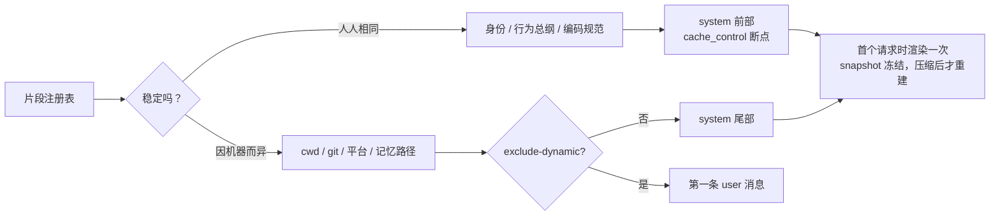

# System Prompt 应该怎么写

> 对应原站：[System Prompt 应该怎么写](https://labuladong.online/zh/ai-coding/claude-code/system-prompt/)（会员内容；本章为独立原创重写）

> **一句话结论**：工业级 system prompt 不是一篇长文，而是一组按「稳不稳定」排序的小片段：人人相同的放最前面吃缓存，因人因机器而异的往后挪甚至挪出 system；每条规则写成「判断标准 → 例子 → 禁止项」，让模型能举一反三，而不是死记条文。

## 你的 CLAUDE.md 写长了，会怎样？

你在 `~/.claude/CLAUDE.md` 开头写了一句很重的话：「常驻层是稀缺资源，每加一行都在和别的行抢注意力。」

这句话是对的。但你可能会问：那 Claude Code 自己的 system prompt 呢？它要教模型怎么用十几个工具、怎么写代码、怎么跟用户沟通，按理说应该是一大篇吧？它是怎么在「讲清楚」和「不浪费」之间平衡的？

上一章我们数过：本机 Claude Code 2.1.306 的 system 只有三块，加起来不到 1 万字符。真正的大头（环境、MCP 说明、你的 CLAUDE.md）都被挪到了 messages 里。

这一章就拆这个设计，并从中提炼出你自己写 prompt 时能用的套路。

## 为什么要拆成碎片

先想一个场景：Claude Code 有几百万用户。如果每个人的 system prompt 里都嵌着自己的 cwd、git 分支、今天日期，那每个人的 system 都不一样，缓存只能各算各的。

把它们拆开，人人相同的部分放前面，就能共享同一份缓存。

打个比方，这像印刷厂做书：正文是统一排版、大批量印的，扉页上的「赠某某」是最后单独盖章的。没人会为了盖一个名字章把整本书重新排版。

类比的局限是：书印完就不变了，而 Claude Code 的「正文」也会随版本升级变，一升级缓存就要重建。

本机的证据有三条：

1. **system 被切成三块，断点打在第 1、2 块上**，而且第 1 块的断点带 `scope: "global"`（上一章说过，这是我推测的跨会话共享缓存）。
2. **`claude --help` 里有个参数直接说明了「动态段」的存在**：

```text
--exclude-dynamic-system-prompt-sections
    Move per-machine sections (cwd, env info, memory paths, git status) from
    the system prompt into the first user message. Improves cross-user
    prompt-cache reuse. Only applies with the default system prompt (ignored
    with --system-prompt).
```

cwd、环境信息、记忆路径、git 状态，被它称为 per-machine sections，也就是「每台机器不一样的段」。能被单独挪走，说明它们本来就是独立的片段。

3. **还有一个 `--system-prompt-snapshot`**，帮助文本说：默认会在会话第一次请求时把 system prompt 渲染并记录下来，之后每次请求和 resume 都**原样复用**这份记录，直到会话被压缩。

你可能会问：为什么要冻结？因为片段是「按当前环境」拼出来的。如果中途你切了 git 分支，git 状态片段就变了，system 一变缓存就全断。冻结住，就算环境变了，前缀也不变。代价是模型看到的环境信息可能有点过时。



图里「片段注册表」那一层是我按现象推出来的结构，Claude Code 闭源，具体代码怎么组织不得而知。（推测，依据是上面三条 CLI 行为和本机记录里的分块。）

回到主线：上下文有限、而且每个 token 都要钱。拆碎片本身不让 prompt 变短，但它让**最长、最不变**的那部分只算一次，这是用排序换成本。

## 一个碎片长什么样

Claude Code 的 system 正文我不贴（那是人家的产品文本，你想看可以自己抓包）。但有一类「碎片」你每天都在读，而且就在请求里，那就是**工具描述**。工具描述也是 prompt，它只是放在 tools 字段里而已。

看本机请求里 `Edit` 工具的完整描述：

```text
Performs exact string replacement in a file.

- You must Read the file in this conversation before editing, or the call will fail.
- `old_string` must match the file exactly, including indentation, and be unique — the edit fails otherwise. Strip the Read line prefix (line number + tab) before matching.
- `replace_all: true` replaces every occurrence instead.
```

只有 360 个字符，却很有讲究：

- 第一句是**它是什么**：精确字符串替换，不是 diff，不是正则。
- 每条规则都带着**后果**：「否则调用会失败」。模型知道违反了会怎样，比单纯说「必须」更容易遵守。
- 有一条**预判模型会犯的错**：Read 的输出带着「行号 + tab」前缀，模型很容易把前缀也抄进 `old_string`。这条规则一看就是踩过坑才加的。

再看 `Read` 的描述里有一句：「Do NOT re-read a file you just edited to verify — Edit/Write would have errored if the change failed, and the harness tracks file state for you.」

这句话同时干了三件事：给了禁止项（别重读），给了理由（失败会报错），还交代了背后的机制（harness 在追踪文件状态）。下一章讲文件读写时，你会看到这个「追踪」是怎么实现的。

## 规则的写法：判断标准 → 例子 → 禁止项

从这些片段里能提炼出一个三段式：

1. **判断标准**：告诉模型「什么情况下算对」，而不是「做什么动作」。标准能泛化，动作只能照抄。
2. **例子**：一两个具体场景，让标准落地。
3. **禁止项**：明确的红线，最好附上后果。

你可能会问：直接列禁止项不是更省字吗？

问题在于，禁止项列不完。你写「不要用 cat 读文件」，模型就去用 `head`；你写「不要顺手重构」，它就「顺手改个命名」。给了判断标准（「改动是否让用户的目标更近一步」），它面对你没写到的情况也能推出该怎么做。

说实话，我觉得这条比任何 prompt 技巧都重要：**你是在给一个很聪明但不了解你项目的新同事写入职手册，不是在给编译器写规则。**

## 动手：一个按稳定性排序的拼装器

下面这段代码（存成 `system_prompt_demo.ts` 就能跑，Python 版存成 `system_prompt_demo.py`，都只用标准库）模拟「片段注册表 + 稳定段在前 + 断点打在稳定段末尾」。两个用户的环境完全不同，看看缓存前缀会不会一样：

=== "Node"

    ```ts
    import { createHash } from "node:crypto";

    type Ctx = Record<string, string>;
    type Block = { type: "text"; text: string; cache_control?: { type: "ephemeral" } };

    // 每个片段：[名字, 是否稳定, 生成函数]。稳定片段放前面，动态片段放后面。
    const SECTIONS: [string, boolean, (ctx: Ctx) => string][] = [
      ["identity", true, (ctx) => "You are a coding agent running in the user's terminal."],
      ["doing_tasks", true, (ctx) =>
        "# Doing tasks\n" +
        "判断标准：改动是否让用户的目标更近一步。\n" +
        "例子：用户说『修这个 bug』，先复现再改，不顺手重构无关代码。\n" +
        "禁止：没读过的文件不要直接改。"],
      ["tool_policy", true, (ctx) => "# Tools\n优先用专用工具（Read/Edit），不要用 cat/sed 代替。"],
      ["env", false, (ctx) => `# Environment\ncwd: ${ctx.cwd}\nos: ${ctx.os}\ndate: ${ctx.date}`],
      ["git", false, (ctx) => `# Git\nbranch: ${ctx.branch}`],
    ];

    function buildSystem(ctx: Ctx, dynamicToUser = false): [Block[], string | null] {
      const stable: Block[] = SECTIONS.filter(([, s]) => s).map(([, , f]) => ({ type: "text", text: f(ctx) }));
      const dynamic: Block[] = SECTIONS.filter(([, s]) => !s).map(([, , f]) => ({ type: "text", text: f(ctx) }));
      stable[stable.length - 1].cache_control = { type: "ephemeral" };   // 断点打在稳定段末尾
      if (dynamicToUser)                                                   // 类似 --exclude-dynamic-system-prompt-sections
        return [stable, dynamic.map((b) => b.text).join("\n\n")];
      return [[...stable, ...dynamic], null];
    }

    const sha1 = (s: string) => createHash("sha1").update(s).digest("hex").slice(0, 8);
    const a = { cwd: "/home/alice/proj", os: "Linux", date: "2026-10-21", branch: "main" };
    const b = { cwd: "/Users/bob/work", os: "Darwin", date: "2026-10-22", branch: "feat/x" };
    for (const [name, ctx] of [["alice", a], ["bob", b]] as const) {
      const [sysBlocks] = buildSystem(ctx);
      const bp = sysBlocks.findIndex((x) => "cache_control" in x);
      const prefix = sysBlocks.slice(0, bp + 1).map((x) => x.text);
      console.log(name, "blocks:", sysBlocks.length, "cached-prefix hash:", sha1(prefix.join("")),
        "full hash:", sha1(sysBlocks.map((x) => x.text).join("")));
    }
    ```

=== "Python"

    ```python
    import hashlib

    # 每个片段：(名字, 是否稳定, 生成函数)。稳定片段放前面，动态片段放后面。
    SECTIONS = [
        ("identity", True,  lambda ctx: "You are a coding agent running in the user's terminal."),
        ("doing_tasks", True, lambda ctx: (
            "# Doing tasks\n"
            "判断标准：改动是否让用户的目标更近一步。\n"
            "例子：用户说『修这个 bug』，先复现再改，不顺手重构无关代码。\n"
            "禁止：没读过的文件不要直接改。")),
        ("tool_policy", True, lambda ctx: "# Tools\n优先用专用工具（Read/Edit），不要用 cat/sed 代替。"),
        ("env", False, lambda ctx: f"# Environment\ncwd: {ctx['cwd']}\nos: {ctx['os']}\ndate: {ctx['date']}"),
        ("git", False, lambda ctx: f"# Git\nbranch: {ctx['branch']}"),
    ]

    def build_system(ctx, dynamic_to_user=False):
        stable = [{"type": "text", "text": f(ctx)} for _, s, f in SECTIONS if s]
        dynamic = [{"type": "text", "text": f(ctx)} for _, s, f in SECTIONS if not s]
        stable[-1]["cache_control"] = {"type": "ephemeral"}      # 断点打在稳定段末尾
        if dynamic_to_user:                                        # 类似 --exclude-dynamic-system-prompt-sections
            return stable, "\n\n".join(b["text"] for b in dynamic)
        return stable + dynamic, None

    a = dict(cwd="/home/alice/proj", os="Linux", date="2026-10-21", branch="main")
    b = dict(cwd="/Users/bob/work", os="Darwin", date="2026-10-22", branch="feat/x")
    for name, ctx in (("alice", a), ("bob", b)):
        sys_blocks, extra = build_system(ctx)
        bp = next(i for i, x in enumerate(sys_blocks) if "cache_control" in x)
        prefix = [x["text"] for x in sys_blocks[: bp + 1]]
        print(name, "blocks:", len(sys_blocks), "cached-prefix hash:", hashlib.sha1("".join(prefix).encode()).hexdigest()[:8],
              "full hash:", hashlib.sha1("".join(x["text"] for x in sys_blocks).encode()).hexdigest()[:8])
    ```

===! "Node"

    ```text
    ❯ node system_prompt_demo.ts
    alice blocks: 5 cached-prefix hash: 32826c2c full hash: 382811fb
    bob blocks: 5 cached-prefix hash: 32826c2c full hash: 2dc9e33a
    ```

=== "Python"

    ```text
    ❯ uv run python system_prompt_demo.py
    alice blocks: 5 cached-prefix hash: 32826c2c full hash: 382811fb
    bob blocks: 5 cached-prefix hash: 32826c2c full hash: 2dc9e33a
    ```

（纯本地计算，不调用模型。）

完整的 system 两人不同，但断点之前的前缀哈希一模一样，两个人可以命中同一份缓存。

如果把稳定段和动态段的顺序颠倒一下，把 `env` 挪到最前面，前缀哈希就会不同，缓存就没法共享了。这就是「不变的放前面」这条规矩的全部道理。说穿了，就是对一个列表**排了个序**。

## 对照你的环境

你的环境里其实已经有一套「碎片化 system prompt」，只是层级在 messages 里：

| 你的层 | 什么时候进上下文 | 稳定性 |
|---|---|---|
| `~/.claude/CLAUDE.md`（全局准则） | 每个会话，第一条 user 消息 | 高：跨项目不变 |
| `~/.claude/refs/` 下的公司层 / 项目层护栏（按仓库身份注入） | SessionStart hook | 中：按仓库变 |
| skill 正文 | 用到时才加载 | 按需 |

这和 Claude Code 的思路一模一样：常驻层只放「走哪条轨」，步骤放进 skill 按需加载。你 CLAUDE.md 里那句「常驻层只回答『走哪条轨』，不回答『怎么做』（复述 skill 内容 = 每个 session 重复付费）」，就是本章结论的另一种说法。

再看你的写法。`enforce-worktree.py` 的 docstring 写了**背景**（为什么需要它）、**拦什么**、**放行什么**、**退出码约定**。这正是「判断标准 → 例子 → 禁止项」的结构，只不过读者是未来的你，不是模型。

有一点可以改进：你 CLAUDE.md 里有几条规则只给了禁止项，没有判断标准，比如「不说某工具『更名 / 下线』」。补一句「判断标准：只陈述本 session 能观测到的事实」，模型遇到类似但没写到的情况（比如「某 API 已废弃」）也能推出来。

## 回到开头的问题

CLAUDE.md 写长了会怎样？它不会破坏缓存（它在 messages 里，每轮都是同一个前缀），但每一行都会一直占着上下文窗口，跟真正的任务抢注意力。Claude Code 自己的做法是：system 只放人人相同、最核心的几千字符，其余按稳定性往后排，按需加载。你的 CLAUDE.md 也该这么分层。

## 常见坑

1. **在 system 里放时间戳或随机 ID**：每次请求都不一样，断点之前的前缀就永远命中不了缓存。
2. **只写禁止项**：模型会找到你没禁止的等价做法。先给判断标准。
3. **规则不写后果**：「必须先 Read」不如「必须先 Read，否则调用会失败」。
4. **把工具描述当成 API 文档写**：它是 prompt，要写的是「什么时候用、容易犯什么错」，而不只是参数说明。
5. **中途改 system 片段**：缓存全断。Claude Code 用 snapshot 冻结来避免这个问题，你自己的 Agent 也该在会话内保持 system 不变。

## 练习

1. 把上面的拼装器改成 `dynamic_to_user=True`，把动态段作为第一条 user 消息，验证前缀依然一致。
2. 挑你 CLAUDE.md 里的三条规则，按「判断标准 → 例子 → 禁止项」重写，用 `wc -c` 比较字数变化。
3. 开放题：snapshot 冻结让缓存稳定，但模型看到的 git 分支可能已经过时。你会怎么设计，让「环境变化」既能告诉模型，又不打断缓存？（提示：想想追加在 messages 末尾的提醒消息。）

## 延伸阅读

- Anthropic 工程博客 *Effective context engineering for AI agents*：https://www.anthropic.com/engineering/effective-context-engineering-for-ai-agents
- *Writing effective tools for agents — with agents*：https://www.anthropic.com/engineering/writing-tools-for-agents
- Claude Code prompt caching（哪些变化会让缓存失效）：https://code.claude.com/docs/en/prompt-caching
- 本库：[上一章 发一句 Hi](02-hi-request.md)、[下一章 文件读写](04-file-read-write.md)、[Skills](../p1-tools/12-skills.md)
