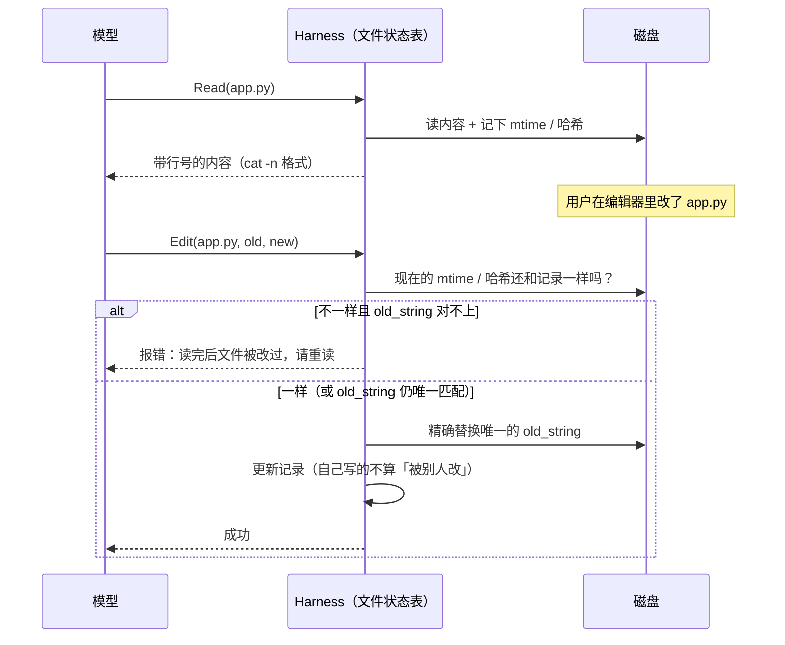

# 文件读写是怎么实现的

> 对应原站：[文件读写是怎么实现的](https://labuladong.online/zh/ai-coding/claude-code/file-read-write/)（会员内容；本章为独立原创重写）

> **一句话结论**：Read、Edit、Write 三个工具共享一份「读过什么、读的时候长什么样」的记录。没读过不让改，读完被别人改过要重读；Edit 只让模型说出「把哪段换成哪段」，既省输出 token，又让「改错地方」变成一个能被程序当场拦下的错误。

## 一个你肯定遇到过的场景

你在 VS Code 里改了 `Login.tsx` 的一行，没保存提醒 Claude。过了一会儿 Claude 要改同一个文件。

它会不会把你的改动覆盖掉？

再想一个：一个 800 行的组件，Claude 只想改一个 import。它要不要把 800 行重新输出一遍？

这两个问题，一个关于**正确性**，一个关于**成本**。Claude Code 用同一套设计回答了它们。

## 为什么让 LLM 写文件特别难

你可能会问：写文件不就是 `open(path, "w").write(content)` 吗，有什么难的？

对程序来说不难，对 LLM 来说有三个坑：

1. **幻觉**：模型可能根本没读过这个文件，凭「这种项目一般长这样」去改，把原文件改得面目全非。
2. **过期**：模型读完之后，你或者格式化工具、git checkout 改了文件，模型脑子里还是旧版本，照着旧版本写回去，就把别人的改动冲掉了。
3. **成本**：输出 token 比输入贵得多，也慢得多。为改一行重写整个文件，又贵又容易在抄写时出错（漏一行、改一个缩进）。

打个比方，这就像你让一个视力很好但记性不太可靠的助理改合同。你会定三条规矩：没看过原件不许动笔；你看完之后要是有人改过，得重新看；改的时候别重抄整份合同，用红笔把要改的那句圈出来、旁边写新的就行。

类比的局限是：真的助理圈错了地方你可能发现不了，而程序可以**精确核对**红笔圈的那段原文在不在、是不是唯一。

## 三个工具，一份记录



### 证据一：工具描述直接写明了规则

本机请求里三个工具的描述（这些文本模型每轮都会看到）：

- Edit：「You must Read the file in this conversation before editing, or the call will fail.」以及 `old_string` 必须精确匹配并且唯一。
- Write：「Overwriting an existing file you haven't Read will fail.」
- Read：「Do NOT re-read a file you just edited to verify — Edit/Write would have errored if the change failed, and the harness tracks file state for you.」

最后一句里的 *the harness tracks file state* 就是图里那张「文件状态表」。

### 证据二：官方文档补充了细节

tools-reference 文档里有几条比工具描述更细的说明：

- 「先读后改」的强制程度和模型有关：Opus 4.6、Haiku 4.5 及更早的模型总是要求先读；更新的模型在「读这个文件本来就不需要权限确认」的情况下，可以改没读过的文件。
- 文件过期时，只要 `old_string` 在当前内容里仍然精确且唯一地匹配，编辑**可以成功**；否则模型要先重读。
- 用 Bash 对单个文件 `cat`、`head`、`grep` 也算「读过」。
- `Read` 的 deny 规则同时挡住同一路径上的 Edit 和 Write。

### 证据三：本机 jsonl 里的结果字段

我统计了本机所有会话里 Edit 和 Write 的 `toolUseResult` 字段（只看字段名和次数）：

- Edit 结果有 `filePath / oldString / newString / originalFile / structuredPatch / userModified / replaceAll`，其中 101 次带了 `staleRecovered`，521 次带了 `contentNotInModelContext`。
- Write 结果有 `filePath / content / structuredPatch / originalFile / userModified`。

`staleRecovered` 这个名字和文档里「过期但仍唯一匹配就放行」对得上，我推测它标记的就是这种情况。`contentNotInModelContext` 我推测是「模型没完整读过这个文件（比如只读了片段、或通过 Bash 读的）但编辑仍然成功」。这两个字段都没有文档，含义是我按名字和文档推断的。（推测）

本机 jsonl 里还有一类 attachment 叫 `edited_text_file`，出现过 799 次，字段是文件名和一段 snippet。我推测这就是「你在编辑器里改了文件，Claude Code 主动告诉模型」的通知。（推测，依据是名字和字段。）

再看错误。本机出现过的 Edit 报错原文（路径已抹掉）：

```text
<tool_use_error>No changes to make: old_string and new_string are exactly the same.
<tool_use_error>Found 2 matches of the string to replace, but replace_all is false. To replace all occurrences ...
<tool_use_error>String to replace not found in file.
Refusing to write <path> it is a symbolic link. Write to the link's target path instead.
```

注意这些错误都是**写给模型看的**：不只说「失败了」，还说清楚为什么、怎么改。它们会作为 `tool_result` 回到上下文里，模型下一步就会自己修正。

回到主线：Edit 的设计在上下文上做了两件事。输出侧，只吐「旧片段 + 新片段」，省掉整文件重写的 token；输入侧，一次失败的编辑只多出一行错误信息，模型马上就能修正，不用人介入。

## 为什么是字符串替换，而不是行号或 diff

你可能会问：直接让模型给行号不是更简单？

行号很脆。模型看到的是 Read 那一刻的行号，前面只要插入一行，后面全错位。而且模型数行号经常数错一两行。

那 unified diff 呢？diff 要求模型同时写对上下文行、`@@` 头里的行号、每行前面的 `+`/`-`/空格，格式要求太多，模型很容易写出一个应用不上的补丁。

字符串替换只有一个要求：**`old_string` 必须在文件里唯一出现**。这个要求程序一检查就知道对不对：出现 0 次说明模型记错了，出现 2 次说明给的上下文不够。两种情况都能当场报错。

我很认可这个设计，因为它把「模型可能出错」变成了「程序一定能发现的错」。这是 harness 设计里非常值钱的一种转换。

## 动手：一个最小的带状态文件工具

下面这段代码把三条规则落成一个类（只用标准库）。报错文案是我自己写的，不是 Claude Code 原文，只有「Found N matches」和「No changes to make」两条参考了上面本机见到的错误：

=== "Node"

    ```ts
    import { createHash } from "node:crypto";
    import { appendFileSync, existsSync, mkdtempSync, readFileSync, statSync, utimesSync, writeFileSync } from "node:fs";
    import { tmpdir } from "node:os";
    import { basename, join } from "node:path";

    class FileState {
      /** Read / Edit / Write 共享的一份「读取记录」：path -> "mtimeNs:sha1" */
      seen = new Map<string, string>();

      private stamp(path: string): string {
        const data = readFileSync(path);
        return `${statSync(path, { bigint: true }).mtimeNs}:${createHash("sha1").update(data).digest("hex")}`;
      }

      read(path: string): string {
        const text = readFileSync(path, "utf8");
        this.seen.set(path, this.stamp(path));
        return text.split(/(?<=\n)/).map((l, i) => `${String(i + 1).padStart(6)}\t${l}`).join("");
      }

      private checkFresh(path: string): void {
        if (!this.seen.has(path))
          throw new Error("File has not been read yet. Read it first before writing to it.");
        if (this.stamp(path) !== this.seen.get(path))
          throw new Error("File has been modified since read. Read it again before writing.");
      }

      edit(path: string, old: string, neu: string, replaceAll = false): string {
        this.checkFresh(path);
        let text = readFileSync(path, "utf8");
        const n = text.split(old).length - 1;
        if (old === neu)
          throw new Error("No changes to make: old_string and new_string are exactly the same.");
        if (n === 0)
          throw new Error("String to replace not found in file.");
        if (n > 1 && !replaceAll)
          throw new Error(`Found ${n} matches of the string to replace, but replace_all is false.`);
        text = replaceAll ? text.replaceAll(old, neu) : text.replace(old, () => neu);
        writeFileSync(path, text, "utf8");
        this.seen.set(path, this.stamp(path));        // 自己写的不算「被别人改」
        return `The file ${basename(path)} has been updated.`;
      }

      write(path: string, content: string): string {
        if (existsSync(path))
          this.checkFresh(path);                      // 覆盖已有文件也必须先读
        writeFileSync(path, content, "utf8");
        this.seen.set(path, this.stamp(path));
        return `File created successfully at: ${basename(path)}`;
      }
    }

    function tool(fs: FileState, name: "read" | "edit" | "write", ...args: any[]): void {
      try {
        const out: string = (fs[name] as Function)(...args);
        console.log(`✔ ${name}: ${out.trim().split("\n")[0]}`);
      } catch (e) {
        console.log(`✘ ${name}: <tool_use_error>${(e as Error).message}</tool_use_error>`);
      }
    }

    const d = mkdtempSync(join(tmpdir(), "fs-")); const p = join(d, "app.py");
    writeFileSync(p, "x = 1\nprint(x)\nprint(x)\n");
    const fs = new FileState();
    tool(fs, "edit", p, "x = 1", "x = 2");                        // 没读过就改
    tool(fs, "read", p);
    tool(fs, "edit", p, "print(x)", "print(x + 1)");              // 不唯一
    tool(fs, "edit", p, "x = 1", "x = 2");                        // 正常
    appendFileSync(p, "# 用户在编辑器里加了一行\n");                // 外部修改
    const st = statSync(p);
    utimesSync(p, st.atime, new Date(st.mtimeMs + 1000));
    tool(fs, "edit", p, "x = 2", "x = 3");                        // 读完被别人改了
    tool(fs, "read", p);
    tool(fs, "edit", p, "x = 2", "x = 3");
    console.log(readFileSync(p, "utf8"));
    ```

=== "Python"

    ```python
    import hashlib, os, tempfile

    class FileState:
        """Read / Edit / Write 共享的一份「读取记录」：path -> (mtime_ns, sha1)"""
        def __init__(self):
            self.seen = {}

        def _stamp(self, path):
            data = open(path, "rb").read()
            return os.stat(path).st_mtime_ns, hashlib.sha1(data).hexdigest()

        def read(self, path):
            text = open(path, encoding="utf-8").read()
            self.seen[path] = self._stamp(path)
            return "".join(f"{i:>6}\t{l}" for i, l in enumerate(text.splitlines(True), 1))

        def _check_fresh(self, path):
            if path not in self.seen:
                raise PermissionError("File has not been read yet. Read it first before writing to it.")
            if self._stamp(path) != self.seen[path]:
                raise PermissionError("File has been modified since read. Read it again before writing.")

        def edit(self, path, old, new, replace_all=False):
            self._check_fresh(path)
            text = open(path, encoding="utf-8").read()
            n = text.count(old)
            if old == new:
                raise ValueError("No changes to make: old_string and new_string are exactly the same.")
            if n == 0:
                raise ValueError("String to replace not found in file.")
            if n > 1 and not replace_all:
                raise ValueError(f"Found {n} matches of the string to replace, but replace_all is false.")
            text = text.replace(old, new) if replace_all else text.replace(old, new, 1)
            open(path, "w", encoding="utf-8").write(text)
            self.seen[path] = self._stamp(path)          # 自己写的不算「被别人改」
            return f"The file {os.path.basename(path)} has been updated."

        def write(self, path, content):
            if os.path.exists(path):
                self._check_fresh(path)                  # 覆盖已有文件也必须先读
            open(path, "w", encoding="utf-8").write(content)
            self.seen[path] = self._stamp(path)
            return f"File created successfully at: {os.path.basename(path)}"

    def tool(fs, name, *args, **kw):
        try:
            out = getattr(fs, name)(*args, **kw)
            print(f"✔ {name}: {out.strip().splitlines()[0]}")
        except Exception as e:
            print(f"✘ {name}: <tool_use_error>{e}</tool_use_error>")

    d = tempfile.mkdtemp(); p = os.path.join(d, "app.py")
    open(p, "w").write("x = 1\nprint(x)\nprint(x)\n")
    fs = FileState()
    tool(fs, "edit", p, "x = 1", "x = 2")              # 没读过就改
    tool(fs, "read", p)
    tool(fs, "edit", p, "print(x)", "print(x + 1)")    # 不唯一
    tool(fs, "edit", p, "x = 1", "x = 2")              # 正常
    open(p, "a").write("# 用户在编辑器里加了一行\n")    # 外部修改
    os.utime(p, ns=(os.stat(p).st_atime_ns, os.stat(p).st_mtime_ns + 1000))
    tool(fs, "edit", p, "x = 2", "x = 3")              # 读完被别人改了
    tool(fs, "read", p)
    tool(fs, "edit", p, "x = 2", "x = 3")
    print(open(p).read())
    ```

===! "Node"

    ```text
    ❯ node file_state_demo.ts
    ✘ edit: <tool_use_error>File has not been read yet. Read it first before writing to it.</tool_use_error>
    ✔ read: 1	x = 1
    ✘ edit: <tool_use_error>Found 2 matches of the string to replace, but replace_all is false.</tool_use_error>
    ✔ edit: The file app.py has been updated.
    ✘ edit: <tool_use_error>File has been modified since read. Read it again before writing.</tool_use_error>
    ✔ read: 1	x = 2
    ✔ edit: The file app.py has been updated.
    x = 3
    print(x)
    print(x)
    # 用户在编辑器里加了一行
    ```

=== "Python"

    ```text
    ❯ uv run python file_state_demo.py
    ✘ edit: <tool_use_error>File has not been read yet. Read it first before writing to it.</tool_use_error>
    ✔ read: 1	x = 1
    ✘ edit: <tool_use_error>Found 2 matches of the string to replace, but replace_all is false.</tool_use_error>
    ✔ edit: The file app.py has been updated.
    ✘ edit: <tool_use_error>File has been modified since read. Read it again before writing.</tool_use_error>
    ✔ read: 1	x = 2
    ✔ edit: The file app.py has been updated.
    x = 3
    print(x)
    print(x)
    # 用户在编辑器里加了一行
    ```

（纯本地运行，不调用模型。）

逐行对一下：

- 没读就改，被拦。
- 读完后 `print(x)` 出现两次，不唯一，被拦，模型需要多带一点上下文或者用 `replace_all`。
- 正常编辑成功，**并且更新了记录**：自己刚写的文件不算「被别人改过」，否则每次连续编辑都要重读。
- 模拟用户在编辑器里加了一行，再编辑就被拦。重读之后才能改，最终文件里用户加的那一行还在。

我的玩具版比 Claude Code 严格：它在过期时一律拒绝。按官方文档，Claude Code 在 `old_string` 仍然唯一匹配时会放行。你可以在练习里实现这个放宽。

## 对照你的环境

- 你 `settings.json` 里有一个 PreToolUse hook，匹配 `Edit|Write|MultiEdit|NotebookEdit`，跑的是内部平台的 `check-i18n.py`。它在**权限层**拦截写操作，和本章的「文件状态表」是两道不同的闸：一道管「该不该写」，一道管「写得对不对」。下一篇[权限检查](10-permission-check.md)会把两者的先后关系讲清楚。
- 本机错误统计里有一条「Refusing to write … it is a symbolic link」。你的 `~/.claude/skills` 和 `~/.claude/CLAUDE.md` 都是指向 `claude-skills` 的 symlink，让 Claude 改这些文件时，要给它真实路径 `~/dotfiles/claude-skills/...`。
- 你在 CLAUDE.md 里要求「代码变更走独立 worktree」。worktree 里的文件和主工作区是不同路径，状态表按路径记，所以在主工作区读过的文件，到了 worktree 里还得重新读一遍。

## 回到开头的问题

你在编辑器里改了 `Login.tsx`，Claude 再改它会怎样？如果它的 `old_string` 恰好没碰到你改的地方、并且仍然唯一，编辑会成功，而且是在**当前**文件上做替换，你的改动保得住；如果碰到了，它会收到「文件被改过」之类的错误，重读之后再改。800 行的文件改一个 import，它只需要输出那一行的旧版和新版。

## 常见坑

1. **把 Read 的行号前缀抄进 `old_string`**：Edit 描述里专门提醒了这一条。你自己实现时也要在工具描述里写明。
2. **`old_string` 给得太短**：比如只给 `}`，几乎必然不唯一。描述里要引导模型带上足够的上下文。
3. **自己的写入没更新状态表**：会导致连续两次 Edit 中第二次被当成「过期」。
4. **用 mtime 判断过期，但文件系统精度不够**：有的文件系统 mtime 只到秒，一秒内的两次修改分不出来。我的玩具版同时比较 mtime 和内容哈希。
5. **symlink**：写 symlink 等于写它指向的文件，很容易越过权限边界。Claude Code 选择直接拒绝，让模型写真实路径。

## 练习

1. 按官方文档放宽规则：过期时如果 `old_string` 在当前内容里仍唯一匹配，就允许编辑，并在返回值里标一个 `stale_recovered=True`。
2. 给 `FileState` 加上「Bash 里的 `cat file` 也算读过」：写一个函数从命令里解析出被读的单个文件路径，读了就登记。想想 `cat a b`、`cat *.ts` 该怎么办。
3. 开放题：如果两个 subagent 并行改同一个文件，每个 subagent 各有一份状态表，会发生什么？你会怎么设计，让它们不互相覆盖？

## 延伸阅读

- Claude Code 工具参考（Edit / Write / Read 行为）：https://code.claude.com/docs/en/tools-reference
- Claude Code checkpointing（`/rewind` 用到的文件快照；本机 jsonl 里的 `file-history-snapshot` / `file-history-delta` 记录推测与此相关）：https://code.claude.com/docs/en/checkpointing
- 本库：[上一章 System Prompt](03-system-prompt.md)、[下一章 上下文压缩](05-context-compaction.md)、[mini Claude Code：可靠的文件编辑工具](../p4-mini-cc/07-file-edit.md)、[动手实现 Coding Agent](../p2-agent-basics/02-coding-agent.md)
