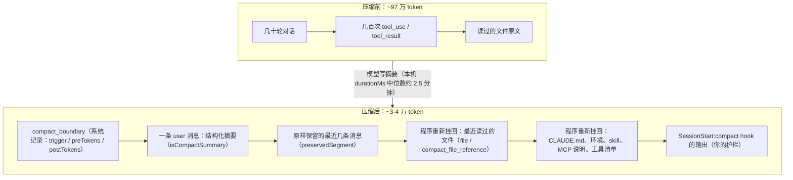

# 如何实现上下文压缩

> 对应原站：[如何实现上下文压缩](https://labuladong.online/zh/ai-coding/claude-code/context-compaction/)（会员内容；本章为独立原创重写）

> **一句话结论**：压缩就是让模型把旧对话写成一份结构化摘要，再用「摘要 + 原样保留的最近几条消息 + 程序重新挂回来的文件和规则」替换掉整段历史；摘要负责记住「在干什么」，程序负责记住摘要说不清的东西。

## 你的会话被压缩过多少次？

先看一组本机数据。我用 `session_stats.py compact` 统计了本机所有会话里的压缩边界（`compact_boundary` 记录）：

=== "Node"

    ```text
    ❯ node http_analyzer/session_stats.ts compact
    100 compact boundaries
    by trigger: {"auto":55,"manual":45}
    post/pre ratio: min 0.013  median 0.043  max 0.253
    auto preTokens: min 171742  median 967354  max 1010134
    ```

=== "Python"

    ```text
    ❯ uv run python -m http_analyzer.session_stats compact
    100 compact boundaries
    by trigger: {'auto': 55, 'manual': 45}
    post/pre ratio: min 0.013  median 0.043  max 0.253
    auto preTokens: min 171742  median 967354  max 1010134
    ```

100 次压缩，一半多是自动触发的。压缩前的中位数是 96.7 万 token，压缩后只剩原来的 4% 左右。

你可能会问：一百万 token 的对话压成四万，丢了 96%，Claude 后面怎么还能接着干活？丢掉的是什么，留下的又是什么？

## 为什么非压不可

[上下文和 token](../p0-core/03-messages-and-tokens.md)那章讲过：LLM 没有记忆，每次请求都要把完整历史塞进 messages。会话越长，三个问题越严重：

1. **贵**：就算有缓存，每轮也要按读取价付全部前缀的钱。
2. **变笨**：关键信息被淹没在几百次工具调用里，模型容易「迷失在中间」。
3. **满了就停**：超过窗口，请求直接失败。

官方模型配置文档说，原生 1M 窗口的模型（Sonnet 5 及以后、Haiku 5.5 等）默认在约 967K token 时自动压缩。本机自动压缩的 `preTokens` 中位数是 967354，和文档对得严丝合缝。

打个比方，压缩就像读一本很厚的书，读到一半合上书写一页读书笔记：人物关系、主线进展、还没解开的悬念。之后你只带着笔记和最近读的那几页继续读。

类比的局限：读书笔记是你自己写的，你知道自己关心什么；而模型写摘要时并不知道「后面会用到什么」，所以摘要提示词必须**事先规定好**要保留哪些东西。

## 压缩之后，上下文里有什么

我按记录类型统计了本机每次压缩边界之后紧跟着的内容（只看类型，不看正文）：



图里每一层都对应本机 jsonl 里能看到的东西（最早统计时 95 次压缩里出现的次数）：

- **摘要**：每次都有。它是一条 `isCompactSummary: true` 的 user 消息。
- **原样保留的尾巴**：`compactMetadata` 里有 `preservedSegment`（头、锚点、尾三个消息 uuid）和 `preservedMessages`。摘要正文的最后一段也明说了：后面的消息是压缩前最近的几条，**原样保留**；摘要是在没看到它们的情况下写的，所以摘要里说「还没做」的事，可能在这几条里已经做了。
- **重新挂回的文件**：`file` 出现 85 次、`compact_file_reference` 61 次。官方文档说压缩后会重新注入最多 5 个最近读过或编辑过的文件。
- **重新挂回的规则和环境**：`instructions`（CLAUDE.md）、`environment`、`invoked_skills`、`mcp_instructions_delta`、`deferred_tools_delta`、`agent_listing_delta` 等。文档里「压缩后保留什么」那张表说：system prompt、项目根的 CLAUDE.md、不带路径限制的 rules、auto memory、plan 模式写的计划都会从磁盘重新注入；调用过的 skill 正文每个最多 5000 token、总共最多 25000 token。
- **hook**：压缩后出现 154 次 `SessionStart:compact`。官方 hooks 文档里 SessionStart 的 matcher 有 `compact` 这个来源，专门用来在压缩后重新注入上下文。

这就是一句话结论里说的分工：**摘要只负责「我们在干什么」，其余能从磁盘重新读的东西，程序直接重新读。** 让模型去「记住」一个文件的内容既不可靠又浪费，重读一遍才是最准的。

## 摘要写什么

本机摘要的骨架是 9 个固定小节（我只列标题）：

```text
1. Primary Request and Intent
2. Key Technical Concepts
3. Files and Code Sections
4. Errors and fixes
5. Problem Solving
6. All user messages
7. Pending Tasks
8. Current Work
9. Optional Next Step
```

值得注意的有两处：

- **第 6 节「All user messages」**：用户说过的每句话都要列出来。为什么？因为用户的原话是最贵的信息，「别改 API 签名」这种约束要是被摘要概括没了，后面就会出事。工具输出可以概括，用户的指令不能。
- **第 8、9 节「Current Work / Next Step」**：让压缩后的模型知道「刚才手上在干什么、下一步是什么」。摘要末尾还有一句指令，大意是：直接接着干，不要复述摘要，不要说「我继续」之类的开场白。

你可能会问：为什么不让模型自由发挥，写一段自然的总结？

因为自由总结会按「模型觉得重要」来取舍，而模型觉得重要的（技术细节）和真正要紧的（用户约束、当前进度）经常不一样。固定小节是在强制它别漏掉后者。

回到主线：压缩是最直接的「用信息损失换上下文空间」。设计压缩的关键不是压得多狠，而是决定**哪些信息不许丢**，以及哪些信息根本不用模型记、交给程序重新拿。

## 动手：一个最小的压缩器

下面这段代码把上面的分工落成一个类：超过阈值就压缩；摘要由一个假的「模型」生成（真实实现是一次模型调用）；尾部原样保留，而且切点**不能把 `tool_use` 和它的 `tool_result` 切开**；最近读过的文件由程序重新挂回来：

=== "Node"

    ```ts
    type Msg = { role: "user" | "assistant"; content: string | any[] };

    function tokens(x: unknown): number {     // 粗估：4 字符 ≈ 1 token
      return Math.floor(JSON.stringify(x).length / 4);
    }

    const SUMMARY_SECTIONS = ["Primary Request and Intent", "Key Technical Concepts", "Files and Code Sections",
      "Errors and fixes", "All user messages", "Pending Tasks", "Current Work", "Optional Next Step"];

    /** 真实实现里这是一次模型调用；这里用规则模拟，重点是『提示词要求它保留什么』。 */
    function fakeLlmSummarize(history: Msg[]): string {
      const users = history.filter((m) => m.role === "user" && typeof m.content === "string").map((m) => m.content as string);
      const out = [];
      for (const s of SUMMARY_SECTIONS) {
        const body = ({
          "All user messages": users.map((u) => `   - ${u}`).join("\n"),   // 用户原话逐条保留
          "Current Work": `   - 正在处理：${users.at(-1)}`,
        } as Record<string, string>)[s] ?? "   - …";
        out.push(`${s}:\n${body}`);
      }
      return out.join("\n");
    }

    const isToolResult = (m: Msg) => Array.isArray(m.content) && m.content[0].type === "tool_result";

    class Session {
      msgs: Msg[] = [];
      readFiles = new Map<string, string>();
      window: number; ratio: number; keepTail: number;
      constructor(window = 2000, ratio = 0.8, keepTail = 1) {
        [this.window, this.ratio, this.keepTail] = [window, ratio, keepTail];
      }

      add(role: Msg["role"], content: Msg["content"]): void {
        this.msgs.push({ role, content });
        if (tokens(this.msgs) > this.window * this.ratio) this.compact("auto");
      }

      compact(trigger: string): void {
        const pre = tokens(this.msgs);
        let cut = this.msgs.length - this.keepTail;
        while (cut > 0 && isToolResult(this.msgs[cut]))   // 不能把 tool_use 和它的 tool_result 切开
          cut -= 1;
        const head = this.msgs.slice(0, cut), tail = this.msgs.slice(cut);
        const summary = fakeLlmSummarize(head);
        const reattach: Msg[] = [...this.readFiles].slice(-2)                   // 程序保留：最近读过的文件
          .map(([p, c]) => ({ role: "user", content: `[re-read] ${p}\n${c.slice(0, 80)}` }));
        this.msgs = [{ role: "user", content: "This session is being continued from a previous " +
          "conversation. Summary:\n" + summary }, ...reattach, ...tail];      // 尾部原样保留
        console.log(`⏺ compact_boundary trigger=${trigger} preTokens=${pre} postTokens=${tokens(this.msgs)}`);
      }
    }

    const s = new Session();
    s.add("user", "帮我把 utils/date.ts 的时区 bug 修掉");
    for (let i = 0; i < 8; i++) {
      s.readFiles.set(`src/file${i}.ts`, "export const x = 1;\n".repeat(30));
      s.add("assistant", [{ type: "tool_use", name: "Read", input: { file_path: `src/file${i}.ts` } }]);
      s.add("user", [{ type: "tool_result", content: "export const x = 1;\n".repeat(30) }]);
      if (i === 4) s.add("user", "别改 API 签名");
    }
    console.log("---- after:");
    for (const m of s.msgs) {
      const c = typeof m.content === "string" ? m.content : JSON.stringify(m.content);
      console.log(`[${m.role}] ${JSON.stringify(c.slice(0, 70))}`);
    }
    console.log("用户原话是否还在：", JSON.stringify(s.msgs).includes("别改 API 签名"));
    ```

=== "Python"

    ```python
    import json

    def tokens(x):                       # 粗估：4 字符 ≈ 1 token
        return len(json.dumps(x, ensure_ascii=False)) // 4

    SUMMARY_SECTIONS = ["Primary Request and Intent", "Key Technical Concepts", "Files and Code Sections",
                        "Errors and fixes", "All user messages", "Pending Tasks", "Current Work", "Optional Next Step"]

    def fake_llm_summarize(history):
        """真实实现里这是一次模型调用；这里用规则模拟，重点是『提示词要求它保留什么』。"""
        users = [m["content"] for m in history if m["role"] == "user" and isinstance(m["content"], str)]
        out = []
        for s in SUMMARY_SECTIONS:
            body = {"All user messages": "\n".join(f"   - {u}" for u in users),   # 用户原话逐条保留
                    "Current Work": f"   - 正在处理：{users[-1]}"}.get(s, "   - …")
            out.append(f"{s}:\n{body}")
        return "\n".join(out)

    def _is_tool_result(m):
        return isinstance(m["content"], list) and m["content"][0].get("type") == "tool_result"

    class Session:
        def __init__(self, window=2000, ratio=0.8, keep_tail=1):
            self.msgs, self.read_files = [], {}
            self.window, self.ratio, self.keep_tail = window, ratio, keep_tail

        def add(self, role, content):
            self.msgs.append({"role": role, "content": content})
            if tokens(self.msgs) > self.window * self.ratio:
                self.compact("auto")

        def compact(self, trigger):
            pre = tokens(self.msgs)
            cut = len(self.msgs) - self.keep_tail
            while cut > 0 and _is_tool_result(self.msgs[cut]):   # 不能把 tool_use 和它的 tool_result 切开
                cut -= 1
            head, tail = self.msgs[:cut], self.msgs[cut:]
            summary = fake_llm_summarize(head)
            reattach = [{"role": "user", "content": f"[re-read] {p}\n{c[:80]}"}       # 程序保留：最近读过的文件
                        for p, c in list(self.read_files.items())[-2:]]
            self.msgs = [{"role": "user", "content": "This session is being continued from a previous "
                          "conversation. Summary:\n" + summary}] + reattach + tail      # 尾部原样保留
            print(f"⏺ compact_boundary trigger={trigger} preTokens={pre} postTokens={tokens(self.msgs)}")

    s = Session()
    s.add("user", "帮我把 utils/date.ts 的时区 bug 修掉")
    for i in range(8):
        s.read_files[f"src/file{i}.ts"] = "export const x = 1;\n" * 30
        s.add("assistant", [{"type": "tool_use", "name": "Read", "input": {"file_path": f"src/file{i}.ts"}}])
        s.add("user", [{"type": "tool_result", "content": "export const x = 1;\n" * 30}])
        if i == 4:
            s.add("user", "别改 API 签名")
    print("---- after:")
    for m in s.msgs:
        c = m["content"] if isinstance(m["content"], str) else json.dumps(m["content"], ensure_ascii=False)
        print(f"[{m['role']}] {c[:70]!r}")
    print("用户原话是否还在：", "别改 API 签名" in json.dumps(s.msgs, ensure_ascii=False))
    ```

===! "Node"

    ```text
    ❯ node compact_demo.ts
    ⏺ compact_boundary trigger=auto preTokens=1620 postTokens=365
    ---- after:
    [user] "This session is being continued from a previous conversation. Summary:"
    [user] "[re-read] src/file6.ts\nexport const x = 1;\nexport const x = 1;\nexport "
    [user] "[re-read] src/file7.ts\nexport const x = 1;\nexport const x = 1;\nexport "
    [assistant] "[{\"type\":\"tool_use\",\"name\":\"Read\",\"input\":{\"file_path\":\"src/file7.ts\"}"
    [user] "[{\"type\":\"tool_result\",\"content\":\"export const x = 1;\\nexport const x "
    用户原话是否还在： true
    ```

=== "Python"

    ```text
    ❯ uv run python compact_demo.py
    ⏺ compact_boundary trigger=auto preTokens=1655 postTokens=372
    ---- after:
    [user] 'This session is being continued from a previous conversation. Summary:'
    [user] '[re-read] src/file6.ts\nexport const x = 1;\nexport const x = 1;\nexport '
    [user] '[re-read] src/file7.ts\nexport const x = 1;\nexport const x = 1;\nexport '
    [assistant] '[{"type": "tool_use", "name": "Read", "input": {"file_path": "src/file'
    [user] '[{"type": "tool_result", "content": "export const x = 1;\\nexport const'
    用户原话是否还在： True
    ```

（离线 fake 模型，摘要由规则生成。）

注意 `keep_tail=1`：本来只保留最后 1 条消息，但最后一条是 `tool_result`，单独留下它会让 API 报错（找不到对应的 `tool_use`），所以切点往前挪了一位，保留了一对完整的调用。这种「切点对齐」在真实实现里很重要。

## API 侧的另外两种做法

Claude Code 的压缩是客户端做的：它自己调模型写摘要，自己重组 messages。Messages API 本身还提供了两种服务端的机制：

1. **上下文编辑（context editing）**：beta 头 `context-management-2025-06-27`，在请求里带 `context_management.edits`。比如 `clear_tool_uses_20250919` 在输入超过阈值时清掉旧的工具结果；`clear_thinking_20251015` 清掉旧的 thinking 块。本机每次请求里都带着 `{"type": "clear_thinking_20251015", "keep": "all"}`，也就是声明了策略但保留全部 thinking。
2. **服务端压缩（compaction）**：官方有按需压缩和按阈值压缩两种，各有自己的 beta 头，阈值版默认在 15 万输入 token 触发。

我的看法：清工具结果是「无损的有损」，丢掉的是程序随时能重新拿到的东西，很划算；写摘要才是真正的有损。两者可以叠加：先清旧工具输出，实在不够再写摘要。

## 对照你的环境

- 你的 SessionStart hook matcher 是空字符串，匹配所有来源，所以每次压缩之后 `inject-guardrails.sh` 都会重跑一次。本机记录里压缩后 154 次 `SessionStart:compact` 就是证据。这是对的：护栏不该被摘要「概括」掉。
- 本机 45 次手动 `/compact`。官方文档支持 `/compact 只保留 X 相关的内容` 这种带指令的写法。在 webapp 上调 bug 调了很久、准备换话题时，带一句指令能让摘要聚焦。
- `CLAUDE_AUTOCOMPACT_PCT_OVERRIDE` 可以把自动压缩阈值调低（只能调低，不能调高）。如果你发现长会话后半段质量明显下降，可以试着让它早点压缩。

## 回到开头的问题

一百万 token 压成四万，丢掉的是历史上的工具输出、旧的思考过程、读过的文件原文；留下的是用户的每句原话、当前进度、最近几条原样消息。文件、CLAUDE.md、护栏这些能从磁盘重新拿的东西，压缩后由程序重新挂回来。所以 Claude 能接着干活，靠的不只是摘要。

## 常见坑

1. **切点切在 tool_use 和 tool_result 中间**：API 会拒绝请求。切之前先对齐。
2. **摘要把用户约束概括掉了**：一定要让用户原话逐条保留。
3. **压缩后不重新注入规则**：规则只在第一条消息里，压缩后就没了。用 SessionStart `compact` hook 或者由程序重新挂回。
4. **摘要和保留的尾巴打架**：摘要是在看不到尾巴的情况下写的，要在摘要里明说「以后面原样消息为准」。
5. **压缩本身也要上下文**：写摘要的那次请求要把整段历史发给模型，如果已经顶到窗口上限就来不及了。所以阈值要留余量。

## 练习

1. 给 `Session.compact()` 加一个 `instructions` 参数，模拟 `/compact 只关注 X`，让假摘要只保留包含关键词的用户消息。
2. 实现「先清工具结果、再写摘要」的两级策略：超过 60% 先把旧 `tool_result` 换成占位符，超过 80% 才写摘要。比较两种策略下 `postTokens` 的差别。
3. 开放题：Codex 和 Claude Code 都会压缩，但压缩后「还剩什么」的取舍不同。如果让你给一个跑 8 小时的后台 Agent 设计压缩，你会额外保留什么？（提示：Anthropic 的 *Effective harnesses for long-running agents* 用了进度文件。）

## 延伸阅读

- Claude Code 上下文窗口与压缩：https://code.claude.com/docs/en/context-window
- 自动压缩阈值：https://code.claude.com/docs/en/model-config
- Hooks（PreCompact / PostCompact / SessionStart `compact`）：https://code.claude.com/docs/en/hooks
- API 上下文编辑：https://platform.claude.com/docs/en/build-with-claude/context-editing
- API 服务端压缩：https://platform.claude.com/docs/en/build-with-claude/compaction
- 本库：[上一章 文件读写](04-file-read-write.md)、[下一章 自动记忆](06-auto-memory.md)、[mini Claude Code：compact](../p4-mini-cc/14-compact.md)
