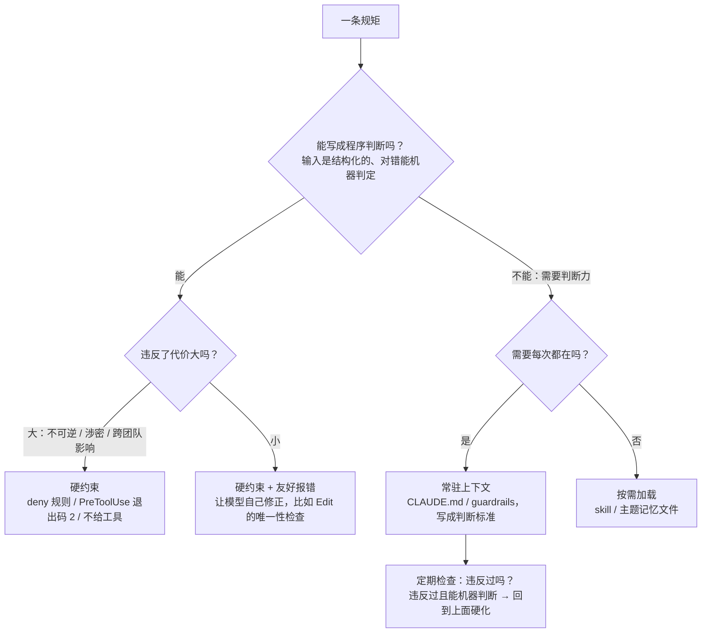

# Harness Engineering 是什么

> 对应原站：[Harness Engineering 是什么](https://labuladong.online/zh/ai-coding/basics/harness-engineering/)（会员内容；本章为独立原创重写）

> **一句话结论**：Agent 里除了模型本身，其余全是 harness：拼上下文、执行工具、检查权限、压缩、记忆、hook。它有两只手，一只手用 prompt 给模型立规矩（软约束，靠模型自觉），另一只手用代码设硬限制（硬约束，模型忘了也没用）。好的 harness 工程，就是把能硬化的规矩尽量从第一只手挪到第二只手。

## 一条写了还是被违反的规则

你的 `enforce-worktree.py` 开头有一段很诚实的背景说明，大意是：

> 记忆里早就写了「一律用 EnterWorktree 切进去，不要只 `git worktree add` 然后每条命令 cd 进去」，但没有任何机制会拦，于是照犯不误……本 hook 补上那个「拦」。

这是 2026 年 9 月的事。规则写在 memory 里，模型每个会话都读得到，可它还是会犯。

你可能会问：模型都读到了规则，为什么还会违反？是模型不够聪明吗？

不是。回到全库的主线：LLM 是在根据上下文预测下一个 token。规则只是上下文里的一段文字，它和几十万 token 的代码、日志、工具输出挤在一起，竞争模型的「注意力」。规则在上下文里，只能**提高**模型守规矩的概率，没法保证它一定守。

这一章就讲：Agent 工程里，哪些事该交给 prompt，哪些事必须交给代码。

## Harness 是什么

harness 原意是马具，套在马身上的那一整套挽具和缰绳。马（模型）提供力气，挽具决定这股力气往哪个方向使、能不能拉着车不翻沟。

打个比方，模型是一匹很聪明的马，听得懂人话。你可以对它喊「慢点，别往左」（prompt），它多半会听；但山路边上，你还是要装护栏（代码）。类比的局限是：真的马不会因为听了太多话而忘记前面说的，而模型会，上下文越长，开头说过的话越容易被淹没。

把这个系列前面拆过的东西放在一起看，你会发现每一样都是 harness 的一部分，而且每一样都同时用了两只手：

| 章节 | 软约束（进上下文） | 硬约束（代码执行） |
|---|---|---|
| [System Prompt](03-system-prompt.md) | 行为规范、工具描述里的「必须先 Read」 | 稳定段在前、snapshot 冻结（保证缓存） |
| [文件读写](04-file-read-write.md) | 「先读后改」写在工具描述里 | 文件状态表：没读过、读完被改过就报错 |
| [上下文压缩](05-context-compaction.md) | 摘要提示词要求保留用户原话 | 程序重新挂回文件、CLAUDE.md、hook 输出 |
| [自动记忆](06-auto-memory.md) | 告诉模型什么值得记 | 索引只加载前 200 行 / 25KB，超了提醒精简 |
| [权限检查](10-permission-check.md) | CLAUDE.md 里的「不要……」 | deny 规则、退出码 2 的 hook |
| [Plan Mode](11-plan-mode.md) | 「只规划不动手」的指令 | 权限层拦截、子 agent 不给写工具、ExitPlanMode 审批 |

## 什么该软、什么该硬



几个判断依据：

**能不能机器判定。**「不要在主工作区直接改代码」能判定：看命令是不是 `git worktree add`、cwd 在不在 worktree 里。「方案要先想清楚再写」不能判定，只能写成判断标准放进上下文。

**违反的代价。** force push、删库、泄露 key，一次就够你受的，必须硬拦。命名不够好看，提醒一下就行。

**硬约束要给模型留台阶。** 被拦之后，错误信息会作为 `tool_result` 回到上下文。写清楚「为什么拦、该怎么做」，模型下一步就能自己改对。你的 `enforce-worktree.py` 把说明写进 stderr、退出码 2，正是这个模式；第 4 章那些 Edit 报错（「Found 2 matches… replace_all is false」）也是。

**软约束要定期复查。** 上下文里的规则被违反过，而且违反的形态能机器判断，就该硬化。你 worktree 那条规则就是这么从 memory 升级成 hook 的。

回到主线：上下文是有限的，而且越长越不可靠。硬约束**不占上下文**（只在被触发时多一条报错），还不受上下文长度影响。把规矩从上下文挪进代码，同时换来了省 token 和可靠性。

## 动手：同一条规则，软 vs 硬

下面这个实验用一个离线假模型：它大部分时候守规矩，但有 8% 的概率「忘了」，直接执行 `git push --force`。两种方案的 system prompt 里都写了禁止，区别只在有没有 hook：

=== "Node"

    ```ts
    /** 可设种子的伪随机数（mulberry32）：Math.random 不能设种子，实验要可复现 */
    function seeded(seed: number): () => number {
      return () => {
        seed = (seed + 0x6d2b79f5) | 0;
        let t = Math.imul(seed ^ (seed >>> 15), 1 | seed);
        t = (t + Math.imul(t ^ (t >>> 7), 61 | t)) ^ t;
        return ((t ^ (t >>> 14)) >>> 0) / 4294967296;
      };
    }

    /** 离线假模型：大部分时候守规矩，偶尔『忘了』规则直接 git push --force。 */
    function fakeModel(step: number, rng: () => number): string {
      return rng() < 0.08 ? "git push --force" : `npm test -- --shard ${step}`;
    }

    function run(enforceWithHook: boolean, steps = 500, seed = 7): [number, number] {
      const rng = seeded(seed);
      let violations = 0, blocked = 0;
      // 两种方案的 system prompt 里都写了「永远不要 force push」，区别只在有没有 hook
      for (let step = 0; step < steps; step++) {
        const cmd = fakeModel(step, rng);
        if (enforceWithHook && cmd.includes("push --force")) {
          blocked += 1;                                  // PreToolUse 退出码 2：不执行，stderr 回灌给模型
          continue;
        }
        if (cmd.includes("push --force")) violations += 1;
      }
      return [violations, blocked];
    }

    for (const hook of [false, true]) {
      const [v, b] = run(hook);
      console.log(`${hook ? "prompt + hook" : "prompt only  "}  violations executed: ${String(v).padStart(3)}   blocked by hook: ${String(b).padStart(3)}`);
    }
    ```

=== "Python"

    ```python
    import random

    def fake_model(step, rng):
        """离线假模型：大部分时候守规矩，偶尔『忘了』规则直接 git push --force。"""
        return "git push --force" if rng.random() < 0.08 else f"npm test -- --shard {step}"

    def run(enforce_with_hook, steps=500, seed=7):
        rng, violations, blocked = random.Random(seed), 0, 0
        # 两种方案的 system prompt 里都写了「永远不要 force push」，区别只在有没有 hook
        for step in range(steps):
            cmd = fake_model(step, rng)
            if enforce_with_hook and "push --force" in cmd:
                blocked += 1                                 # PreToolUse 退出码 2：不执行，stderr 回灌给模型
                continue
            if "push --force" in cmd:
                violations += 1
        return violations, blocked

    for hook in (False, True):
        v, b = run(hook)
        print(f"{'prompt + hook' if hook else 'prompt only  '}  violations executed: {v:>3}   blocked by hook: {b:>3}")
    ```

===! "Node"

    ```text
    ❯ node harness_demo.ts
    prompt only    violations executed:  36   blocked by hook:   0
    prompt + hook  violations executed:   0   blocked by hook:  36
    ```

=== "Python"

    ```text
    ❯ uv run python harness_demo.py
    prompt only    violations executed:  49   blocked by hook:   0
    prompt + hook  violations executed:   0   blocked by hook:  49
    ```

（离线 fake 模型，8% 违规率是我设的参数，不代表任何真实模型的数据。）

结果没什么悬念：只靠 prompt，500 步里 49 次违规全部被执行了；加了 hook，49 次全部被拦下。（Node 版换了一个可设种子的随机数生成器，同样的种子抽出来是 36 次，数字不同，结论一样。）

这个实验的意义不在数字，在于它说明了两者的**性质**不同：prompt 改变的是违规的概率，hook 改变的是违规的后果。你可以把 prompt 写得再好，把概率从 8% 压到 0.8%，但只要不是 0，跑足够多步就一定会发生；而 hook 让「发生了也没事」。

当然 hook 也不是万能的。你在 `enforce-worktree.py` 里自己写了：`bash -c "git worktree add …"` 这种把命令藏进引号里的写法拦不住。hook 防的是「无意的违规」，防不了「刻意的绕过」。要防后者，得用沙箱这种不依赖命令文本的机制。

## 对照你的环境：你已经在做 harness 工程了

你 CLAUDE.md 里第一条原则就是：「**工具链能强制的就别写进上下文**——该写成 lint / CI / 类型，而不是多一条规则。」后面还有一句更狠的：「一条规则要真生效，还得**撤掉能触发相反行为的工具**。」

这两句话几乎就是这一章的结论。把你环境里的东西按两只手分一下：

**硬约束（代码层）：**

- `enforce-worktree.py`（PreToolUse:Bash，退出码 2）：把 worktree 纪律从 memory 变成了拦截。
- 团队平台自带的三个 PreToolUse 检查脚本：写文案、发布回滚、审批流水线之前各拦一道。
- `doctor.sh` 的 §11.5「护栏注入链路」：脚本注释写着「文件在仓库 ≠ 真的会注入」，它逐条跑真实注入探针。这是对 harness **本身**的测试，很少有人做到这一步。
- TDD 铁律（先写失败测试）：测试是给「代码对不对」做的硬约束，模型说「改好了」不算数，测试绿了才算。
- 「完成前跑命令贴真实输出」：把「我觉得做完了」换成「机器证明做完了」。

**软约束（上下文层），但带工程手段：**

- `inject-guardrails.sh`（SessionStart）：按 git 身份（不是路径子串）决定注入哪几层护栏。脚本注释里写了为什么：路径不是身份，按目录名子串匹配会让 `/tmp` 下一个同名的临时目录也吃到公司层规则。还有一句踩坑记录：SessionStart 只把纯 stdout 当上下文，JSON 形状不对会被静默丢弃。
- 分层：全局准则常驻、项目护栏按 cwd 注入、流程进 skill 按需加载、一次性事实进 memory。本质是按「每次都要付的上下文成本」分层。
- codex 异源 review：同一个模型容易对自己的错误视而不见，换一个模型来审，是在用**另一个上下文**做交叉检查。它不是硬约束，但比「让同一个模型自查」可靠得多。

**一个值得补的缺口：** 上一章和第 10 章都提到，你的 `defaultMode` 是 bypass，`permissions` 里没有 deny。你 CLAUDE.md 里「env / apikey / secret 绝不写文件」这条，目前完全靠软约束。按你自己的原则，它是「违反代价大 + 部分能机器判断」的典型，值得加几条 `Read` / `Edit` 的 deny 规则，或者一个扫描写入内容的 PreToolUse hook。

## 业内的几条共识

Anthropic 工程博客里有几篇和 harness 直接相关，我挑出和本章最相关的观点（用我自己的话转述）：

- *Effective context engineering for AI agents*：上下文是一种边际收益递减的有限资源，要找「最小的、高信号的 token 集合」。这对应软约束要少而精。
- *Writing effective tools for agents*：工具本身就是 prompt，工具的设计（名字、描述、报错信息）决定模型能不能用对。这对应硬约束要「给台阶」。
- *Effective harnesses for long-running agents*：长任务里，让每个会话做增量进展，并留下结构化的进度记录给下一个会话。这对应压缩和记忆：不能全指望模型记得，要把状态落到外部。

我自己的总结是三句话：

1. **能用代码判断的，别交给模型判断。**
2. **必须交给模型判断的，给它判断标准，而不是条文。**
3. **规则写进上下文之后，盯着它被违反的记录；违反过且能机器判断的，就硬化。**

## 回到开头的问题

模型读到了规则，为什么还会违反？因为规则只是上下文里的一段文字，它影响的是概率。你后来用 hook 解决了这个问题，这就是 Harness Engineering：不是写更好的 prompt 去求模型，而是在模型外面造一套东西，让它犯错时也翻不了车。

## 常见坑

1. **规则只写在 CLAUDE.md 里**：那是概率，不是保证。必须守住的事交给代码。
2. **硬约束只拦不说**：拦下来不说为什么，模型会换个写法重试，甚至绕过去。错误信息要写清楚原因和正确做法。
3. **hook 本身成了故障点**：你的 hook 里有一句「读不到输入就不拦，hook 不该成为新的故障点」，这是对的。hook 崩溃导致所有命令都被拦，比没有 hook 更糟。
4. **harness 没有测试**：注入脚本、hook 脚本也是代码。你的 `doctor.sh` 做了注入探针，hook 也该有 fixture 测试。
5. **把所有规则都硬化**：需要判断力的事硬化了只会制造误伤。worktree 那个 hook 一开始也误伤过「往 memory 里写这条规则本身」，后来才加了「抹掉 heredoc 和引号串」的处理。

## 练习

1. 把你 CLAUDE.md 里的规则逐条过一遍上面的决策图，挑出两条「能机器判断 + 违反代价大」但目前只是软约束的，写出对应的 deny 规则或 hook 草稿（先不要装到真实配置里）。
2. 给 `harness_demo.py` 加一个「每 50 步在上下文里重复一次规则」的选项，假设重复提醒能把违规率从 8% 降到 3%。对比三种方案：只写一次、定期重复、加 hook。
3. 开放题：codex 异源 review 是软约束还是硬约束？如果要把它变成硬约束（比如「review 没过就不许 push」），你会怎么接进现有的 hook 体系？代价是什么？

## 延伸阅读

- *Effective context engineering for AI agents*：https://www.anthropic.com/engineering/effective-context-engineering-for-ai-agents
- *Writing effective tools for agents — with agents*：https://www.anthropic.com/engineering/writing-tools-for-agents
- *Effective harnesses for long-running agents*：https://www.anthropic.com/engineering/effective-harnesses-for-long-running-agents
- Claude Code Hooks：https://code.claude.com/docs/en/hooks
- Claude Code 沙箱：https://code.claude.com/docs/en/sandboxing
- 本库：[上一章 Plan Mode](11-plan-mode.md)、[LLM 和 Agent 的核心术语](../p0-core/01-llm-and-agent.md)、[Hooks](../p1-tools/08-hooks.md)、[Workflow 和 Agent](../p2-agent-basics/05-workflow-vs-agent.md)、下一部分 [Coding Agent 的命令系统](../p4-mini-cc/01-cli.md)
