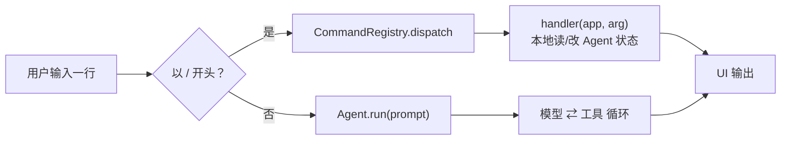

# Coding Agent 的命令系统

> 对应原站：[Coding Agent 的命令系统](https://labuladong.online/zh/ai-coding/coding-agent/cli/)（会员内容；本章为独立原创重写）

> **一句话结论**：斜杠命令和对话走的是两条完全不同的路。命令在本地直接读写 agent 的状态（清历史、看用量、换模型），**一个 token 都不发给模型**；在入口处把这两条路分开，就是 CLI 外壳的全部骨架。

## 敲 `/clear` 花不花钱？

你每天在 Claude Code 里敲 `/clear`、`/model`、`/usage`。有没有想过：这几行输入会不会也被发给模型？

如果会，那 `/clear` 本身就自相矛盾——为了清空上下文，先往上下文里塞一句「请清空上下文」。

答案是不会。带着这个答案，我们从这一章开始在 `code/mini_cc-node/`（Python 版 `code/mini_cc/`）里从零手搓一个 mini Claude Code：不用 agent 框架，只用 Anthropic 官方 SDK（Node 版 `@anthropic-ai/sdk`，Python 版 `anthropic`），让循环的每一行都摆在你面前。21 章之后它会有权限审批、会话恢复、压缩、MCP、sub agent、plan 模式。但第一步，是先有一个能聊、能调工具、能敲 `/help` 的壳。

## 先跑起来看看

离线 fake 模型（`examples/ch01.json` 是一份两步剧本：先调 `Bash(ls examples)`，再回答），不发任何 API 请求：

=== "Node"

    ```console
    $ printf '/help\n/stauts\n列一下 examples 目录\n/status\n/new\n/status\n/exit\n' \
        | node mini_cc/cli.ts --fake examples/ch01.json
    ❯ /help
    /context  查看上下文里都放了什么（system 段落、注入的提醒、历史）
    /exit     退出（别名 /quit）
    /help     显示所有命令
    /mode     查看或切换权限模式：/mode acceptEdits（REPL 里也可按 Shift+Tab 循环切换）
    /model    查看或切换模型：/model claude-sonnet-5-5
    /new      开启新会话，清空对话历史（别名 /clear）
    /resume   列出本项目的历史会话；/resume <序号|id 前缀> 恢复
    /status   查看模型、消息数与 token 消耗
    ❯ /stauts
    ✗ 未知命令 /stauts，你是不是想输入 /status？
    ❯ 列一下 examples 目录
    ◇ system  项目说明 0 个文件、git 快照
    ◇ system  日期 2026-10-22
    ● 我先看看目录。
    ⏺ Bash(ls examples)
    ✔ Bash -> ch01.json
      ch02.json
      ch03.json  …(+8 lines)
    ● examples 目录里有若干演示脚本。
    ❯ /status
    model     claude-opus-5-5
    effort    medium
    cwd       /Users/me/agent-learn/code/mini_cc-node
    session   00a5bf3f-d016-4eb3-88e7-627fb0fd12f0
    mode      default
    allow     -
    reviewer  0 calls
    messages  4
    context   100 tokens（最近一次请求的输入）
    total     in 200 / out 40 / 2 requests
    ❯ /new
    已开启新会话 abc70aaa（旧会话仍在磁盘上，可用 /resume 找回）
    ❯ /status
    model     claude-opus-5-5
    effort    medium
    cwd       /Users/me/agent-learn/code/mini_cc-node
    session   abc70aaa-2650-4f3d-a149-eaa7007e718f
    mode      default
    allow     -
    reviewer  0 calls
    messages  0
    context   0 tokens（最近一次请求的输入）
    total     in 0 / out 0 / 0 requests
    ❯ /exit
    ```

=== "Python"

    ```console
    $ printf '/help\n/stauts\n列一下 examples 目录\n/status\n/new\n/status\n/exit\n' \
        | uv run python -m mini_cc --fake examples/ch01.json
    › /help
    /exit    退出（别名 /quit）
    /help    显示所有命令
    /model   查看或切换模型：/model claude-sonnet-5-5
    /new     开启新会话，清空对话历史（别名 /clear）
    /status  查看模型、消息数与 token 消耗
    › /stauts
    ✗ 未知命令 /stauts，你是不是想输入 /status？
    › 列一下 examples 目录
    ⏺ Bash(ls examples)
    examples 目录里有若干演示脚本。
    › /status
    model     claude-opus-5-5
    effort    medium
    cwd       /Users/me/agent-learn/code/mini_cc
    messages  4
    context   100 tokens（最近一次请求的输入）
    total     in 200 / out 40 / 2 requests
    › /new
    已开启新会话
    › /status
    ...
    messages  0
    context   0 tokens（最近一次请求的输入）
    total     in 0 / out 0 / 0 requests
    › /exit
    ```

（Python 版是第 1 章当时的真实输出；token 数是 FakeClient 写死的 100/20。第 2 章起提示符改成了 `❯`。Node 版是在实现到第 10 章的代码上跑的，所以多了几条命令、两行 `◇ system` 注入（第 9 章），模型调工具前那句「我先看看目录。」也已经显示出来了（第 2 章）。）

七行输入，只有「列一下 examples 目录」这一行真正进了模型，`/status` 显示的 2 次请求都来自它。其余六行全在本地处理完了。

还有个细节先记下：剧本第一步里模型说了一句「我先看看目录。」，第 1 章的屏幕上却没有。这是下一章的事。

## 入口分流：一个 if 决定花不花钱



图注：左边那条路 0 token、0 延迟；右边那条才是 agent 循环。

打个比方，这像餐厅的前台和后厨。点菜（对话）要送进后厨，厨师（模型）按单子做；问「我这桌消费多少了」「换张桌子」（命令）前台直接答，用不着惊动厨师。

这个比方有一处不成立：餐厅前台知道的，厨师也大概知道；而 agent 里，**模型对客户端状态一无所知**。你问模型「我现在用的哪个模型」，它只能猜。所以命令不只是省钱，有些问题只有客户端答得对。

你可能会问：那为什么不干脆让模型调一个 `get_status` 工具？

可以，但没必要。工具调用要先付一整轮请求的钱（整个上下文都要再发一遍），换来的信息客户端本来就有。我的观点是：**凡是客户端自己知道答案的，都不该绕到模型那里去。**

**回到主线**：LLM 只是「给定上下文预测下一个 token」，上下文里的每个 token 都有成本、也都会影响预测。斜杠命令是一条**不占上下文的控制通道**——管理上下文（`/new` 清空、`/status` 观测）这件事本身，不该往上下文里再塞东西。

## 项目骨架

下文提到的 `mini_cc/xxx.py`，Node 版就是同名的 `mini_cc/xxx.ts`；标识符从 snake_case 换成 camelCase（`run_turn` → `runTurn`），发给 API 的字段（`tool_use_id`、`max_tokens`）保持原样。

=== "Node"

    ```
    code/mini_cc-node/
    ├── mini_cc/
    │   ├── cli.ts          # node mini_cc/cli.ts：REPL + CommandRegistry + main()
    │   ├── config.ts       # Settings：所有可调旋钮
    │   ├── model.ts        # ModelClient 接口 + AnthropicClient + FakeClient
    │   ├── loop.ts         # Agent 循环
    │   ├── ui.ts           # ConsoleUI（ANSI 转义） / BufferUI（测试）
    │   └── tools/          # registry + 每个工具一个文件：Read / Write / Bash
    ├── tests/              # node:test，全部用 FakeClient，不发真实请求
    └── examples/           # 离线演示剧本（--fake）
    ```

=== "Python"

    ```
    code/mini_cc/
    ├── mini_cc/
    │   ├── __main__.py     # uv run python -m mini_cc
    │   ├── config.py       # Settings：所有可调旋钮
    │   ├── model.py        # ModelClient 协议 + AnthropicClient + FakeClient
    │   ├── loop.py         # Agent 循环
    │   ├── cli.py          # REPL + CommandRegistry
    │   ├── ui.py           # ConsoleUI（rich） / BufferUI（测试）
    │   └── tools/          # registry + 每个工具一个文件：Read / Write / Bash
    ├── tests/              # pytest，全部用 FakeClient，不发真实请求
    └── examples/           # 离线演示剧本（--fake）
    ```

## 模型层：一个很窄的接口

`mini_cc/model.ts`（Python 版 `model.py`）里，循环和模型之间只交换两个 interface（Python 版是两个 dataclass）：

=== "Node"

    ```ts
    export interface ModelRequest {
      system: Block[];
      messages: Message[];
      tools?: Block[];
      maxTokens?: number;                         // 默认 64000
      outputConfig?: Record<string, any> | null;  // effort / 结构化输出
    }

    export interface ModelResponse {
      content: Block[];      // 纯对象，能直接 JSON.stringify 落盘
      stopReason: string;
      usage: Record<string, any>;
    }
    ```

=== "Python"

    ```python
    @dataclass
    class ModelRequest:
        system: list[Block]
        messages: list[dict[str, Any]]
        tools: list[dict[str, Any]] = field(default_factory=list)
        max_tokens: int = 64000
        output_config: dict[str, Any] | None = None   # effort / 结构化输出

    @dataclass
    class ModelResponse:
        content: list[Block]      # 纯 dict，能直接 json.dumps 落盘
        stop_reason: str
        usage: dict[str, int]
    ```

`AnthropicClient.create()` 是 `client.messages.create(...)` 的薄包装，最后一步把 SDK 的 Pydantic 对象转成纯 dict（`b.to_dict()`；Node 版 SDK 返回的本来就是普通对象，JSON 往返一次即可）。这样循环、持久化、测试都不依赖 SDK 类型。

`FakeClient` 是整个系列的测试基石。构造时给一份「剧本」，每次请求弹出一步，同时把收到的请求深拷贝进 `self.requests`，测试可以断言「模型到底看到了什么」：

=== "Node"

    ```ts
    const client = new FakeClient([
      call("Bash", { command: "echo hello" }),   // 第 1 次请求：模型说要调 Bash
      say("命令输出了 hello"),                    // 第 2 次请求：模型给出最终回答
    ]);
    ```

=== "Python"

    ```python
    client = FakeClient([
        call("Bash", {"command": "echo hello"}),   # 第 1 次请求：模型说要调 Bash
        say("命令输出了 hello"),                    # 第 2 次请求：模型给出最终回答
    ])
    ```

说白了，FakeClient 就是一个「只会背台词的演员」。它在哪里不像真模型？它不会因为你改了 prompt 就换台词——所以它测的是**循环逻辑**，不是 prompt 效果。

## Agent 循环：三十行

`mini_cc/loop.ts:Agent.run`（Python 版 `loop.py:Agent.run`；第 1 章版本，要等整轮跑完才返回。Node 版的模型调用是 `await`，Python 版是阻塞式）：

=== "Node"

    ```ts
    async run(prompt: string): Promise<TurnResult> {
      this.messages.push({ role: "user", content: prompt });
      const steps: string[] = [];
      for (let i = 0; i < this.settings.maxIterations; i++) {
        const resp = await this.client.create(this.request());
        this.usage.add(resp.usage);
        this.messages.push({ role: "assistant", content: resp.content });
        const toolUses = resp.content.filter((b) => b.type === "tool_use");
        if (resp.stopReason !== "tool_use" || !toolUses.length) {
          const text = resp.content.filter((b) => b.type === "text").map((b) => b.text).join("");
          return new TurnResult(text, steps);
        }
        const results = [];
        for (const tu of toolUses) {
          steps.push(this.tools.get(tu.name)!.summary(tu.input));
          const r = await this.tools.execute(tu.name, tu.input, this.ctx);
          results.push({ type: "tool_result", tool_use_id: tu.id,
                         content: r.content, is_error: r.isError });
        }
        this.messages.push({ role: "user", content: results });
      }
      return new TurnResult("[stopped: max_iterations reached]", steps);
    }
    ```

=== "Python"

    ```python
    def run(self, prompt: str) -> TurnResult:
        self.messages.append({"role": "user", "content": prompt})
        steps: list[str] = []
        for _ in range(self.settings.max_iterations):
            resp = self.client.create(self._request())
            self.usage.add(resp.usage)
            self.messages.append({"role": "assistant", "content": resp.content})
            tool_uses = [b for b in resp.content if b["type"] == "tool_use"]
            if resp.stop_reason != "tool_use" or not tool_uses:
                return TurnResult("".join(b["text"] for b in resp.content if b["type"] == "text"), steps)
            results = []
            for tu in tool_uses:
                steps.append(self.tools.get(tu["name"]).summary(tu["input"]))
                r = self.tools.execute(tu["name"], tu["input"], self.ctx)
                results.append({"type": "tool_result", "tool_use_id": tu["id"],
                                "content": r.content, "is_error": r.is_error})
            self.messages.append({"role": "user", "content": results})
        return TurnResult("[stopped: max_iterations reached]", steps)
    ```

两条容易写错的规则：

- assistant 的**整个 content** 原样存回历史，不能只抽文本。`claude-opus-5-5` 的 thinking 块要原样回传，`tool_use` 块更是下一条 `tool_result` 的配对依据。
- 同一条 assistant 里的多个 `tool_use`，结果放进**同一条** user 消息。

`max_iterations=50` 是兜底：模型陷入「调工具 → 看结果 → 再调」的死循环时不会无限烧钱。

## 命令注册表：命令是数据

你可能会问：五个命令，写个 `if line == "/help": ... elif ...` 不就完了？

五个是可以。但这个系列后面会陆续加 `/resume`、`/mode`、`/tasks`，以及第 12–21 章的 `/memory`、`/rewind`、`/compact`、`/mcp`……每加一个都去改分发函数，那个函数很快会变成几百行。所以命令做成数据：`Command(name, help, handler, aliases)` 放进注册表，`/help` 只是遍历打印。

`mini_cc/cli.ts:CommandRegistry.dispatch`（Python 版 `cli.py:CommandRegistry.dispatch`）：

=== "Node"

    ```ts
    async dispatch(app: App, line: string): Promise<string | null> {
      const trimmed = line.trim();
      const sp = trimmed.indexOf(" ");
      const [name, arg] = sp < 0 ? [trimmed, ""] : [trimmed.slice(0, sp), trimmed.slice(sp + 1)];
      const cmd = this.lookup(name);                // 先查别名表
      if (cmd === undefined) {
        const close = getCloseMatches(name, this.allNames(), 1);
        const hint = close.length ? `，你是不是想输入 ${close[0]}？` : "，输入 /help 查看全部命令";
        app.ui.error(`未知命令 ${name}${hint}`);
        return null;
      }
      return (await cmd.handler(app, arg.trim())) ?? null;
    }
    ```

=== "Python"

    ```python
    def dispatch(self, app: "App", line: str) -> str | None:
        name, _, arg = line.strip().partition(" ")
        cmd = self.lookup(name)               # 先查别名表
        if cmd is None:
            close = difflib.get_close_matches(name, self.all_names(), n=1)
            hint = f"，你是不是想输入 {close[0]}？" if close else "，输入 /help 查看全部命令"
            app.ui.error(f"未知命令 {name}{hint}")
            return None
        return cmd.handler(app, arg.strip())
    ```

注册一个命令只要一个装饰器（Node 没有装饰器语法，直接调 `COMMANDS.register(name, help, handler, aliases)`）：

=== "Node"

    ```ts
    COMMANDS.register("/new", "开启新会话，清空对话历史", (app) => {
      app.agent.reset();
      app.ui.info("已开启新会话");
    }, ["/clear"]);
    ```

=== "Python"

    ```python
    @COMMANDS.register("/new", "开启新会话，清空对话历史", aliases=("/clear",))
    def _new(app: App, arg: str) -> None:
        app.agent.reset()
        app.ui.info("已开启新会话")
    ```

handler 拿到的是 `App`，也就是整个客户端状态：Agent（messages、usage）、Settings、UI。命令能做的事，就是读写这些状态。

本章装了五个：`/help`、`/new`（别名 `/clear`）、`/status`、`/model`、`/exit`（别名 `/quit`）。`/status` 的 `context` 取的是**最近一次请求的输入 token**（`input_tokens + cache_read + cache_creation`），这是「当前上下文有多大」最直接的读数。第 14 章做自动压缩时，触发阈值就看它。

`App.handle_line()` 是唯一入口，REPL（`prompt_toolkit`，带命令补全；Node 版用 `node:readline`）和测试都只调它。stdin 不是终端时（管道），退化成逐行读取并回显，上面那段演示就是这么录的。

## 测试

`tests/ch01_commands.test.ts`（Python 版 `tests/test_ch01_commands.py`）覆盖：普通输入进模型、工具循环把结果回传、斜杠命令**不触发模型请求**（`client.requests == []`）、`/new` 清空历史、别名、未知命令纠错、`/status` 读数、`/model` 切换。

=== "Node"

    ```console
    $ cd /Users/me/agent-learn/code/mini_cc-node && node --test 'tests/ch01*.test.ts'
    ℹ tests 8
    ℹ suites 0
    ℹ pass 8
    ℹ fail 0
    ℹ cancelled 0
    ℹ skipped 0
    ℹ todo 0
    ℹ duration_ms 630.533084
    ```

=== "Python"

    ```console
    $ cd /Users/me/agent-learn/code/mini_cc && uv run pytest -q
    ........                                                                 [100%]
    8 passed in 0.02s
    ```

去掉 `--fake`、设好 `ANTHROPIC_API_KEY`（或用 `ANTHROPIC_BASE_URL` 指向中转站），`node mini_cc/cli.ts`（Python 版 `uv run python -m mini_cc`）就是真模型。

## 和真实 Claude Code 比一比

从本机 Claude Code 2.1.306 的二进制里能直接看到内置命令的定义（`strings` 提取）：

| 命令 | Claude Code 的定义（摘录） | mini-cc |
|---|---|---|
| `/clear` | `aliases:["reset","new"]`，「Start a new session with empty context; previous session stays on disk (resumable with /resume)」 | `/new`（别名 `/clear`），第 4 章起旧会话同样留在磁盘 |
| `/status` | 版本、模型、账号、API 连通性、工具状态 | 模型、effort、消息数、token |
| `/usage` | `aliases:["cost","stats"]` | 合并进 `/status` |
| `/exit` | `aliases:["quit"]` | 同 |
| `/context` | 用彩色网格可视化上下文占用 | 未实现（练习 3） |

更本质的差异是：Claude Code 的命令分**类型**。`local` 本地执行返回文本；`local-jsx` 渲染交互 UI（如 `/context` 的网格）；`prompt` 则把一段 prompt 展开后**送进模型**——你写的 skill 用 `/skill-name` 调用就走这条路。mini-cc 目前只有 `local`，第 20 章做 skills 时会加 prompt 型命令。

所以开头那个问题要补半句：`/clear` 不花钱，但**不是所有斜杠命令都不花钱**。`/your-skill` 恰恰是最花钱的那种，它把整份 SKILL.md 塞进了上下文。

## 对照你的环境

- 你在 `~/.claude/settings.json` 里配了 `UserPromptSubmit` hook。它拦的是「进模型的那条路」；`local` 类命令根本不形成一次提交给模型的 prompt，和本章的分流图一致。
- 你那 40 多个 skill 走的是 `prompt` 型命令：内容展开后进上下文，和 `/clear` 这种 0 token 的本地命令性质完全不同。

## 常见坑

1. **`/new` 只清 messages**。usage 也要一起清，否则 `/status` 显示的是上一个会话的数字（`Agent.reset()` 两个都清）。
2. **只存文本、丢掉 content 块**。下一轮请求会因为 `tool_result` 找不到配对的 `tool_use` 而 400。
3. **多个 tool_result 分成多条 user 消息**。API 能接受，但 claude-api 文档明确提醒：这会让模型逐渐不再并行调用工具。
4. **把命令输出 append 进 messages**。`/status` 的结果是给人看的，进了历史就白白占上下文。
5. **工具列表顺序不稳定**（比如从 set 生成）。工具定义在 prompt 最前面，顺序一变 prompt cache 全部失效；`ToolRegistry.schemas()` 按注册顺序输出。

## 练习

1. 给 `/status` 加一行「本次会话预估花费」：按 `claude-opus-5-5` 每百万 token $4 输入 / $20 输出计算，并加一个测试断言。
2. 实现 `/history`：把当前 messages 以「角色: 前 40 字」列出，tool_use / tool_result 显示成工具名。
3. 开放题：仿照 Claude Code 的 `/context`，设计一个可视化：system、工具定义、历史消息、工具结果各占多少 token？真实场景可以用 `client.messages.count_tokens` 分段计数，离线测试又该怎么办？

## 延伸阅读

- Claude Code 斜杠命令：<https://code.claude.com/docs/en/slash-commands>
- Tool use 概览（手写循环）：<https://platform.claude.com/docs/en/agents-and-tools/tool-use/overview>
- 本系列：[动手实现一个 Coding Agent](../p2-agent-basics/02-coding-agent.md)、[上下文是什么？token 怎么计费？](../p0-core/03-messages-and-tokens.md)、[用 Skills 定制你的 AI 工作流](../p1-tools/12-skills.md)
- 下一章：[Agent 循环的逐步输出](02-realtime-output.md)
