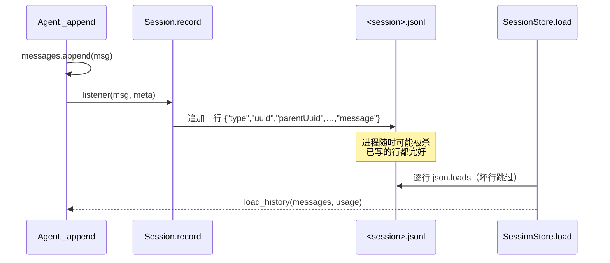

# 持久化聊天记录

> 对应原站：[持久化聊天记录](https://labuladong.online/zh/ai-coding/coding-agent/resume/)（会员内容；本章为独立原创重写）

> **一句话结论**：会话持久化就是「每往 messages 追加一条，就往 JSONL 文件追加一行」；恢复会话就是把这些行读回来、重新塞进 messages。能做得这么简单，靠的是上一章定下的规矩——**历史只追加、不修改**。

## `claude --resume` 是怎么「接着聊」的？

你的 `~/.claude/projects/` 下面有几百个 `.jsonl` 文件，文件夹名长得像 `-Users-me-work-webapp`。`claude -c` 一敲，昨天的对话原样回来了。

你可能会问：它恢复的到底是什么？是把模型的「记忆」存起来了吗？

不是。模型没有记忆，每次请求都是把完整的 messages 从头发一遍（[上下文是什么](../p0-core/03-messages-and-tokens.md) 讲过）。所谓「恢复会话」，恢复的只是**客户端手里那个 messages 数组**。把数组存下来、再读回来，下一次请求就和没退出过一模一样。

而 mini-cc 现在的数组只活在内存里：手一滑 Ctrl+D，一下午的上下文全没了。

## 先跑起来看看

启动两次进程（离线 fake 模型；`MINI_CC_HOME` 指到临时目录，不污染 `~/.mini_cc`）：

```console
--- 第一次启动
❯ 记一下：测试命令是 uv run pytest -q
● 好的，我记住了：这个项目的测试命令是 uv run pytest -q。
❯ /exit
--- 第二次启动
❯ /resume
1. b25c2034  10-21 19:44    2 msgs  记一下：测试命令是 uv run pytest -q
输入 /resume <序号> 恢复
❯ /resume 1
已恢复会话 b25c2034（2 条消息），继续聊吧
❯ 测试命令是什么来着？
● 你之前告诉我，测试命令是 uv run pytest -q。
❯ /status
...
session   3f9c2a1e-5b7d-4c1a-9e2f-8a6b0c4d1e7f
messages  4
total     in 200 / out 40 / 2 requests
--- 磁盘上的文件
3f9c2a1e-5b7d-4c1a-9e2f-8a6b0c4d1e7f.jsonl
{"type": "user", "uuid": "4cf00467-…", "parentUuid": null, "sessionId": "b25c2034-…", "timestamp": "2026-10-21T11:44:41.544+00:00", "cwd": "/Users/liz/liz/agent-learn/code/mini_cc", "message": {"role": "user", "content": "记一下：测试命令是 uv run pytest -q"}}
{"type": "assistant", "uuid": "3e85657e-…", "parentU…
       4 $SCRATCH/demo_home/projects/-Users-liz-liz-agent-learn-code-mini-cc/b25c2034-….jsonl
```

（fake 模型第二次的回答是剧本写好的；但测试里会断言「第二个进程发给模型的请求确实带上了第一个进程的历史」，那才是真正要验证的东西。）

注意两点：`/status` 里的 token 累计也是 2 次请求——用量跟着历史一起恢复了；文件只有 4 行——恢复后的新消息追加在**同一个文件**后面。

## 为什么是 JSONL



图注：写入路径和 agent 循环是同一个节拍——每条消息落地一次；读回路径就是逐行解析。

你可能会问：为什么不每轮结束时把整个 messages `json.dump` 成一个文件？

想象一下记账。一种是每天晚上把整本账重抄一遍（整文件覆盖），另一种是每笔交易发生时在账本末尾记一行（追加）。重抄的问题是：抄到一半停电，整本账就花了。追加的话，停电最多丢最后那半行。

JSONL（JSON Lines，一行一个 JSON 对象）就是追加式账本：

- **崩溃安全**：进程在写最后一行时被杀，只损失那半行。`SessionStore.read_records` 遇到解析不了的行直接跳过。
- **写入便宜**：每条消息 O(1) 追加，而不是每轮 O(n) 重写——一个几千条消息的长会话，差别很明显。
- **可以 `tail -f`、`grep`、`jq`**：你调试 Claude Code 时肯定这么干过。

这个比方的不成立之处：账本可以划掉错账重写，而我们的历史**永远不改旧行**。这不是偷懒，是有意为之——下一节说为什么。

**回到主线**：持久化没有改变上下文的内容，它改变的是上下文的**寿命**——从「进程活多久」延长到「磁盘在多久」。代价为零：发给模型的 token 一个没多。

## 只追加：一条规矩换三个好处

上一章定下「历史只在 `MessageDone` 之后写入」，这一章把它推到底：`mini_cc/loop.py:Agent._append` 是历史**唯一**的写入口，只追加、不修改。

```python
def _append(self, msg: dict[str, Any], **meta: Any) -> None:
    """历史的唯一写入口。只追加、不修改——这条规矩让持久化、prompt cache、thinking 校验都简单。"""
    self.messages.append(msg)
    for fn in self.listeners:
        fn(msg, meta)
```

这条规矩同时换来三个好处：

1. **持久化变成纯追加**。内存里每 append 一条，磁盘上就 append 一行，两边永远对得上，不需要「diff 一下哪里变了」。
2. **prompt cache 命中**。Anthropic 的缓存是前缀匹配：只要前面的消息一个字节都没变，那部分就能命中缓存，只按约 1/10 的价格计费。你一旦回头改了第 3 条消息，第 3 条之后全部失效。
3. **thinking 块保持有效**。claude-api 文档专门提到，`claude-opus-5-5` 有「preserved thinking」校验：改写更早的轮次会让之前的 thinking 块失效，2026-08-31 之后新建的账号甚至会直接 400。所以「把 harness 做成只追加」是官方建议。

后面的章节会不断考验这条规矩：第 9 章要往上下文里注入提醒、第 14 章要压缩历史。到时候你会看到，我们宁可多绕一步，也不去改旧消息。

## 实现：listener + 一个 Session 类

Agent 不知道磁盘的存在，它只负责在 `_append` 时通知 listener。`mini_cc/session.py:Session.record` 就是那个 listener：

```python
def record(self, msg, meta=None):
    rec = {
        "type": msg["role"],
        "uuid": str(uuidlib.uuid4()),
        "parentUuid": self.last_uuid,      # 串成一条链
        "sessionId": self.id,
        "timestamp": _now(),
        "cwd": str(self.store.cwd),
        "message": msg,                     # 原样存，恢复时原样回传
    }
    if meta and meta.get("usage"):
        rec["usage"] = meta["usage"]        # assistant 行带上这次请求的 usage
    self.append_record(rec)
    self.last_uuid = rec["uuid"]
```

几个字段的用意：

- `message` **原样存**。thinking 块的 `signature`、tool_use 的 `id`，恢复后都要一字不差地回传给 API。
- `uuid` / `parentUuid` 把消息串成链表。现在看是多余的（文件顺序就是消息顺序），但第 13 章做 `/rewind` 回退时，「回到某条消息」就是沿着这条链找祖先。Claude Code 的记录里也有这两个字段。
- `usage` 只记在 assistant 行上。恢复时把它们加起来，`/status` 的累计用量就对得上。

文件放在 `<home>/projects/<slug>/<session_id>.jsonl`，`project_slug()` 的规则和 Claude Code 一样：路径里非字母数字的字符都换成 `-`。所以 `/Users/liz/liz/agent-learn/code/mini_cc` 变成 `-Users-liz-liz-agent-learn-code-mini-cc`——和你 `~/.claude/projects/` 下那些文件夹名对照一下，`.claude/worktrees` 也被变成了 `-claude-worktrees`。

还有个小细节：**第一条消息之前不建文件**（`append_record` 才 `mkdir` + 打开）。否则每次启动、立刻 `/resume` 走人，都会留下一个空会话，`/resume` 列表里全是垃圾。

## 恢复：读回来，再修一下

`mini_cc/session.py:SessionStore.load` 逐行读，只取 `type` 是 `user`/`assistant` 的行，其他类型一律忽略——第 13、14 章会写入别的记录类型（比如压缩边界），老代码读到也不会崩。

`mini_cc/cli.py:App.resume`：

```python
def resume(self, session_id: str) -> int:
    session, messages, usage = self.store.load(session_id)
    self._attach(session)  # 先接上文件，load_history 里补的修复记录才会写进这个会话
    self.agent.load_history(messages, usage)
    return len(messages)
```

`load_history()` 里会调一次上一章的 `repair_history()`。为什么恢复时还要修？因为进程可能死在「模型说要调工具、工具还没返回」那一刻，磁盘上最后一行就是一个悬空的 `tool_use`。不修，恢复后第一次请求就 400。

那行注释是我踩过的坑：最初写成先 `load_history` 再 `_attach`，结果修复记录被 listener 写进了**旧会话**（启动时那个空会话）的文件里。测试 `test_resume_repairs_dangling_tool_use` 现在专门断言修复记录落在被恢复的文件里。

恢复之后的新消息继续追加到同一个文件——这和 Claude Code 默认行为一致。Claude Code 还有 `--fork-session` 参数，恢复时另起一个新 session id（`claude --help` 里能看到）。

### 命令和参数

- `/resume`：列出当前项目的会话（按修改时间倒序，标题取第一条用户消息）。
- `/resume <序号|id 前缀>`：恢复。
- `/new`：不再只是清空内存，而是**另起一个会话**，旧的留在磁盘上。这正是 Claude Code `/clear` 的描述：「previous session stays on disk (resumable with /resume)」。
- 命令行 `-c/--continue` 恢复最近一次，`-r/--resume <ref>` 恢复指定的。和 `claude -c` / `claude -r` 同名。

## 测试

`tests/test_ch04_session.py`：

- slug 规则；第一条消息前不建文件；每条消息立刻落盘；`parentUuid` 链；assistant 行带 `usage`。
- **模拟重启**：同一个 `home` 新建第二个 `App`，`/resume 1` 后断言 FakeClient 收到的第一次请求里带着上一个进程的历史，且新消息追加在原文件上、用量也恢复了。
- `/new` 后旧会话还在；最后一行写了半截也能读；恢复时修复悬空 `tool_use` 并落盘；id 前缀解析与报错。

```console
$ cd /Users/liz/liz/agent-learn/code/mini_cc && uv run pytest -q
.....................................                                    [100%]
37 passed in 1.68s
```

## 和真实 Claude Code 比一比

拿你本机最近 40 个会话文件统计一下记录类型（`type` 字段），会发现 Claude Code 存的远不止消息：

| 类型（节选） | 次数 | 用途（据字段内容判断） |
|---|---|---|
| `attachment` | 22634 | 注入进上下文的东西：hook 输出、日期、CLAUDE.md、`@` 文件……（第 8、9 章） |
| `assistant` / `user` | 14833 / 8861 | 消息本体，和我们的一样 |
| `permission-mode` | 2504 | 权限模式变化（第 5 章） |
| `file-history-snapshot` | 613 | 文件快照，`/rewind` 用（第 13 章） |
| `ai-title` / `custom-title` | 2518 / 1310 | 会话标题 |

每条消息记录还有 `isSidechain`（是不是 sub agent 的消息）、`gitBranch`、`version` 等字段。mini-cc 只保留最核心的几个，其他的等用到的章节再加。

另一个区别：从记录类型名 `ai-title` 看，Claude Code 的会话标题是模型生成的；mini-cc 直接取第一句用户输入。省一次请求，代价是标题不太好看。

## 回到开头

`claude --resume` 恢复的不是模型的记忆，而是客户端那个 messages 数组。把数组的每一次 append 同步成文件的一行，就是全部秘密——说穿了，就是给 `messages.append` 配了一个 `f.write`。

## 对照你的环境

- 你的 CLAUDE.md 规定「给用户返回文件路径一律用绝对路径」，理由是常在 worktree 里工作。会话目录按 cwd 分，所以**同一个仓库的不同 worktree 是不同的项目目录**（`…-claude-worktrees-agt-1814` 这种）。在 worktree A 里 `claude -c`，找不到在 worktree B 里聊的会话——这不是 bug，是 slug 规则的直接结果。
- 你的 `SessionEnd` hook 拿到的 payload 里有 `transcript_path`，指向的就是这个 JSONL。想做会话审计（你有个 `session-audit` skill），直接读这个文件即可。

## 常见坑

1. **整文件覆盖写**。写到一半崩溃就丢整个会话；会话越长写得越慢。
2. **只存文本**。恢复后 thinking 块签名、tool_use id 全丢，第一次请求就 400。
3. **恢复时不修悬空 `tool_use`**。进程死在工具执行中途，恢复后永远 400。
4. **listener 挂错顺序**。先加载再挂 listener，修复记录会写进错误的文件（我们踩过）。
5. **在 JSONL 里存 API key、环境变量**。会话文件是明文，常被同步、备份、分享。你的 CLAUDE.md「涉密信息绝不写文件」这条，对 agent 自己的会话记录同样成立——工具输出里打印了 secret，它就进了 JSONL。

## 练习

1. 给 `/resume` 加搜索：`/resume pytest` 只列出标题或内容里包含 pytest 的会话。
2. 实现 `--fork-session`：恢复历史，但写入一个新的 session 文件。测试时注意新文件的第一条记录的 `parentUuid` 应该是什么？
3. 开放题：两个终端同时 `mini_cc -c` 恢复同一个会话、各自聊天，文件会变成什么样？`parentUuid` 链会分叉吗？Claude Code 是怎么处理的？（`claude --help` 里 `--bg` 的说明给了一点线索：「continues that session … or starts a copy and says so when the session is already running」。）

## 延伸阅读

- Claude Code 会话与 `--resume`：<https://code.claude.com/docs/en/cli-reference>
- JSON Lines 格式：<https://jsonlines.org/>
- 本系列：[你的聊天记录存在哪](../p1-tools/07-session-storage.md)、上一章 [错误处理与重试](03-error-handling.md)、下一章 [对工具调用进行权限审批](05-permission.md)
