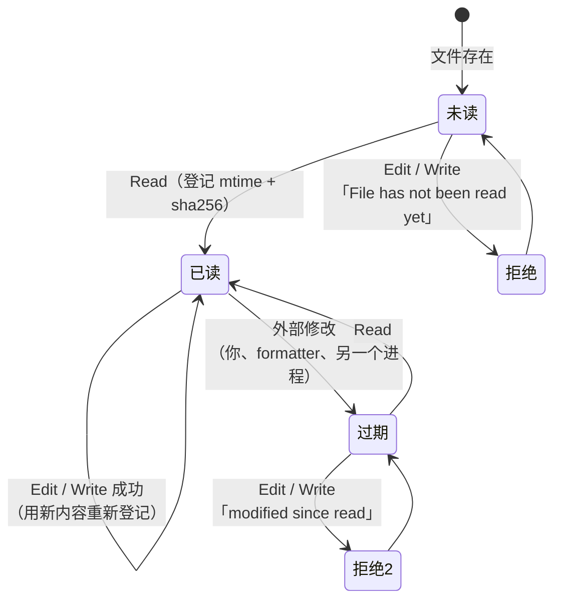

# 可靠的文件编辑工具

> 对应原站：[可靠的文件编辑工具](https://labuladong.online/zh/ai-coding/coding-agent/file-edit/)（会员内容；本章为独立原创重写）

> **一句话结论**：可靠的编辑靠的不是更聪明的 diff 算法，而是三条朴素的规矩：**先读后改、读后未变、`old_string` 必须唯一**。每条规矩被违反时，报错都要告诉模型「下一步该怎么做」。

## 为什么 Claude Code 老说「File has not been read yet」？

你在自己的会话记录里一定见过这些报错（下面几条是从你本机 `~/.claude/projects/*/*.jsonl` 里原样搜出来的）：

```
<tool_use_error>File has not been read yet. Read it first before writing to it.</tool_use_error>
<tool_use_error>Found 2 matches of the string to replace, but replace_all is false. To replace all occurrences, set replace_all to true. To replace only one occurrence, please provide more context to uniquely identify the instance.</tool_use_error>
<tool_use_error>No changes to make: old_string and new_string are exactly the same.</tool_use_error>
```

你可能会问：模型明明知道文件内容（它刚写过、或者上下文里有），为什么非要它再读一遍？这不是浪费 token 吗？

先看看我们现在的 `Write` 有多危险：它拿到一个路径和一整份内容，二话不说覆盖。模型「记得」的文件内容可能是十轮之前的；这期间你可能在编辑器里改了几行，formatter 可能重排了 import。整文件覆盖，这些改动就全没了。而且为了改一行，模型要把整个 500 行的文件重新输出一遍——输出 token 比输入贵 5 倍。

[Claude Code 文件读写是怎么实现的](../p3-agent-internals/04-file-read-write.md) 把问题归成三类：幻觉盲改、并发覆盖、token 浪费。这一章动手把对应的机制搬到 mini-cc 上。

## 先跑起来看看

离线 fake 模型（`examples/ch07.json`），一个有两处 `TIMEOUT = 30` 的 `config.py`，中途用一条 `sed` 模拟「你在另一个终端改了文件」：

=== "Node"

    ```console
    ❯ 把 prod 的超时改成 60，再关掉 DEBUG
    ◇ system  项目说明 0 个文件
    ◇ system  日期 2026-10-22
    ● 直接把 DEBUG 关掉。
    ⏺ Edit(config.py)
    ✘ Edit -> <tool_use_error>File has not been read yet. Read it first before writing to it.</tool_use_error>
    ● 得先读文件。
    ⏺ Read(config.py)
    ✔ Read ->      1	# dev
           2	TIMEOUT = 30
           3	# prod  …(+2 lines)
    ⏺ Edit(config.py)
    ✘ Edit -> <tool_use_error>Found 2 matches of the string to replace, but replace_all is false. To replace all o
      String: TIMEOUT = 30</tool_use_error>
    ● 有两处，带上注释那一行让它唯一。
    ⏺ Edit(config.py)
    ✔ Edit -> The file config.py has been updated (1 replacement). Snippet:
           1	# dev
           2	TIMEOUT = 30  …(+3 lines)
    ● （模拟：你在另一个终端里改了这个文件）
    ⏺ Bash(sed -i '' 's/DEBUG = True/DEBUG = True  # set by ops/' config.py)
    是否允许 Bash(sed -i '' 's/DEBUG = True/DEBUG = True  # set by ops/' config.py)？（needs approval）
      1. 允许
      2. 允许，且本会话不再询问 Bash(sed -i '' 's/DEBUG = True/DEBUG = True  # set by ops/' config.py)
      3. 拒绝（可以附一句话告诉模型该怎么做）
    选择 [1/2/3]: 1
    ✔ Bash -> (no output)
    ◇ system  1 个文件被外部修改
    ● 提醒里说文件被改过了（带了 diff），按新内容改。
    ⏺ Edit(config.py)
    ✔ Edit -> The file config.py has been updated (1 replacement). Snippet:
           2	TIMEOUT = 30
           3	# prod  …(+2 lines)
    ● 改好了：prod 的 TIMEOUT 改成 60，DEBUG 关闭，保留了你加的注释。
    --- config.py
    # dev
    TIMEOUT = 30
    # prod
    TIMEOUT = 60
    DEBUG = False  # set by ops
    ```

=== "Python"

    ```console
    ❯ 把 prod 的超时改成 60，再关掉 DEBUG
    ● 直接把 DEBUG 关掉。
    ⏺ Edit(config.py)
    ✘ Edit -> <tool_use_error>File has not been read yet. Read it first before writing to it.</tool_use_error>
    ● 得先读文件。
    ⏺ Read(config.py)
    ✔ Read ->      1        # dev
           2        TIMEOUT = 30
           3        # prod  …(+2 lines)
    ⏺ Edit(config.py)
    ✘ Edit -> <tool_use_error>Found 2 matches of the string to replace, but replace_all is false. To replace all o
      String: TIMEOUT = 30</tool_use_error>
    ● 有两处，带上注释那一行让它唯一。
    ⏺ Edit(config.py)
    ✔ Edit -> The file config.py has been updated (1 replacement). Snippet:
           1        # dev
           2        TIMEOUT = 30  …(+3 lines)
    ● （模拟：你在另一个终端里改了这个文件）
    ⏺ Bash(sed -i '' 's/DEBUG = True/DEBUG = True  # set by ops/' config.py)
    ...
    选择 [1/2/3]: 1
    ✔ Bash -> (no output)
    ⏺ Edit(config.py)
    ✘ Edit -> <tool_use_error>File has been modified since read, either by the user or by a linter. Read it again 
    ● 文件被改过了，重新读。
    ⏺ Read(config.py)
    ...
    ⏺ Edit(config.py)
    ✔ Edit -> The file config.py has been updated (1 replacement). Snippet:
    ...
    ● 改好了：prod 的 TIMEOUT 改成 60，DEBUG 关闭，保留了你加的注释。
    --- config.py
    # dev
    TIMEOUT = 30
    # prod
    TIMEOUT = 60
    DEBUG = False  # set by ops
    ```

三条规矩各拦了一次，每次模型都按报错的提示自我修正。（Node 版是在实现到第 10 章的代码上跑的：第 9 章的「外部修改提醒」会在 Bash 结果后面主动注入 diff、按新内容重新登记文件——就是那行 `◇ system  1 个文件被外部修改`——所以规矩二在这里不再「拦下」，模型直接按提醒里的新内容改；规矩二拦下的样子见测试「读后被外部修改，必须重读」。Node 版剧本也相应少了「撞墙 → 重读」两步。）最后的文件里，dev 的 `TIMEOUT` 没被误改，「你」加的注释 `# set by ops` 也没被覆盖。

## 三条规矩，各防一种事故



图注：这是 `mini_cc/tools/file_state.py:FileStateCache` 里每个文件的状态机。只有在「已读」状态下才能写；写成功后自己的新内容就是最新状态，可以接着改，不用再读。

打个比方，这像在共享文档里改合同。规矩一：**你得先打开看过**，不能凭印象说「把第三条改了」；规矩二：**你打开之后要是别人动过，得刷新再改**，不然你的保存会盖掉别人的修改；规矩三：**「把『甲方』改成『乙方』」这种说法不行**，合同里有二十个「甲方」，你得指明是哪一句。

比方在一点上不成立：人改合同时会自然地「看一眼上下文」，模型不会——所以规矩三在 agent 里必须由工具**强制**，而不是靠提醒。

**回到主线**：这三条规矩看起来在「浪费」token（多读一次文件），实际上是在用一点输入 token 换可靠性，同时大幅省下输出 token。`Edit` 只需要输出 `old_string` 和 `new_string` 两小段，而不是整个文件；`Read` 进上下文的内容带行号，让模型能精确定位。上下文里放的东西更少、更准。

## 规矩一：先读后改

`mini_cc/tools/file_state.ts:guardWrite`（Python 版 `file_state.py:guard_write`）是 `Write` 和 `Edit` 共用的检查：

=== "Node"

    ```ts
    export function guardWrite(state: FileStateCache, path: string): string | null {
      if (!existsSync(path)) return null;              // 新文件随便写
      if (state.get(path) === undefined) return NOT_READ; // "File has not been read yet. Read it first before writing to it."
      if (state.isStale(path)) return STALE;           // 规矩二，见下节
      return null;
    }
    ```

=== "Python"

    ```python
    def guard_write(state: FileStateCache, path: Path) -> str | None:
        if not path.exists():
            return None            # 新文件随便写
        if state.get(path) is None:
            return NOT_READ        # "File has not been read yet. Read it first before writing to it."
        if state.is_stale(path):
            return STALE           # 规矩二，见下节
        return None
    ```

`Read` 每次读完都调 `ctx.file_state.remember(path, text, partial=...)`，记下文件当时的 `mtime_ns` 和内容的 sha256。`FileStateCache` 挂在 `ToolContext.file_state` 上，整个会话共享一份。

你可能会问：`/resume` 恢复会话之后呢？历史里明明有 Read 的结果。

恢复后 `file_state` 是空的，模型得重新读。这是故意的：两次启动之间文件完全可能被改过，历史里那份内容已经不可信了。**状态表只信任「这个进程亲眼看到的」**。

## 规矩二：读后未变

`FileStateCache.is_stale`：

=== "Node"

    ```ts
    isStale(path: string): boolean {
      const rec = this.records.get(path);
      ...
      if (statSync(path, { bigint: true }).mtimeNs === rec.mtimeNs)
        return false;                                   // 快路径：时间戳没变
      return digest(readText(path)) !== rec.sha;        // 时间戳变了，再比内容
    }
    ```

=== "Python"

    ```python
    def is_stale(self, path: Path) -> bool:
        rec = self._records.get(path)
        ...
        if path.stat().st_mtime_ns == rec.mtime_ns:
            return False                                  # 快路径：时间戳没变
        return digest(read_text(path)) != rec.sha         # 时间戳变了，再比内容
    ```

为什么不只比 mtime？因为很多工具会 `touch` 文件而不改内容（构建系统、git checkout 同一个版本）。只比 mtime 会让模型白白重读。先比 mtime 是快路径，变了再比内容才是准确判断。测试 `test_touch_without_content_change_is_not_stale` 守着这一点。

报错文案 `File has been modified since read, either by the user or by a linter. Read it again before attempting to write it.` 是 Claude Code 二进制里的原文。这句话里「by a linter」很关键——你配了 PostToolUse hook 跑 formatter 的话，formatter 改完文件，模型手里的版本就过期了。

## 规矩三：old_string 必须唯一

`mini_cc/tools/edit.ts:EditTool.run`（Python 版 `edit.py:EditTool.run`）的核心几行：

=== "Node"

    ```ts
    const n = count(text, old);
    if (n === 0) return err(diagnoseNotFound(text, old));
    if (n > 1 && !replaceAll) {
      return err(`Found ${n} matches of the string to replace, but replace_all is false. ` +
        "To replace all occurrences, set replace_all to true. To replace only one occurrence, " +
        `please provide more context to uniquely identify the instance.\nString: ${old}`);
    }
    const pos = text.indexOf(old);
    const updated = replaceAll ? text.split(old).join(replacement)
                               : text.slice(0, pos) + replacement + text.slice(pos + old.length);
    ```

=== "Python"

    ```python
    count = text.count(old)
    if count == 0:
        return err(_diagnose_not_found(text, old))
    if count > 1 and not replace_all:
        return err(f"Found {count} matches of the string to replace, but replace_all is false. "
                   "To replace all occurrences, set replace_all to true. To replace only one occurrence, "
                   f"please provide more context to uniquely identify the instance.\nString: {old}")
    updated = text.replace(old, new) if replace_all else text.replace(old, new, 1)
    ```

你可能会问：多处匹配时，替换第一处不就行了？大多数时候模型想改的就是第一处。

演示里正好是反例：两处 `TIMEOUT = 30`，用户要改的是 **prod** 那一处，也就是第二处。替换第一处会悄悄改错 dev 的配置，而且**不报错**——这是最糟糕的失败方式。所以 Claude Code 的语义是：多处匹配就拒绝，让模型二选一——

- 给更多上下文让它唯一（演示里带上了 `# prod` 那一行）；
- 或者显式 `replace_all: true`，表明「我确实要改所有地方」（比如重命名一个变量）。

`replace_all` 默认 `false`，这个默认值本身就是一种安全设计：**批量修改必须是明确表达的意图**。

另外几个边界情况：

- `old_string == new_string`：拒绝，`No changes to make`。模型偶尔会这样「假装做了修改」。
- `old_string` 为空且文件不存在：新建文件；文件已存在则拒绝（避免误当作「在开头插入」）。
- 文件是 CRLF、模型给的是 LF：把模型的 `\n` 换成 `\r\n` 再匹配，写回时保持文件原有的换行风格。`read_text/write_text` 用 `newline=""` 打开，Python 不会悄悄转换换行符（Node 的 `readFileSync` / `writeFileSync` 本来就不转换）。

## 报错要能指路

光说「找不到」是不够的。`_diagnose_not_found` 猜一猜模型是怎么抄错的：

| 模型的 old_string | 诊断 |
|---|---|
| `"     2\t    return 1"` | 抄进了 Read 输出的行号前缀，去掉它 |
| `'msg = "hi"'`，文件里是 `msg = “hi”` | 弯引号/直引号不一致，按文件原样抄 |
| `"\treturn 1"`，文件里是 4 个空格 | 缩进不一致（tab vs 空格） |

第一种是我见过模型最常犯的错：`Read` 输出是 `cat -n` 格式（6 位行号 + tab），模型复制时把行号也带上了。这也是为什么 `EditTool.description` 里专门写了一句「Never include the line-number prefix from Read output」。

Claude Code 在这方面做得更细。你本机的一条真实报错是：

```
String to replace not found in file.
String:     /** assistant 消息：langfuse trace id */ ...
(note: Edit also tried swapping \uXXXX escapes and their characters; neither form matched, so the mismatch is likely elsewhere in old_string. Re-read the file and copy the exact surrounding text.)
```

它会自动尝试 `\uXXXX` 转义和字符互换——因为 claude-api 文档提到，新模型在工具参数里的 JSON 转义方式可能不同。

成功时返回的也不只是「OK」，而是改动附近带行号的片段（`_snippet`）。模型不用再 Read 一次就能确认改对了，下一次 Edit 也有了准确的上下文。

## Read 也升级了

`mini_cc/tools/read.ts:ReadTool`（Python 版 `read.py:ReadTool`）：

- 输出 `cat -n` 风格：`{行号:>6}\t{内容}`。行号让模型能说「第 42 行」，也让人能对照。
- `offset` / `limit`，默认最多 2000 行，单行最多 2000 字符。超大文件分段读，末尾注明 `[showing lines 50-51 of 100]`。
- 目录、二进制文件直接拒绝并给出替代方案（「用 Bash ls」）。

## 给 rewind 留的口子

`ToolContext` 加了一个 `write_hooks` 列表，`Write` 和 `Edit` 在真正写盘前都会调用 `ctx.before_write(path)`。现在没人订阅它；第 13 章做 `/rewind` 时，会在这里给文件拍快照，回退对话时一起恢复文件。测试 `test_write_hook_called_before_write` 断言了钩子在写之前被调用（那一刻文件还不存在）。

## 测试

`tests/ch07_file_edit.test.ts`（Python 版 `tests/test_ch07_file_edit.py`），15 个：

- Read：行号格式、offset/limit 与部分读取标记。
- 规矩一：未读不许 Edit、未读不许覆盖已存在文件（新文件可以）。
- 规矩二：外部修改后必须重读且外部修改不丢失；只 touch 不算修改。
- 规矩三：多处匹配报错 → `replace_all` 全部替换；加上下文变唯一；no-op 拒绝。
- 诊断：行号前缀、缩进、弯引号；CRLF 保留；空 `old_string` 新建文件后接着改不用重读；写前钩子；Edit 在 acceptEdits 下被识别为编辑；agent 级别的「Edit 失败 → Read → Edit 成功」。

=== "Node"

    ```console
    $ cd /Users/liz/liz/agent-learn/code/mini_cc-node && node --test 'tests/ch0[1-7]*.test.ts'
    ℹ tests 82
    ℹ suites 0
    ℹ pass 82
    ℹ fail 0
    ℹ cancelled 0
    ℹ skipped 0
    ℹ todo 0
    ℹ duration_ms 2685.042625
    ```

=== "Python"

    ```console
    $ cd /Users/liz/liz/agent-learn/code/mini_cc && uv run pytest -q
    ........................................................................ [ 87%]
    ..........                                                               [100%]
    82 passed in 1.58s
    ```

## 回到开头

Claude Code 非要模型先读一遍，不是因为模型不知道文件内容，而是因为**它知道的可能是旧的**。一次 Read 的输入 token，换来的是「不会覆盖你的修改」「不会改错地方」「不用整文件重写」。说穿了就是在写文件之前，多查了一张「谁什么时候看过这个文件」的表。

## 和真实 Claude Code 的差异

- 本机 Claude Code 2.1.306 的二进制里，Edit 相关的报错还有 `old_string is a substring of a new_string from a previous edit`（多处编辑时防重叠）、`old_string targets a region the hook reformatted, Read the file first`（hook 改过的区域）。它对编辑与 hook 的交互处理得更细。
- Claude Code 有过 `MultiEdit`（二进制里能看到「Performs exact string replacements in files.」），一次调用对同一文件做多处替换，按顺序应用。mini-cc 没做（练习 2）。
- 你本机会话记录里有大量 `edited_text_file` 类型的 attachment：Claude Code 发现文件被外部修改后，会**主动**把变化片段注入上下文，而不是等模型撞上「modified since read」。这是第 9 章的内容。
- Claude Code 的 Read 支持图片、PDF、notebook；mini-cc 只读文本（图片在第 19 章）。

## 对照你的环境

- 你的 PostToolUse hook 如果对 Edit/Write 跑了 formatter（比如 prettier/eslint --fix），那么每次编辑后文件的 mtime 和内容都变了——按本章的规矩二，下一次编辑同一个文件就必须重读。这就是为什么 Claude Code 要专门处理「hook 改过的区域」，否则 formatter 会让每次编辑都多一轮 Read。
- webapp 里 i18n 文案、大型 TSX 组件经常有重复的片段（相同的 `className`、相同的 `</div>`）。你会话里那条「Found 2 matches」就是一段 `</span>\n</button>\n) : null}` 重复出现。遇到这种情况，让模型带上更有辨识度的上一行（组件名、props），比 `replace_all` 安全得多。

## 常见坑

1. **只比 mtime**。构建工具 touch 一下就逼模型重读，浪费 token。先比 mtime，变了再比内容。
2. **多处匹配时默认替换第一处**。改错了还不报错，这是最难发现的 bug。
3. **用默认 `open()` 读写**。Python 默认的通用换行模式会把 CRLF 悄悄变成 LF，一次编辑改动整个文件的每一行。
4. **报错只说「失败」**。模型会原样重试；报错里要写清楚为什么、怎么改。
5. **写完不更新状态表**。模型刚 Write 完紧接着 Edit，会被自己的写入判成「外部修改」。

## 练习

1. 实现 `MultiEdit`：`edits: [{old_string, new_string, replace_all?}]`，按顺序应用，任意一步失败则整体不写盘。想想第二步的 `old_string` 是基于原文件还是第一步之后的内容？
2. Claude Code 会自动尝试 `\uXXXX` 转义互换。给 `_diagnose_not_found` 加上「把 old_string 里的 `中` 换成『中』再试」的自动修复：匹配唯一时直接替换，并在结果里注明「auto-corrected」。
3. 开放题：如果两个 sub agent（第 17 章）同时编辑同一个文件，`FileStateCache` 应该共享还是各自一份？各有什么问题？

## 延伸阅读

- Text editor tool（Anthropic 定义的 `str_replace_based_edit_tool`，语义类似）：<https://platform.claude.com/docs/en/agents-and-tools/tool-use/text-editor-tool>
- Claude Code 内置工具列表：<https://code.claude.com/docs/en/settings#tools-available-to-claude>
- 本系列：[Claude Code 文件读写是怎么实现的](../p3-agent-internals/04-file-read-write.md)、上一章 [auto 模式](06-auto-mode.md)、下一章 [用 @ 引用文件](08-file-mention.md)
