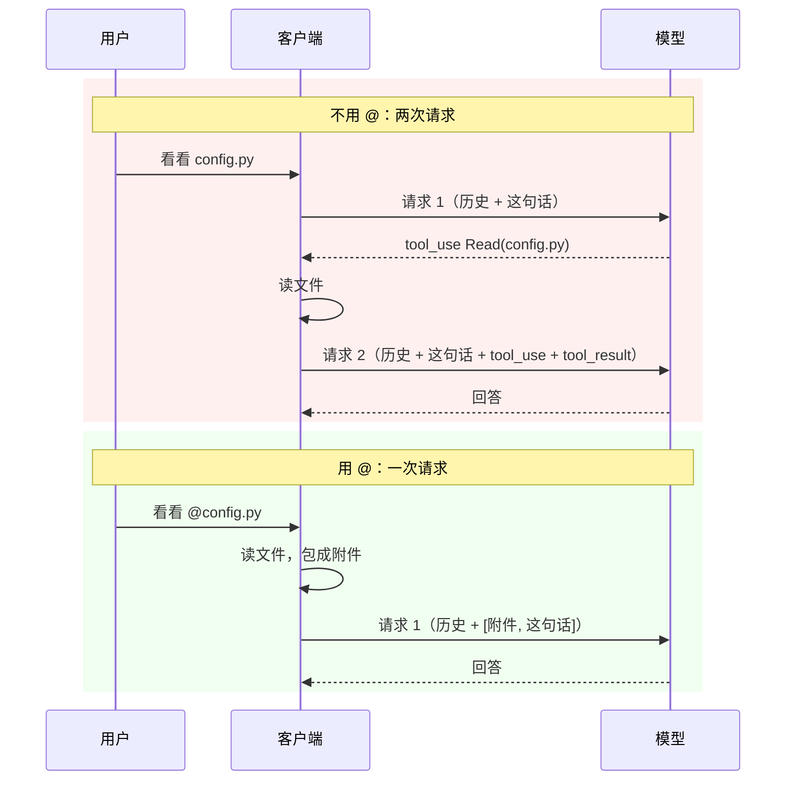

# 用 @ 引用文件

> 对应原站：[用 @ 引用文件](https://labuladong.online/zh/ai-coding/coding-agent/file-mention/)（会员内容；本章为独立原创重写）

> **一句话结论**：`@文件` 就是让**客户端**替模型调一次 Read：用户提交时，把文件内容包成一个附件，和用户原话放进同一条 user 消息。省掉的是「模型说要读 → 工具读 → 再请求一次」这一整轮来回。

## `@` 和「你自己去读 config.py」有什么区别？

在 Claude Code 里你有两种说法：「帮我看看 src/config.ts」和「帮我看看 @src/config.ts」。结果看起来差不多，模型都看到了文件。

你可能会问：那 `@` 只是一个补全路径的快捷键吗？

不只是。区别在**谁去读、什么时候读**。不带 `@`，模型先要回一条「我来读一下」+ `tool_use`，客户端执行 Read，再把结果连同**整个历史**发回去——多了一次完整的请求。带 `@`，文件内容在**第一次请求**里就已经在了。

对一个已经积累了几万 token 上下文的会话来说，省一轮请求就是省一次完整上下文的输入费用和几秒延迟。

## 先跑起来看看

离线 fake 模型（`examples/ch08.json`），`--permission-mode acceptEdits`：

=== "Node"

    ```console
    ❯ 把 @app/config.py 的超时改成 60
      ⎿ 已附加 @app/config.py（2 行）
    ◇ system  项目说明 0 个文件
    ◇ system  日期 2026-10-22
    ● 文件内容已经在上下文里了，直接改。
    ⏺ Edit(app/config.py)
    ✔ Edit -> The file app/config.py has been updated (1 replacement). Snippet:
           1	TIMEOUT = 60
           2	RETRIES = 3
    ● 已把 app/config.py 的 TIMEOUT 从 30 改成 60。
    ```

=== "Python"

    ```console
    ❯ 把 @app/config.py 的超时改成 60
      ⎿ 已附加 @app/config.py（2 行）
    ● 文件内容已经在上下文里了，直接改。
    ⏺ Edit(app/config.py)
    ✔ Edit -> The file app/config.py has been updated (1 replacement). Snippet:
           1        TIMEOUT = 60
           2        RETRIES = 3
    ● 已把 app/config.py 的 TIMEOUT 从 30 改成 60。
    ```

注意模型第一步就是 `Edit`，没有 `Read`——而且没有撞上上一章的「File has not been read yet」。

输入框里打 `@` 时的补全候选（`FileMentionCompleter`，模糊匹配，`node_modules` 被排除）：

=== "Node"

    ```console
    改一下 @cfg → ["app/config.py"]
    看看 @app/ → ["app/","app/__init__.py","app/cli.py","app/config.py"]
    ```

=== "Python"

    ```console
    改一下 @cfg → ['app/config.py']
    看看 @app/ → ['app/', 'app/__init__.py', 'app/cli.py', 'app/config.py']
    ```

会话文件里，这条 user 消息长这样：

```json
{
 "role": "user",
 "content": [
  {"type": "text", "text": "<system-reminder>\nThe user mentioned @app/config.py. Contents of app/config.py (same format as the Read tool):\n     1\tTIMEOUT = 30\n     2\tRETRIES = 3\n</system-reminder>"},
  {"type": "text", "text": "把 @app/config.py 的超时改成 60"}
 ]
}
```

这就是全部秘密：**一条 user 消息里多了一个文本块**。

## 省掉的是一整轮



图注：红框里请求 2 要把整个历史再发一遍；绿框里客户端在发请求前就把文件读好了。

打个比方：你去医院，可以空手去，医生说「先去拍个片子」，你拍完回来再排一次队；也可以带着片子去，医生当场就能看。`@` 就是「带着片子去」。

这个比方不成立的地方是：医生会自己判断要拍什么片子，而 `@` 是**你**替模型判断了它需要看哪个文件。你判断错了（引用了一个无关的大文件），白白占掉的是上下文。所以 `@` 是一个「用户比模型更清楚该看什么」时才划算的优化。

**回到主线**：`@` 不改变模型看到的信息量（文件内容反正都要进上下文），它改变的是**信息进入上下文的路径**：从「模型请求 → 工具返回」变成「客户端预先放好」。少了一次请求，就少了一次「整个历史再发一遍」。

## 两件事：输入时列出来，提交时塞进去

### 提交时：解析 → 读取 → 附件

`mini_cc/mentions.ts:findMentions`（Python 版 `mentions.py:find_mentions`）用一个正则找出所有 `@路径`：

=== "Node"

    ```ts
    // @ 前面必须是开头或空白（避免误伤邮箱 a@b.com）；中文标点也视为路径结束
    const MENTION = /(?:^|(?<=\s))@("[^"]+"|[^\s"，。；：！？（）、]+)/gu;
    ```

=== "Python"

    ```python
    # @ 前面必须是开头或空白（避免误伤邮箱 a@b.com）；中文标点也视为路径结束
    MENTION = re.compile(r'(?:^|(?<=\s))@("[^"]+"|[^\s"，。；：！？（）、]+)')
    ```

三个边界情况都写成了测试：`a@b.com` 不算引用；`@"my notes.txt"` 支持带空格的路径；「看看 @README.md，然后改」里的中文逗号不算路径的一部分（我第一版就漏了这个，测试当场挂掉）。

`resolve_mentions()` 对每个引用：是文件就读内容，是目录就列一层，**都不是就原样留在文本里**（`@nobody` 可能只是在说一个人）。

文件附件由 `_file_attachment()` 生成，有三个细节：

=== "Node"

    ```ts
    const text = readText(path);
    const lines = splitLines(text);
    const shown = lines.slice(0, maxLines);
    // 内容进了上下文 = 模型「读过」了：登记文件状态，模型可以直接 Edit，不用再 Read 一遍
    ctx.fileState.remember(path, text, shown.length < lines.length);
    ...
    const body = numberLines(shown, 1);   // 和 Read 工具完全相同的 cat -n 格式
    ```

=== "Python"

    ```python
    text = read_text(path)
    lines = text.splitlines()
    shown = lines[:max_lines]
    # 内容进了上下文 = 模型「读过」了：登记文件状态，模型可以直接 Edit，不用再 Read 一遍
    ctx.file_state.remember(path, text, partial=len(shown) < len(lines))
    ...
    body = number_lines(shown, 1)     # 和 Read 工具完全相同的 cat -n 格式
    ```

1. **格式和 Read 一样**。模型已经熟悉 Read 的输出格式，附件用同一种格式，它就知道怎么引用行号、怎么构造 `old_string`。
2. **登记文件状态**。这是本章和上一章的接口：附件让模型「看过」了文件，所以 `FileStateCache` 里要记一笔，否则模型接着 Edit 会被「先读后改」挡住，那 `@` 省下的一轮又白搭了。测试 `test_mentioned_file_counts_as_read_so_edit_works` 断言整个过程只有 2 次请求。
3. **大文件截断**。超过 2000 行只放前 2000 行，并告诉模型「用 Read 的 offset 看更多」。

### 附件放在哪

`build_user_content()`：

=== "Node"

    ```ts
    /** 附件在前、用户原话在后：长资料放前面、问题放最后，是 Anthropic 长上下文提示的建议顺序。 */
    export function buildUserContent(text: string, attachments: Attachment[]): string | Block[] {
      if (!attachments.length) return text;
      return [...attachments.map(render), { type: "text", text }];
    }
    ```

=== "Python"

    ```python
    def build_user_content(text, attachments):
        """附件在前、用户原话在后：长资料放前面、问题放最后，是 Anthropic 长上下文提示的建议顺序。"""
        if not attachments:
            return text
        return [render(a) for a in attachments] + [{"type": "text", "text": text}]
    ```

你可能会问：为什么不直接把文件内容拼接进用户那句话里？

两个原因。第一，**分开的块是可识别的**：附件统一用 `<system-reminder>` 包起来（`mini_cc/attachments.py:render`），后续代码能认出「这是客户端塞的，不是用户说的」——上一章的 auto 审查员只看用户原话，靠的就是 `is_reminder()` 这个判断；`/resume` 列表的标题也跳过了附件，显示的是「@a.py 解释一下」而不是一大段代码。第二，**顺序**：Anthropic 的长上下文提示建议把长资料放在前面、问题放在最后，模型的回答质量更好。

`Attachment(kind, title, text)` 这个数据结构是本章新建的 `mini_cc/attachments.py`。现在只有 `file` 和 `directory` 两种；下一章它会变成所有「客户端主动注入」的统一载体。

### 输入时：模糊补全

`FileMentionCompleter` 是一个 prompt_toolkit 的 `Completer`（Node 版只负责算候选，`cli.ts` 把它接到 `node:readline` 的 `completer` 上）：光标前那个词以 `@` 开头时，列出模糊匹配的文件。

文件列表来自 `list_project_files()`：**优先 `git ls-files -co --exclude-standard`**（自动尊重 `.gitignore`，几万个文件也很快），不是 git 仓库才自己 `os.walk`，跳过 `node_modules`、`.venv` 之类。列表缓存 5 秒，避免每敲一个字符就扫一遍磁盘。

匹配用的是**子序列**（`fuzzy_score`）：`btn` 能匹配 `Button.tsx`，因为 b、t、n 按顺序出现了。分数是「字符之间隔了多少」，文件名本身包含 query 的再加一个大额奖励。这就是 VS Code `Cmd+P` 那种匹配的最朴素版本。

REPL 里命令补全和文件补全用 `merge_completers` 合在一起（Node 版是同一个 `completer` 函数里按行首 `/` 和 `@` 分流）：行首 `/` 补命令，`@` 补文件，互不干扰。

## 测试

`tests/ch08_mentions.test.ts`（Python 版 `tests/test_ch08_mentions.py`），9 个：

- 解析：多个引用、邮箱、引号路径、去重、中文标点。
- 附件：在用户原话**之前**、带行号、`<system-reminder>` 包裹；引用后直接 Edit 成功且只有 2 次请求；不存在的 `@nobody` 原样保留、目录列出条目；大文件截断；会话标题跳过附件。
- 补全：模糊排序、忽略 `node_modules`、`Document("看看 @app")` 的候选。

=== "Node"

    ```console
    $ cd /Users/liz/liz/agent-learn/code/mini_cc-node && node --test 'tests/ch0[1-8]*.test.ts'
    ℹ tests 91
    ℹ suites 0
    ℹ pass 91
    ℹ fail 0
    ℹ cancelled 0
    ℹ skipped 0
    ℹ todo 0
    ℹ duration_ms 2695.403375
    ```

=== "Python"

    ```console
    $ cd /Users/liz/liz/agent-learn/code/mini_cc && uv run pytest -q
    ........................................................................ [ 79%]
    ...................                                                      [100%]
    91 passed in 1.63s
    ```

## 回到开头

`@` 和「你自己去读」的区别：前者是客户端在发请求**之前**替模型读，后者是模型在请求**之后**要求读。省掉的是一整轮，而且模型一上来就拿着准确的、带行号的内容。说穿了，就是在 user 消息里多放了一个文本块，再在文件状态表里记了一笔。

## 和真实 Claude Code 的差异

- 你本机 Claude Code 的会话记录里，`@` 文件以 `attachment` 记录存下来，`attachment.type` 是 `file`，`content` 的结构是 `{'type': 'text', 'file': {'filePath': …, 'content': …}}`——和 Read 工具结果的结构一样。这说明 Claude Code 的思路与我们相同：把 `@` 当作「客户端替模型做的一次 Read」。附件最终渲染成什么样的 API 文本，记录里没有直接给出。
- 按官方文档，Claude Code 的 `@` 还能引用 MCP 资源（`@server:protocol://resource/path` 这种形式）。mini-cc 只做文件和目录。
- mini-cc 的附件是**一次性**的：只在这条消息里。文件之后被改了，模型手里的就是旧版本——这正是下一章「文件被外部修改」提醒要解决的问题。

## 对照你的环境

- webapp 是 monorepo（`webapp/apps/web`），根目录 `git ls-files` 能列出几万个文件。补全只取前 20 个结果、列表缓存 5 秒，这两个限制就是为这种规模准备的。
- 你的 skill 里常写「先读 X 文件再做 Y」。如果 X 是固定的，用户侧可以直接 `@X`，省掉模型自己决定去读的那一轮；但如果 X 很大（比如整份 i18n 资源文件），`@` 会让它在每一轮都留在历史里——这时候让模型按需 `Read` 某一段反而更省。

## 常见坑

1. **附件不登记文件状态**。模型看过了内容，Edit 却被「先读后改」挡住，`@` 省的一轮又补回去了。
2. **把文件内容直接拼进用户原话**。后续代码区分不出「用户说的」和「客户端塞的」，auto 审查员会把文件内容当成用户授权。
3. **补全时每次都扫描磁盘**。大仓库里每敲一个字符卡半秒；用 `git ls-files` + 缓存。
4. **`@` 一个巨大的文件**。几万行的 lock 文件进了上下文，之后每一轮都要为它付费；截断并提示用 Read 分段。
5. **正则太宽**。`a@b.com`、`@someone` 被当成路径，找不到时要原样保留而不是报错。

## 练习

1. 支持行号范围：`@app/config.py#L10-20` 只附加第 10 到 20 行（注意：这算部分读取，`partial=True`）。
2. 补全列表里把「最近被 Read / Edit 过的文件」排在最前面。提示：`FileStateCache.paths()` 就是一个现成的「最近文件」来源。
3. 开放题：同一个文件在一个会话里被 `@` 了三次，上下文里就有三份内容。要不要去重？如果文件中间被改过，三份内容哪份才算数？你会怎么设计？

## 延伸阅读

- Claude Code 常用工作流（@ 引用文件）：<https://code.claude.com/docs/en/common-workflows>
- 长上下文提示技巧（资料在前、问题在后）：<https://platform.claude.com/docs/en/build-with-claude/prompt-engineering/long-context-tips>
- prompt_toolkit 补全：<https://python-prompt-toolkit.readthedocs.io/en/master/pages/asking_for_input.html#autocompletion>
- 本系列：上一章 [可靠的文件编辑工具](07-file-edit.md)、下一章 [更灵活的上下文注入机制](09-context-injection.md)
