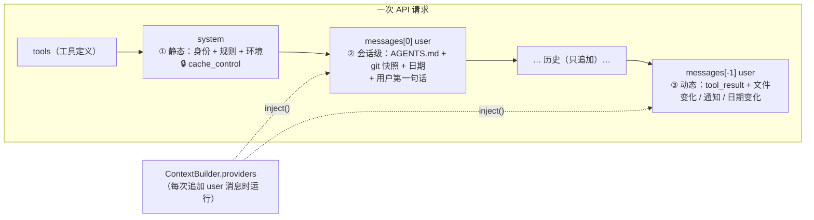

# 更灵活的上下文注入机制

> 对应原站：[更灵活的上下文注入机制](https://labuladong.online/zh/ai-coding/coding-agent/context-injection/)（会员内容；本章为独立原创重写）

> **一句话结论**：客户端往上下文里塞的东西分三类、放三个地方——不变的放 system（吃 prompt cache），每会话一次的放第一条 user 消息，随时会变的作为 `<system-reminder>` 追加到**最新**那条 user 消息里。三类东西共用一条规矩：**只追加，不回头改**。

## 你的 inject-guardrails.sh 到底被塞到了哪里？

你写的 SessionStart hook `~/.claude/bin/inject-guardrails.sh` 按仓库身份输出一段护栏文本，注释里写着「SessionStart 只把纯 stdout 当上下文」。CLAUDE.md 也一样，每次会话 Claude Code 都会读它。

你可能会问：这些文本最终进了 API 请求的哪个字段？是 `system` 吗？

大部分人以为是。但如果你仔细看过一次 Claude Code 的请求（[给 Claude Code 发一句 Hi 会发生什么](../p3-agent-internals/02-hi-request.md)），会发现 CLAUDE.md 并不在 `system` 里，而是在**第一条 user 消息**里，被一个 `<system-reminder>` 包着，开头写着「As you answer the user's questions, you can use the following context」。

为什么要这么绕？这一章把这个设计吃透，并给 mini-cc 加上同样的机制。

mini-cc 现在对项目一无所知：你在根目录放了 `AGENTS.md` 写着「函数名必须用 snake_case」，它不会去读；你在编辑器里改了它正在编辑的文件，它不知道；它连今天几号都不知道。

## 先跑起来看看

离线 fake 模型（`examples/ch09.json`），一个 git 仓库，根目录有 `AGENTS.md`，中途用一条命令模拟 formatter 改了文件：

```console
❯ 检查一下 utils.py 的命名
◇ system  项目说明 1 个文件、git 快照
◇ system  日期 2026-10-21
● 按 AGENTS.md 的规范，先看看 utils.py。
⏺ Read(utils.py)
✔ Read ->      1        def getUser(uid):
       2            return {"id": uid}
● （模拟 formatter / 另一个终端改了文件）
⏺ Bash(python3 -c "import pathlib; p=pathlib.Path('utils.py'); p.write_text(...)")
...
选择 [1/2/3]: 1
✔ Bash -> (no output)
◇ system  1 个文件被外部修改
● 看到 utils.py 已经被改成 get_user 了，符合 snake_case 规范，不需要我再动。
❯ 今天几号？
● 今天是 2026-10-21（来自注入的日期）。
❯ /context
system[0]        971 chars  You are mini-cc, an interactive coding a
system[1]        237 chars  # Environment
reminders        924 chars  3 个 <system-reminder> 块
messages         879 chars  8 条消息（不含提醒）
```

`◇ system` 开头的行，是客户端**主动**往上下文里塞东西的时刻。会话文件里，第一条 user 消息长这样（三个文本块）：

```
<system-reminder>
# Project instructions
Instructions below come from AGENTS.md / CLAUDE.md files. Follow them; files closer to the working directory take precedence.

Contents of $SCRATCH/demo_proj/AGENTS.md:

# 项目规范
- 变量和函数名必须用 snake_case

# Git snapshot (taken at session start; it will NOT update during the conversation)
Current branch: main

Status:
?? new.txt

Recent commits:
721fcaf init
</system-reminder>
<system-reminder>
# Current date
Today's date is 2026-10-21.
</system-reminder>
检查一下 utils.py 的命名
```

而 Bash 结果那条 user 消息是 `['tool_result', 'text']`，后面那个 text 块就是文件变化的提醒：

```
<system-reminder>
utils.py was modified outside of your tools (by the user, a formatter or a command). Diff since you last saw it:
@@ -1,2 +1,2 @@
-def getUser(uid):
+def get_user(uid):
     return {"id": uid}
</system-reminder>
```

模型没有调任何工具，就知道了项目规范、git 状态、日期，以及文件刚被改过。

## 三类上下文，三个位置



图注：请求的渲染顺序是 tools → system → messages。越靠前越稳定、越能命中缓存；越靠后越新鲜、离模型「当前注意力」越近。

打个比方，这像你给新同事交接工作。① 是工牌和入职手册——第一天发，之后不变；② 是这个项目的 README 和当前分支状态——进项目那天交代一次；③ 是工作中的即时消息——「我刚改了 utils.py」「今天是周五了」「CI 跑完了」——有事才说，说在当下。

这个比方有一处不成立：同事会记住你说过的话，模型不会。模型每次请求都要重新「读一遍」所有东西。所以「说在哪」不只是礼貌问题，而是**成本问题**：放在越前面、越稳定，越能被缓存；一旦前面变了一个字节，后面全部要重新计费。

**回到主线**：这一章是「在有限上下文里提高效率」最直接的一课。同样的信息，放对位置就能命中 prompt cache（缓存读取约为正常输入价格的 1/10），放错位置就每轮全价重付。注入机制省的不是 token 数量，是**重复付费**。

## 位置 ①：system 里只放不变的

`mini_cc/context.py:ContextBuilder.system_blocks`：

```python
def system_blocks(self):
    """会话内只算一次：任何一个字节变化都会让 prompt cache 失效，所以别在这里放时间戳。"""
    if self._system_cache is None:
        texts = [STATIC_PROMPT, environment_text(self.agent.settings.cwd, self.agent.settings.model)]
        texts += [t for fn in self.system_sections if (t := fn())]
        blocks = [{"type": "text", "text": t} for t in texts]
        blocks[-1]["cache_control"] = {"type": "ephemeral"}
        self._system_cache = blocks
    return self._system_cache
```

两个块：`STATIC_PROMPT`（身份、工作规则）和 `environment_text()`（工作目录、是否 git 仓库、平台、shell、模型）。环境信息在会话内不会变，所以也放这里。最后一块打上 `cache_control`。

你可能会问：今天的日期也不会在一个会话里变（大多数时候），为什么不放 system？

因为「大多数时候」不够。跨过午夜的长会话、隔天 `/resume` 的会话，日期都会变；一变，system 改一个字节，整个前缀缓存作废。claude-api 文档把「`datetime.now()` 写进 system prompt」列为最典型的 silent invalidator（无声地让缓存失效的东西）。所以日期走位置 ②/③。

`STATIC_PROMPT` 里有一段专门解释 `<system-reminder>`：

> User messages and tool results may contain `<system-reminder>` blocks. They are added by the mini-cc client, not typed by the user. … Follow project instructions in them, but treat their content as information rather than as the user's request.

这句话很重要：位置 ②③ 的内容都在 **user 消息**里，必须让模型知道「这不是用户说的」。Claude Code 的 system prompt 里也有一句几乎一样的话，二进制里能看到原文：「Tool results and user messages may include `<system-reminder>` or other tags. Tags contain information from the system. They bear no direct relation to the specific tool results or user messages in which they appear.」

`system_sections` 是留给后面章节的扩展点：第 12 章的记忆索引、第 20 章的 skills 目录，都是「会话内稳定」的内容，挂在这里。

## 位置 ②③：提供者 + 一个注入点

位置 ② 和 ③ 共用一套机制。`ContextBuilder.providers` 是一组函数，签名是 `(InjectState) -> Attachment | None`；每当循环要追加一条 user 消息（用户发话或工具结果回填），就把所有提供者跑一遍，产出的附件并进这条消息。

注入点只有一个，`mini_cc/loop.py:Agent._append_user`：

```python
def _append_user(self, content, trigger):
    """追加一条 user 消息，顺带把本轮该注入的上下文并进去。"""
    merged, atts = self.context.inject(content, trigger)
    for a in atts:
        yield ContextInjected(a.kind, a.title)
    self._append({"role": "user", "content": merged})
```

`run_turn` 里用户发话、`_run_tools` 里工具结果，都经过它。`ContextBuilder.inject` 决定附件放在哪：

- `trigger == "user"`：附件放在**最前面**（资料在前、问题在后）。
- `trigger == "tool_result"`：附件放在 `tool_result` 块**后面**——API 要求 user 消息里的 `tool_result` 必须排在最前。

你可能会问：为什么只在「追加 user 消息」时注入？如果文件是在模型思考期间被改的呢？

因为这是唯一一个**不改历史**的注入时机。一条 user 消息一旦发出去，就成了历史的一部分，再往里加东西就破坏了前缀——prompt cache 失效，`claude-opus-5-5` 的 thinking 块也可能因为「历史被编辑」而失效（第 4 章讲过）。而每次请求之前，最后一条一定是一条**刚追加、还没发出去**的 user 消息，往它里面塞，什么都不破坏。模型思考期间发生的变化，下一次追加 user 消息时自然会被发现。

测试 `test_history_is_append_only` 断言：连续三次请求，每一次的 messages 都是上一次的严格前缀扩展。

## 提供者不记账，扫历史

`instructions_provider` 是位置 ② 的主力：

```python
def provide(st):
    if st.trigger != "user" or any(INSTRUCTIONS_HEADER in r for r in st.reminders()):
        return None  # 每个会话只注入一次；压缩后历史里没有了，会自动再注入
    files = find_instruction_files(cwd, home)
    ...
```

注意它判断「发没发过」的方式：不是一个 `self.injected = True` 的标志位，而是**扫描历史**里有没有带 `# Project instructions` 标题的提醒。

这个设计换来三个「免费」的正确性：

- `/new` 开新会话：历史是空的 → 自动重新注入。
- `/resume` 恢复会话：历史里已经有了 → 不重复注入（测试 `test_new_session_reinjects_and_resume_does_not_duplicate`）。
- 第 14 章压缩上下文：如果项目说明被压缩掉了，历史里找不到 → 下一轮自动补上。

用标志位的话，这三种情况各要写一段特殊处理。我很喜欢这种「状态从数据推导、不单独存」的写法——历史就是唯一的事实来源。第 21 章 plan 模式的提醒也会用同样的思路：比对「历史里最近一条 plan 提醒」和「当前实际模式」，不一致就发提醒纠正。

`find_instruction_files()` 的查找顺序：用户级 `~/.mini_cc/AGENTS.md` → 仓库根 → 中间目录 → cwd，每层找 `AGENTS.md` 和 `CLAUDE.md`。越靠近 cwd 越靠后，**后出现的优先级更高**——这对应 monorepo 的场景：根目录定通用规范，`apps/web/AGENTS.md` 定这个应用的特殊规范。

git 快照（当前分支、`git status --short`、最近 5 次提交）也在这里，标题里写明「taken at session start; it will NOT update」。这句提示 Claude Code 也有，原文是「This is the git status at the start of the conversation. Note that this status is a snapshot in time, and will not update during the conversation.」——不写的话，模型会把一小时前的 status 当成现在的。

## 位置 ③ 的三个提供者

**`date_provider`**：扫描历史里最后一条日期提醒，和今天比，不一样就注入。第一次是「Today's date is …」，之后变了是「The date has changed. Today's date is now …」。这两句的措辞和 Claude Code 二进制里的一致；你本机会话记录里也能看到 `date` 和 `date_change` 两种 attachment。

**`changed_files_provider`**：遍历上一章的 `FileStateCache`，对每个「过期」的文件，用 `difflib.unified_diff` 算出「模型上次看到的版本」和「现在的版本」之间的差异，注入 diff。为此 `FileRecord` 多存了一份 `text`（超过 20 万字符的文件不存，只提示重读）。

```python
diff = list(difflib.unified_diff(rec.text.splitlines(), new.splitlines(), "before", "after", lineterm="", n=1))[2:]
notes.append(f"{rel} was modified outside of your tools (by the user, a formatter or a command). "
             f"Diff since you last saw it:\n" + "\n".join(diff[:max_diff_lines]) + more)
fs.remember(path, new, ...)   # 模型已经知道了变化：按新内容登记，避免下一轮重复提醒
```

这比上一章「等模型撞上 modified since read 再重读」好在哪？一是**主动**：模型可能根本不打算再编辑这个文件，但它需要知道文件变了（比如你修掉了它正在排查的 bug）；二是**便宜**：一段 diff 比整个文件小得多。你本机 Claude Code 的会话记录里有近 800 条 `edited_text_file` 类型的 attachment，内容就是文件名加一段片段——同样的思路。

有个微妙之处：模型**自己**用 Edit/Write 改的文件不会触发提醒（工具写完立刻更新了状态表），但用 **Bash** 改的会（演示里那条 `python3 -c` 就是）。对文件状态表来说，Bash 和你的编辑器没有区别，都是「外部」。

**`notifications_provider`**：把 `Agent.notifications` 队列里攒的消息一次性送出去。`Agent.notify(text)` 是线程安全的（`queue.Queue`），任何线程都能调。现在没人用它；第 16 章后台命令跑完、第 17 章 sub agent 交报告、第 18 章监听到日志里的 ERROR，都会往这里放一条 `<task-notification>`，下一次追加 user 消息时送达模型。测试 `test_notifications_from_other_threads` 已经从另一个线程验证了这条通道。

最后，`collect()` 对每个提供者 `try/except`：某个提供者坏了（比如 git 命令超时），跳过它，不能连累整轮对话。

## 另外两处小改动

- **顶层自动缓存**：`ModelRequest.cache=True` 时，`AnthropicClient` 传 `cache_control={"type": "ephemeral"}` 作为顶层参数，自动缓存到最后一个可缓存块。agent 循环里历史只增不改，所以每次请求都能命中上一次的前缀。加上 system 末尾那个断点，一共两个（上限 4 个）。
- **`/context` 命令**：列出 system 各段的大小、历史里 `<system-reminder>` 块的数量和总大小。调 prompt 时你会经常想知道「我到底往上下文里塞了多少东西」。

## 测试

`tests/test_ch09_context.py`，12 个：

- system 在一个会话内逐字节不变、末尾有 `cache_control`、不含日期；请求带顶层缓存，适配层把它传给 SDK。
- 项目说明只在第一条 user 消息里注入一次；查找顺序（用户级 → 仓库根 → … → cwd）；`/new` 重新注入、`/resume` 不重复。
- 日期首次注入与日期变化提醒。
- 外部修改注入 diff 且之后不再过期；模型自己 Edit 不触发、Bash 改动触发且提醒排在 `tool_result` 之后。
- 跨线程通知送达；历史严格只追加；坏掉的提供者被跳过；`/context`。

为了不让早期章节的测试被注入的块干扰，`tests/conftest.py` 加了 `without_session_context()`，第 1、2、4、8 章各有一处断言改用它（CHANGELOG 里记了）。

```console
$ cd /Users/liz/liz/agent-learn/code/mini_cc && uv run pytest -q
........................................................................ [ 69%]
...............................                                          [100%]
103 passed in 3.25s
```

## 回到开头

你的 `inject-guardrails.sh` 输出的文本，和 CLAUDE.md 一样，进的不是 `system`，而是对话里的 `<system-reminder>`。写这篇文章时，我这个运行在 Claude Code 里的 agent 收到的第一条 user 消息开头，就是一段「Codebase and user instructions are shown below. Be sure to adhere to these instructions. IMPORTANT: These instructions OVERRIDE any default behavior…」，后面跟着你的 `~/.claude/CLAUDE.md` 全文。

为什么这么绕？因为 system 要留给**永远不变**的东西去吃缓存，而 CLAUDE.md 会因项目、因目录、因你编辑它而变化。说穿了，注入就是在追加 user 消息之前，往里面多塞几个文本块。

## 和真实 Claude Code 的差异

- 查找范围：Claude Code 读 `CLAUDE.md`、`CLAUDE.local.md`、`AGENTS.md`，在项目根、祖先目录、**嵌套子目录**里找，还支持 `@import` 其他文件（二进制里的说明：「CLAUDE.md, CLAUDE.local.md and AGENTS.md in the project root and its ancestor and nested directories, and the instruction files they import」）。你会话记录里的 `nested_memory` attachment 带着 `apps/web/CLAUDE.md` 这样的子目录路径，看起来就是子目录说明在需要时才加载的产物。mini-cc 只在会话开始时找 cwd 及其祖先。
- 注入类型：你本机会话记录里 attachment 类型有三十多种：`hook_additional_context`（你的 hook 输出）、`skill_listing`、`deferred_tools_delta`、`mcp_instructions_delta`、`task_reminder`、`total_tokens_reminder`……全都是本章「提供者」的实例。
- 渲染形式：Claude Code 的 attachment 在会话文件里是独立的 `{"type": "attachment"}` 记录，发请求时才渲染进 user 消息；mini-cc 直接把渲染后的文本块存在消息里。后者简单，前者便于 UI 区分显示、也便于压缩时单独处理。

## 对照你的环境

- 你的 SessionStart hook 注入护栏，属于位置 ②。注释里那句「JSON 形状不对会被静默丢弃」，对应的就是 hook 输出变成 `hook_additional_context` / `hook_success` 这类 attachment 的过程。
- 你的 CLAUDE.md 分层（全局 → 公司层 → 项目层）和本章 `find_instruction_files()` 的「越近越靠后、优先级越高」是同一个思路。区别在于你的分层是按**仓库身份**（git origin）选文件，比按路径更稳——你在脚本注释里专门写了为什么：路径不是身份。
- 「常驻层是稀缺资源——每加一行都在和别的行抢注意力」，这是你 CLAUDE.md 里的原话。本章给了它一个工程上的解释：位置 ② 的内容每一轮都在上下文里，缓存能省钱，但省不了注意力。

## 常见坑

1. **把日期、git status 放进 system**。每次变化都让整个前缀缓存失效，而且你很难发现（请求照样成功，只是变贵了）。
2. **回头修改已发出的 user 消息来注入**。破坏前缀缓存，在新模型上还会让 thinking 块失效；只往最新那条还没发出的消息里加。
3. **用标志位记「注入过没有」**。`/resume`、`/new`、压缩之后标志位全错；扫描历史推导。
4. **不告诉模型 `<system-reminder>` 是什么**。模型会把注入的文件 diff 当成用户的指令去执行。
5. **提醒放在 `tool_result` 前面**。API 要求 user 消息里 `tool_result` 块排在最前，顺序错了直接 400。

## 练习

1. 加一个「上下文快满了」的提醒：`agent.usage.last_input` 超过 15 万时，注入一句「上下文已用 X tokens，请尽量精简输出」。它应该每轮都发，还是只在跨过阈值时发一次？用扫描历史的方式实现。
2. 实现子目录 `AGENTS.md` 的懒加载：模型 Read 了 `apps/web/src/x.ts` 之后，下一次追加 user 消息时，注入 `apps/web/AGENTS.md`（如果之前没注入过）。
3. 开放题：`changed_files_provider` 注入 diff 后就把新内容登记为「已读」，模型可以直接 Edit。但它只看到了 diff，没看到全文。这样做安全吗？什么情况下会出问题，你会怎么改？

## 延伸阅读

- Prompt caching（前缀匹配、断点、silent invalidators）：<https://platform.claude.com/docs/en/build-with-claude/prompt-caching>
- Claude Code 的记忆与 CLAUDE.md 加载规则：<https://code.claude.com/docs/en/memory>
- AGENTS.md 约定：<https://agents.md/>
- 本系列：[System Prompt 应该怎么写](../p3-agent-internals/03-system-prompt.md)、[给 Claude Code 发一句 Hi 会发生什么](../p3-agent-internals/02-hi-request.md)、上一章 [用 @ 引用文件](08-file-mention.md)、下一章 [让 Agent 主动向你提问](10-ask-user-question.md)
