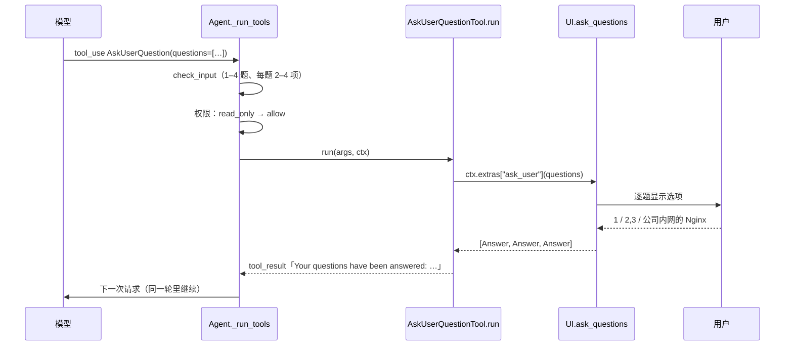

# 让 Agent 主动向你提问

> 对应原站：[让 Agent 主动向你提问](https://labuladong.online/zh/ai-coding/coding-agent/ask-user-question/)（会员内容；本章为独立原创重写）

> **一句话结论**：「向用户提问」在 agent 里就是**一个工具**：模型调用它，循环停下来等 UI 拿到答案，答案作为普通的 `tool_result` 回给模型。难点不在实现（不到一百行），而在工具描述——**什么时候该问、什么时候不该问**。

## 模型为什么不直接在回复里问？

你让 agent「帮我搭一个博客」，它不知道你想用什么技术栈。最自然的做法似乎是：回一段文字「请问你想用 Next.js 还是 Astro？」，然后结束这一轮，等你回答。

你可能会问：这不就是提问吗？为什么 Claude Code 要专门做一个 `AskUserQuestion` 工具、弹一个多选界面？

区别有三个。第一，**回复里的问题会结束这一轮**：你回答之后，模型要从一个新的 user 消息重新开始，前面「准备开始干活」的那股劲儿就断了；而工具调用是在**同一轮里**停顿一下，拿到答案接着干。第二，**选项是结构化的**：模型把它拿不准的问题一次列全、每个问题给好候选，你按几个数字就答完了，而不是打一段话。第三，**选项本身就是信息**：模型列出的候选和「(Recommended)」标记，让你一眼看到它的判断，你只需要纠正它。

## 先跑起来看看

离线 fake 模型（`examples/ch10.json`）：

=== "Node"

    ```console
    ❯ 帮我开发一个博客系统
    ◇ system  项目说明 0 个文件
    ◇ system  日期 2026-10-22
    ● 需求里技术栈和功能范围都没说，我先问清楚。
    ⏺ AskUserQuestion(3 个问题：技术栈 / 功能范围 / 部署)
    [技术栈] (1/3) 博客用什么技术栈？
      1. Astro (Recommended) — 内容站首选，默认零 JS
      2. Next.js — 需要动态功能时更灵活
      3. Hugo — Go 写的静态站生成器，构建最快
      或直接输入你自己的答案；回车跳过
    › 1
    [功能范围] (2/3) 第一版要哪些功能？（可多选，用逗号分隔）
      1. 评论 — 接 giscus
      2. RSS
      3. 全文搜索 — pagefind
      或直接输入你自己的答案；回车跳过
    › 2,3
    [部署] (3/3) 部署到哪里？
      1. Cloudflare Pages
      2. Vercel
      或直接输入你自己的答案；回车跳过
    › 公司内网的 Nginx
    ✔ AskUserQuestion -> Your questions have been answered: "博客用什么技术栈？"="Astro (Recommended)", "第一版要哪些功能？"="RSS, 全文搜索", "部署到哪
    ● 收到：Astro + RSS + 全文搜索，部署到公司内网的 Nginx。我按这个口径开始搭骨架。
    ```

=== "Python"

    ```console
    ❯ 帮我开发一个博客系统
    ◇ system  项目说明 0 个文件
    ◇ system  日期 2026-10-21
    ● 需求里技术栈和功能范围都没说，我先问清楚。
    ⏺ AskUserQuestion(3 个问题：技术栈 / 功能范围 / 部署)
    [技术栈] (1/3) 博客用什么技术栈？
      1. Astro (Recommended) — 内容站首选，默认零 JS
      2. Next.js — 需要动态功能时更灵活
      3. Hugo — Go 写的静态站生成器，构建最快
      或直接输入你自己的答案；回车跳过
    › 1
    [功能范围] (2/3) 第一版要哪些功能？（可多选，用逗号分隔）
      1. 评论 — 接 giscus
      2. RSS
      3. 全文搜索 — pagefind
      或直接输入你自己的答案；回车跳过
    › 2,3
    [部署] (3/3) 部署到哪里？
      1. Cloudflare Pages
      2. Vercel
      或直接输入你自己的答案；回车跳过
    › 公司内网的 Nginx
    ✔ AskUserQuestion -> Your questions have been answered: "博客用什么技术栈？"="Astro (Recommended)", "第一版要哪些功能？"="RSS, 全文搜索", "部署到哪
    ● 收到：Astro + RSS + 全文搜索，部署到公司内网的 Nginx。我按这个口径开始搭骨架。
    ```

三个问题一次问完；第二题多选；第三题的两个选项都不对，直接打字回答。回给模型的完整 `tool_result`（Node 版逐字相同）：

```
Your questions have been answered: "博客用什么技术栈？"="Astro (Recommended)", "第一版要哪些功能？"="RSS, 全文搜索", "部署到哪里？"="公司内网的 Nginx". You can now continue with these answers in mind.
```

注意 `AskUserQuestion` 没有触发权限弹窗——问你一个问题，不需要先问你「可以问你吗」。

## 提问就是一次工具调用



图注：和第 5 章的权限弹窗一模一样——生成器停在一次同步调用上，等用户。区别只在于这次是**模型**主动发起的。

打个比方：这像装修师傅干活前打电话问你「瓷砖要哑光还是亮面？我建议哑光，防滑」。他不会先砸完墙、等你下班回家再问（那是回复里提问、结束这一轮）；也不会每铺一块砖问一次（那是问得太多）。

这个比方不成立的地方：师傅打电话问你，是他觉得你会在意；模型调用这个工具，完全取决于**工具描述**里写了什么。它不会自己揣摩你在意什么。

**回到主线**：一次提问往上下文里放的东西很少——一个 `tool_use`（问题和选项）加一个 `tool_result`（答案），通常几百 token。换来的是避免「猜错 → 推倒重来」：那一来一回浪费的，可能是几万 token 的探索和代码。这是整个系列里性价比最高的一个工具。

## 工具本身：不到一百行

`mini_cc/tools/ask_user.ts:AskUserQuestionTool`（Python 版 `ask_user.py:AskUserQuestionTool`）：

=== "Node"

    ```ts
    export class AskUserQuestionTool extends Tool {
      override name = "AskUserQuestion";
      override readOnly = true;   // 不碰文件系统；问用户本身不需要再经过权限审批
      override kind = "meta";
      ...
      override async run(args: Args, ctx: ToolContext): Promise<ToolResult> {
        const asker: Asker | undefined = ctx.extras.ask_user;
        if (asker === undefined) {
          return new ToolResult("The user is not available to answer questions in this mode. " +
            "Proceed with sensible defaults and state your assumptions explicitly.", true);
        }
        const questions = args.questions.map((q) => new Question(q.question, q.header, q.options, q.multiSelect ?? false));
        const answers = await asker(questions);
        ...
        return new ToolResult("Your questions have been answered: " + parts.join(", ") +
          ". You can now continue with these answers in mind.");
      }
    }
    ```

=== "Python"

    ```python
    class AskUserQuestionTool(Tool):
        name = "AskUserQuestion"
        read_only = True   # 不碰文件系统；问用户本身不需要再经过权限审批
        kind = "meta"
        ...
        def run(self, args, ctx):
            asker = ctx.extras.get("ask_user")
            if asker is None:
                return ToolResult("The user is not available to answer questions in this mode. "
                                  "Proceed with sensible defaults and state your assumptions explicitly.", True)
            questions = [Question(q["question"], q["header"], q["options"], q.get("multiSelect", False))
                         for q in args["questions"]]
            answers = asker(questions)
            ...
            return ToolResult("Your questions have been answered: " + ", ".join(parts)
                              + ". You can now continue with these answers in mind.")
    ```

几个设计点：

- **`read_only = True`**：权限判定的「只读」分支直接放行。它确实不改任何东西。
- **UI 通过 `ctx.extras["ask_user"]` 注入**（Node 版是 `ctx.extras.ask_user`，返回 Promise，工具 `await` 它）。工具不 import UI，`App` 在启动时把 `ui.ask_questions` 挂上去。测试里换成 `BufferUI`，答案从 `answers` 列表里取。
- **没有 UI 时不报「失败」，而是告诉模型怎么办**：按默认值继续，并明确说出假设。`-p` 非交互模式下就是这样。
- **结果措辞参考 Claude Code**。你本机会话记录里一条真实的 `AskUserQuestion` 结果是：`Your questions have been answered: "这份说明要解决的是哪种「换 apikey」?"="切到内部 AI Gateway" … You can now continue with these a…`。

输入 schema 约束「1–4 个问题、每题 2–4 个选项」。这里上一章的校验器派上了用场：第 3 章的 `validate.py` 支持 `minItems` / `maxItems`，模型一次塞 5 个问题，会在执行前收到 `InputValidationError: … must have at most 4 items`。Claude Code 的 schema 里能看到同样的限制：`questions: …min(1).max(4).describe("Questions to ask the user (1-4 questions)…")`。

### 解析答案

`parse_answer()` 把用户的一行输入变成答案：

| 输入 | 解析结果 |
|---|---|
| `2` | 选第 2 项 |
| `1,3` 或 `1，3` | 多选（中文逗号也行）；单选题里输入多个序号算无效 |
| `公司内网的 Nginx` | 不是序号 → 当作「其他」，用户自己写的答案 |
| 空 | 跳过这一题 |
| `9`（越界） | 无效，重问一次 |

你可能会问：为什么不让模型在选项里加一个「其他」？

因为「其他」永远都在。用户随时可以不选任何一项、直接打字。让模型自己加，它就会浪费一个选项位（一共才 4 个），还可能加得不统一（「其他」「自定义」「都不是」）。所以工具描述里专门写了「Do not add an "Other" option」——Claude Code 的工具描述里也有同样的话：「Users will always be able to select "Other" to provide custom text input」。

全部跳过时，结果是 `User declined to answer questions`，并提示模型「去问用户想要什么，而不是猜」。这句开头和 Claude Code 二进制里的 `User declined to answer questions` 一致。

## 真正的难点：什么时候该问

实现是简单的，难的是让模型**问得恰到好处**。问得太少，它瞎猜；问得太多，你会觉得它在推卸责任。

我们的工具描述（`DESCRIPTION`）分三层约束：

```text
Ask the user 1-4 multiple-choice questions when you are blocked on a decision that is genuinely
the user's to make (tech stack, scope, naming, trade-offs) and cannot be resolved from the request, the code,
or sensible defaults. Ask all open questions in ONE call instead of one at a time.
...
Do not use this tool to ask for permission to proceed or to confirm a plan you could just execute.
```

1. **什么时候问**：决定权确实在用户手里，并且无法从请求、代码、合理默认值推出来。「用 Next.js 还是 Astro」该问；「缩进用几个空格」看一眼项目里的 `.editorconfig` 就知道，不该问。
2. **怎么问**：一次问完；推荐项放第一个并标 `(Recommended)`；选项带一行说明。
3. **什么时候不该问**：不要拿它请求许可（那是权限系统的事），也不要拿它确认一个可以直接执行的计划。

最后这条很关键。没有它，模型会养成「每做一步问一句『可以继续吗？』」的坏习惯。第 21 章的 plan 模式里，「请求批准计划」由专门的 `exit_plan_mode` 工具负责，就是为了不和这里混用。

`STATIC_PROMPT` 里也加了一句呼应：请求的歧义**会改变做法**时才问，能用合理默认值决定的事不要问。

说实话，这些约束的效果高度依赖模型。Claude Code 本机二进制里的 `AskUserQuestion` 描述写得更细，比如「Use this tool only when you are blocked on a decision that is genuinely the user's to make」、「If you recommend a specific option, make that the first option in the list and add "(Recommended)" at the end of the label」——我们的描述借鉴了这个结构，但措辞是自己写的。

## 测试

`tests/ch10_ask_user.test.ts`（Python 版 `tests/test_ch10_ask_user.py`），8 个：

- `parse_answer` 的各种输入（单选、多选、中文逗号、Other、跳过、越界、单选题多选无效）。
- agent 级：提问后用答案继续、结果文本逐字匹配、**不触发权限弹窗**；Other + 跳过；无效输入重问；全部跳过 = declined。
- schema 限制（5 个问题、1 个选项都被校验器拦下）；没有 UI 时的降级；工具和 system prompt 都发给了模型。

=== "Node"

    ```console
    $ cd /Users/liz/liz/agent-learn/code/mini_cc-node && node --test 'tests/ch*.test.ts'
    ℹ tests 111
    ℹ suites 0
    ℹ pass 111
    ℹ fail 0
    ℹ cancelled 0
    ℹ skipped 0
    ℹ todo 0
    ℹ duration_ms 3689.434375
    ```

=== "Python"

    ```console
    $ cd /Users/liz/liz/agent-learn/code/mini_cc && uv run pytest -q
    ........................................................................ [ 64%]
    .......................................                                  [100%]
    111 passed in 3.32s
    ```

## 回到开头

模型为什么不直接在回复里问？因为回复里的问题会**结束这一轮**，而工具调用只是**暂停这一轮**。说穿了，`AskUserQuestion` 就是一个会阻塞等待键盘输入的工具，和 `Bash` 等待子进程退出没有本质区别——只不过它等的是你。

## 和真实 Claude Code 的差异

- 本机 Claude Code 2.1.306 的 `AskUserQuestion` 支持 `preview` 字段（选项旁边显示代码片段、ASCII 原型的预览框，二进制里有完整说明），某些宿主还支持 `"kind": "text"`（开放文本框）和 `"kind": "number"`（带 min/max 的数字）。你本机那条真实记录里，选项就带了一大段 `preview`。
- Claude Code 的 UI 是可以上下选择的交互组件；mini-cc 是输入序号。
- 「用户还想再问几个问题」：Claude Code 的描述里提到用户可以要求更多问题，模型应再调用一次工具。mini-cc 没做。

## 对照你的环境

- 你的 CLAUDE.md 里写着「只问会改变做法的那一两个问题」——这正是本章工具描述的核心约束。你把它写进了常驻层，因为工具描述里的版本对你来说还不够强。这是一个好例子：同一条约束，工具描述管「怎么问」，CLAUDE.md 管「问多少」。
- 你的 `feishu-bug-intake` skill 要求「图和视频必须下载看完才允许定性」。如果把这种场景交给 agent，「证据不足时该用 AskUserQuestion 向反馈人确认，还是先自己下载证据」就是一个典型的「什么时候该问」的判断——答案是：能自己查到的，先查。

## 常见坑

1. **让模型自己加「其他」选项**。浪费选项位，还和 UI 自带的自由输入重复。
2. **一次只问一个问题**。用户要被打断三次；工具描述里明确要求一次问完。
3. **拿它请求许可**。「我可以开始写代码吗？」该由权限系统和 plan 模式处理，不该是一个问题。
4. **没有 UI 时直接报错**。非交互模式下模型会卡住；应该让它按默认值继续并说明假设。
5. **答案只回 label 不回问题**。多个问题时模型对不上哪个答案属于哪个问题；结果里用 `"问题"="答案"` 成对列出。

## 练习

1. 支持 `preview` 字段：选项带 `preview` 时，在选项下面缩进显示它（多行代码块）。想想终端宽度不够时怎么办。
2. 给 `AskUserQuestion` 加一个「超时」：60 秒没回答就当作跳过，模型按默认值继续。提示：`input()` 没法直接超时，可以用 `select` 或 prompt_toolkit 的异步接口。
3. 开放题：sub agent（第 17 章）在后台跑，它遇到需要用户决定的问题时该怎么办？直接弹窗会打断你和主 agent 的对话；不弹又只能瞎猜。你会怎么设计？

## 延伸阅读

- Claude Code 内置工具（AskUserQuestion）：<https://code.claude.com/docs/en/settings#tools-available-to-claude>
- 工具描述怎么写：<https://platform.claude.com/docs/en/agents-and-tools/tool-use/implement-tool-use#best-practices-for-tool-definitions>
- 本系列：上一章 [更灵活的上下文注入机制](09-context-injection.md)、下一章 [让 Agent 跟踪多步任务](11-task-management.md)、[让 Agent 先规划再动手](21-plan.md)
