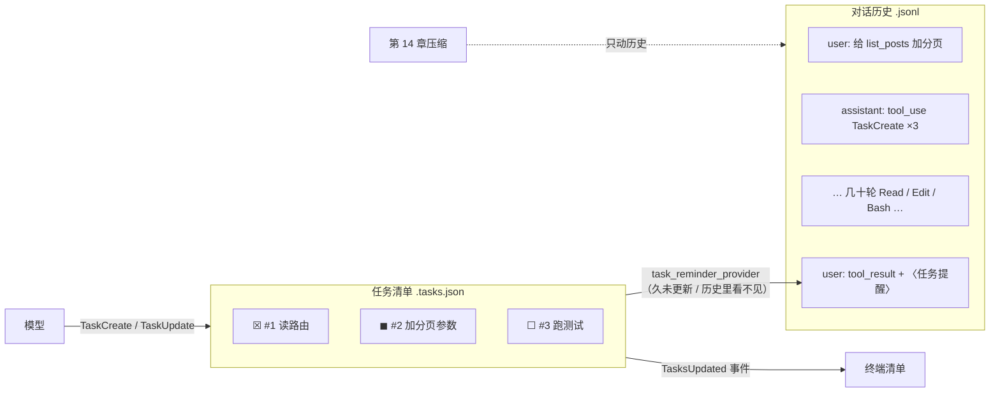

# 让 Agent 跟踪多步任务

> 对应原站：[让 Agent 跟踪多步任务](https://labuladong.online/zh/ai-coding/coding-agent/task-management/)（会员内容；本章为独立原创重写）

> **一句话结论**：把计划从「混在对话历史里的一段文字」变成「一份独立存储、模型用工具维护、客户端定期提醒的状态」。任务清单之所以有用，不是因为它让模型更聪明，而是因为它**不会被历史淹没、不会被压缩掉、人也看得见**。

## 说好八步，为什么做着做着就漏了？

你一定遇到过：让 agent 重构一个模块，它一开始列得清清楚楚「1. 抽出接口 2. 迁移调用方 … 8. 删掉旧实现」，干完前两步，跳到了第五步，最后说「重构完成」——第三、四步和第八步谁也没提。

你可能会问：计划明明就写在上下文里，模型为什么会忘？

因为那份计划只是历史里的**一条普通 assistant 消息**。三十轮工具调用之后，它被埋在几万 token 的文件内容和命令输出中间。模型每次预测下一个 token 时，注意力更多落在最近的内容上（[LLM 是怎么预测下一个 token 的](../p0-core/04-llm-token-prediction.md)），开头那份计划的「存在感」越来越弱。更糟的是，等第 14 章的上下文压缩一来，那条消息可能被总结成一句「用户要求重构模块」，具体步骤彻底没了。

而你作为旁观者，盯着终端里滚动的工具调用，也看不出它现在做到第几步、还剩几步。

## 先跑起来看看

离线 fake 模型（`examples/ch11.json`），`--permission-mode acceptEdits`（Node 版的演示项目是 `posts.js`，Python 版是 `posts.py`）：

=== "Node"

    ```console
    ❯ 给 list_posts 加上分页
    ◇ system  项目说明 0 个文件
    ◇ system  日期 2026-10-22
    ● 这个改动分三步，先建任务清单。
    ⏺ TaskCreate(读 posts 路由)
    ⏺ TaskCreate(给 list_posts 加 page/page_size)
    ⏺ TaskCreate(跑测试验证)
      ☐ #1 读 posts 路由
      ☐ #2 给 list_posts 加 page/page_size
      ☐ #3 跑测试验证
      (0/3 completed)
    ⏺ TaskUpdate(#1 → in_progress)
      ◼ #1 读 posts 路由  ← 读 posts 路由
      ☐ #2 给 list_posts 加 page/page_size
      ☐ #3 跑测试验证
      (0/3 completed)
    ⏺ Read(posts.js)
    ✔ Read ->      1	function list_posts(posts) {
           2	  return posts;
           3	}  …(+2 lines)
    ⏺ TaskUpdate(#1 → completed)
    ⏺ TaskUpdate(#2 → in_progress)
      ☒ #1 读 posts 路由
      ◼ #2 给 list_posts 加 page/page_size  ← 加分页参数
      ☐ #3 跑测试验证
      (1/3 completed)
    ⏺ Edit(posts.js)
    ✔ Edit -> The file posts.js has been updated (1 replacement). Snippet:
    ...
    ⏺ TaskUpdate(#2 → completed)
    ⏺ TaskUpdate(#3 → in_progress)
      ☒ #1 读 posts 路由
      ☒ #2 给 list_posts 加 page/page_size
      ◼ #3 跑测试验证  ← 跑测试
      (2/3 completed)
    ⏺ Bash(node -e "const { list_posts } = require('./posts.js'); const r = list_posts([...Array(50).keys()], 2, 20); if (r[0] !== 20 || r.length !== 20) process.exit(1); console.log('ok')")
    ...
    选择 [1/2/3]: 1
    ✔ Bash -> ok
    ⏺ TaskUpdate(#3 → completed)
      ☒ #1 读 posts 路由
      ☒ #2 给 list_posts 加 page/page_size
      ☒ #3 跑测试验证
      (3/3 completed)
    ● 分页加好了：list_posts(posts, page=1, page_size=20)，测试通过。
    ❯ /todos
    ☒ #1 读 posts 路由
    ☒ #2 给 list_posts 加 page/page_size
    ☒ #3 跑测试验证
    (3/3 completed)
    --- 磁盘上的清单（节选）
    {"id":"2","subject":"给 list_posts 加 page/page_size","description":"","active_form":"加分页参数","status":"completed"}
    ```

=== "Python"

    ```console
    ❯ 给 list_posts 加上分页
    ◇ system  项目说明 0 个文件
    ◇ system  日期 2026-10-21
    ● 这个改动分三步，先建任务清单。
    ⏺ TaskCreate(读 posts 路由)
    ⏺ TaskCreate(给 list_posts 加 page/page_size)
    ⏺ TaskCreate(跑测试验证)
      ☐ #1 读 posts 路由
      ☐ #2 给 list_posts 加 page/page_size
      ☐ #3 跑测试验证
      (0/3 completed)
    ⏺ TaskUpdate(#1 → in_progress)
      ◼ #1 读 posts 路由  ← 读 posts 路由
      ☐ #2 给 list_posts 加 page/page_size
      ☐ #3 跑测试验证
      (0/3 completed)
    ⏺ Read(posts.py)
    ✔ Read ->      1        def list_posts(posts):
           2            return posts
    ⏺ TaskUpdate(#1 → completed)
    ⏺ TaskUpdate(#2 → in_progress)
      ☒ #1 读 posts 路由
      ◼ #2 给 list_posts 加 page/page_size  ← 加分页参数
      ☐ #3 跑测试验证
      (1/3 completed)
    ⏺ Edit(posts.py)
    ✔ Edit -> The file posts.py has been updated (1 replacement). Snippet:
    ...
    ⏺ TaskUpdate(#2 → completed)
    ⏺ TaskUpdate(#3 → in_progress)
      ☒ #1 读 posts 路由
      ☒ #2 给 list_posts 加 page/page_size
      ◼ #3 跑测试验证  ← 跑测试
      (2/3 completed)
    ⏺ Bash(python3 -c "from posts import list_posts; assert list_posts(list(range(50)), 2, 20) == list(range(20, 40)); print('ok')")
    ...
    选择 [1/2/3]: 1
    ✔ Bash -> ok
    ⏺ TaskUpdate(#3 → completed)
      ☒ #1 读 posts 路由
      ☒ #2 给 list_posts 加 page/page_size
      ☒ #3 跑测试验证
      (3/3 completed)
    ● 分页加好了：list_posts(posts, page=1, page_size=20)，测试通过。
    ❯ /todos
    ☒ #1 读 posts 路由
    ☒ #2 给 list_posts 加 page/page_size
    ☒ #3 跑测试验证
    (3/3 completed)
    --- 磁盘上的清单（节选）
    {"id": "2", "subject": "给 list_posts 加 page/page_size", "description": "", "active_form": "加分页参数", "status": "completed"}
    ```

每一步开始前标 `◼`，做完立刻标 `☒`。你在任何时候都能一眼看到进度；清单同时落在磁盘上，和对话历史是**两个文件**。

## 计划要有自己的家



图注：清单是一份**独立于历史的状态**。模型通过工具写它；UI 通过事件读它；提供者在需要时把它的**当前快照**重新放回上下文末尾。压缩只动历史，动不了清单。

打个比方：以前的计划像你在会议上口头说的「我们分八步做」，说完就散在会议纪要里；现在的计划像墙上的看板——谁都能看到，每张卡片有状态，会开得再长，看板也不会被冲走。

这个比方不成立的地方是：人会自己抬头看看板，模型不会。模型「看到」的只有上下文里的 token，看板放在磁盘上它是看不见的。所以光有看板不够，还需要有人**定期把看板拍照贴回它眼前**——那就是任务提醒。

**回到主线**：任务清单是一个典型的「上下文外置」：把一份重要但会被稀释的状态挪到上下文之外持久保存，只在需要时把**最新、最精简的版本**注入回来。一份三行的清单，比翻回几万 token 之前找那段计划，便宜得多，也准得多。

## 三个工具，一份清单

`mini_cc/tools/task_tools.ts`（Python 版 `task_tools.py`）里三个工具共用一份 `TaskStore`（`ctx.extras["tasks"]`）：

| 工具 | 参数 | 结果 |
|---|---|---|
| `TaskCreate` | `subject`、`description?`、`activeForm?` | `Task #3 created: …` |
| `TaskUpdate` | `taskId`、`status?`、`subject?`、`description?`、`activeForm?` | 新状态 + 剩余数量 / `All tasks completed.` |
| `TaskList` | 无 | 整份清单 |

`activeForm` 是「进行时」的说法（「加分页参数」 vs 标题「给 list_posts 加 page/page_size」），UI 在 `◼` 那一行后面显示 `← 加分页参数`，告诉你它**此刻**在干什么。

你可能会问：为什么拆成三个工具？一个 `TodoWrite(todos=[...])` 每次传整份清单，不是更简单吗？

Claude Code 其实两种都做过：本机二进制里既有 `TodoWrite` 的描述（「Each todo has `content`, `status` … and `activeForm`」），也有 `TaskCreate` / `TaskUpdate` / `TaskList` / `TaskGet`，你本机最近的会话里实际在用的是后者。我选了增量式的三个工具，理由是**输出 token**：清单有 10 项时，`TodoWrite` 每改一个状态都要把 10 项全部重新输出一遍；`TaskUpdate` 只输出 `{"taskId": "3", "status": "completed"}`。这和第 7 章「用 Edit 而不是 Write」是同一个道理。

几个细节：

- **免审批**：`read_only = True`。它们只改 agent 自己的清单，不碰项目文件。
- **结果里带「剩余数量」**：每次更新都告诉模型「还剩 2 项」，最后一项完成时说 `All tasks completed.`——这是在它准备收尾之前给的一个小提示。
- **同时有两个 `in_progress` 时提示**：`Note: #1 also in_progress; keep only one in progress.`。不强制拒绝，因为模型偶尔需要切换；但「一次只做一件事」是工具描述里的明确要求，Claude Code 的描述原文是「Exactly ONE task must be in_progress at any time (not less, not more)」。

工具描述（`GUIDE`）回答了「什么时候用」：三步以上、或者用户一次给了好几件事；**开始前**标 in_progress、**做完立刻**标 completed；测试失败或做了一半不许标 completed；单步小事不要用清单。`STATIC_PROMPT` 里也加了一句呼应。

## 清单存哪：和历史分开

`mini_cc/tasks.ts:TaskStore`（Python 版 `tasks.py:TaskStore`）每次改动都写 `<session>.tasks.json`：

=== "Node"

    ```ts
    save(): void {
      ...
      const tmp = this.path.replace(/\.json$/, ".tmp");
      writeFileSync(tmp, JSON.stringify(this.tasks, null, 1), "utf8");
      renameSync(tmp, this.path); // 先写临时文件再改名：崩溃时不会留下半个 JSON
    }
    ```

=== "Python"

    ```python
    def save(self):
        ...
        tmp = self.path.with_suffix(".tmp")
        tmp.write_text(json.dumps([asdict(t) for t in self.tasks], ensure_ascii=False, indent=1), encoding="utf-8")
        tmp.replace(self.path)  # 先写临时文件再改名：崩溃时不会留下半个 JSON
    ```

清单是「整体覆盖」的小文件，用「写临时文件 + 原子改名」保证不会写坏。这和第 4 章会话历史的 JSONL 追加是两种不同的持久化策略：**追加适合只增不改的日志，原子覆盖适合会被修改的小状态**。

`App._attach()` 在切换会话时载入对应的清单：`/new` 开新会话就是一张空清单；`/resume` 恢复会话就把当时的清单也恢复了（测试 `test_tasks_persist_with_session_and_survive_resume`）。

## 把清单贴回模型眼前

`mini_cc/tasks.ts:taskReminderProvider`（Python 版 `tasks.py:task_reminder_provider`）挂在第 9 章的提供者列表里。它判断两件事：

=== "Node"

    ```ts
    const store: TaskStore | undefined = st.agent.ctx.extras.tasks;
    if (store === undefined || !store.unfinished().length) return null; // 清单做完了（或没有清单）：不打扰
    let gap = 0, seen = false;
    for (const m of [...st.messages].reverse()) { // 从后往前数：最近一次碰清单 / 最近一次提醒之后，过了几条 assistant 消息
      ...
    }
    if (seen && gap < every) return null;
    ```

=== "Python"

    ```python
    store = st.agent.ctx.extras.get("tasks")
    if store is None or not store.unfinished():
        return None                       # 清单做完了（或没有清单）：不打扰
    gap, seen = 0, False
    for m in reversed(st.messages):       # 从后往前数：最近一次碰清单 / 最近一次提醒之后，过了几条 assistant 消息
        ...
    if seen and gap < every:
        return None
    ```

- 模型已经 **连续 6 次请求**没碰过清单 → 注入「You have not updated the task list in the last 6 steps」+ 当前清单。
- 历史里**根本看不到**任何清单操作或提醒（`seen == False`）→ 注入「This is the current task list for this session」+ 当前清单。

第二种情况就是为第 14 章准备的：压缩之后，历史里那些 `TaskCreate` 调用都被总结掉了，但磁盘上的清单还在；下一次追加 user 消息时，提供者发现「历史里看不见」，于是把清单重新贴回去。测试 `test_reminder_when_list_not_visible_in_history` 模拟的正是这种情况。

又是第 9 章那个思路：**不记标志位，从历史推导**。「上次提醒是什么时候」不需要单独存，往回数一数就知道。

## 让人看得见

工具在执行期间会改清单，但工具本身不能 `yield` 事件。所以 `ToolContext` 加了一个通用的小机制：

=== "Node"

    ```ts
    pendingEvents: Event[] = [];

    emit(event: Event): void {
      this.pendingEvents.push(event);
    }
    ```

=== "Python"

    ```python
    pending_events: list[Any] = field(default_factory=list)

    def emit(self, event: Any) -> None:
        self.pending_events.append(event)
    ```

任务工具改完清单就 `ctx.emit(TasksUpdated(store.render()))`（Node 版是 `ctx.emit(tasksUpdated(...))`，事件是带 `type` 标签的普通对象）；循环在 `ToolEnd` 之后把攒下的事件转发给 UI。一批里多次修改（演示里一次建三个任务、或「完成 #1 + 开始 #2」）只在批末转发一次最终状态，屏幕上不会刷三遍清单。

`emit()` 不是专门为任务清单写的。第 16 章后台命令的进度、第 17 章 sub agent 的状态变化，都可以走这条路。

`/todos` 命令随时打印清单。没叫 `/tasks`，是因为 Claude Code 里 `/tasks` 是看后台任务的（二进制里：`name:"tasks",aliases:["bashes"],description:"View and manage everything running in the background"`），第 16 章会用到这个名字；Claude Code 也有一个 `todos` 命令。

## 测试

`tests/ch11_tasks.test.ts`（Python 版 `tests/test_ch11_tasks.py`），8 个：

- `TaskStore` 的落盘与读回、清单渲染格式。
- 模型建清单 → 开始 → 完成，事件次数（批内合并）、最终状态、免审批、「2 task(s) remaining」。
- 清单跟着会话：`/new` 空清单、`/resume` 恢复、`/todos` 显示。
- 提醒：连续 6 次不碰清单后恰好在第 7 次请求前注入；历史里看不见清单时首条消息就注入；全部完成时不提醒。
- 更新不存在的任务报错、两个 `in_progress` 时提示；UI 清单渲染。

这一章收尾时，还给第 12–21 章留了两个生命周期钩子：`Agent.before_request`（每次请求模型之前，第 14 章自动压缩会挂在这里）和 `Agent.turn_end`（一轮结束时，第 12 章提取记忆、第 13 章打检查点）。`tests/extension_points.test.ts`（Python 版 `tests/test_extension_points.py`）的 3 个测试守着所有预留的扩展点，完整清单见 `code/mini_cc/ARCHITECTURE.md`。

=== "Node"

    ```console
    $ cd /Users/me/agent-learn/code/mini_cc-node && node --test tests/ch0*.test.ts tests/ch1[01]*.test.ts tests/extension_points.test.ts
    ℹ tests 122
    ℹ suites 0
    ℹ pass 122
    ℹ fail 0
    ℹ cancelled 0
    ℹ skipped 0
    ℹ todo 0
    ℹ duration_ms 3737.579167
    ```

=== "Python"

    ```console
    $ cd /Users/me/agent-learn/code/mini_cc && uv run pytest -q
    ........................................................................ [ 59%]
    ..................................................                       [100%]
    122 passed in 3.69s
    ```

## 回到开头

说好八步为什么会漏？因为计划只是历史里的一段文字，会被稀释、会被压缩、人还看不见。解法说穿了很朴素：**把计划存成一个 JSON 文件，给模型三个改它的工具，再在它很久没看的时候把最新版本贴回上下文末尾**。

## 和真实 Claude Code 的差异

- Claude Code 的 `TaskUpdate` 还有 `owner` 和依赖关系（二进制里：「use TaskUpdate with the `owner` parameter to assign them」「set up dependencies (blocks/blockedBy)」），用于多 agent 协作时分配任务；还有 `TaskGet` 查看单个任务详情。mini-cc 只做了单 agent 的最小集合。
- Claude Code 的任务提醒是 `task_reminder` 类型的 attachment，你本机会话里出现了三千多次，带 `content` 和 `itemCount` 字段——频率和触发条件我们无从得知，mini-cc 的「6 步」是自己定的。
- Claude Code 有任务相关的 hook 事件（二进制里能看到 `TaskCreated`）。mini-cc 的对应扩展点是 `TasksUpdated` 事件。

## 对照你的环境

- 你在 CLAUDE.md 里明确「不走 7 步 SDD 编排」、不要 `writing-plans` 产出 implementation.md。这和任务清单并不冲突：你反对的是**仪式性的计划文档**，任务清单是**给模型自己用的工作记忆**，几行字、随做随勾。你本机会话里那条真实的 `TaskUpdate`，`subject` 被改成了「【已证伪】prod 实跑模型是 sonnet-5」——清单在那里被当成了「排查假设的看板」，这是很好的用法。
- 你的 `linear-status-push` skill 维护「已转 QA 不再指派给我」的 watchlist，思路是一样的：**状态外置**，不依赖谁的记忆。

## 常见坑

1. **清单只存在内存里**。`/resume` 之后清单没了，模型只能从历史里猜做到哪一步。
2. **清单存在历史里**（比如让模型在回复里输出 markdown 清单）。压缩一来就丢，每次更新还要重新输出整份。
3. **只在开头提醒一次**。长任务后半段模型照样会忘；要按「多久没碰清单」来提醒。
4. **提醒太频繁**。每轮都贴一遍清单，既浪费 token，又让提醒变成噪音、模型学会忽略它。
5. **允许做了一半就标 completed**。工具描述里要写死：测试失败、部分完成，都不算完成。

## 练习

1. 给 `TaskUpdate` 加一个 `deleted` 状态，渲染时不显示、但保留在文件里。想想 `id` 要不要重新编号？
2. 在 `TurnEnd` 时检查：如果模型要结束这一轮、但清单里还有 `in_progress` 的任务，就注入一条「你还有任务没做完」并让循环继续一次。这和 Claude Code 的 Stop hook 有什么关系？
3. 开放题：第 17 章会有多个 sub agent 并行工作。它们应该共享一份清单（像 Claude Code 的 `owner` 字段那样分配），还是各自一份？共享的话，并发写同一个 JSON 文件怎么办？

## 延伸阅读

- Claude Code 的 Todo / Task 工具：<https://code.claude.com/docs/en/settings#tools-available-to-claude>
- Effective harnesses for long-running agents（Anthropic 工程博客，关于进度文件与长任务）：<https://www.anthropic.com/engineering/effective-harnesses-for-long-running-agents>
- 本系列：[如何实现上下文压缩](../p3-agent-internals/05-context-compaction.md)、上一章 [让 Agent 主动向你提问](10-ask-user-question.md)、下一章 [给 Agent 加上长期记忆](12-memory.md)
