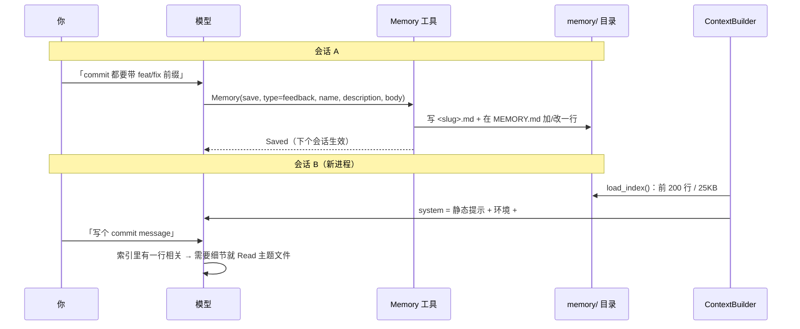

# 给 Agent 加上长期记忆

> 对应原站：[给 Agent 加上长期记忆](https://labuladong.online/zh/ai-coding/coding-agent/memory/)（会员内容；本章为独立原创重写）

> **一句话结论**：长期记忆说穿了是「一个目录 + 一份索引」。模型用一个工具把值得记的东西写成 markdown，下个会话开始时只把**索引**放进 system，正文等用到再读。记忆不是让模型变聪明，而是让它每次开工前都能读到同一页笔记。

## 我上周教过它的，这周怎么又忘了？

你一定有过这种体验：上周在 mini-cc 里说了一句「commit message 要带 `feat:` / `fix:` 前缀」，它那一轮照做了。这周开个新会话让它写提交信息，交出来的又是光秃秃的一句「修改分页逻辑」。

你可能会问：第 4 章不是已经把会话存盘了吗？`/resume` 能找回来啊。

能找回来的是**那一个会话**。新会话从空历史开始，上周那句话躺在另一个 jsonl 文件里，模型根本看不到。第 9 章的 `AGENTS.md` 倒是每个会话都会注入，但那是**你写给它的规则**，你得自己记得去改那个文件。

我们要的是另一件事：**它自己发现「这句话以后还用得上」，自己记下来，下次自己读到。**

## 两条路：文件式还是向量式

做记忆有两条成熟路线，本库都拆过：

| | 文件式（[Claude Code 自动记忆](../p3-agent-internals/06-auto-memory.md)） | 向量式（[mem0](../p3-agent-internals/08-mem0-memory.md)） |
|---|---|---|
| 存什么 | 一条记忆一个 markdown，外加一行索引 | LLM 从对话里抽出的短事实 + 向量 |
| 谁决定记 | 主模型在对话中自己判断 | 每轮对话后额外调一次 LLM 抽取 |
| 怎么取回 | 索引常驻上下文，正文用 Read 按需读 | 每轮按语义检索 top-k 注入 |
| 依赖 | 文件系统 | 向量库 + embedding 模型 |
| 人能不能直接看、直接改 | 能，就是 markdown | 很难 |

你可能会问：mem0 装上就能用，为什么不直接用它？

我选文件式，理由有三条：

1. **coding agent 的记忆量很小**。一个项目攒上几十条偏好和约定就算多了，你本机最大的 `MEMORY.md` 也才 139 行。几十条内容根本用不着检索，全部列出来让模型自己挑，比 top-k 召回更不容易漏。
2. **它要能被人审**。记错一条偏好，后果是它以后每次都错。markdown 你打开就能改、能删、能 `git diff`；向量库里的一条 embedding 你没法读。
3. **少一次模型调用**。mem0 每轮都要额外跑一次抽取；文件式让主模型在干活的同时顺手记，不额外花钱。

代价也说清楚：文件式依赖主模型「想得起来去记」，记不记、记什么全看提示词写得好不好；而且索引常驻上下文，条目一多就要精简。这两点后面都会碰到。

## 先跑起来看看

离线 fake 模型（`examples/ch12a.json` 和 `ch12b.json`），**两个独立进程**，中间什么都不传，只共享 `MINI_CC_HOME` 目录。演示项目是一个暂存了 `posts.py`（Node 版是 `posts.js`）改动的 git 仓库；路径前缀替换成了 `$DEMO`，项目 slug 写成 `<slug>`（终端里工具结果按 100 字符截断，替换路径后我补全了文件名）：

=== "Node"

    ```console
    $ printf '以后 commit message 都要带 feat:/fix: 这类前缀，别再写光秃秃的一句话了\n/memory\n/exit\n' \
        | node mini_cc/cli.ts --fake examples/ch12a.json
    ❯ 以后 commit message 都要带 feat:/fix: 这类前缀，别再写光秃秃的一句话了
    ◇ system  项目说明 0 个文件、git 快照
    ◇ system  日期 2026-10-22
    ● 这是一条以后每次都要遵守的偏好，记进长期记忆。
    ⏺ Memory(save commit message 前缀)
    ✔ Memory -> Saved memory commit-message-071596ac to $DEMO/home/projects/<slug>/memory/commit-message-071596ac.md…
    ● 记住了。以后写 commit message 都会带 feat: / fix: 这类前缀，换个会话也一样。
    ❯ /memory
    记忆目录：$DEMO/home/projects/<slug>/memory（1 条，下个会话开始时进上下文）
    commit-message-071596ac  commit message 前缀 — 写 commit message 时用 feat:/fix:/docs: 这类前缀
    ❯ /exit

    $ printf '/context\n帮我给暂存区的改动写个 commit message\n/exit\n' \
        | node mini_cc/cli.ts --fake examples/ch12b.json
    ❯ /context
    system[0]       1278 chars  You are mini-cc, an interactive coding a
    system[1]        239 chars  # Environment
    system[2]       1427 chars  # Memory
    reminders          0 chars  0 个 <system-reminder> 块
    messages           0 chars  0 条消息（不含提醒）
    last request       0 tokens
    ❯ 帮我给暂存区的改动写个 commit message
    ◇ system  项目说明 0 个文件、git 快照
    ◇ system  日期 2026-10-22
    ● 先看看暂存区改了什么。
    ⏺ Bash(git diff --cached --stat)
    ✔ Bash ->  posts.js | 5 +++--
       1 file changed, 3 insertions(+), 2 deletions(-)
    ● 按记忆里的约定加前缀：

    feat: list_posts 支持 page / page_size 分页参数
    ❯ /exit
    ```

=== "Python"

    ```console
    $ printf '以后 commit message 都要带 feat:/fix: 这类前缀，别再写光秃秃的一句话了\n/memory\n/exit\n' \
        | uv run python -m mini_cc --fake examples/ch12a.json
    ❯ 以后 commit message 都要带 feat:/fix: 这类前缀，别再写光秃秃的一句话了
    ◇ system  项目说明 0 个文件、git 快照
    ◇ system  日期 2026-10-21
    ● 这是一条以后每次都要遵守的偏好，记进长期记忆。
    ⏺ Memory(save commit message 前缀)
    ✔ Memory -> Saved memory commit-message-071596ac to $DEMO/home/projects/<slug>/memory/commit-message-071596ac.md…
    ● 记住了。以后写 commit message 都会带 feat: / fix: 这类前缀，换个会话也一样。
    ❯ /memory
    记忆目录：$DEMO/home/projects/<slug>/memory（1 条，下个会话开始时进上下文）
    commit-message-071596ac  commit message 前缀 — 写 commit message 时用 feat:/fix:/docs: 这类前缀
    ❯ /exit

    $ printf '/context\n帮我给暂存区的改动写个 commit message\n/exit\n' \
        | uv run python -m mini_cc --fake examples/ch12b.json
    ❯ /context
    system[0]       1278 chars  You are mini-cc, an interactive coding a
    system[1]        239 chars  # Environment
    system[2]       1427 chars  # Memory
    reminders          0 chars  0 个 <system-reminder> 块
    messages           0 chars  0 条消息（不含提醒）
    last request       0 tokens
    ❯ 帮我给暂存区的改动写个 commit message
    ◇ system  项目说明 0 个文件、git 快照
    ◇ system  日期 2026-10-21
    ● 先看看暂存区改了什么。
    ⏺ Bash(git diff --cached --stat)
    ✔ Bash ->  posts.py | 5 +++--
       1 file changed, 3 insertions(+), 2 deletions(-)
    ● 按记忆里的约定加前缀：

    feat: list_posts 支持 page / page_size 分页参数
    ❯ /exit
    ```

第二个进程的 `/context` 里多了一段 `system[2] # Memory`，这就是上一个进程留下的东西。磁盘上是两个普通文件（Node 版写出来的逐字相同）：

```console
$ cat $DEMO/home/projects/<slug>/memory/MEMORY.md
- [commit message 前缀](commit-message-071596ac.md) — 写 commit message 时用 feat:/fix:/docs: 这类前缀
$ cat $DEMO/home/projects/<slug>/memory/commit-message-071596ac.md
---
name: commit message 前缀
description: 写 commit message 时用 feat:/fix:/docs: 这类前缀
type: feedback
---
commit message 第一行必须以 feat: / fix: / docs: / refactor: / test: 开头，后面是一句中文摘要。
**Why:** 用户要按前缀生成 changelog，光秃秃的一句话没法归类。
**How to apply:** 任何时候帮用户写或改 commit message 都套用；用户另有指定时以用户为准。
```

（fake 模型的台词是写死的，它「按记忆加前缀」是剧本安排的。真模型会不会照做，取决于它在 system 里看到这条索引后的判断。这正是下面要讲的：我们能保证的只是**它看得到**。）

## 原理：写一次，读很多次



图注：写路径走工具，读路径走 system。**正文不预加载**，模型看到相关的那一行再自己 Read。

打个比方，这像你自己的工作笔记本。每页写一件事，第一页是目录。每天上班先翻目录（几秒钟），今天要用哪页再翻到哪页。你不会每天早上把整本笔记从头读一遍。

这个比方在一处不成立：你翻目录时知道自己今天要干什么；模型在会话开头读索引时，**还不知道用户要它干什么**。所以索引的每一行都得写清「什么时候用得上」，而不只是「这条叫什么」。这就是 `description` 字段要求写成「写 commit message 时用……」而不是「commit 规范」的原因。

**回到主线**：模型的上下文每个会话都从零开始，记忆是在**会话之间**搬运上下文。它的取舍是分层付费：索引每次都付（几百 token），正文用到才付（一次 Read）。和第 20 章 skills 的渐进式加载是同一个思路。

## 动手

### 存储：`mini_cc/memory.py:MemoryStore`

目录位置是 `<home>/projects/<slug>/memory/`。这里的 slug 按**仓库根**算（`git_root(cwd) or cwd`），而不是按 cwd，所以你在 `apps/web/` 子目录和仓库根启动，读写的是同一份记忆。Claude Code 也是这么做的（文档：记忆目录由 git 仓库推出，所有 worktree 和子目录共用）。

=== "Node"

    ```ts
    static forProject(home: string, cwd: string): MemoryStore {
      return new MemoryStore(join(home, "projects", projectSlug(gitRoot(cwd) ?? cwd), "memory"));
    }
    ```

=== "Python"

    ```python
    @classmethod
    def for_project(cls, home: Path, cwd: Path) -> "MemoryStore":
        from .context import git_root
        from .session import project_slug
        return cls(home / "projects" / project_slug(git_root(cwd) or cwd) / "memory")
    ```

`save()` 做两件事：写主题文件（frontmatter + 正文），然后在索引里**加一行或改一行**：

=== "Node"

    ```ts
    const line = `- [${name}](${slug}.md) — ${description}`;
    const lines = this.lines();
    const hit = lines.findIndex((ln) => ln.includes(`](${slug}.md)`));
    if (hit >= 0) lines[hit] = line; // 同一个 slug：原地更新那一行，索引里不会重复
    else lines.push(line);
    this.writeIndex(lines); // 先写 .tmp 再 rename，崩溃不留半个文件
    ```

=== "Python"

    ```python
    line = f"- [{name}]({slug}.md) — {description}"
    lines = self._lines()
    hit = [i for i, ln in enumerate(lines) if f"]({slug}.md)" in ln]
    if hit:
        lines[hit[0]] = line          # 同一个 slug：原地更新那一行，索引里不会重复
    else:
        lines.append(line)
    self._write_index(lines)          # 先写 .tmp 再 replace，崩溃不留半个文件
    ```

你可能会问：slug 为什么不直接用 `name`？

因为 name 经常是中文。`slugify("提交信息加前缀")` 会得到 `memory-<8 位哈希>`，`slugify("commit message 前缀")` 得到 `commit-message-071596ac`：ASCII 部分保留可读性，丢掉了非 ASCII 字符时补一段哈希，避免「提交前缀」和「提交规范」撞成同一个文件名。哈希是 `sha1(name)` 的前 8 位，同一个 name 永远得到同一个 slug，模型用同样的 name 再存一次就是更新。

### 读：索引截断要说出来

=== "Node"

    ```ts
    loadIndex(): string {
      const lines = this.lines();
      const kept: string[] = [];
      let size = 0;
      for (const ln of lines.slice(0, MAX_LINES)) { // 200 行
        const n = Buffer.byteLength(ln, "utf8") + 1;
        if (size + n > MAX_BYTES) break; // 25KB
        kept.push(ln);
        size += n;
      }
      let text = kept.join("\n");
      if (kept.length < lines.length) {
        text += `\n\n(MEMORY.md is truncated: ${lines.length - kept.length} more lines were not loaded. ` +
          "Condense the index.)";
      }
      return text;
    }
    ```

=== "Python"

    ```python
    def load_index(self) -> str:
        lines = self._lines()
        kept, size = [], 0
        for ln in lines[:MAX_LINES]:                 # 200 行
            n = len(ln.encode("utf-8")) + 1
            if size + n > MAX_BYTES:                 # 25KB
                break
            kept.append(ln); size += n
        text = "\n".join(kept)
        if len(kept) < len(lines):
            text += (f"\n\n(MEMORY.md is truncated: {len(lines) - len(kept)} more lines were not loaded. "
                     "Condense the index.)")
        return text
    ```

200 行 / 25KB 这两个数沿用了 Claude Code 官方文档的说法。截断本身不难，关键是**截断了要告诉模型**。否则第 201 条记忆就静悄悄地「不存在」了，模型还以为自己看到的是全部。

另一个防线在写入时：`_size_note()` 在索引超过上限的 90% 时，往 `Memory` 的返回结果里追加一句「请精简：一条一行，合并或删掉过时条目」。Claude Code 文档里描述的也是这个机制（接近上限时提醒精简）。让模型自己整理自己的笔记，比客户端按某种规则硬删更合理：只有它知道哪些条目是重复的。

### 进上下文：放 system，而不是 user 消息

`MemoryStore.system_section()` 挂在第 9 章预留的 `ContextBuilder.system_sections` 上。`cli.py:App.__init__`：

=== "Node"

    ```ts
    this.memory = MemoryStore.forProject(settings.home, settings.cwd);
    this.agent.ctx.extras.memory = this.memory;
    this.agent.context.systemSections.push(() => this.memory.systemSection());
    ```

=== "Python"

    ```python
    self.memory = MemoryStore.for_project(settings.home, settings.cwd)
    self.agent.ctx.extras["memory"] = self.memory
    self.agent.context.system_sections.append(self.memory.system_section)
    ```

你可能会问：项目说明（`AGENTS.md`）是注入在第一条 user 消息里的，记忆为什么放 system？

两者的区别在于「会话内会不会变」和「是谁的指令」。`system_sections` 里的函数**每个会话只求值一次**（`ContextBuilder.system_blocks()` 有缓存），整个会话里 system 逐字节不变，prompt cache 的前缀一直能命中。代价是：这个会话里新存的记忆，不会出现在这个会话的 system 里。

这没关系。模型刚刚自己写的东西，它当然知道（工具结果里也明说了 `you already know it in this one`）。换会话时 `App._attach()` 调 `context.invalidate()`，下一次请求重新计算 system，新记忆就进来了。测试 `test_memory_index_reaches_next_session_system_prompt` 同时守着两件事：同一会话 system 不变，`/new` 之后新记忆可见。

放 system 还有一层含义：system 是客户端（operator）的地盘。记忆是 agent 跨会话的**工作背景**，而不是「用户这一轮说的话」。

段落里除了索引，还有一段「什么值得记、什么不该记」的指引（`memory.py:GUIDE`），四种类型直接沿用 Claude Code 文档的 `user / feedback / project / reference`：

```text
Do NOT save: anything derivable from the code or git history, anything already in AGENTS.md / CLAUDE.md,
details of the current task only, or secrets. Update an existing memory (same slug) instead of adding a
duplicate, and delete memories that turn out to be wrong.
```

「不该记」那一句比「该记」更重要。不写的话，模型很容易把「`posts.py` 在第 3 行定义了 `list_posts`」这种代码里一查就有、而且明天就过时的事实也记进去。

### 写：一个专用的 Memory 工具

`mini_cc/tools/memory_tool.ts:MemoryTool`（Python 版 `memory_tool.py:MemoryTool`），两个动作：

=== "Node"

    ```ts
    override inputSchema = {
      type: "object",
      properties: {
        action: { type: "string", enum: ["save", "delete"] },
        type: { type: "string", enum: [...TYPES] },
        name: { type: "string" }, description: { type: "string" },
        body: { type: "string" }, slug: { type: "string" },
      },
      required: ["action"],
      additionalProperties: false,
    };

    override selfCheck(_args: Args): "allow" {
      return "allow"; // 不是只读，但只写 agent 自己的记忆目录、不碰项目文件：和任务清单一样免审批
    }
    ```

=== "Python"

    ```python
    input_schema = {
        "type": "object",
        "properties": {
            "action": {"type": "string", "enum": ["save", "delete"]},
            "type": {"type": "string", "enum": list(TYPES)},
            "name": {"type": "string"}, "description": {"type": "string"},
            "body": {"type": "string"}, "slug": {"type": "string"},
        },
        "required": ["action"],
        "additionalProperties": False,
    }

    def self_check(self, args) -> str | None:
        return "allow"   # 不是只读，但只写 agent 自己的记忆目录、不碰项目文件：和任务清单一样免审批
    ```

你可能会问：Claude Code 没有专用的记忆工具，用的是普通的 Write / Edit（[自动记忆那章](../p3-agent-internals/06-auto-memory.md)有本机证据），我们为什么要单独做一个？

这是我有意做的取舍。用普通 Write / Edit 写记忆，mini-cc 会撞上三处摩擦：

- **第 7 章的「先读后改」**：`MEMORY.md` 已存在，模型没 Read 过就 Edit，会被 `File has not been read yet` 拦下。索引明明就在 system 里，还得再读一遍。
- **第 5 章的权限**：记忆目录在项目外面，acceptEdits 的「项目内编辑」快速通道不覆盖它。Claude Code 是在权限系统里给记忆目录开了一个专门的例外。
- **索引格式靠模型自觉**：手写 Edit 很容易把索引行写成一段话，或者忘了加那一行。

一个专用工具把这三件事一次解决：写主题文件和改索引是一个原子操作，格式由代码保证，`self_check` 返回 `"allow"` 免审批。代价是灵活性，模型没法对记忆做「改正文里的一个词」这种细粒度编辑，只能整条重存。对几十条短记忆来说，我觉得划算。

还有第三种选择值得一提：Anthropic API 有一个官方的客户端记忆工具 `memory_20250818`（命令 `view / create / str_replace / insert / delete / rename`，操作 `/memories` 目录），模型对这套命令是训练过的。它更通用，但没有「索引常驻 system」这一层，读记忆要模型自己 `view`。练习 3 留给你比较。

### 命令：`/memory`

`/memory` 列出索引和目录位置，`/memory rm <slug>` 删一条。记错了的东西你能随时看见、随时删掉，这是文件式记忆最大的好处。

## 测试

`tests/ch12_memory.test.ts`（Python 版 `tests/test_ch12_memory.py`），8 个：

- `MemoryStore` 的保存、同 slug 更新不重复、删除；`slugify` 对中英文的处理。
- 索引超过 200 行时截断并提示；接近上限时保存结果里有「condense」提醒。
- 模型调 `Memory` 免审批，返回「future sessions」；同一个仓库的子目录共用一个记忆目录。
- 同一会话 system 不变、新进程 / `/new` 后索引进入 system。
- `/memory` 列表和删除；非法 type、删不存在的 slug 都是工具错误。

另外 `test_ch09_context.py`（Node 版 `ch09_context.test.ts`）里一个断言原来假定 `# Environment` 是 system 的最后一段，现在 `# Memory` 排在它后面，改成了按标题查找。

=== "Node"

    ```console
    $ cd /Users/liz/liz/agent-learn/code/mini_cc-node && node --test tests/ch0*.test.ts tests/ch1[0-2]*.test.ts tests/extension_points.test.ts
    ℹ tests 130
    ℹ suites 0
    ℹ pass 130
    ℹ fail 0
    ℹ cancelled 0
    ℹ skipped 0
    ℹ todo 0
    ℹ duration_ms 5079.0485
    ```

=== "Python"

    ```console
    $ cd /Users/liz/liz/agent-learn/code/mini_cc && uv run pytest -q
    ........................................................................ [ 55%]
    ..........................................................               [100%]
    130 passed in 4.44s
    ```

## 和真实 Claude Code 的差异

- **写路径**：Claude Code 用普通 Write / Edit 写进记忆目录，权限系统对「auto memory 目录里的 markdown」开了例外；mini-cc 用专用 `Memory` 工具。
- **主题文件 frontmatter**：你本机的记忆文件是 `name / description / metadata(type, …)`，mini-cc 简化成平铺的 `name / description / type`。
- **何时写入**：两者都是主模型在对话中自己决定。Codex 的路线完全相反，在下一次启动时由后台把旧会话批量提炼（[Codex 自动记忆](../p3-agent-internals/07-auto-memory.md)）。mini-cc 预留的 `Agent.turn_end` 钩子本章没用上，它适合做 Codex 那种「一轮结束后再提炼」，练习 2 会用到。
- **sub agent**：Claude Code 文档说主会话的 auto memory 不加载进 subagent。第 17 章的 sub agent 用独立的 `ContextBuilder`，同样看不到记忆段落。

## 对照你的环境

- 你在全局 CLAUDE.md 里定的分层「每次必须遵守的 → guardrails；多步流程 → skill；一次性事实、单轮教训 → memory」，和本章的设计正好对应：guardrails 相当于第 9 章每次全文注入的项目说明，memory 相当于本章只注入索引的记忆，skill 是第 20 章用到才加载的说明书。
- 你最大的 `MEMORY.md` 是 23,388 字节、139 行，离 25KB 只差一点。先撞上的是字节上限，不是行数。按本章的实现，到那时每次保存记忆，模型都会收到「请精简」提醒。
- 你有 `env/backup-memory.sh` 做异地备份。mini-cc 的记忆同样只在本机，`MINI_CC_HOME` 指向哪里就在哪里，换机器不会同步。

## 常见坑

1. **在同一个会话里改 system**。为了让新记忆「立刻生效」去刷新 system，每存一条记忆整个 prompt cache 前缀就失效一次。新记忆模型本来就知道，等下个会话再进 system。
2. **索引截断不提示**。超出的条目就等于不存在，模型却不知道。
3. **description 写成标题**。「commit 规范」不如「写 commit message 时用 feat/fix 前缀」：模型在会话开头还不知道任务是什么，要靠这一句判断要不要去读正文。
4. **什么都记**。能从代码、git log 推出来的东西不记；当前任务的中间状态是任务清单（第 11 章）的事，不是记忆的事。
5. **把密钥记进去**。记忆是明文 markdown，还会被原样塞进每个会话的上下文。

## 练习

1. 给 `MemoryStore` 加一个 `orphans()`：找出索引里指向不存在文件的行，以及没被索引引用的主题文件，并在 `/memory` 里提示。
2. 用 `Agent.turn_end` 钩子实现一个「事后提炼」：一轮结束时，如果用户这一轮的原话里有「以后」「每次」「别再」这类词，就 `agent.notify()` 一条提醒，问模型要不要存成记忆。和让模型在对话中自己判断比，这种做法的误报和漏报各在哪里？
3. 开放题：把 `Memory` 工具换成官方的 `memory_20250818`（在 `ToolRegistry` 里输出 `{"type": "memory_20250818", "name": "memory"}`，实现 `view/create/str_replace/...` 六个命令）。你会保留「索引常驻 system」这一层吗？两种方案各自省了什么、多花了什么？

## 延伸阅读

- Claude Code 记忆文档（CLAUDE.md 层级、auto memory、200 行 / 25KB）：<https://code.claude.com/docs/en/memory>
- Claude API 记忆工具（`memory_20250818`）：<https://platform.claude.com/docs/en/agents-and-tools/tool-use/memory-tool>
- 本系列：[Claude Code 自动记忆系统](../p3-agent-internals/06-auto-memory.md)、[Codex 自动记忆系统](../p3-agent-internals/07-auto-memory.md)、[mem0 记忆库的实现思路](../p3-agent-internals/08-mem0-memory.md)
- 上一章：[让 Agent 跟踪多步任务](11-task-management.md)；下一章：[支持 rewind 回退对话和代码](13-rewind.md)
