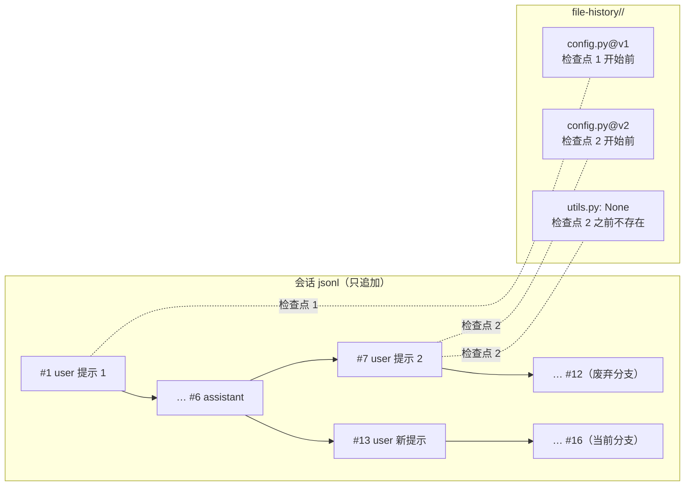

# 支持 rewind 回退对话和代码

> 对应原站：[支持 rewind 回退对话和代码](https://labuladong.online/zh/ai-coding/coding-agent/rewind/)（会员内容；本章为独立原创重写）

> **一句话结论**：rewind 是两件事的组合：**对话回到某条消息之前的前缀**，**代码回到那条消息发出时的样子**。前者靠会话文件里的 `uuid/parentUuid` 链分叉，后者靠「每一轮第一次写某个文件之前，先把它备份一份」。两件事都不需要修改任何已有记录。

## 有了 git，为什么还要 rewind？

你习惯每个任务开一个 worktree、做完一个功能提一次 commit。那 agent 改坏了，`git checkout .` 不就行了？

你可能会问：rewind 和 git 是不是重复了？

不重复，粒度不一样。一个 bugfix 你会和 agent 来回聊七八轮：第三轮它改对了，第四轮你随口说「顺便把那个函数也重构一下」，它改了五个文件，你一看，不想要。这时候：

- `git checkout .` 会连第三轮改对的部分一起扔掉，因为你还没提交；
- 为了能回退，每一轮都 commit 一次，git 历史又会碎成一地「wip」；
- 就算代码回去了，**对话还停在第四轮之后**，模型的上下文里塞满了那次重构的 diff 和它的推理。你接着聊，它会以为那次重构还在。

所以要的是：代码回到第四轮之前，对话**也**回到第四轮之前，然后你换个说法重新发。git 管功能边界，rewind 管一次对话里的每一步。

## 先跑起来看看

离线 fake 模型（`examples/ch13.json`），`--permission-mode acceptEdits`。项目里只有一个 `config.py`（`DEBUG = True` 和 `HOST`）：

```console
❯ 给 config.py 加一个 TIMEOUT = 30
◇ system  项目说明 0 个文件
◇ system  日期 2026-10-21
⏺ Read(config.py)
✔ Read ->      1        DEBUG = True
       2        HOST = "localhost"
⏺ Edit(config.py)
✔ Edit -> The file config.py has been updated (1 replacement). Snippet:
       1        DEBUG = True
       2        TIMEOUT = 30  …(+1 lines)
● 加好了：TIMEOUT = 30。
❯ 顺便把 DEBUG 删掉，再建一个 utils.py
● 去掉 DEBUG，再新建 utils.py。
⏺ Edit(config.py)
✔ Edit -> The file config.py has been updated (1 replacement). Snippet:
       1        TIMEOUT = 30
       2        HOST = "localhost"
⏺ Write(utils.py)
✔ Write -> Created utils.py (5 lines)
● DEBUG 已删除，utils.py 已创建。
❯ /rewind
1. 给 config.py 加一个 TIMEOUT = 30  （改了 1 个文件）
2. 顺便把 DEBUG 删掉，再建一个 utils.py  （改了 2 个文件）
输入 /rewind <序号> [both|conversation|code] 回到那条消息发出之前（默认 both）
❯ /rewind 2
  ⎿ 恢复 config.py
  ⎿ 删除（这之后才新建的） utils.py
已回到第 2 个检查点之前，对话剩 6 条消息
原话：顺便把 DEBUG 删掉，再建一个 utils.py（已放回输入框，可以改一改再发）
❯ 只建 utils.py，DEBUG 先留着
● 这次只建 utils.py，DEBUG 保留。
⏺ Write(utils.py)
✔ Write -> Created utils.py (5 lines)
● utils.py 已创建，config.py 没动。
❯ /exit
--- config.py
DEBUG = True
TIMEOUT = 30
HOST = "localhost"
```

`/rewind 2` 回到了第 2 条消息发出之前：第 1 轮加的 `TIMEOUT` 还在，第 2 轮删掉的 `DEBUG` 回来了，第 2 轮新建的 `utils.py` 被删掉；对话剩 6 条消息，正好是第 1 轮的全部。

会话文件没有被改写过一个字节。下面是同一个 jsonl 里每条记录的 `parentUuid`（我把 uuid 换成了序号）：

```text
#1  parent=#0  user      给 config.py 加一个 TIMEOUT = 30
...
#6  parent=#5  assistant 加好了：TIMEOUT = 30。
#7  parent=#6  user      顺便把 DEBUG 删掉，再建一个 utils.py
...
#12 parent=#11 assistant DEBUG 已删除，utils.py 已创建。
    rewind leaf=#6
#13 parent=#6  user      只建 utils.py，DEBUG 先留着
#14 parent=#13 assistant 这次只建 utils.py，DEBUG 保留。
...
```

#7 到 #12 是被放弃的分支，还留在文件里；#13 的 parent 指回 #6，从那里长出了新分支。

## 原理：对话是一棵树，文件有一叠备份



图注：每条用户亲手发的消息是一个**检查点**。对话回退 = 把「当前叶子」挪回检查点前一条消息；代码回退 = 用那个检查点及之后**第一次**写每个文件之前的备份覆盖回去。

打个比方，这像玩游戏时的存档。每进一个关卡（你发一条消息）自动存一次档。读档时，角色状态（代码）和剧情进度（对话）一起回到那一刻。

这个比方有一处不成立：游戏存档存的是整个世界，我们只存「agent 自己通过 Write/Edit 动过的文件」。你在编辑器里改的、`Bash` 里 `sed -i` 改的、`npm install` 装的，都不在存档里。这一点后面单独说。

**回到主线**：rewind 在上下文这件事上做的，是**撤回**一段已经进了上下文的内容。撤回只能整段撤掉「某个点之后的全部」，留下的是原来的前缀。这恰好是最便宜的撤回方式：前缀逐字节不变，prompt cache 照样命中，`claude-opus-5-5` 的 thinking 块也照样有效（claude-api 文档：删掉对话**中间**的轮次会让之后的 thinking 块全部失效，而截掉一个后缀不会）。

## 动手

### 1. 会话文件：从叶子往回走

第 4 章的 `SessionStore.load` 是从头到尾逐行读的。有了分叉，这样读会把两条分支拼在一起。改成从最新的叶子沿 `parentUuid` 往回走，`mini_cc/session.py:branch`：

```python
def branch(recs):
    by_id, leaf = {}, None
    for r in recs:
        if r.get("type") in ("user", "assistant") and r.get("uuid") and "message" in r:
            by_id[r["uuid"]] = r
            leaf = r["uuid"]                    # 最后写的那条消息是叶子
        elif r.get("type") == "rewind":
            leaf = r.get("leafUuid")            # 回退把叶子挪回分叉点
    out = []
    while leaf and leaf in by_id:
        out.append(by_id[leaf])
        leaf = by_id[leaf].get("parentUuid")
    return out[::-1]
```

你可能会问：为什么还要一条 `rewind` 记录？下一条新消息的 parent 本来就指回分叉点了。

因为你可能回退之后什么都没说就退出了。没有这条记录，`/resume` 会找到 #12 当叶子，把废弃的分支又恢复回来。`Session.rewind(keep)` 做的就是截断内存里的 `chain`、把 `last_uuid` 挪回分叉点、追加这条记录。

`Session.chain` 是本章新加的：当前分支上每条消息的 uuid，和 `Agent.messages` 一一对应。`/rewind` 要把「第 n 个检查点」换算成「保留前几条消息」，就靠 `chain.index(checkpoint.uuid)`。

这里用的正是第 4 章埋下的 `uuid/parentUuid`。当时它只是一条直线，现在它变成了树。

### 2. 文件备份：每轮每个文件只备份一次

`mini_cc/rewind.py:FileHistory.before_write` 挂在第 7 章预留的 `ToolContext.write_hooks` 上，`Write` 和 `Edit` 在真正写盘前调用它：

```python
def before_write(self, path: Path) -> None:
    if not self.checkpoints:
        return
    cp, key = self.checkpoints[-1], str(path)
    if key in cp.files:
        return                                   # 这一轮已经备份过：要的是「这一轮开始前」的版本
    if path.exists():
        version = 1 + sum(key in c.files for c in self.checkpoints[:-1])
        name = f"{hashlib.sha256(key.encode()).hexdigest()[:16]}@v{version}"
        (self.dir / name).write_bytes(path.read_bytes())
        cp.files[key] = name
    else:
        cp.files[key] = None                     # 写之前不存在：回退 = 删除
    self.save()
```

命名 `<路径哈希>@v<版本>` 和目录 `file-history/<session>/` 都照搬 Claude Code。你本机 `~/.claude/file-history/` 下有 34 个会话目录，里面就是 `03e172fcd311f8f7@v2` 这样的文件；会话 jsonl 里对应的 `file-history-snapshot` 记录带着 `trackedFileBackups`，每项有 `backupFileName`、`version`、`backupTime`，新建的文件 `backupFileName` 是 `null`。mini-cc 把检查点列表存进同目录的 `index.json`，没有写进会话 jsonl，`/resume` 之后照样能回退代码。

检查点什么时候开？`cli.py:App._on_message` 订阅 `Agent.listeners`（第 4 章预留），排在会话落盘之后，因为要用落盘时刚分配的 uuid：

```python
def _on_message(self, msg, meta):
    if is_prompt(msg) and self.session.last_uuid:
        self.file_history.begin(self.session.last_uuid, prompt_text(msg))
```

`is_prompt` 只认用户亲手发的消息：带 `tool_result` 的不算，只有 `<system-reminder>` 的也不算（第 16 章后台任务完成时会用这种消息「唤醒」模型）。

### 3. 恢复：取检查点之后「第一次」的备份

```python
def restore(self, uuid):
    changes = []
    for key in self.changed_since(uuid):
        first = next(c for c in self.checkpoints[self.index_of(uuid):] if key in c.files)
        backup, path = first.files[key], Path(key)
        if backup is None:
            if path.exists():
                path.unlink(); changes.append((key, "deleted"))
        else:
            data = (self.dir / backup).read_bytes()
            if not path.exists() or path.read_bytes() != data:
                path.write_bytes(data); changes.append((key, "restored"))
    return changes
```

你可能会问：为什么是「第一次」的备份，不是最后一次？

举个例子：回退到检查点 2，而 `config.py` 在检查点 2 和 4 都被改过。检查点 2 的备份是「第 2 轮开始前」的内容，也就是我们要回到的状态；检查点 4 的备份是第 3 轮结束后的内容，已经包含了第 2、3 轮的改动。所以对每个文件，取目标检查点之后**最早**出现的那份。

这里有一个隐含前提：从检查点 2 开始到第一次写 `config.py` 之间，没有别人改过它。`Bash` 或你手动改过的话，那份备份就不是「检查点开始时」的样子了。

### 4. 三种模式

`cli.py:App.rewind(n, mode)`：

```python
cp = self.checkpoints()[n - 1]
if mode in ("both", "code"):
    changes = self.file_history.restore(cp.uuid)
    for path, _ in changes:
        self.agent.ctx.file_state.forget(Path(path))
if mode in ("both", "conversation"):
    keep = self.session.chain.index(cp.uuid)
    self.agent.load_history(self.agent.messages[:keep], self.agent.usage)  # 原来的前缀
    self.session.rewind(keep)
    self.file_history.truncate(cp.uuid)
    self.agent.ctx.file_state.clear()
    self.prefill = cp.prompt
```

`both / conversation / code` 三个名字来自 Claude Code 的二进制：`/rewind`（别名 `checkpoint`、`undo`，描述「Restore the code and/or conversation to a previous point」）的菜单里就是 `Restore code and conversation` / `Restore conversation` / `Restore code` 三项。只回退代码适合「方案没问题，但改坏了，让它重来」；只回退对话适合「代码留着，但刚才那段讨论把上下文搞乱了」。

有两处细节：

- **回退对话会清空第 7 章的文件状态表**。被丢弃的分支里模型可能 Read 过某个文件，但在新分支里它「没读过」。和 `/resume` 一样，只信任这条分支上亲眼看到的东西，让模型重新 Read。只回退代码时，只让被恢复的那几个文件失效。
- **原话放回输入框**。`App.prefill` 交给 `prompt_toolkit` 的 `session.prompt(default=...)`。回退的目的几乎总是「换个说法再说一遍」，帮你把原话填好。

你可能会问：`load_history` 换掉整段历史，不违反第一条不变量「历史只追加、不修改」吗？

不违反，但值得把边界说清。这条不变量保护的是**已经发给模型的前缀**不被悄悄改写：改写会让会话文件、prompt cache、thinking 校验全部对不上。rewind 不改写任何一条消息，它只是声明「从这个前缀重新开始」。会话文件那边也一样，只追加了一条 `rewind` 记录。第 14 章的压缩是另一个这样的「分支点」。我把这一点补进了 `ARCHITECTURE.md` 的不变量说明。

## 测试

`tests/test_ch13_rewind.py`，8 个：

- `FileHistory`：同一检查点只备份一次、新建文件记成 `None`、恢复时还原和删除、`index.json` 读回。
- `/rewind` 列表显示每个检查点改了几个文件。
- `both`：代码恢复、历史变成第 1 轮的原样前缀、文件状态清空；`conversation` 只回对话；`code` 只回代码。
- 会话文件分叉：新消息的 `parentUuid` 指回分叉点，`/resume` 走的是新分支。
- `Bash` 改的文件不在检查点里；序号越界、模式写错的提示。

```console
$ cd /Users/liz/liz/agent-learn/code/mini_cc && uv run pytest -q
........................................................................ [ 52%]
..................................................................       [100%]
138 passed in 4.85s
```

## 和真实 Claude Code 的差异

- **Bash 不跟踪**：Claude Code 的检查点文档在「Limitations」里第一条就是「Bash command changes not tracked」（`rm`、`mv`、`cp` 改的文件回退不了），外部修改、其他并发会话的修改也不跟踪，并明说它不是版本控制的替代品。mini-cc 的边界一样，因为两者都只在自己的编辑工具里拍快照。
- **回退后立刻退出**：Claude Code 文档有一节专门提醒「回退之后、发下一条消息之前退出，被回退的消息可能会回来」，因为它是和下一条提示词一起保存回退结果的。mini-cc 多写了一条 `rewind` 记录，没有这个问题。
- **快照存哪里**：Claude Code 写进会话 jsonl（`file-history-snapshot`，后来还有增量的 `file-history-delta`），并且只保留最近 100 个检查点的快照、约 30 天后清理；mini-cc 存在 `file-history/<session>/index.json`，不清理。
- **菜单里还有压缩选项**：Claude Code 的菜单还有 `Summarize from here` / `Summarize up to here`：把这一点之后 / 之前的对话压成摘要，相当于一次定点的 `/compact`。下一章做完压缩，你可以自己把它接上（练习 3）。
- **sub agent 的改动**：Claude Code 文档说，后台运行的 sub agent 改的文件通常不进主会话的检查点。第 17 章的 sub agent 用的是自己的 `ToolContext`，没有挂 `write_hooks`，情况相同。
- **交互**：Claude Code 在输入框为空时按两下 Esc 弹出消息列表；mini-cc 是 `/rewind` 加序号。

## 对照你的环境

- 你的全局规则是「代码变更默认走独立 worktree」。worktree 和 rewind 不冲突：worktree 隔离的是**任务**，rewind 撤回的是**任务里的某一步**。两者叠在一起用，git 历史里只有有意义的 commit。
- 你配了 PostToolUse hook 跑 formatter。formatter 改文件发生在 Edit 之后，下一次 Edit 前的备份已经包含了格式化结果，所以回退回去的是「格式化过的」版本，这通常正是你想要的。但如果 formatter 是从 Bash 里跑的，它的改动不会单独留快照。
- 你在 webapp 里常让 agent 跑 `pnpm` 装依赖、跑 codegen。这些全是 Bash 改的文件，rewind 管不到，`git status` 才管得到。

## 常见坑

1. **备份最后一次而不是第一次**。一个文件一轮里改三次，要回到的是第一次改之前。
2. **从头逐行读会话文件**。分叉以后两条分支会被拼在一起，模型看到一段自相矛盾的历史。
3. **回退后不留记录**。回退完直接退出，`/resume` 会把废弃分支捡回来。
4. **回退对话但保留文件状态表**。模型在新分支里没读过的文件，Edit 不会被「先读后改」拦下，等于又回到了盲改。
5. **以为 rewind 能撤销一切**。`rm`、`git push`、调用外部 API 都撤不回来。这也是为什么高危命令要在第 5 章的权限里拦住，而不是指望事后回退。

## 练习

1. 第 11 章的任务清单存在独立的 `<session>.tasks.json` 里，回退对话时它不会跟着回去。给检查点也存一份清单快照，让 `/rewind` 一起恢复。
2. 用第 7 章的 `file_state` 给 Bash 补一个「事后快照」：执行 Bash 前记下所有已读文件的 sha256，执行后比对，变了的文件补一份备份。这能覆盖 `sed -i`，但覆盖不了哪些情况？
3. 开放题：Claude Code 的菜单里有「Summarize from here」。如果让你实现「保留前 3 轮原样，把第 4 轮以后压缩成摘要」，你会怎么接第 14 章的压缩？它对 prompt cache 和 thinking 块有什么影响？

## 延伸阅读

- Claude Code 检查点（checkpointing）：<https://code.claude.com/docs/en/checkpointing>
- 本系列：[Claude Code 会话存储](../p1-tools/07-session-storage.md)、[持久化聊天记录](04-resume.md)、[可靠的文件编辑工具](07-file-edit.md)
- 上一章：[给 Agent 加上长期记忆](12-memory.md)；下一章：[支持 compact 压缩上下文](14-compact.md)
