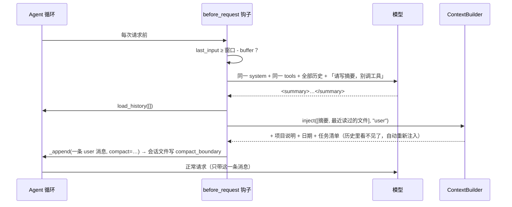

# 支持 compact 压缩上下文

> 对应原站：[支持 compact 压缩上下文](https://labuladong.online/zh/ai-coding/coding-agent/compact/)（会员内容；本章为独立原创重写）

> **一句话结论**：压缩就是多发一次请求，让模型把整段对话写成摘要，然后**用「摘要 + 程序重新挂回的东西」作为新的起点**。摘要只负责记住「我们在干什么」；项目说明、任务清单、最近读的文件这些能从磁盘重新拿的，由程序重新拿，不靠模型记。

## 压缩之后，它为什么忘了「别改函数名」？

你本机的会话被压缩过 95 次，自动压缩前的中位数是 96.7 万 token（[如何实现上下文压缩](../p3-agent-internals/05-context-compaction.md)里统计过）。你多半遇到过这种情况：长会话后半段，它突然把你一小时前明确说过不许动的函数签名改了。

你可能会问：压缩不是有摘要吗？摘要里没写吗？

可能真没写。摘要是模型写的，它会按「它觉得重要」来取舍。而它觉得重要的（技术细节、刚才的推理）和你觉得要紧的（你亲口说的约束），经常不是一回事。

所以这一章动手做压缩时，最该花心思的不是「怎么压得更短」，而是两件事：**哪些东西必须原样留下**，以及**哪些东西根本不该交给摘要**。

## 先跑起来看看

离线 fake 模型（`examples/ch14.json`），`--permission-mode acceptEdits`。项目里有 `posts.py` 和一份 `AGENTS.md`。剧本里每一步的 `input_tokens` 是手写的：第一轮约 11.8 万，第三步故意写成 97.5 万，模拟「上下文快满了」：

```console
❯ 给 list_posts 加分页，别改函数名，默认每页 20 条。先说方案
◇ system  项目说明 1 个文件
◇ system  日期 2026-10-21
● 先看代码。
⏺ Read(posts.py)
✔ Read ->      1        def list_posts(posts):
       2            return posts
● list_posts 目前直接返回全部数据，没有分页。建议加 page / page_size 两个参数，默认 1 和 20。
❯ /compact 重点保留用户的约束
压缩上下文中（当前约 118400 tokens）…
◇ system  项目说明 1 个文件
◇ system  日期 2026-10-21
已压缩：118400 → 约 300 tokens（摘要 260 字符，挂回 1 个文件）
❯ /context
system[0]       1278 chars  You are mini-cc, an interactive coding a
system[1]        240 chars  # Environment
system[2]       1364 chars  # Memory
reminders        717 chars  3 个 <system-reminder> 块
messages         448 chars  1 条消息（不含提醒）
last request     300 tokens
❯ 就按这个方案改，改完验证一下
● 按摘要里的方案改。
⏺ Edit(posts.py)
✔ Edit -> The file posts.py has been updated (1 replacement). Snippet:
       1        def list_posts(posts, page=1, page_size=20):
       2            start = (page - 1) * page_size  …(+1 lines)
自动压缩上下文中（当前约 975000 tokens）…
◇ system  项目说明 1 个文件
◇ system  日期 2026-10-21
已压缩：975000 → 约 358 tokens（摘要 250 字符，挂回 1 个文件）
● 接着验证。
⏺ Bash(python3 -c "from posts import list_posts; assert list_posts(list(range(50)), 2) == list(range(20, 40)); print('ok')")
是否允许 Bash(python3 -c "…")？（needs approval）
...
选择 [1/2/3]: 1
✔ Bash -> ok
● 改好并验证通过：函数名没变，默认每页 20 条。
```

两次压缩，一次手动、一次自动：

- 手动 `/compact` 后，历史只剩 **1 条消息**，里面有摘要、3 个 `<system-reminder>`（项目说明、日期、重新挂回的 `posts.py`）。
- 自动压缩发生在**一轮中间**：Edit 的结果刚回来，下一次请求之前发现上下文逼近窗口，先压缩再请求。模型接着说「接着验证」，没有停下来问你。

会话文件里留下了两条边界记录：

```json
{"subtype": "compact_boundary", "parentUuid": null, "compactMetadata": {"trigger": "manual", "preTokens": 118400, "postTokens": 300}}
{"subtype": "compact_boundary", "parentUuid": null, "compactMetadata": {"trigger": "auto", "preTokens": 975000, "postTokens": 358}}
```

（摘要内容是剧本写死的；`postTokens` 是按 4 字符 ≈ 1 token 粗估的，真实场景请以下一次请求的 usage 为准。）

## 原理：一次额外请求，换一个新起点



图注：压缩用的是第 11 章末尾预留的 `Agent.before_request` 钩子；新起点的组装复用了第 9 章的 providers。

打个比方，这像交接班。下班的人写一页交接单：客户提了什么要求、做到哪了、下一步干什么。接班的人拿着交接单，再去档案柜里把今天要用的几份文件抽出来，就能接着干。没人会指望交接单里抄一遍所有档案。

比方在这里不成立：人写交接单时知道接班的人缺什么；模型写摘要时并不知道「之后会用到什么」。所以摘要提示词要**事先规定**必须写哪些小节，而且明确要求用户的原话尽量照抄。

**回到主线**：压缩是最直接的「用信息损失换上下文空间」。把它做好的关键是分工：会丢失的信息交给摘要尽量保住，**能从磁盘重新拿的，一个字都不交给摘要**。

## 动手

### 1. 摘要请求：同一个前缀，多一条指令

`mini_cc/compact.py:compact`：

```python
req = agent._request()                      # 同一个 system、同一套 tools
history = merge_consecutive_users(agent.messages)
if history and history[-1]["role"] == "user":
    # 自动压缩发生在工具结果之后：指令并进最后一条 user 消息，保持交替（只改请求副本）
    history = history[:-1] + [{"role": "user", "content": _blocks(history[-1]["content"]) + [
        {"type": "text", "text": ask}]}]
else:
    history = history + [{"role": "user", "content": [{"type": "text", "text": ask}]}]
req.messages = history
done = complete(agent.client, req)
```

你可能会问：写摘要而已，为什么不另起一个干净的请求，只带历史、不带工具？

因为**前缀要一样**。system 和 tools 一换，整段历史的 prompt cache 全部作废，压缩这次请求就要按全价付几十万 token 的输入。保持同一个前缀、只在末尾多一条指令，前面的部分都能命中缓存。

代价是：带着工具，模型有可能「顺手」调一个工具，而不是写摘要。所以 `SUMMARY_PROMPT` 的最后一句是 `Do not call any tools while writing this summary; respond with text only.`。claude-api 文档专门点了这句：摘要请求还带着工具时，这一句是承重的，去掉它模型偶尔会去调工具。

摘要提示词规定了六个小节（`compact.py:SUMMARY_PROMPT`），第一节是「用户的每一个请求、约束、偏好，尽量用原话」。开头那个「别改函数名」的问题，靠的就是这一节。`/compact <指令>` 会把你的话追加在提示词末尾，比如演示里的「重点保留用户的约束」。

### 2. 新起点：简单压缩，不保留尾巴

拿到摘要以后：

```python
text = f"{SUMMARY_HEADER}\n\n{summary}" + (f"\n\n{CONTINUE}" if trigger == "auto" else "")
blocks = [{"type": "text", "text": text}] + _reattach_files(agent)
agent.load_history([], agent.usage)
merged, atts = agent.context.inject(blocks, "user")    # 项目说明 / 日期 / 任务清单自动重新注入
msg = {"role": "user", "content": merged}
agent._append(msg, compact={"trigger": trigger, "preTokens": pre, "postTokens": post})
```

`SUMMARY_HEADER` 是 Claude Code 摘要消息的开头原句：「This session is being continued from a previous conversation that ran out of context. The summary below covers the earlier portion of the conversation.」（你本机 jsonl 里 `isCompactSummary: true` 的那条 user 消息就是这样开头的）。自动压缩时末尾再加一句 `CONTINUE`：接着干，不要复述摘要、不要问用户。

你可能会问：Claude Code 压缩后还**原样保留了最近几条消息**（`compactMetadata` 里有 `preservedSegment`），我们为什么不留？

因为 `claude-opus-5-5` 的 thinking 块和对话绑定（claude-api 文档叫 preserved thinking）：一个 thinking 块只在「它之前的全部内容和产生它时逐字节相同」时有效。保留尾巴意味着尾巴之前的内容从「完整历史」变成了「摘要」，尾巴里的 thinking 块就失效了，新账号上会直接 400。文档给的选项是：剥掉保留轮次里的 thinking 块，或者设 `drop_block`，或者干脆用**简单压缩**：只带摘要和新的 user 消息，别的什么都不重放。文档还说 Claude 模型就是按这种方式在长任务上训练的，效果和更复杂的方案相当。

我选简单压缩。Claude Code 选了保留尾巴，代价是要处理 thinking 块（它具体怎么处理的我没有验证）。

### 3. 程序重新挂回：providers 的回报

第 9 章设计 providers 时定了一条规矩：**不记「发没发过」的标志位，扫描历史自己判断**。当时说的理由之一就是「压缩之后依然正确」。现在兑现：

- `instructions_provider` 扫历史，找不到 `# Project instructions` → 重新注入 `AGENTS.md` 和 git 快照；
- `date_provider` 找不到日期 → 重新注入；
- 第 11 章的 `task_reminder_provider` 找不到清单 → 重新注入完整清单。

压缩函数里一行相关代码都没写，只是用 `"user"` 作为触发点调了一次 `context.inject()`。演示里压缩后那两行 `◇ system 项目说明 1 个文件`、`◇ system 日期` 就是这么来的。

最近读过的文件由 `_reattach_files()` 处理：

```python
recent = [p for p in fs.paths() if p.is_file()][-REATTACH_FILES:]   # 最近 5 个
fs.clear()
for p in recent:
    att = _file_attachment(p, agent.ctx.rel(p), agent.ctx, REATTACH_LINES)   # 按 Read 的格式，也重新登记
```

5 这个数来自 Claude Code 文档（压缩后最多重新注入 5 个最近读过或编辑过的文件）。为了让 `paths()` 按「最近看到」排序，`FileStateCache.remember()` 改成先 `pop` 再插入。

注意 `fs.clear()`：没有挂回的文件，从第 7 章的文件状态表里一并删掉。压缩之后模型已经看不到它们的内容了，还让它「免读直改」，就回到了盲改。**文件状态表只记录上下文里还看得见的文件**，这条规矩和第 13 章 rewind 回退对话时清空状态表是同一个道理。

### 4. 什么时候自动压缩

`compact.py:auto_compact_hook`，挂在 `Agent.before_request`：

```python
def auto_compact_hook(agent):
    s = agent.settings
    if not s.auto_compact or agent.usage.last_input < s.context_window - s.auto_compact_buffer:
        return []
    if not agent.messages or agent.messages[-1]["role"] != "user":
        return []           # 只在「即将请求」的位置压缩；悬空的 tool_use 不能拆开
    return list(compact(agent, "auto"))
```

阈值是 `context_window - auto_compact_buffer`，默认 100 万减 4 万，也就是 96 万。Claude Code 文档说原生 1M 窗口的模型约在 967K 时自动压缩，你本机的中位数也正好在那附近。

buffer 要留够，原因有两个：

- 判断用的是**上一次**请求的输入。这一步刚追加的工具结果（比如一次 `cat` 了一个大文件）还没算进去。
- 压缩请求本身要把整段历史再发一遍，外加摘要指令和摘要输出。真顶到窗口上限才压缩，压缩请求自己就会失败。

`before_request` 被调用时，最后一条消息一定是 user（用户的话或工具结果），一轮工具调用已经完整。claude-api 文档也提醒：不要在 `tool_use` 还在等 `tool_result` 的时候压缩。

压缩完把 `usage.last_input` 设成新消息的粗估值，否则下一次请求前钩子看到的还是 97.5 万，会再压缩一次。测试 `test_auto_compact_mid_turn` 守着这一点。

### 5. 手动压缩之后：两条相邻的 user 消息

`/compact` 发生在两轮之间，压缩后历史是 `[摘要]`，接着你发「就按这个方案改」，历史变成 `[摘要, 你的话]`——两条相邻的 user 消息。API 要求 user / assistant 交替，相邻同角色会报 400。

你可能会问：那把你的话并进摘要那条消息不就行了？

那就是在修改一条已经存在的历史消息，第一条不变量不允许。我们换一个思路：**历史照存，请求时合并**。`Agent._request()` 发请求前调 `merge_consecutive_users()`：

```python
def merge_consecutive_users(messages):
    out = []
    for m in messages:
        if out and m["role"] == "user" and out[-1]["role"] == "user":
            out[-1] = {"role": "user", "content": _blocks(out[-1]["content"]) + _blocks(m["content"])}
        else:
            out.append(m)
    return out
```

合并是历史的**确定性函数**：同样的历史永远合并出同样的字节，后续请求的前缀依然稳定，prompt cache 不受影响。这恰好也是 claude-api 文档描述的简单压缩形状：下一次请求以「摘要 + 新的 user 消息」开头。

### 6. 会话文件：边界记录

`Session.record` 看到 `meta["compact"]` 时，先写一条边界：

```python
boundary = {"type": "system", "subtype": "compact_boundary", "uuid": ...,
            "parentUuid": None, "logicalParentUuid": self.last_uuid, "compactMetadata": meta["compact"]}
```

字段名照搬你本机 Claude Code 的记录：`parentUuid` 为空、`logicalParentUuid` 指向压缩前最后一条消息、`compactMetadata` 里有 `trigger / preTokens / postTokens`。第 13 章的 `branch()` 从叶子往回走，走到摘要消息时它的 parent 是边界、边界不是消息，链就在这里断开。`/resume` 恢复出来的就是压缩后的历史，压缩前的记录还在文件里（只追加），但不在链上。

顺带一个联动：压缩之前的检查点不在当前链上，`App.checkpoints()` 不再列出它们。那段对话已经不在上下文里了，没法「回到它之前」。

## 测试

`tests/test_ch14_compact.py`，8 个：

- `extract_summary`（有无 `<summary>` 标签）、`merge_consecutive_users` 不修改原历史。
- 手动压缩：摘要请求与正常请求同 system / 同 tools、历史是原样前缀、指令含「Do not call any tools」和用户附加的话；压缩后只剩一条消息，含摘要、挂回的文件、重新注入的项目说明；下一轮请求只有一条合并后的 user 消息。
- 边界记录字段、`/resume` 只恢复摘要、压缩前的检查点不可回退。
- 一轮中途自动压缩、阈值以下不压缩、摘要为空时历史不变。
- 7 个文件只挂回最近 5 个，文件状态表只剩这 5 个；剧本可以写 `usage`。

```console
$ cd /Users/liz/liz/agent-learn/code/mini_cc && uv run pytest -q
........................................................................ [ 49%]
........................................................................ [ 98%]
..                                                                       [100%]
146 passed in 5.18s
```

## API 侧的两种做法

mini-cc 和 Claude Code 都是**客户端压缩**：自己调模型写摘要，自己重组 messages。Messages API 还提供了服务端的机制（claude-api 文档）：

- **服务端压缩**：beta 头 `compact-2026-01-12`，请求里带 `context_management={"edits": [{"type": "compact_20260112"}]}`，默认在约 15 万输入 token 时由 API 自动总结。响应里会有 `compaction` 块，必须把整个 `response.content` 原样存回历史。
- **上下文编辑**：`clear_tool_uses_20250919` 清掉旧的工具结果，`clear_thinking_20251015` 清掉旧的 thinking 块。

文档说这两种都**不算编辑历史**，不会触发 thinking 块失效。如果你的 agent 只跑在官方 API 上，服务端压缩是更省事的选择。我在 mini-cc 里坚持自己做，原因是想把每一步摊开看；另外，走中转站时 beta 功能不一定可用，客户端压缩到哪都能跑。

## 对照你的环境

- 你的 SessionStart hook matcher 是空字符串，每次压缩后 `inject-guardrails.sh` 都会重跑（本机 154 次 `SessionStart:compact`）。这和 mini-cc 里 providers 自动重新注入项目说明是同一件事：护栏不能交给摘要。
- 你本机有 43 次手动 `/compact`。在 webapp 上调了很久的 bug 准备换话题时，`/compact 只保留 XX 相关的结论` 能让摘要聚焦。mini-cc 的 `/compact <指令>` 是同一个用法。
- 第 11 章的任务清单存在独立文件里，压缩后由 provider 原样贴回来。这也是当初把计划从历史里拿出去的理由之一。

## 常见坑

1. **摘要请求换了 system 或工具**。几十万 token 的缓存全部作废，压缩本身变成最贵的一次请求。
2. **保留尾巴却不处理 thinking 块**。尾巴之前的内容变了，尾巴里的 thinking 块随之失效，新账号上直接 400。
3. **压缩后文件状态表照旧**。模型看不见文件内容，却可以跳过「先读后改」直接 Edit。
4. **压缩后不更新 `last_input`**。下一次请求前又判定「快满了」，连压两次。
5. **阈值卡得太死**。上一次的 `last_input` 不包含这一步新增的工具结果，压缩请求本身也要吃上下文，buffer 要留足。

## 练习

1. 实现「先清工具结果、再写摘要」的两级策略：超过 70% 时把较早的 `tool_result` 换成占位符（想想这算不算编辑历史？对 thinking 块有什么影响？），超过 96% 才写摘要。
2. 捕获「上下文超长」的 API 错误（`ModelError.kind == "too_large"`），自动压缩一次再重试这一轮。压缩请求本身也超长怎么办？
3. 开放题：把模型切到服务端压缩（`compact_20260112`）。`ContextBuilder` 的 providers 还能「扫描历史判断要不要重新注入」吗？压缩发生在服务端，客户端怎么知道该重新挂回哪些东西？

## 延伸阅读

- Claude Code 上下文窗口与压缩：<https://code.claude.com/docs/en/context-window>
- API 服务端压缩：<https://platform.claude.com/docs/en/build-with-claude/compaction>
- API 上下文编辑：<https://platform.claude.com/docs/en/build-with-claude/context-editing>
- 本系列：[如何实现上下文压缩](../p3-agent-internals/05-context-compaction.md)、[更灵活的上下文注入机制](09-context-injection.md)
- 上一章：[支持 rewind 回退对话和代码](13-rewind.md)；下一章：[给 Agent 注册 MCP server](15-mcp.md)
