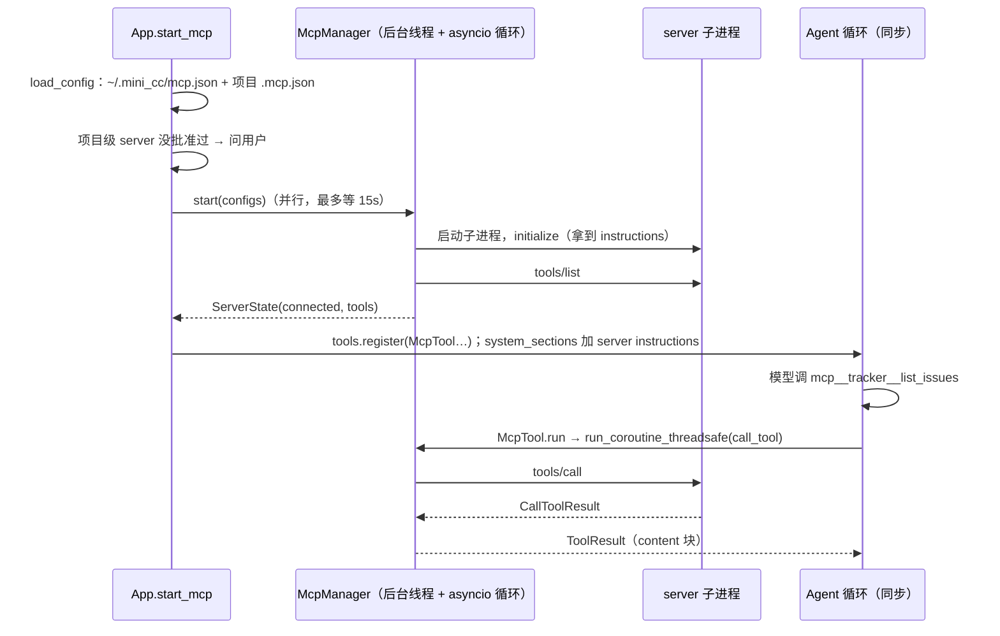

# 给 Agent 注册 MCP server

> 对应原站：[给 Agent 注册 MCP server](https://labuladong.online/zh/ai-coding/coding-agent/mcp/)（会员内容；本章为独立原创重写）

> **一句话结论**：接入 MCP 不需要改 agent 循环。读 `.mcp.json`、把每个 server 拉起来握手、把它的工具包装成普通的 `Tool` 注册进去，模型就会像用 `Read` 一样用它们。真正要动脑子的只有三件事：**async 和同步循环怎么接**、**项目里的 server 凭什么能在你机器上跑**、**server 自己声明的「只读」信不信**。

## 加一个 MCP server，要改几行代码？

在 [动手开发 MCP 工具](../p2-agent-basics/10-mcp-tool.md) 里，我们手写了一个 notes server，又手写了一段客户端：起子进程、握手、列工具、转发调用。那段客户端的 server 路径是写死在代码里的。

你在 Claude Code 里接 Linear、Notion、chrome-devtools，从来没改过一行代码：往 `.mcp.json` 里加几行，重启，工具就出现了。你这个会话里就挂着几百个 `mcp__` 开头的工具。

你可能会问：Claude Code 是怎么做到「装工具像装 App」的？

答案是把「接 server」这件事从代码挪到配置里，然后在启动时**统一**做一遍：读配置 → 连接 → 注册。这一章就给 mini-cc 补上这一层，外加一个 `/mcp` 命令看状态。

## 先跑起来看看

`examples/mcp_tracker_server.py`（Node 版 `examples/mcp_tracker_server.ts`，用 SDK 的 `McpServer` + zod）是一个假的 issue tracker（数据在内存里，不联网），三个工具：`list_issues`、`get_issue` 声明了 `readOnlyHint`，`add_comment` 没有。项目根的 `.mcp.json`：

=== "Node"

    ```json
    {"mcpServers": {
      "tracker": {"command": "node", "args": ["$MINI_CC/examples/mcp_tracker_server.ts"]}
    }}
    ```

=== "Python"

    ```json
    {"mcpServers": {
      "tracker": {"command": "$MINI_CC/.venv/bin/python", "args": ["$MINI_CC/examples/mcp_tracker_server.py"]}
    }}
    ```

离线 fake 模型（`examples/ch15.json`），`--permission-mode acceptEdits`。**模型是假的，MCP server 是真的**：真实的 stdio 子进程、真实的 JSON-RPC 握手和调用（路径前缀替换成了 `$MINI_CC`）：

=== "Node"

    ```console
    项目 .mcp.json 声明了 MCP server tracker：node $MINI_CC/examples/mcp_tracker_server.ts
      它会以你的身份在本机运行。是否启动？  1. 启动并记住  2. 本次不启动
    选择 [1/2]: 1
    MCP：1/1 个 server 已连接，3 个工具
    ❯ /mcp -v
    tracker  connected  project  3 tools
               mcp__tracker__list_issues  (read-only)
               mcp__tracker__get_issue  (read-only)
               mcp__tracker__add_comment
    ❯ 看看 tracker 里有哪些 Todo，挑一个跟 posts.js 有关的修掉，修完在 issue 里回复
    ◇ system  项目说明 0 个文件
    ◇ system  日期 2026-10-22
    ● 先看 tracker 里的 Todo。
    ⏺ mcp__tracker__list_issues(Todo)
    ✔ mcp__tracker__list_issues -> BUG-101 [Todo] list_posts 没有分页，首页一次返回 5000 条
    ⏺ mcp__tracker__get_issue(BUG-101)
    ✔ mcp__tracker__get_issue -> BUG-101: list_posts 没有分页，首页一次返回 5000 条
      status: Todo
      comments:  …(+1 lines)
    ⏺ Read(posts.js)
    ✔ Read ->      1	function list_posts(posts) {
           2	  return posts;
           3	}  …(+2 lines)
    ⏺ Edit(posts.js)
    ✔ Edit -> The file posts.js has been updated (1 replacement). Snippet:
           1	function list_posts(posts, page = 1, page_size = 20) {
           2	  const start = (page - 1) * page_size;  …(+4 lines)
    ● 改好了，在 issue 里回复一下。
    ⏺ mcp__tracker__add_comment(BUG-101)
    是否允许 mcp__tracker__add_comment(BUG-101)？（needs approval）
      1. 允许
      2. 允许，且本会话不再询问 mcp__tracker__add_comment
      3. 拒绝（可以附一句话告诉模型该怎么做）
    选择 [1/2/3]: 1
    ✔ mcp__tracker__add_comment -> Comment added to BUG-101 (1 total).
    ● BUG-101 已修复并在 tracker 里回复。BUG-102 是 Safari 样式问题、已经有人在做，没动。
    ❯ /exit
    ```

=== "Python"

    ```console
    项目 .mcp.json 声明了 MCP server tracker：$MINI_CC/.venv/bin/python $MINI_CC/examples/mcp_tracker_server.py
      它会以你的身份在本机运行。是否启动？  1. 启动并记住  2. 本次不启动
    选择 [1/2]: 1
    MCP：1/1 个 server 已连接，3 个工具
    ❯ /mcp -v
    tracker  connected  project  3 tools
               mcp__tracker__list_issues  (read-only)
               mcp__tracker__get_issue  (read-only)
               mcp__tracker__add_comment
    ❯ 看看 tracker 里有哪些 Todo，挑一个跟 posts.py 有关的修掉，修完在 issue 里回复
    ◇ system  项目说明 0 个文件
    ◇ system  日期 2026-10-21
    ● 先看 tracker 里的 Todo。
    ⏺ mcp__tracker__list_issues(Todo)
    ✔ mcp__tracker__list_issues -> BUG-101 [Todo] list_posts 没有分页，首页一次返回 5000 条
    ⏺ mcp__tracker__get_issue(BUG-101)
    ✔ mcp__tracker__get_issue -> BUG-101: list_posts 没有分页，首页一次返回 5000 条
      status: Todo
      comments:  …(+1 lines)
    ⏺ Read(posts.py)
    ✔ Read ->      1        def list_posts(posts):
           2            return posts
    ⏺ Edit(posts.py)
    ✔ Edit -> The file posts.py has been updated (1 replacement). Snippet:
           1        def list_posts(posts, page=1, page_size=20):
           2            start = (page - 1) * page_size  …(+1 lines)
    ● 改好了，在 issue 里回复一下。
    ⏺ mcp__tracker__add_comment(BUG-101)
    是否允许 mcp__tracker__add_comment(BUG-101)？（needs approval）
      1. 允许
      2. 允许，且本会话不再询问 mcp__tracker__add_comment
      3. 拒绝（可以附一句话告诉模型该怎么做）
    选择 [1/2/3]: 1
    ✔ mcp__tracker__add_comment -> Comment added to BUG-101 (1 total).
    ● BUG-101 已修复并在 tracker 里回复。BUG-102 是 Safari 样式问题、已经有人在做，没动。
    ❯ /exit
    ```

三处值得注意：

- 启动时先问了一句「是否启动」。这个 server 是**项目文件**声明的，不是你写的。
- 两个只读工具直接执行，`add_comment` 弹了审批。它会让整个团队看到一条评论。
- MCP 工具和 `Read`、`Edit` 混在一起用，循环根本不知道哪个是本地工具、哪个在另一个进程里。

批准记录落在 `<home>/mcp-approvals.json`，server 的 stderr 日志在 `<home>/logs/mcp-tracker.log`：

=== "Node"

    ```json
    {
     "$DEMO/proj": {
      "tracker": "7142b09aeb5d6b03"
     }
    }
    ```

=== "Python"

    ```json
    {"$DEMO/proj": {"tracker": "653180b99c561d0a"}}
    ```

## 原理：MCP 工具就是一个转发器



图注：`McpTool` 对循环来说和 `ReadTool` 一模一样，都是 `name + description + input_schema + run()`。不同的只是 `run()` 里面把调用转发给另一个进程。（图里的「后台线程 + asyncio 循环」是 Python 版的做法；Node 版的 `McpManager` 和 agent 循环在同一个事件循环里，`McpTool.run` 直接 `await`。）

打个比方，这像手机装 App。系统（agent 循环）不需要为每个 App 改代码，它只认一套统一的接口（MCP 协议）；你装一个 App（往 `.mcp.json` 加一项），系统就多一个能力。

这个比方在安全上不成立：手机 App 跑在沙箱里，权限要一项项申请；stdio MCP server 是一个**以你的身份运行的普通进程**，能读你的 `~/.ssh`、能联网。所以「装 App」之前那一问，在 agent 里比在手机上更重要。

**回到主线**：MCP 在上下文里放进了两样东西：每个工具的 schema（在 `tools` 里），以及 server 的使用说明（在 system 里）。它扩展的是模型的**能力边界**，代价是每多一个 server，每次请求都要多付这些 schema 的 token。

## 动手

### 1. 配置：和 Claude Code 同一个格式

`mini_cc/mcp_client.ts:loadConfig`（Python 版 `mcp_client.py:load_config`）读两个文件，后读的覆盖先读的：

| 文件 | 范围 | 要不要批准 |
|---|---|---|
| `<home>/mcp.json` | 用户级，所有项目 | 不用，你自己写的 |
| `<cwd>/.mcp.json` | 项目级，跟着仓库走 | 第一次启动前要批准 |

格式就是 Claude Code 的 `{"mcpServers": {name: {command, args, env}}}`，`"type": "http"` 加 `url` 是远程 server。字符串里的 `${VAR}` 和 `${VAR:-默认值}` 会展开成环境变量：

=== "Node"

    ```ts
    const VAR = /\$\{([A-Za-z_][A-Za-z0-9_]*)(?::-([^}]*))?\}/g;

    function expand(v: any): any {
      if (typeof v === "string") return v.replace(VAR, (_, name: string, dflt?: string) => process.env[name] ?? dflt ?? "");
      ...
    }
    ```

=== "Python"

    ```python
    _VAR = re.compile(r"\$\{([A-Za-z_][A-Za-z0-9_]*)(?::-([^}]*))?\}")

    def _expand(v):
        if isinstance(v, str):
            return _VAR.sub(lambda m: os.environ.get(m[1], m[2] if m[2] is not None else ""), v)
        ...
    ```

你可能会问：为什么要支持变量展开？

因为 `.mcp.json` 会被提交进 git。token 写在里面就泄露了；写成 `"${LINEAR_API_KEY}"`，文件可以放心提交，密钥留在每个人自己的环境变量里。

### 2. async 接同步：一个后台事件循环

MCP 的 Python SDK 全是 async（`async with stdio_client(...)`），而我们的 `Agent.run_turn` 是同步生成器。`ARCHITECTURE.md` 当初给的建议是：后台线程跑一个事件循环，用 `asyncio.run_coroutine_threadsafe` 提交。（Node 版没有这道坎：`@modelcontextprotocol/sdk` 的 `Client` 本来就是 Promise 接口，agent 循环也是 async 的，每个 server 常驻一个 `Client` 对象，`McpTool.run` 直接 `await client.callTool()`，不需要后台线程。下面的 Node 代码就是这个版本。）

`McpManager` 就是这么做的。每个 server 一个**常驻协程**：

=== "Node"

    ```ts
    private async connect(st: ServerState): Promise<void> {
      const cfg = st.config;
      const client = new Client({ name: "mini-cc", version: "0.1.0" });
      try {
        // stdio 分支（http 用 StreamableHTTPClientTransport；env 合并略）
        st.logFd = openSync(join(this.logDir, `mcp-${st.name}.log`), "a");
        const transport = new StdioClientTransport({ command: cfg.command, args: cfg.args, env, stderr: st.logFd });
        await client.connect(transport); // 握手（initialize）在这里完成
        const tools = (await client.listTools()).tools;
        ...
        st.instructions = client.getInstructions() ?? "";
        st.tools = tools;
        st.client = client; // 常驻：直到 close() 调 client.close()
        st.status = "connected";
      } catch (e) {
        if (st.status === "pending") {
          st.status = "failed";
          st.error = errText(e);
        }
        await client.close().catch(() => {});
      }
    }
    ```

=== "Python"

    ```python
    async def _serve(self, st, ready):
        st._stop = asyncio.Event()
        try:
            async with AsyncExitStack() as stack:
                errlog = stack.enter_context(open(self.log_dir / f"mcp-{st.name}.log", "a"))
                params = StdioServerParameters(command=st.config.command, args=st.config.args, env=...)
                read, write = await stack.enter_async_context(stdio_client(params, errlog=errlog))
                session = await stack.enter_async_context(ClientSession(read, write))
                init = await session.initialize()
                st.instructions = init.instructions or ""
                st.tools = (await session.list_tools()).tools
                st.session, st.status = session, "connected"
                ready.set()
                await st._stop.wait()          # 常驻：直到 close()
        except BaseException as e:
            if st.status != "connected":
                st.status, st.error = "failed", f"{type(e).__name__}: {e}"[:300]
        finally:
            ...
            ready.set()
    ```

你可能会问：为什么不每次调用工具时现连现断？

因为 `ClientSession` 是有状态的：一次握手、一个子进程、一条 stdin/stdout 管道。每次调用都重新拉起子进程、重新握手，慢不说，有状态的 server（比如浏览器自动化的 chrome-devtools）会把上一次打开的页面全丢掉。所以连接要**常驻**，`async with` 的上下文要一直开着，直到 `close()` 设置 `_stop`。

工具调用从同步那一侧提交：

=== "Node"

    ```ts
    async call(server: string, tool: string, args: Args, timeout = CALL_TIMEOUT): Promise<ToolResult> {
      ...
      let r;
      try {
        r = await st.client.callTool({ name: tool, arguments: args }, undefined, { timeout: timeout * 1000 });
      } catch (e) {
        // SDK 超时抛 McpError（code = RequestTimeout）；连接断了等其他错误也变成工具错误，不往外抛
        if ((e as any)?.code === -32001) return new ToolResult(`MCP tool ${tool} timed out after ${timeout.toFixed(0)}s.`, true);
        return new ToolResult(`MCP tool ${tool} failed: ${errText(e)}`, true);
      }
      return new ToolResult(convertContent((r.content as any[]) ?? []), Boolean(r.isError));
    }
    ```

=== "Python"

    ```python
    def call(self, server, tool, args, timeout=CALL_TIMEOUT):
        fut = asyncio.run_coroutine_threadsafe(st.session.call_tool(tool, args), self._loop)
        try:
            r = fut.result(timeout)
        except TimeoutError:
            fut.cancel()
            return ToolResult(f"MCP tool {tool} timed out after {timeout:.0f}s.", True)
        return ToolResult(convert_content(r.content or []), bool(r.is_error))
    ```

`fut.result(timeout)` 阻塞的是 agent 所在的线程，事件循环在另一个线程里照常跑。这和第 10 章 `AskUserQuestion` 同步等用户回答是一样的：工具执行期间，循环本来就是停着等的。

还有一个容易漏的细节：`stdio_client` 的 `errlog` 参数（Node 版是 `StdioClientTransport` 的 `stderr` 选项，传一个打开的文件描述符）。server 的日志默认打到你的终端上，和 mini-cc 的输出搅在一起（我们的 tracker server 每次报错都会打一行 INFO）。改成写到 `<home>/logs/mcp-<name>.log`。

### 3. 启动：并行、限时、失败不拖累别人

=== "Node"

    ```ts
    async start(configs: ServerConfig[], timeout = CONNECT_TIMEOUT): Promise<void> {
      await Promise.all(configs.map((cfg) => {
        const st = new ServerState(cfg.name, cfg);
        this.servers.set(cfg.name, st);
        let timer: NodeJS.Timeout | undefined;
        const timedOut = new Promise<void>((resolve) => {
          timer = setTimeout(() => {
            if (st.status === "pending") {
              st.status = "failed";
              st.error = `connection timed out after ${timeout.toFixed(0)}s`;
            }
            resolve();
          }, timeout * 1000);
        });
        return Promise.race([this.connect(st), timedOut]).finally(() => clearTimeout(timer));
      }));
    }
    ```

=== "Python"

    ```python
    def start(self, configs, timeout=CONNECT_TIMEOUT):
        for cfg in configs:
            st = self.servers[cfg.name] = ServerState(cfg.name, cfg)
            ev = threading.Event()
            ready.append((st, ev))
            self._tasks.append(asyncio.run_coroutine_threadsafe(self._serve(st, ev), loop))
        for st, ev in ready:
            if not ev.wait(timeout) and st.status == "pending":
                st.status, st.error = "failed", f"connection timed out after {timeout:.0f}s"
    ```

所有 server 同时连，每个最多等 15 秒。命令不存在、握手失败、超时，都只是把这一个 server 标成 `failed`，原因留给 `/mcp` 看。测试 `test_failed_server_does_not_block_startup` 里，一个不存在的命令和一个正常的 tracker 一起配，tracker 照常连上。

Claude Code 的启动超时可以用 `MCP_TIMEOUT` 环境变量调（二进制里能看到这个名字，以及 `MCP_CONNECT_TIMEOUT_MS`）。我们写死成常量 `CONNECT_TIMEOUT`。

### 4. 包装成 Tool：名字、只读、结果

`McpTool.__init__`：

=== "Node"

    ```ts
    this.name = mcpToolName(server, tool.name); // mcp__tracker__list_issues
    this.description = tool.description || ...;
    this.inputSchema = tool.inputSchema ?? { type: "object", properties: {} };
    this.readOnly = Boolean(tool.annotations?.readOnlyHint);
    ```

=== "Python"

    ```python
    self.name = mcp_tool_name(server, tool.name)          # mcp__tracker__list_issues
    self.description = tool.description or ...
    self.input_schema = tool.input_schema or {"type": "object", "properties": {}}
    ann = tool.annotations
    self.read_only = bool(ann and ann.read_only_hint)
    ```

**名字**。`mcp__<server>__<tool>` 是 Claude Code 的命名，你这个会话里的 `mcp__linear__get_issue`、`mcp__chrome-devtools__click` 都是这个格式。双下划线分隔让名字不会撞：两个 server 都有 `search` 工具也没关系。API 要求工具名匹配 `^[a-zA-Z0-9_-]{1,64}$`，所以 `mcp_tool_name` 先把其他字符换成下划线，再截到 64 位。

**只读**。`readOnlyHint` 是 server 自己声明的「我不改任何东西」。第 5 章的权限链里，`read_only=True` 的工具直接放行。

你可能会问：server 说自己只读就信？它撒谎怎么办？

这是我认为本章最值得想清楚的一个取舍。`readOnlyHint` 只是**提示**，MCP 规范也这么定位它。我的做法是：只用它来**放宽**审批（只读的免问），不用它做安全边界。理由是：一个恶意 server 根本不需要撒谎，它在被你批准启动的那一刻就已经能在你机器上做任何事了。真正的安全闸门是启动前那一问，而不是每次调用的审批。Claude Code 二进制里能看到它读取了 `readOnlyHint` / `destructiveHint` / `openWorldHint`，但它是否据此免审批，我没有验证。

**结果**。MCP 的 `CallToolResult.content` 是一组块（文本、图片、资源），`convert_content` 转成 Anthropic 的 content 块，图片转成 `{"type": "image", "source": {"type": "base64", ...}}`。第 3 章预留的「`ToolResult.content` 可以是 list」在这里第一次用上，第 19 章还会再用。`is_error` 原样传过去。`ToolError` 的消息（Node 版 `McpServer` 里直接 `throw new Error(...)`）会原样到达模型（演示里查不存在的 issue 时，模型看到的就是 `No issue NOPE. Use list_issues to see ids.`），模型据此自我修正。

### 5. server instructions：进 system

`initialize` 的结果里有一个 `instructions` 字段，是 server 作者写给模型的使用说明。tracker 的是「先 list 找 id，再 get，只有用户要求时才 add_comment」。

`McpManager.instructions_section()` 挂在 `system_sections` 上。你这个会话的 system prompt 里就有一段 `# MCP Server Instructions`，开头是「The following MCP servers have provided instructions for how to use their tools and resources」，下面按 server 分小节（Figma、Linear、Notion、研发平台的说明都在那里）。mini-cc 照这个结构写了一段。

`App.start_mcp()` 最后调 `context.invalidate()`，因为 system 多了一段。它在第一次请求之前调用，所以不会打断已有的 prompt cache。

### 6. 项目级 server 要批准

`select_servers` 对项目级、没批准过的 server 问一次。批准记录是 `{项目目录: {server 名: 配置指纹}}`，指纹是 `type / command / args / env / url` 的哈希（Node 版用 `JSON.stringify` 序列化，不带空格，同一份配置算出的指纹和 Python 版不同，两版的批准记录不能混用）：

=== "Node"

    ```ts
    fingerprint(): string {
      const raw = JSON.stringify([this.type, this.command, this.args, this.env, this.url]);
      return createHash("sha256").update(raw).digest("hex").slice(0, 16);
    }
    ```

=== "Python"

    ```python
    def fingerprint(self) -> str:
        raw = json.dumps([self.type, self.command, self.args, self.env, self.url], ensure_ascii=False)
        return hashlib.sha256(raw.encode()).hexdigest()[:16]
    ```

你可能会问：为什么要绑定指纹，记住 server 名不就够了？

设想你批准过 `tracker`，某天拉了一个同事的分支，`.mcp.json` 里 `tracker` 的命令被改成了 `curl … | sh`。只记名字的话，这条命令会被静默执行。绑定指纹之后，配置一变就重新问。测试 `test_project_server_needs_approval_and_is_remembered` 守着「拒绝 → 不启动；批准 → 记住；没变 → 不再问」。

Claude Code 对应的设置是 `enableAllProjectMcpServers` 和 `enabledMcpjsonServers`（二进制里都能看到），交互上同样是第一次遇到项目 `.mcp.json` 时询问。

### 7. `/mcp`

`/mcp` 显示每个 server 的状态（`connected / failed / disabled`）、来源（`project / user`）、工具数或失败原因；`/mcp -v` 列出每个工具并标出只读。

## 测试

`tests/ch15_mcp.test.ts`（Python 版 `tests/test_ch15_mcp.py`），7 个，其中 4 个会**真的拉起** `examples/mcp_tracker_server.ts`（Python 版 `.py`）子进程（只走 stdio，不联网）：

- 配置：`${VAR}` / `${VAR:-默认}` 展开、项目级覆盖用户级。
- 工具名清洗与 64 字符上限；`convert_content` 保留图片块。
- 端到端：批准 → 连接 → 工具出现在请求里 → 只读免审批、写操作要审批 → 结果回到模型 → instructions 进 system → `/mcp`。
- `ToolError` 作为 `is_error` 结果回到模型；坏命令只让自己 failed；拒绝 / 批准 / 记住。

=== "Node"

    ```console
    $ cd /Users/me/agent-learn/code/mini_cc-node && node --test tests/ch0*.test.ts tests/ch1[0-5]*.test.ts tests/extension_points.test.ts
    ℹ tests 153
    ℹ suites 0
    ℹ pass 153
    ℹ fail 0
    ℹ cancelled 0
    ℹ skipped 0
    ℹ todo 0
    ℹ duration_ms 4599.661916
    ```

=== "Python"

    ```console
    $ cd /Users/me/agent-learn/code/mini_cc && uv run pytest -q
    ........................................................................ [ 47%]
    ........................................................................ [ 94%]
    .........                                                                [100%]
    153 passed in 6.63s
    ```

## 和真实 Claude Code 的差异

- **作用域**：Claude Code 有 local / project / user 三级，用户级配置在 `~/.claude.json`，还能 `claude mcp add` 命令行添加；mini-cc 只有 `.mcp.json` 和 `<home>/mcp.json`。
- **传输**：两边都支持 stdio 和 HTTP；Claude Code 还处理 OAuth 登录（你接 Linear、Notion 时走过）。mini-cc 的 HTTP 分支只做了无认证连接，没有测试。
- **工具太多时**：你这个会话里，大部分 MCP 工具一开始只给了**名字**，schema 要先用 `ToolSearch` 加载才能调用（system-reminder 里明说「deferred tools」）。这是第 20 章「渐进式加载」思想在工具上的应用。mini-cc 把所有 schema 一次性放进 `tools`，练习 3 留给你。
- **断线重连、`list_changed` 通知**：Claude Code 二进制里能看到 `reconnect_scheduled`、`keepaliveIntervalMs` 这类状态；mini-cc 连上之后不再刷新工具列表，server 挂了就一直是坏的。

## 对照你的环境

- 你的 Linear、Notion、研发平台、chrome-devtools 全是 MCP。`/mcp` 列表里 failed 的那几个，原因就躺在 Claude Code 的 MCP 日志里，和 mini-cc 的 `<home>/logs/mcp-<name>.log` 是一回事。
- 你在全局规则里写了「不动 Linear API」「涉密信息不写文件」。`.mcp.json` 里的 token 用 `${VAR}` 引用，就是把这条规则落到配置上。
- chrome-devtools 这类有状态的 server 正是「连接必须常驻」的理由：每次调用重启一个浏览器，页面状态全丢。

## 常见坑

1. **每次调用都重新连接**。慢，而且有状态的 server 会丢状态。连接要常驻在后台循环里。
2. **server 的 stderr 打到终端**。日志和 agent 输出搅在一起；stdout 更不能碰，那是协议通道。
3. **只记批准过的名字，不记配置**。同名 server 的命令被改了也会静默执行。
4. **把 `readOnlyHint` 当安全边界**。它是 server 自己说的。安全闸门在「要不要启动这个进程」。
5. **工具名不清洗**。server 名里有空格、点号，或者拼起来超过 64 个字符，API 会直接拒绝整个请求，所有工具一起不能用。

## 练习

1. 给 `McpTool` 加输出上限：结果超过 2.5 万 token（按 4 字符估）就截断并提示。Claude Code 对应的环境变量是 `MAX_MCP_OUTPUT_TOKENS`。
2. 实现 `/mcp restart <name>`：关掉这个 server 的常驻协程、重新连接、重新注册工具。注意 prompt cache：工具列表变了会怎样？
3. 开放题：你接了 20 个 server、300 个工具，每次请求光 schema 就几万 token。仿照 Claude Code 的 deferred tools，设计一个 `ToolSearch` 工具：`tools` 里只放名字和一句描述，模型搜到之后才把完整 schema 加进来。新加的 schema 放在哪里，才不会让 prompt cache 失效？（提示：claude-api 文档里的 tool search 工具和 `defer_loading`。）

## 延伸阅读

- Claude Code MCP 文档（作用域、`.mcp.json`、环境变量展开、审批）：<https://code.claude.com/docs/en/mcp>
- MCP 规范（tools、annotations）：<https://modelcontextprotocol.io/specification>
- MCP Python SDK：<https://github.com/modelcontextprotocol/python-sdk>
- 本系列：[动手开发 MCP 工具](../p2-agent-basics/10-mcp-tool.md)、[MCP 协议](../p2-agent-basics/11-mcp-protocol.md)
- 上一章：[支持 compact 压缩上下文](14-compact.md)；下一章：[让 Agent 在后台运行命令](16-background.md)
