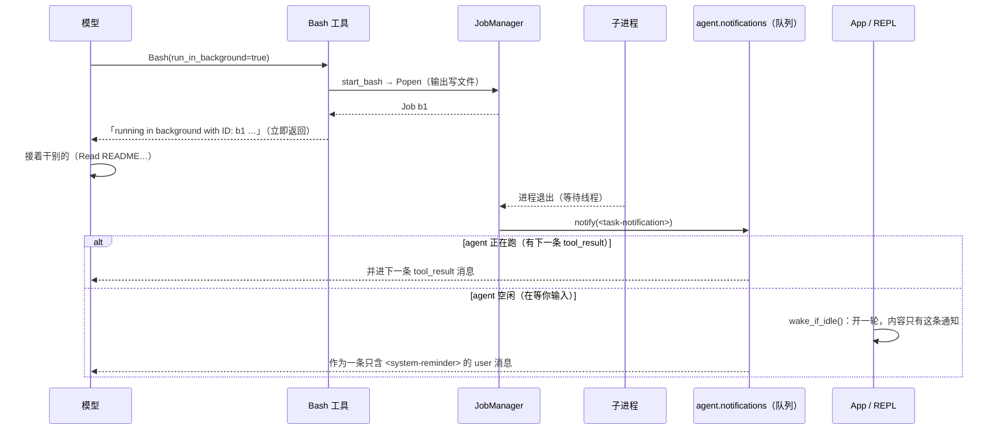

# 让 Agent 在后台运行命令

> 对应原站：[让 Agent 在后台运行命令](https://labuladong.online/zh/ai-coding/coding-agent/background/)（会员内容；本章为独立原创重写）

> **一句话结论**：后台命令 = 「先把任务 id 和输出文件交给模型，让它接着干活」+「命令结束时往通知队列里塞一条 `<task-notification>`」。通知搭下一条 user 消息的便车进上下文；agent 空闲时，客户端主动开一轮把它送进去。

## dev server 起来 30 秒，为什么就「失败」了？

mini-cc 的 `Bash` 从第 1 章起就是 `subprocess.run(..., timeout=30)`（Node 版是 `spawn` 加一个 30 秒的定时器）：命令 30 秒内不结束就被杀掉，返回一个超时错误。

对 `ls`、`git status` 来说这很合理。但你让它「把 webapp 的 dev server 起起来，我看看页面」：`pnpm dev` 永远不会自己退出，30 秒后被杀，模型还会一本正经地告诉你「启动超时，可能是端口被占用」。跑一遍完整测试、装一个大依赖，也会撞上同一堵墙。

你可能会问：把超时调大不就行了？

调大只是把问题换了个样子。超时 10 分钟，模型就要**干等** 10 分钟，这期间它什么也做不了，你也只能看着终端发呆。我们真正想要的是：命令在后台跑，模型和你继续干别的；命令结束时，**有人来告诉它一声**。

## 先跑起来看看

离线 fake 模型（`examples/ch16.json`）。项目里有一个要跑 2 秒的 `slow_tests.sh`。输入用 `(printf …; sleep 4; printf …)` 分两段喂进去，中间 4 秒**你什么都没输入**：

=== "Node"

    ```console
    $ (printf '跑一下完整测试，同时帮我看看 README 有没有写安装步骤\n1\n/tasks\n'; sleep 4; printf '/tasks\n/exit\n') \
        | node mini_cc/cli.ts --fake examples/ch16.json --permission-mode acceptEdits
    ❯ 跑一下完整测试，同时帮我看看 README 有没有写安装步骤
    ◇ system  项目说明 0 个文件
    ◇ system  日期 2026-10-22
    ● 测试要跑一阵，放后台。
    ⏺ Bash(./slow_tests.sh)
    是否允许 Bash(./slow_tests.sh)？（needs approval）
    ...
    选择 [1/2/3]: 1
    ✔ Bash -> Command running in background with ID: b1. Output is being written to: $DEMO/home/tasks/…
    ● 趁这段时间看 README。
    ⏺ Read(README.md)
    ✔ Read ->      1	# demo
           2	一个演示项目。
    ● README 里只有项目简介，没有安装步骤，建议补一节「pnpm install && pnpm dev」。测试还在后台跑，结束了我再告诉你。
    ❯ /tasks
    b1  bash     running       0.0s  完整测试套件
    ◇ system  1 条通知
    ● 后台测试结束了，看一眼结果。
    ⏺ Bash(tail -n 2 "$MINI_CC_HOME"/tasks/*/b1.output)
    ✔ Bash -> collecting...
      12 passed in 2.01s
    ● 测试全部通过：12 passed。
    ❯ /tasks
    b1  bash     completed     2.6s  完整测试套件
    ❯ /exit
    ```

=== "Python"

    ```console
    $ (printf '跑一下完整测试，同时帮我看看 README 有没有写安装步骤\n1\n/tasks\n'; sleep 4; printf '/tasks\n/exit\n') \
        | uv run python -m mini_cc --fake examples/ch16.json --permission-mode acceptEdits
    ❯ 跑一下完整测试，同时帮我看看 README 有没有写安装步骤
    ◇ system  项目说明 0 个文件
    ◇ system  日期 2026-10-21
    ● 测试要跑一阵，放后台。
    ⏺ Bash(./slow_tests.sh)
    是否允许 Bash(./slow_tests.sh)？（needs approval）
    ...
    选择 [1/2/3]: 1
    ✔ Bash -> Command running in background with ID: b1. Output is being written to: $DEMO/home/tasks/…
    ● 趁这段时间看 README。
    ⏺ Read(README.md)
    ✔ Read ->      1        # demo
           2        一个演示项目。
    ● README 里只有项目简介，没有安装步骤，建议补一节「pnpm install && pnpm dev」。测试还在后台跑，结束了我再告诉你。
    ❯ /tasks
    b1  bash     running       0.0s  完整测试套件
    ◇ system  1 条通知
    ● 后台测试结束了，看一眼结果。
    ⏺ Bash(tail -n 2 "$MINI_CC_HOME"/tasks/*/b1.output)
    ✔ Bash -> collecting...
      12 passed in 2.01s
    ● 测试全部通过：12 passed。
    ❯ /tasks
    b1  bash     completed     2.6s  完整测试套件
    ❯ /exit
    ```

注意 `◇ system 1 条通知` 那一行：它出现时你没有输入任何东西。后台命令结束，mini-cc 发现自己闲着，主动开了一轮，把通知交给模型，模型自己去看了结果。

（fake 模型最后那条 `tail` 命令用通配符找输出文件，是因为剧本写死时不知道会话 id；真模型会直接 Read 通知里给的路径。）

## 原理：一个队列，两种送达时机



图注：通知是第 9 章就预留好的通道，`Agent.notify()` 线程安全（Node 版是单线程事件循环，子进程的 `close` 事件和 agent 循环交替执行，一个数组就够；图里的「等待线程」对应 `close` 回调），`notifications_provider` 在下一次追加 user 消息时把队列清空送进去。本章只是第一次往里放东西。

打个比方，这像在餐厅点了一份要做 40 分钟的菜。服务员不会让你干坐着等，而是给你一个取餐号（任务 id），你可以先吃前菜、聊天。菜好了，取餐器响一声（通知）。

这个比方有一处要改：取餐器是**你**随时能听到的，而模型只有在「被请求」的那一刻才能「听到」东西。它没有后台线程，不会自己醒过来。所以送达时机必须由客户端来安排：要么搭下一次请求的便车，要么客户端专门为它发一次请求。

**回到主线**：后台任务解决的是「时间」问题，代价落在上下文上：每条通知都是一段进上下文的文本。所以通知要**短**（id、状态、一句摘要、输出文件路径），输出本身留在文件里，模型需要时再读。

## 动手

### 1. 后台任务表：`mini_cc/jobs.py`

=== "Node"

    ```ts
    export class Job {
      id: string;
      kind: string; // bash | agent | monitor（后两种是第 17、18 章的）
      description: string;
      outputFile: string;
      toolUseId: string;
      status: JobStatus = "running"; // running | completed | failed | killed
      exitCode: number | null = null;
      proc: ChildProcess | null = null;
      done: Promise<void> = Promise.resolve(); // 对应 Python 的 thread：任务（连同通知）彻底结束时 resolve
      stopRequested = false;
      ...
    }
    ```

=== "Python"

    ```python
    @dataclass
    class Job:
        id: str
        kind: str                 # bash | agent | monitor（后两种是第 17、18 章的）
        description: str
        output_file: Path
        tool_use_id: str = ""
        status: str = "running"   # running | completed | failed | killed
        exit_code: int | None = None
        proc: subprocess.Popen | None = None
        thread: threading.Thread | None = None
        stop_requested: bool = False
    ```

`JobManager.start_bash`：

=== "Node"

    ```ts
    const job = this.newJob("bash", "b", description || command, toolUseId);
    const out = openSync(job.outputFile, "w");
    job.proc = spawn(command, { shell: true, cwd, stdio: ["ignore", out, out], detached: true });
    closeSync(out);

    job.done = new Promise((resolve) => {
      job.proc!.on("close", (code, sig) => { // 不用等待线程：子进程退出时事件循环回调这里
        const rc = exitCode(code, sig);
        job.exitCode = rc;
        job.ended = Date.now() / 1000;
        if (job.stopRequested) {
          job.status = "killed";
          return resolve(); // 主动停的：调用方已经知道了，不再通知
        }
        job.status = rc === 0 ? "completed" : "failed";
        const verb = rc === 0 ? "completed (exit code 0)" : `failed with exit code ${rc}`;
        this.notify(renderNotification(job, `Background command "${job.description}" ${verb}`));
        resolve();
      });
    });
    ```

=== "Python"

    ```python
    job = self._new("bash", "b", description or command, tool_use_id)
    out = open(job.output_file, "w", encoding="utf-8")
    job.proc = subprocess.Popen(command, shell=True, cwd=cwd, stdout=out, stderr=subprocess.STDOUT,
                                stdin=subprocess.DEVNULL, start_new_session=True)
    out.close()

    def wait():
        rc = job.proc.wait()
        job.exit_code, job.ended = rc, time.time()
        if job.stop_requested:
            job.status = "killed"
            return                                   # 主动停的：调用方已经知道了，不再通知
        job.status = "completed" if rc == 0 else "failed"
        verb = "completed (exit code 0)" if rc == 0 else f"failed with exit code {rc}"
        self.notify(render_notification(job, f'Background command "{job.description}" {verb}'))

    job.thread = threading.Thread(target=wait, daemon=True)
    job.thread.start()
    ```

三个细节：

- **输出写文件，不进内存**。dev server 能跑一整天，日志几百 MB。文件放在 `<home>/tasks/<会话 id>/b1.output`，模型要看进度就用 `Read` 读它。
- **`start_new_session=True`**（Node 版是 `spawn(..., { detached: true })`，停止时 `process.kill(-pid)` 杀整组）。`pnpm dev` 会拉起一串子进程（node、esbuild……）。新开一个进程组，`TaskStop` 用 `os.killpg` 能把整串一起杀掉；只杀 shell 的话，node 会变成孤儿继续占着端口。
- **`stdin=DEVNULL`**（Node 版 `stdio` 的第一项写 `"ignore"`）。后台命令要是读 stdin（比如某个交互式脚手架问你「是否覆盖？」），它会和 REPL 抢输入。直接给它一个空的 stdin。

### 2. 通知长什么样

`render_notification` 照搬了你本机 Claude Code 会话记录里的结构：

```xml
<task-notification>
<task-id>b1</task-id>
<tool-use-id>toolu_…</tool-use-id>
<output-file>…/tasks/…/b1.output</output-file>
<status>completed</status>
<summary>Background command "完整测试套件" completed (exit code 0)</summary>
</task-notification>
```

你本机的一条真实记录是 `<summary>Background command "Start local dev server on port 3692" failed with exit code 143</summary>`（143 是被 SIGTERM 杀掉）。有 `description` 时用它，没有就用命令本身，这样通知短而且可读。

`tool-use-id` 指回当初那次 `Bash` 调用，模型能把「这个结果」和「那次决定」对上。为了拿到它，`ToolContext` 加了一个 `tool_use_id` 字段（Node 版 `toolUseId`），循环在执行每个工具前填上（`loop.py:_run_tools`，Node 版 `loop.ts` 的 `runTools`）。

### 3. Bash 工具：多一个参数，多一段说明

=== "Node"

    ```ts
    override async run(args: Args, ctx: ToolContext): Promise<ToolResult> {
      if (args.run_in_background) {
        const job = ctx.extras.jobs.startBash(args.command, ctx.cwd, args.description ?? "", ctx.toolUseId);
        return new ToolResult(`Command running in background with ID: ${job.id}. Output is being written to: ` +
          `${job.outputFile}. You will be notified when it completes. ` +
          "To check interim output, use Read on that file path.");
      }
      ...
    ```

=== "Python"

    ```python
    def run(self, args, ctx):
        if args.get("run_in_background"):
            job = ctx.extras["jobs"].start_bash(args["command"], ctx.cwd, args.get("description", ""), ctx.tool_use_id)
            return ToolResult(f"Command running in background with ID: {job.id}. Output is being written to: "
                              f"{job.output_file}. You will be notified when it completes. "
                              "To check interim output, use Read on that file path.")
    ```

返回文案也是 Claude Code 的原文（本机会话里能搜到）。每一句都在回答模型的一个问题：任务叫什么、输出在哪、什么时候知道结果、等不及了怎么办。

工具描述里我加了一句 `Do not poll with sleep.`。没有这句，模型很容易写出 `sleep 30 && cat output`，在前台干等，等于白做了后台。前台超时的报错也改了，末尾提示 `If it is expected to run long, use run_in_background=true`，让模型撞墙一次就知道换路。

你可能会问：为什么不像 Claude Code 早期那样，给一个 `BashOutput` 工具专门读后台输出？

因为 `Read` 已经能读文件了，多一个工具就多一份 schema 进上下文。你本机现在的 Claude Code 也是这么做的：返回文案里直接让模型「use Read on that file path」。

但这里有一个坑：第 9 章的 `changed_files_provider` 会盯着所有读过的文件，一旦被外部修改就注入 diff。输出文件**本来就一直在变**，模型 Read 一次之后，每一轮都会收到一份「文件被外部修改」的提醒。所以 `ToolContext` 加了 `untracked_dirs`，`App` 把任务目录放进去，provider 跳过这些路径。测试 `test_reading_output_file_does_not_trigger_change_reminders` 守着这一点。

### 4. `TaskStop`

=== "Node"

    ```ts
    override async run(args: Args, ctx: ToolContext): Promise<ToolResult> {
      const job = ctx.extras.jobs.get(args.task_id);
      if (job === undefined) return new ToolResult(`No task ${args.task_id}. Running: …`, true);
      await jobs.stop(job.id);
      return new ToolResult(`Stopped task ${job.id} (${job.description}).`);
    }
    ```

=== "Python"

    ```python
    def run(self, args, ctx):
        job = ctx.extras["jobs"].get(args["task_id"])
        if job is None:
            return ToolResult(f"No task {args['task_id']}. Running: …", True)
        jobs.stop(job.id)
        return ToolResult(f"Stopped task {job.id} ({job.description}).")
    ```

工具名和参数名 `task_id` 跟 Claude Code 一致（它的旧参数名 `shell_id` 已标为 deprecated）。`self_check` 返回 `"allow"`：停掉 agent 自己启动的进程不需要审批。被主动停掉的任务不再发通知，不然模型会收到一条它自己造成的「failed with exit code -15」。

### 5. 空闲时怎么唤醒：`App.wake_if_idle`

=== "Node"

    ```ts
    async wakeIfIdle(): Promise<boolean> {
      if (this.busy || !this.agent.notifications.length) return false;
      await this.run([]); // 空内容：providers 会把通知作为 <system-reminder> 放进这条 user 消息
      return true;
    }
    ```

=== "Python"

    ```python
    def wake_if_idle(self) -> bool:
        if self.busy or self.agent.notifications.empty():
            return False
        self._run([])   # 空内容：providers 会把通知作为 <system-reminder> 放进这条 user 消息
        return True
    ```

`run_turn([])` 走的是普通的一轮，第 9 章的 `inject()` 把通知并进这条空的 user 消息。第 13 章写 `is_prompt()` 时特意排除了「只有 `<system-reminder>` 的 user 消息」，就是为这里准备的：唤醒不是你发的话，不该成为 rewind 的检查点。

难的是**谁来调用它**。REPL 大部分时间阻塞在「等你输入」上：

- **管道模式**：原来是 `sys.stdin.readline()` 一直阻塞。改成 `LineReader`：一个线程读 stdin 放进队列，主线程 `queue.get(timeout=0.2)`，超时就调一次 `wake_if_idle`。权限弹窗的答案也从同一个队列取（`ui.line_source`），否则读线程会把你给弹窗的「1」抢走。
- **终端模式**：`prompt_toolkit` 的输入框是它自己的事件循环。加一个看门线程，每 0.3 秒看一眼「空闲且有通知」，满足就用 `pt.loop.call_soon_threadsafe(...)` 让输入框以一个哨兵值退出，主循环拿到哨兵就去唤醒。我用一个 pty 脚本驱动真实终端验证过这条路径（通知到达后模型自己开口了）。

Node 版没有线程，两条路径都换成了定时器：管道模式的 `LineReader.get(onIdle)` 让「新的一行到达」和一个 0.2 秒的定时器赛跑，定时器先到就调一次 `wakeIfIdle`；终端模式用 `setInterval` 每 0.3 秒看一眼，满足条件就用 `AbortController` 取消正在等待的 `rl.question()`，主循环捕获到取消就去唤醒。终端这条路径我同样用 `script` 开的伪终端验证过。

你可能会问：唤醒的时候你正打字打到一半怎么办？

这个实现会把输入框关掉，你打了一半的字就丢了。Claude Code 的做法更细致（输入框不受影响，通知在后台排队处理），练习 2 留给你。

### 6. `/tasks`

`/tasks`（别名 `/bashes`）列出所有后台任务的 id、类型、状态、运行时长、描述；`/tasks stop <id>` 停止。命令名和别名都来自 Claude Code 二进制里的定义：`name:"tasks",aliases:["bashes"],description:"View and manage everything running in the background"`。第 11 章把任务清单的命令叫 `/todos`，就是为了把这个名字留到现在。

退出时 `App.close()` 调 `jobs.stop_all()`，不留孤儿进程。

## 测试

`tests/ch16_background.test.ts`（Python 版 `tests/test_ch16_background.py`），8 个，用的是真实子进程（`sleep`、`echo`）：

- 后台命令立即返回、结束后产生 `completed` 通知、空闲唤醒把通知送给模型、队列空了不再唤醒。
- 失败的命令 → `failed with exit code 3`，stderr 也进了输出文件。
- 模型忙着跑别的工具时，通知搭 `tool_result` 的便车送达，不用等这一轮结束。
- `TaskStop` 杀掉任务且不再通知；`/tasks` 列表与 `/tasks stop`。
- Read 输出文件不触发「外部修改」提醒；前台超时提示改用后台；`close()` 杀掉所有任务。

=== "Node"

    ```console
    $ cd /Users/liz/liz/agent-learn/code/mini_cc-node && node --test tests/ch0*.test.ts tests/ch1[0-6]*.test.ts tests/extension_points.test.ts
    ℹ tests 161
    ℹ suites 0
    ℹ pass 161
    ℹ fail 0
    ℹ cancelled 0
    ℹ skipped 0
    ℹ todo 0
    ℹ duration_ms 7000.35675
    ```

=== "Python"

    ```console
    $ cd /Users/liz/liz/agent-learn/code/mini_cc && uv run pytest -q
    ........................................................................ [ 44%]
    ........................................................................ [ 89%]
    .................                                                        [100%]
    161 passed in 9.37s
    ```

测试变慢了几秒，来自几个真实的 `sleep`。

## 和真实 Claude Code 的差异

- **通知的位置**：Claude Code 的 `<task-notification>` 是一条独立的 user 消息内容；mini-cc 统一走第 9 章的 provider，包在 `<system-reminder>` 里。
- **输入框**：Claude Code 唤醒时不会打断你正在输入的内容；mini-cc 的终端模式会。
- **任务 id**：Claude Code 是随机的 9 位字符（本机记录里的 `bmzm3kmjc`），mini-cc 用自增的 `b1`、`b2`，演示和测试更好读。
- **默认超时**：你此刻用的这个 Bash 工具，描述里写着前台超时默认 120000ms、最大 600000ms；mini-cc 前台默认 30 秒。

## 对照你的环境

- 你本机记录里那条 `failed with exit code 143` 的 dev server，就是被 `TaskStop` 或会话结束杀掉的后台任务。webapp 的 `pnpm dev` 正是后台命令最典型的用户。
- 你现在用的 Claude Code 环境里，Bash 工具的说明写着「Foreground `sleep` is blocked」，Monitor 的说明写着「do not poll or sleep」。这和本章工具描述里的 `Do not poll with sleep.` 是同一个意思：后台的意义在于不等。
- 你写过 `Stop` hook 和 `Notification` hook。Claude Code 的 Notification hook 是给**你**的通知（桌面弹窗），本章的 `<task-notification>` 是给**模型**的通知，两者方向相反，别混了。

## 常见坑

1. **只杀 shell，不杀进程组**。`pnpm dev` 的 node 子进程变成孤儿，端口一直被占着。
2. **输出读进内存**。长命令的日志能把进程内存撑爆，更不能整段塞进通知。
3. **模型 Read 输出文件之后，每轮都收到「文件被修改」的提醒**。任务输出目录要排除在外部修改检测之外。
4. **主动停掉的任务也发通知**。模型会以为出了意外，去「排查」一个它自己造成的退出码。
5. **只在用户发话时送达通知**。用户不说话，模型永远不知道测试跑完了。空闲时要主动唤醒。

## 练习

1. 给后台任务加一个上限：同时最多 5 个，超过时 Bash 直接返回错误，让模型先停掉一个。为什么并发要有上限？（提示：你全局规则里的「并发必须显式控制」。）
2. 改进终端模式的唤醒：输入框里有内容时不要打断，等你按下回车，先处理通知再处理你的输入。
3. 开放题：Claude Code 允许你用 `Ctrl+B` 把一个正在**前台**跑的命令转到后台。mini-cc 的前台 Bash 用的是 `subprocess.run`，要支持「跑到一半转后台」，执行模型要怎么改？

## 延伸阅读

- Claude Code 交互模式（后台命令、`Ctrl+B`）：<https://code.claude.com/docs/en/interactive-mode>
- Python `subprocess` 与进程组：<https://docs.python.org/3/library/subprocess.html#popen-constructor>
- 本系列：[更灵活的上下文注入机制](09-context-injection.md)（通知通道）、[工具调用权限审批](05-permission.md)
- 上一章：[给 Agent 注册 MCP server](15-mcp.md)；下一章：[实现 Sub Agent 机制](17-subagent.md)
