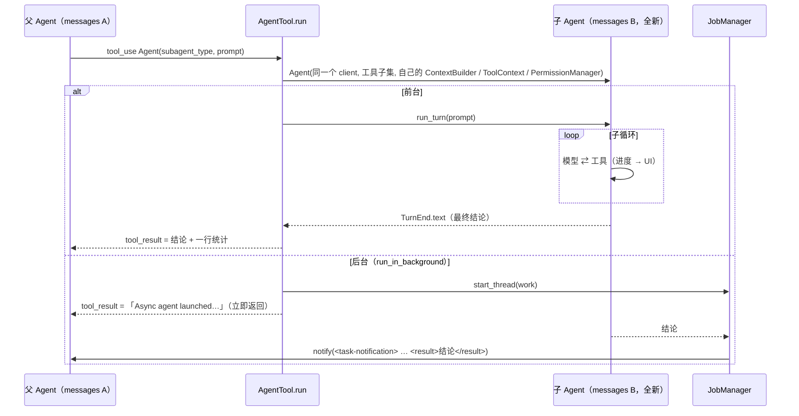

# 实现 Sub Agent 机制

> 对应原站：[实现 Sub Agent 机制](https://labuladong.online/zh/ai-coding/coding-agent/subagent/)（会员内容；本章为独立原创重写）

> **一句话结论**：sub agent 就是在一次工具调用的内部，用一个**全新的 messages 数组**再跑一遍同一个 agent 循环。它只看得到委派 prompt，父 agent 只拿回最终结论；每种 agent 类型 = 一段 system 说明 + 一个工具子集 + 一条权限约束。放到后台跑，就是第 16 章的后台任务换了个干活的。

## 让它查个东西，上下文怎么就涨了两万 token？

你问 mini-cc「分页逻辑散在哪些地方」，它 grep 一遍，读了五个文件，告诉你「两处」。答案是两行字，可这五个文件的全文已经留在了历史里。之后每一轮请求，这两万 token 都要再发一遍，还要跟你后面的问题抢模型的注意力。

你在 Claude Code 里的对策是派 Explore：它翻了二三十个文件，主会话几乎没涨。[Sub Agent：上下文管理的艺术](../p1-tools/10-sub-agent.md)从使用者的角度把这件事讲透了，结论是一道「上下文防火墙」。

你可能会问：这道墙在代码里到底是什么？

是一个新的 `Agent` 对象。第 1 章写下的那个循环，我们要在一次工具调用里面再跑一次。ARCHITECTURE.md 早就留了话：「`Agent` 没有全局状态」。这一章兑现它。

## 先跑起来看看

离线 fake 模型（`examples/ch17.json`）。这份剧本是新格式：`main` 是父 agent 的台词，`agents` 按 description 给每个子 agent 各写一份台词（后台 agent 跑在另一个线程，不能和父亲抢同一份剧本）。项目里有 `api/posts.py`、`api/users.py`、`web/feed.js`：

```console
$ (printf '分页逻辑散在哪些地方？顺便查查有没有地方用 offset 做分页\n'; sleep 2; printf '/tasks\n/context\n/exit\n') \
    | uv run python -m mini_cc --fake examples/ch17.json
❯ 分页逻辑散在哪些地方？顺便查查有没有地方用 offset 做分页
◇ system  项目说明 0 个文件
◇ system  日期 2026-10-21
● 派一个 Explore 去找，免得把一堆文件读进我们的对话。
⏺ Agent(Explore: 找分页实现)
  ⎿ Explore: Bash(grep -rn page_size --include=*.py .)
  ⎿ Explore: Read(api/posts.py)
✔ Agent -> - api/posts.py:3 list_posts(posts, page=1, page_size=20)，切片实现
  - api/users.py:5 list_users(users, page=1, page_size=50)，同样的切片实现
  两处逻辑重复。  …(+2 lines)
● 分页实现找到了。offset 的用法让另一个 agent 在后台查，我先回答你。
⏺ Agent(Explore: 查 offset 用法)
✔ Agent -> Async agent launched successfully.
  agentId: a2
  The agent is working in the background. You will be notified automatically when it completes. Contin
● 分页逻辑在两处：
- api/posts.py:3 list_posts(page, page_size)
- api/users.py:5 list_users(page, page_size)
两处写法一致，可以抽一个公共的 paginate()。offset 的用法还在后台查。
◇ system  1 条通知
● 后台 agent 查完了：web/feed.js:2 用的是 offset/limit，和后端的 page/page_size 不一致，前端调用时要换算 offset = (page - 1) * page_size。
❯ /tasks
a2  agent    completed     0.0s  查 offset 用法
❯ /context
system[0]       1278 chars  You are mini-cc, an interactive coding a
system[1]        240 chars  # Environment
system[2]       1364 chars  # Memory
reminders        813 chars  3 个 <system-reminder> 块
messages        1506 chars  8 条消息（不含提醒）
last request     100 tokens
```

两个子 agent，一个前台一个后台：

- 前台的 `⎿ Explore: …` 两行是**给你看的进度**，不进任何上下文。父 agent 拿到的只有那三行结论。
- 后台的立刻返回「launched」，父 agent 先回答了你；子 agent 跑完，第 16 章的通知通道把结论送回来，父 agent 自己开口补充。

两个子 agent 的完整过程存在会话目录下的 `subagents/agent-a1.jsonl`（6 条消息、1498 字符）和 `agent-a2.jsonl`（4 条、793 字符），没有一条进父历史。演示项目很小所以数字不大；换成 webapp，Explore 翻的二三十个文件就全留在这两个文件里了。

## 原理：同一个循环，另一个数组



图注：子 agent 和父 agent 跑的是**同一份** `Agent.run_turn` 代码，区别只在于构造时传进去的东西。

打个比方，这像派实习生去资料室查东西。你给他一张写清楚要求的条子（prompt），他在资料室里翻多少本书都行（子数组），回来只交给你一页纸（结论）。你桌上只多了这一页。

这个比方在一处不成立：真实的实习生旁听过你们的会，知道前因后果；子 agent **什么都没听过**。条子上没写的，它一概不知。所以 `Agent` 工具的描述里第一句就要求：prompt 必须自足。

**回到主线**：sub agent 把「探索过程」和「结论」放进了两个不同的上下文。父上下文省下了 token，也保住了注意力；代价是一次有损的交接，结论里没写的东西，父 agent 永远看不到。

## 动手

### 1. agent 类型：说明 + 工具 + 约束

`mini_cc/subagent.py:AgentType`：

```python
@dataclass
class AgentType:
    name: str
    description: str
    prompt: str
    tools: list[str] | None = None        # None = 父 agent 的全部工具（减去 NEVER_FOR_CHILDREN）
    read_only: bool = False
    load_instructions: bool = True        # 要不要注入 AGENTS.md / CLAUDE.md
    effort: str = "medium"

BUILTIN = [
    AgentType("general-purpose", "Research, search code and execute multi-step tasks; can edit files.", GENERAL_PROMPT),
    AgentType("Explore", "Read-only, fast codebase search: …",
              EXPLORE_PROMPT, ["Read", "Bash"], read_only=True, load_instructions=False, effort="low"),
]
```

两个内置类型的名字都照搬 Claude Code。有几处取值是有依据的：

- **Explore 不注入 `AGENTS.md`**：Claude Code 文档写明 Explore 和 Plan 跳过 CLAUDE.md 和 git status。理由是它们只读、短命，项目规范对「找东西」帮助不大，却每次都要付 token。
- **Explore 的 effort 是 `low`**：claude-api 文档对 effort 的建议里明确写了「`low` for subagents or simple tasks」。搜索类的活不需要深思，低 effort 意味着更少、更合并的工具调用。
- **`NEVER_FOR_CHILDREN`**：`Agent`（防止无限递归）、`AskUserQuestion`（子 agent 没有用户可问）、任务清单和 `Memory`（那是父会话的状态）、`TaskStop`。

自定义类型从 `<项目>/.mini_cc/agents/*.md` 和 `<home>/agents/*.md` 读，格式和 Claude Code 的 `~/.claude/agents/*.md` 一样：frontmatter 写 `name / description / tools`，正文就是 system 说明。

```markdown
---
name: reviewer
description: 审查改动，只给意见
tools: Read
---
你是代码审查员，只读代码，按严重度列问题。
```

所有类型列在 `Agent` 工具的描述里。模型选哪个类型，全靠这一行 description，和第 12 章记忆索引的 description 是同一个道理。

### 2. 组装一个子 Agent：`run_subagent`

```python
allowed = [t for t in parent_tools if t.name not in NEVER_FOR_CHILDREN
           and (kind.tools is None or t.name in kind.tools)]
settings = replace(parent.settings, max_iterations=max_turns, effort=kind.effort, auto_compact=False)
child = Agent(client, ToolRegistry(allowed), settings)
providers = [date_provider()] + ([instructions_provider(home)] if kind.load_instructions else [])
child.context = ContextBuilder(child, home, providers=providers,
                               static_prompt=f"{BASE_PROMPT}\n\n{kind.prompt}")
child.ctx = ToolContext(cwd=parent.ctx.cwd)
child.permissions = PermissionManager(cwd, mode=parent.permissions.mode,
                                      allow_rules=set(parent.permissions.allow_rules))
if kind.read_only:
    child.permissions.extra_checks.append(_read_only_check)
child.approver = approver
```

逐个看「换掉了什么」：

| 部件 | 子 agent 用的 | 为什么 |
|---|---|---|
| `messages` | 空数组 | 隔离的本体 |
| `ToolRegistry` | 父工具的子集 | 能力按类型裁剪；MCP 工具也会被 general-purpose 继承 |
| `ContextBuilder` | 自己的 system（`BASE_PROMPT` + 类型说明）、只有日期和（可选的）项目说明 | 不要父亲的 `# Memory` 段、任务提醒、后台通知 |
| `ToolContext` | 新的 | 自己的文件状态表：子 agent 读过的文件，父亲要改还得自己 Read；没有 `write_hooks`，所以子 agent 的改动不进第 13 章的检查点（和 Claude Code 文档描述的一样） |
| `PermissionManager` | 新的，继承模式和「不再询问」规则 | 父亲批准过的命令，子 agent 不用再问一遍 |
| `approver` | 前台：父亲的弹窗；后台：`None` | 后台 agent 没法弹窗打断你，需要审批的调用一律拒绝 |

`ContextBuilder` 为此多了一个字段 `static_prompt`，默认还是主 agent 的 `STATIC_PROMPT`。这是本章唯一改动的已有接口。

`BASE_PROMPT` 里最重要的一句是：

```text
Your final message is the ONLY thing the main agent will see, so include everything it needs and nothing it
does not (no raw file dumps).
```

子 agent 如果把三个文件全文贴进结论，墙就白建了。这一句必须写在子 agent 自己的 system 里，因为父 agent 的 prompt 里写什么都管不到子 agent 的输出习惯。

### 3. 只读是硬约束，不是建议

```python
def _read_only_check(tool, args, pm):
    if tool.read_only or tool.self_check(args) == "allow":
        return None
    return Decision("deny", "this agent is read-only; it must not modify files or run state-changing commands", "check")
```

挂在第 5 章预留的 `extra_checks` 上，它排在 bypass 之前。测试 `test_explore_cannot_write` 把父亲设成 `bypassPermissions`，Explore 想 `touch x.txt` 照样被拒。

你可能会问：Explore 的工具列表里本来就没有 Write 和 Edit，为什么还要这一层？

因为它有 Bash。`sed -i`、`rm`、`git checkout` 都能改东西。工具白名单只决定「能调用哪些工具」，决定不了「工具里做什么」。只读要靠第 5 章那套命令分析（`is_read_only`）来兜底。

### 4. 前台：同步跑完，结论当 tool_result

```python
r = run_subagent(app.agent, kind, args["prompt"], app.subagent_client(desc), approver=app.agent.approver,
                 progress=lambda s: app.ui.info(f"  ⎿ {s}"), **common)
return ToolResult(f"{r.text}\n\n(agent {agent_id} · {kind.name} · {uses} · {r.requests} requests)")
```

子循环的事件里，`ToolStart` 变成一行进度直接打给 UI（`progress` 回调）。为什么不走第 11 章的 `ctx.emit()`？因为 emit 的事件要等 `ToolEnd` 之后才转发，进度全挤在结果后面。子 agent 可能要跑一分钟，你需要实时看到它在干什么。

子 agent 触到 `max_turns`（默认 30 次请求）还没结束，返回的结论以 `[partial]` 开头，附上它最后说的话。父 agent 看到这个前缀就知道结论不完整。

### 5. 后台：复用第 16 章的任务表

`JobManager` 加了一个 `start_thread(kind, prefix, description, fn)`：`fn` 在新线程里跑，返回 `(status, summary, result)`，结束时发通知，`result` 放进 `<result>`：

```python
def work(job):
    r = run_subagent(app.agent, kind, args["prompt"], app.subagent_client(desc), approver=None, progress=None, **common)
    status = "failed" if r.partial else "completed"
    return status, f'Agent "{desc}" {status} ({r.tool_uses} tool uses)', r.text

job = app.jobs.start_thread("agent", "a", desc, work, ctx.tool_use_id, job_id=agent_id)
return ToolResult("Async agent launched successfully.\nagentId: a2\nThe agent is working in the background. "
                  "You will be notified automatically when it completes. …")
```

返回文案的头两句和你本机 Claude Code 记录里的一样（「Async agent launched successfully.」「You will be notified auto…」）。后台 agent 的状态 `/tasks` 里能看到，`TaskStop` 也能停（`stop()` 会设 `stop_requested`；子循环本身不支持中途取消，所以要等当前这次请求结束，练习 1 改进它）。

你可能会问：后台 agent 和主 agent 共用一个 `AnthropicClient`，线程安全吗？

SDK 的客户端可以跨线程并发发请求。真正要小心的是**共享的可变状态**：子 agent 有自己的 messages、自己的文件状态表、自己的权限管理器，唯一共享的是磁盘上的项目文件。两个 general-purpose agent 同时改同一个文件就会出事，这也是为什么后台 agent 最适合只读的活。

### 6. transcript：sidechain

每条子 agent 消息写进 `<会话目录>/<会话 id>/subagents/agent-<id>.jsonl`，带 `isSidechain: true` 和 `agentId`。这是你本机 Claude Code 的布局（[Sub Agent 那章](../p1-tools/10-sub-agent.md)看过）。主会话的 jsonl 里只有那次 `Agent` 调用和它的结论。

## 测试

`tests/test_ch17_subagent.py`，8 个：

- 前台 Explore：子 agent 第一次请求只有委派 prompt、看不到父亲的话；system 里有只读说明、没有 `# Memory`；工具只有 Read 和 Bash；父亲拿到结论和统计，子 agent 的 grep 不在父历史里；进度行显示给人看。
- 父亲 bypass，Explore 的 `touch` 也被拒；general-purpose 有编辑工具，但没有 `Agent` 等工具。
- 未知类型列出可用类型；后台 agent 立即返回、通知带 `<result>`。
- 自定义 `reviewer.md` 出现在工具描述里，工具和 system 都按定义来；transcript 是 sidechain；`max_turns` 触发 `[partial]`。

```console
$ cd /Users/liz/liz/agent-learn/code/mini_cc && uv run pytest -q
........................................................................ [ 42%]
........................................................................ [ 85%]
.........................                                                [100%]
169 passed in 9.78s
```

## 和真实 Claude Code 的差异

- **默认前台还是后台**：Claude Code 文档说主会话里由 Claude 发起的子 agent 默认在后台跑；mini-cc 默认前台，`run_in_background` 显式打开。前台更好调试，演示也是确定的。
- **继续一个子 agent**：Claude Code 用 `SendMessage` 恢复子 agent，它带着自己的完整历史接着跑。mini-cc 的子 agent 跑完就扔了（transcript 还在磁盘上，练习 2）。
- **模型**：Claude Code 的 agent 定义可以指定 `model`；内置 Explore 按官方文档默认用主会话的模型（主会话是 Fable 时，部分接入方式下会换成 opus 别名对应的模型）。mini-cc 统一用同一个模型，只把 Explore 的 effort 调低。
- **嵌套**：Claude Code 允许子 agent 再派子 agent（有深度上限，`CLAUDE_CODE_MAX_SUBAGENT_SPAWN_DEPTH`）；mini-cc 直接禁止。
- **Fork**：Claude Code 还有一种完整继承父上下文的 fork（[Fork Agent](../p1-tools/11-fork-agent.md)）。它和 sub agent 正好相反：继承上下文、复用父亲的 prompt cache。mini-cc 没做。

## 对照你的环境

- 你的 `~/.claude/agents/codex-review.md` 只声明了 `tools: Bash, Read`，正文就是它的全部人设。把它原样放进 `<home>/agents/`，mini-cc 就能用 `subagent_type="codex-review"` 派它：工具子集、正文作 system，都会生效。
- 你的 `codex-cross-review` 是「并行起两个子 agent，主进程交叉比对」。在 mini-cc 里就是同一批 tool_use 里两个 `run_in_background=true` 的 Agent 调用，两条通知回来以后父 agent 比对。
- 你常让 subagent 做调研，又发现它「不知道前情」。这正是本章 `BASE_PROMPT` 第二句写的事实，你的派发 prompt 要自带背景。

## 常见坑

1. **子 agent 共用父亲的 `ToolContext`**。它读过的文件会登记进父亲的文件状态表，父亲就能「没读过就改」。
2. **工具白名单当成只读保证**。有 Bash 就能改文件，只读要靠命令分析和 `extra_checks`。
3. **后台 agent 还挂着审批弹窗**。它在另一个线程里弹窗，会和你正在输入的内容抢终端。
4. **结论里贴原文**。墙就白建了，要在子 agent 自己的 system 里约束输出。
5. **工具描述每次请求重新读磁盘**。自定义 agent 文件一改，`Agent` 的描述就变，整个 prompt cache 前缀失效。mini-cc 在启动时读一次。

## 练习

1. 让后台 agent 真正可停：给 `Agent` 加一个 `cancelled` 标志，`_steps()` 每次请求前检查，`TaskStop` 设置它。
2. 实现 `SendMessage(agent_id, message)`：从 `subagents/agent-<id>.jsonl` 读回子 agent 的历史，`load_history` 之后再跑一轮。它的 prompt cache 前缀和第一次一样吗？
3. 开放题：给 mini-cc 做 Fork：子 agent **继承**父亲的全部 messages、system 和 tools（前缀完全相同，能直接命中父亲的 prompt cache），只在末尾追加一条任务。它和 sub agent 在 token 成本和上下文隔离上各占什么便宜？什么时候该用哪个？

## 延伸阅读

- Claude Code subagents：<https://code.claude.com/docs/en/sub-agents>
- 本系列：[Sub Agent：上下文管理的艺术](../p1-tools/10-sub-agent.md)、[Fork Agent](../p1-tools/11-fork-agent.md)、[让 Agent 在后台运行命令](16-background.md)
- 上一章：[让 Agent 在后台运行命令](16-background.md)；下一章：[让 Agent 监听外部事件](18-monitor.md)
