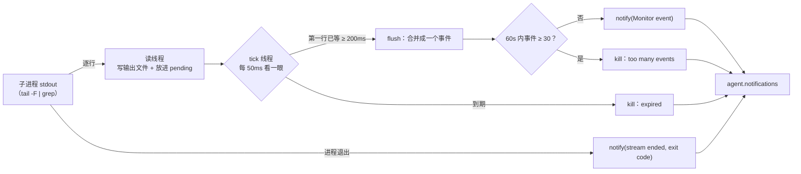

# 让 Agent 监听外部事件

> 对应原站：[让 Agent 监听外部事件](https://labuladong.online/zh/ai-coding/coding-agent/monitor/)（会员内容；本章为独立原创重写）

> **一句话结论**：第 16 章的后台命令是「结束时通知一次」，Monitor 是「**每出现一行输出就通知一次**」。实现上只改了一处：stdout 不再只写文件，而是逐行读出来、200ms 内的合并成一个事件推进通知队列。剩下的功夫全花在**节流**上，因为每个事件都是一段进上下文的文本。

## 「盯着日志，一出 ERROR 就告诉我」，为什么后台命令做不到？

你可能会说：第 16 章不是有后台命令了吗？`tail -F app.log | grep ERROR` 丢到后台不就行了？

试试看就知道：这条命令**永远不会结束**。后台命令只在进程退出时发通知，于是模型一条消息也收不到。日志里已经刷了十条 ERROR，它还在说「我在等」。

问题出在通知的**次数**上。你要的不是「命令结束时通知一次」，而是「每次出现符合条件的输出，就通知一次」。

你可能会问：那让模型自己隔一会儿去 Read 一下输出文件呢？

这就是轮询。模型没有后台线程，它每「看一眼」都是一次完整的请求，要把整段上下文再发一遍。隔 10 秒看一次，一小时就是 360 次请求，绝大部分什么都没看到。事件应该**推**过来，而不是让模型去**拉**。

## 先跑起来看看

离线 fake 模型（`examples/ch18.json`）。演示脚本在后台往 `app.log` 里追加四行（两行 INFO、一行 ERROR、一行 Traceback），中间隔开一秒多；你在这期间什么都没输入：

=== "Node"

    ```console
    ❯ 盯着 app.log，一出现 ERROR 就告诉我
    ◇ system  项目说明 0 个文件
    ◇ system  日期 2026-10-22
    ● 用 Monitor 盯着，过滤 ERROR，也带上 Traceback 和 FATAL，免得进程崩了却没动静。
    ⏺ Monitor(app.log 里的 ERROR / Traceback / FATAL)
    ✔ Monitor -> Monitor started (task m1, expires in 30m unless the source ends first; you get one notice at expiry,
    ● 在盯着了。一有匹配的行我就告诉你，你可以先忙别的。
    ◇ system  1 条通知
    ● app.log 出现了 ERROR：`db timeout after 3000ms`。看起来是数据库连接超时，要我查一下连接池配置吗？
    ◇ system  1 条通知
    ● 又一条：`Traceback (most recent call last)`，紧跟在超时之后，像是超时没被捕获、把 worker 带崩了。
    ❯ /tasks
    m1  monitor  running       5.3s  app.log 里的 ERROR / Traceback / FATAL
    ❯ 可以停了
    ⏺ TaskStop(m1)
    ✔ TaskStop -> Stopped task m1 (app.log 里的 ERROR / Traceback / FATAL).
    ● 已停止监听（m1）。
    ❯ /tasks
    m1  monitor  killed        5.3s  app.log 里的 ERROR / Traceback / FATAL
    ❯ /exit
    ```

=== "Python"

    ```console
    ❯ 盯着 app.log，一出现 ERROR 就告诉我
    ◇ system  项目说明 0 个文件
    ◇ system  日期 2026-10-21
    ● 用 Monitor 盯着，过滤 ERROR，也带上 Traceback 和 FATAL，免得进程崩了却没动静。
    ⏺ Monitor(app.log 里的 ERROR / Traceback / FATAL)
    ✔ Monitor -> Monitor started (task m1, expires in 30m unless the source ends first; you get one notice at expiry,
    ● 在盯着了。一有匹配的行我就告诉你，你可以先忙别的。
    ◇ system  1 条通知
    ● app.log 出现了 ERROR：`db timeout after 3000ms`。看起来是数据库连接超时，要我查一下连接池配置吗？
    ◇ system  1 条通知
    ● 又一条：`Traceback (most recent call last)`，紧跟在超时之后，像是超时没被捕获、把 worker 带崩了。
    ❯ /tasks
    m1  monitor  running       4.4s  app.log 里的 ERROR / Traceback / FATAL
    ❯ 可以停了
    ⏺ TaskStop(m1)
    ✔ TaskStop -> Stopped task m1 (app.log 里的 ERROR / Traceback / FATAL).
    ● 已停止监听（m1）。
    ❯ /tasks
    m1  monitor  killed        4.4s  app.log 里的 ERROR / Traceback / FATAL
    ❯ /exit
    ```

模型调用的命令是 `tail -n 0 -F app.log | grep -E --line-buffered 'ERROR|Traceback|FATAL'`。两条 INFO 被 grep 滤掉了，ERROR 和 Traceback 各触发一次唤醒。模型收到的通知长这样：

```xml
<task-notification>
<task-id>m1</task-id>
<summary>Monitor event: "app.log 里的 ERROR"</summary>
<event>ERROR db timeout after 3000ms</event>
</task-notification>
```

## 原理：把一条流切成一个个事件



图注：事件进的是第 9 章预留、第 16 章第一次用上的同一个通知队列；空闲时 `App.wake_if_idle()` 照样会唤醒模型。（图里的读线程、tick 线程是 Python 版的做法；Node 版是 `node:readline` 的 `line` 事件加两个定时器：一批的第一行到达时定 200ms 的合并定时器，启动时定一个到期定时器。）

打个比方，第 16 章的后台命令像外卖：送到了给你打一个电话。Monitor 像门铃：每来一个人响一次。

比方在这里要补一句：门铃响一次你只要抬头看一眼，模型每「听到」一次门铃，都要把**整段对话**重读一遍才能回应。门铃要是一直响，代价是成倍的 token。所以 Monitor 的设计重心不在「怎么推」，而在「怎么少推」。

**回到主线**：Monitor 把外部世界接进了上下文，模型的能力边界从「它主动去看的东西」扩到了「主动来找它的东西」。代价是上下文的入口多了一个水龙头，必须有阀门：合并、过滤、限流、到期。

## 动手

### 1. 逐行读，200ms 合并

`mini_cc/jobs.ts:JobManager.startMonitor`（Python 版 `jobs.py:JobManager.start_monitor`）和第 16 章的 `start_bash` 只差在 stdout 的去向：

=== "Node"

    ```ts
    job.proc = spawn(command, { shell: true, cwd, stdio: ["ignore", "pipe", out], detached: true });

    const reader = createInterface({ input: job.proc.stdout!, crlfDelay: Infinity }); // node:readline 逐行切
    reader.on("line", (line) => {
      writeSync(out, line + "\n"); // 输出文件照样完整保存
      if (!line.trim()) return;
      pending.push(line);
      batchTimer ??= setTimeout(flush, this.batchWindow * 1000); // 这一批的第一行：0.2s 后合并发出
    });
    ```

=== "Python"

    ```python
    job.proc = subprocess.Popen(command, shell=True, cwd=cwd, stdout=subprocess.PIPE, stderr=out,
                                stdin=subprocess.DEVNULL, start_new_session=True, text=True, bufsize=1)

    def read():
        for line in job.proc.stdout:
            out.write(line); out.flush()              # 输出文件照样完整保存
            if line.strip():
                with lock:
                    pending.append(line.rstrip("\n"))
                    if not first_at:
                        first_at.append(time.monotonic())
    ```

`stdout=PIPE`：stdout 是事件流，要逐行读出来；`stderr=out`：stderr 只进输出文件，**不触发事件**。

合并由另一个线程做（Node 版不需要它：合并靠 `line` 回调里定的 `setTimeout(flush, 200)`，到期靠启动时定的定时器）：

=== "Node"

    ```ts
    const deadline = setTimeout(() => kill("timeout"), timeout * 1000);
    ...
    job.proc.on("close", (code, sig) => {
      clearTimeout(deadline);
      flush(); // 进程结束前的最后几行
      ...
    });
    ```

=== "Python"

    ```python
    def tick():
        while reader.is_alive():
            reader.join(0.05)
            with lock:
                due = bool(first_at) and time.monotonic() - first_at[0] >= self.batch_window   # 0.2s
            if due:
                flush()
            if time.monotonic() >= deadline and reader.is_alive():
                kill("timeout")
        flush()                                        # 进程结束前的最后几行
        ...
    ```

你可能会问：为什么要合并？一行一个事件不是更及时吗？

因为一个「事件」在日志里经常是好几行。一段 Python Traceback 有十几行，一行一个通知，模型就要被唤醒十几次，每次只看到一个碎片。200ms 内到达的行几乎总属于同一次输出，合并成一个事件刚好。这个窗口不是我拍脑袋定的：你本机 Claude Code 的 Monitor 工具说明里写着「Stdout lines within 200ms are batched into a single notification」。

测试 `test_lines_within_200ms_are_batched` 守着「`echo a; echo b; echo c` 只产生一个事件」；`test_each_line_becomes_an_event...` 守着「间隔 0.5 秒的两行是两个事件」。

### 2. 四道阀门

| 阀门 | 参数 | 触发后 |
|---|---|---|
| 合并 | `batch_window = 0.2` | 200ms 内的行进同一个事件 |
| 单个事件的行数 | `max_batch_lines = 50` | 多出来的写成 `(… N more lines in the output file)` |
| 频率 | `max_events = 30` / `event_window = 60s` | 自动停掉，通知里说「too many events，用更严的过滤条件重来」 |
| 到期 | `timeout_ms`，默认 5 分钟，最多 30 分钟 | 杀掉，通知「expired after Ns with N events，需要的话 re-arm」 |

后两条是 Claude Code Monitor 说明里写明的行为（「Monitors that produce too many events are automatically stopped」「Every monitor expires after `timeout_ms` (default 5 minutes, at most 30 minutes)」），具体阈值 30 次 / 60 秒是我定的。

你可能会问：为什么要到期？我就想让它一直盯着。

因为没人记得关。一个 `tail -F` 挂一整天，会话里早就聊到别的事了，它还在往上下文里塞 ERROR。到期之后模型会收到一条通知，它可以根据当前任务判断要不要重新挂上（re-arm）。这把「要不要继续盯」的决定权周期性地交还给模型，而不是一次决定、永久生效。

结束时一定有一条通知，三种结局说法不同：

=== "Node"

    ```ts
    if (endReason === "timeout") {
      summary = `Monitor "${description}" expired after ${timeout}s with ${n} events. Arm it again (re-arm) if …`;
    } else if (endReason === "flood") {
      summary = `Monitor "${description}" was stopped: too many events (${n} in ${this.eventWindow}s). …`;
    } else {
      summary = `Monitor "${description}" stream ended (exit code ${rc}, ${n} events)`;
    }
    ```

=== "Python"

    ```python
    if end_reason == ["timeout"]:
        summary = f'Monitor "{description}" expired after {timeout:g}s with {n} events. Arm it again (re-arm) if …'
    elif end_reason == ["flood"]:
        summary = f'Monitor "{description}" was stopped: too many events ({n} in {self.event_window:g}s). …'
    else:
        summary = f'Monitor "{description}" stream ended (exit code {rc}, {n} events)'
    ```

你本机的 Claude Code 会话里，「Monitor event」通知出现了 586 次，「stream ended」234 次（按 summary 前缀统计）。也就是说，你用 Monitor 的时候，大部分是「有终点的监听」：等 CI 跑完、等测试套件出结果。

### 3. Monitor 工具

`mini_cc/tools/monitor.ts:MonitorTool`（Python 版 `monitor.py:MonitorTool`），参数和 Claude Code 一致：`command`、`description`、`timeout_ms`。权限直接复用 Bash 的命令分析：

=== "Node"

    ```ts
    override selfCheck(args: Args): "allow" | "ask" | null {
      return BashTool.prototype.selfCheck.call(this, args); // tail | grep 这种只读命令免审批，其余要问
    }
    ```

=== "Python"

    ```python
    self_check = BashTool.self_check     # tail | grep 这种只读命令免审批，其余要问
    ```

工具描述是本章最值得花时间的地方，因为 Monitor 用错的方式比用对的多。我从 Claude Code 的 Monitor 说明里挑了几条最关键的，用自己的话写进了描述：

- **一次 vs 每次**：「做完告诉我」用 Bash 后台 + 会退出的命令（比如 `until grep -q Ready dev.log; do sleep 0.5; done`），一个通知就结束；「每次出现都告诉我」才用 Monitor。
- **每一级管道都要逐行刷新**：`grep` 要 `--line-buffered`。不加的话 grep 会攒满 4KB 才输出，事件可能永远到不了。
- **过滤要覆盖失败**：只 grep 成功标志，进程崩了就是一片沉默，而沉默看起来和「还在跑」一模一样。所以演示里模型把 `Traceback|FATAL` 也加进了过滤条件。
- **事件不是用户的回复**：模型在等你回答问题时，可能先收到一个事件。它不能把事件当成你的答复。

最后一条也写进了工具结果：「Events may arrive while you are waiting for the user: an event is not their reply.」

### 4. 停止和查看

`TaskStop`（第 16 章）和 `/tasks` 直接适用，`kind` 显示为 `monitor`。主动停止不再通知，和后台命令一样。sub agent 不能用 Monitor（`NEVER_FOR_CHILDREN` 加了它）：子 agent 跑完就消失了，它挂的监听没人接收。

## 测试

`tests/ch18_monitor.test.ts`（Python 版 `tests/test_ch18_monitor.py`），7 个，都是真实子进程：

- 间隔 0.5 秒的两行 → 两个事件 + 一条 `stream ended (exit code 0, 2 events)`，输出文件完整。
- 同时输出的三行 → 一个事件；stderr 不是事件但进了输出文件。
- 到期：0.5 秒后杀掉，通知里有「expired」「re-arm」；刷屏：第 3 个事件后自动停止，「too many events」「tighter filter」；`seq 1 100` 的单个事件截断到 5 行。
- 端到端：Monitor 工具监听 `tail -F`，测试往日志里追加一行 ERROR，空闲唤醒后模型看到 `<event>ERROR db timeout</event>`；`TaskStop` 停止；`/tasks` 显示 monitor。

=== "Node"

    ```console
    $ cd /Users/me/agent-learn/code/mini_cc-node && node --test tests/ch0*.test.ts tests/ch1[0-8]*.test.ts tests/extension_points.test.ts
    ℹ tests 176
    ℹ suites 0
    ℹ pass 176
    ℹ fail 0
    ℹ cancelled 0
    ℹ skipped 0
    ℹ todo 0
    ℹ duration_ms 10170.098041
    ```

=== "Python"

    ```console
    $ cd /Users/me/agent-learn/code/mini_cc && uv run pytest -q
    ........................................................................ [ 40%]
    ........................................................................ [ 81%]
    ................................                                         [100%]
    176 passed in 12.73s
    ```

## 和真实 Claude Code 的差异

- **WebSocket 源**：Claude Code 的 Monitor 还能直接 `ws: {url}` 订阅 WebSocket，每个文本帧一个事件；mini-cc 只支持命令。
- **通知投递**：Claude Code 把通知放进一个命令队列（你本机记录里是 `queued_command` 附件，`commandMode: "task-notification"`），和你在 agent 忙时打进去的消息排在一起；mini-cc 统一走 provider，包在 `<system-reminder>` 里。
- **阈值**：200ms 合并、5 分钟默认、30 分钟上限来自 Claude Code 的工具说明；「多少算刷屏」它没写具体数字，mini-cc 定为 60 秒 30 个事件。

## 对照你的环境

- 你本机那几百次 Monitor 用法里，典型的是「Wait for CI on both PRs to finish and print the summary」：一个每 30 秒 `gh pr checks` 的轮询循环，状态变了才输出一行，全部结束就 `break`。这就是工具说明里推荐的「有终点的每次通知」。
- 你在 webapp 上跑长测试套件时，Monitor 的 `stream ended` 通知里带着最后几行（`Test Files 475 passed`）。mini-cc 的结束通知没带最后的输出，模型要自己 Read 输出文件，练习 1 补上。
- 你的 SessionStart hook 是「会话开始时一次」，Monitor 是「会话进行中随时」。两者都是往上下文里塞外部信息，区别在于时机由谁决定。

## 常见坑

1. **用 Monitor 等一个一次性的结果**。`tail -f log | grep -m 1 Ready` 匹配到之后，`tail` 不一定会退出（日志不再写入就收不到 SIGPIPE），监听一直挂到到期。一次性的用 Bash 后台 + `until` 循环。
2. **管道某一级没有逐行刷新**。`grep` 不加 `--line-buffered`，`awk` 不 `fflush()`，事件攒在缓冲区里出不来。
3. **只过滤成功信号**。进程崩溃时一行都不输出，模型以为一切正常。
4. **把原始日志整个接进来**。每一行都是一次唤醒，几分钟就能把上下文灌满。要在命令里过滤到「你会采取行动的那几行」。
5. **没有到期和限流**。忘了关的监听会一直往上下文里倒东西。

## 练习

1. 让结束通知像 Claude Code 那样带上最后几行输出（`<event>` 里放最后 3 个非空行），并加测试。
2. 给 Monitor 加一个 `ws` 源：用标准库以外的 `websockets` 包订阅一个 WebSocket，每个文本帧一个事件。和 `command: "websocat …"` 比，少了什么、多了什么？
3. 开放题：两个 Monitor 同时在刷事件，而模型正在跑一个很长的工具调用。事件会在下一个 `tool_result` 里一起送达。如果你希望「紧急事件」能**打断**当前这一轮（比如生产告警），循环要怎么改？打断之后历史怎么保持合法（想想第 3 章的 `repair_history`）？

## 延伸阅读

- Claude Code 工具一览（Monitor、TaskStop）：<https://code.claude.com/docs/en/settings#tools-available-to-claude>
- 本系列：[让 Agent 在后台运行命令](16-background.md)、[更灵活的上下文注入机制](09-context-injection.md)
- 上一章：[实现 Sub Agent 机制](17-subagent.md)；下一章：[支持图片输入](19-image.md)
