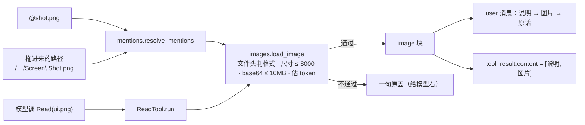

# 支持图片输入

> 对应原站：[支持图片输入](https://labuladong.online/zh/ai-coding/coding-agent/image/)（会员内容；本章为独立原创重写）

> **一句话结论**：图片对 agent 来说只是另一种内容块：`{"type": "image", "source": {"type": "base64", ...}}`。它能出现在两个地方：用户消息里（`@` 引用、拖进终端的路径），以及工具结果里（`Read` 一张图）。要操心的不是怎么发，而是**发之前把关**：格式按文件头判断、尺寸和体积不超限、提前估算它要吃掉多少 token。

## 「样式不对」，一张截图胜过三段描述

你在 webapp 上修 UI bug 时，最常见的输入是一张截图：「这个按钮跟设计稿不一样」。用文字描述它，要说清是哪个页面、哪个按钮、差在哪、差多少，三段话可能还说不准。

但 mini-cc 到现在为止，输入框和所有工具都只认文本。你把截图拖进终端，它收到的是一串路径字符串；让它 `Read` 一张 PNG，第 7 章的 Read 会说「looks like a binary file; not reading it」。

你可能会问：`claude-opus-5-5` 本来就能看图，加个图片支持不就是把文件 base64 一下吗？

核心确实就这一行。但这一行周围有一圈问题：拖进来的路径里有转义的空格；`.png` 扩展名的文件可能其实是 JPEG；一张 4K 截图会被服务端缩小，你得知道它最后值多少 token；图片放在用户消息里和放在工具结果里，后续能不能清理还不一样。

## 先跑起来看看

离线 fake 模型（`examples/ch19.json`）。项目里有一张截图 `Screen Shot 2026-10-21.png`（1280×800）和一张设计稿 `design/login.png`（1440×900），都是测试脚本生成的灰色 PNG。截图用「拖进终端」的方式输入，也就是一个空格被转义的绝对路径：

```console
❯ $DEMO/proj/Screen\ Shot\ 2026-10-21.png 这个登录按钮为什么跟设计稿不一样
  ⎿ 已附加 @Screen Shot 2026-10-21.png（图片 png 1280×800，≈1334 visual tokens）
◇ system  项目说明 0 个文件
◇ system  日期 2026-10-21
● 截图收到了，再对照一下设计稿。
⏺ Read(design/login.png)
✔ Read -> Image: design/login.png (png, 1440x900, 3KB, ≈1716 visual tokens)
  [image]
● 对比两张图：截图里登录按钮比设计稿宽，右侧多出一截留白，像是按钮用了 width: 100% 而设计稿是固定宽度。去看看样式文件？
❯ /context
system[0]       1278 chars  You are mini-cc, an interactive coding a
system[1]        240 chars  # Environment
system[2]       1364 chars  # Memory
reminders        420 chars  3 个 <system-reminder> 块
messages         609 chars  4 条消息（不含提醒）
images          3050 tokens（估算）  2 张图片
last request     100 tokens
```

（fake 模型看不到图，那段「对比两张图」是剧本写死的台词。本章能离线验证的是：图片以什么形状、在什么位置进了请求。真模型的判断，你本地设了 key 后自己看。）

一张图进了用户消息，一张图进了 `Read` 的工具结果。`/context` 把它们单独列成一行，按 visual token 估算，而不是按 base64 字符数。

用户消息里实际发出去的块是这样的（`build_user_content` 的真实输出，base64 截断显示）：

```python
{'type': 'text', 'text': '<system-reminder>\nThe user attached the image @design/login.png (png, 1440x900, 3KB, ≈1716 visual tokens). It follows this note.\n</system-reminder>'}
{'type': 'image', 'source': {'type': 'base64', 'media_type': 'image/png', 'data': 'iVBORw0KGgoA…'}}
{'type': 'text', 'text': '@design/login.png 按钮对齐了吗'}
```

## 原理：两条入口，一道关卡



图注：两条入口共用一道关卡 `load_image`。数字（10MB、8000px、28×28 一个 token、长边 2576）全部来自 Claude 官方 vision 文档。

打个比方，这像给同事发截图。你会先说一句「这是登录页，iPhone 上的」，再贴图，最后问问题。图片单独甩过去不说是什么，对方要先猜半天。

这个比方有一处不成立：同事看图不收钱，模型看图按**面积**收费，而且太大的图会被悄悄缩小。所以发图之前，我们得替模型和你自己算一笔账。

**回到主线**：图片是一种「高密度上下文」。一张 1920×1080 的截图约 2700 个 token，换成文字描述可能只要 200 个，但描述往往说不清楚。图片是在用 token 换准确性，所以要知道它到底多贵。

## 动手

### 1. 识别：看文件头，不看扩展名

`mini_cc/images.py:sniff`：

```python
def sniff(data: bytes) -> str | None:
    if data.startswith(b"\x89PNG\r\n\x1a\n"):
        return "image/png"
    if data.startswith(b"\xff\xd8\xff"):
        return "image/jpeg"
    if data[:6] in (b"GIF87a", b"GIF89a"):
        return "image/gif"
    if data[:4] == b"RIFF" and data[8:12] == b"WEBP":
        return "image/webp"
    return None
```

API 只支持这四种格式。你可能会问：扩展名不就够了？

不够。截图工具、设计工具导出的文件，扩展名和实际编码对不上是常事（比如 `.png` 里其实是 JPEG）。`media_type` 填错，API 会直接拒绝这次请求。测试 `test_wrong_extension_and_oversized` 里就有一个「`.png` 扩展名、JPEG 内容」的文件，发出去的 `media_type` 是 `image/jpeg`。

尺寸也只解析文件头：PNG 的 IHDR、JPEG 的 SOF 段、GIF 的逻辑屏幕描述符、WebP 的 VP8X/VP8/VP8L。这样不用装 Pillow，也不用把像素解码出来。

### 2. 把关：三个硬限制

```python
def load_image(path):
    data = path.read_bytes()
    info = image_info(data)
    if info is None:
        raise ImageError(f"{path.name} is not a supported image (JPEG, PNG, GIF or WebP).")
    media, w, h = info
    if max(w, h) > MAX_DIMENSION:                         # 8000
        raise ImageError(f"{path.name} is {w}x{h}; images must be at most 8000x8000 px. "
                         "Resize it first (e.g. `sips -Z 2576 file.png` on macOS).")
    b64 = base64.standard_b64encode(data).decode("ascii")
    if len(b64) > MAX_BASE64_BYTES:                       # 10MB，按 base64 后的大小算
        raise ImageError(...)
    meta = ImageMeta(media, w, h, len(data), estimate_visual_tokens(w, h))
    return {"type": "image", "source": {"type": "base64", "media_type": media, "data": b64}}, meta
```

这三条在官方文档里都写着：单张图片直连 API 时 base64 后最多 10MB（Bedrock、Vertex 是 5MB），尺寸最多 8000×8000。

你可能会问：超了让 API 报错不行吗？

不行，代价不对等。一张图超限，**整个请求**都会被拒，这一轮什么都做不了，而且这张图已经写进历史了，之后每一轮都会因为它失败。在客户端拦下来，模型收到的只是一句「这张图太大了，先用 `sips -Z 2576` 缩一下」，它可以自己去缩。

还有一条文档里的软限制值得记住：一个请求里图片超过 20 张，每张都不能超过 2000px，历史里的旧图、`tool_result` 里的截图都算。长会话里不停贴截图，迟早会撞上。

### 3. 估价：28×28 一个 token

```python
def estimate_visual_tokens(w, h):
    s = min(1.0, MAX_LONG_EDGE / max(w, h))                # 2576
    w2, h2 = max(1, round(w * s)), max(1, round(h * s))
    tokens = math.ceil(w2 / 28) * math.ceil(h2 / 28)
    while tokens > MAX_VISUAL_TOKENS:                      # 4784
        ...                                                # 再按面积等比缩
    return tokens
```

文档的规则是：每 28×28 像素一个 visual token；高分辨率档的模型（Claude 4.7 及以后，`claude-opus-5-5` 在这一档）长边超过 2576px 或者超过 4784 个 token，服务端会等比缩小。测试 `test_visual_token_estimate_matches_docs_table` 用文档表格里的三个例子校验：1000×1000 → 1296，1920×1080 → 2691，3840×2160 → 缩到 2576×1449 → 4784。

我的实现是对文档规则的近似（文档另有一页给出精确的缩放和补边规则），用来给人和模型一个量级判断足够了。这个数字出现在三个地方：附加时的提示行、`Read` 结果的说明、`/context` 的 `images` 一行。

### 4. 入口一：`@` 引用和拖进来的路径

第 8 章的 `_file_attachment` 遇到图片扩展名时改走 `image_attachment`：

```python
return Attachment("image", f"@{ref}（图片 {meta.short} {meta.width}×{meta.height}，≈{meta.tokens} visual tokens）",
                  f"The user attached the image @{ref} ({meta.note()}). It follows this note.", [block])
```

`Attachment` 多了一个 `blocks` 字段放图片块，`build_user_content` 把它紧跟在说明后面：

```python
for a in attachments:
    blocks += [render(a), *a.blocks]          # 说明 → 图片
return blocks + [{"type": "text", "text": text}]   # 原话放最后
```

顺序是有讲究的：官方文档建议图片放在问题之前（和长文档放在问题之前是一个道理）。说明放在图片前面，是为了让模型知道「下面这张图是哪个文件、多大」，它之后要提这张图时有名字可叫。

拖进终端的图片不带 `@`。macOS 的 Terminal 和 iTerm 会把路径里的空格转义成 `\ `，有的终端会加引号。`images.find_image_paths` 用两个正则把它们找出来（带引号的、以 `/` `~` `./` 开头的），再用 `is_file()` 确认真的是一张图。

这里还踩到一个第 1 章埋下的坑：以 `/` 开头的输入会被当成斜杠命令。拖进来的绝对路径正好以 `/` 开头。所以 `App.handle_line` 现在多看一眼：第一个词里**还有别的 `/`**，就是路径，不是命令。

### 5. 入口二：`Read` 一张图

```python
if is_image_path(path) or sniff(raw[:16]):
    try:
        block, meta = load_image(path)
    except ImageError as e:
        return ToolResult(str(e), True)
    return ToolResult([{"type": "text", "text": f"Image: {ctx.rel(path)} ({meta.note()})"}, block])
```

第 1 章就定义了 `ToolResult.content` 可以是块列表，第 15 章 MCP 的图片结果第一次用到，这里是第二次。`tool_result` 的 `content` 放图片块，是 API 支持的形状（computer use 的截图就是这么回传的）。

你可能会问：图片放用户消息和放工具结果，有区别吗？

有。claude-api 文档在讲 preserved thinking 时专门提过：**放在 `tool_result` 里的图片，以后可以用服务端的上下文编辑（`clear_tool_uses`）清掉，不算修改历史；放在普通 user 消息里的图片，没有服务端的办法删**，客户端自己删就是编辑历史，后面的 thinking 块全部失效。所以「模型需要看图时自己 Read」比「把图片一股脑塞进用户消息」更利于长会话。用户主动贴的截图没得选，只能放用户消息里。

图片不登记进第 7 章的文件状态表：`Edit` 改不了图片，登记了也没用。

### 6. 显示：`[image]` 和 `/context`

`ui.preview` 在第 15 章已经支持块列表：文本拼起来，图片显示 `[image]`。`/context` 现在把图片单独算：遍历所有消息（包括 `tool_result` 里嵌套的），解码 base64 读尺寸，累加估算的 token；`messages` 那一行的字符数也剔除了图片，否则一张 3KB 的 PNG 会让你以为历史里多了四千字。

## 测试

`tests/test_ch19_image.py`，8 个。测试图片用纯标准库生成（`zlib` + `struct` 拼 PNG），JPEG / GIF / WebP 只构造文件头：

- 四种格式的识别和尺寸；visual token 估算对上文档表格的三个例子。
- 拖进来的路径（转义空格、引号）能找到，不存在的路径忽略。
- `@shot.png`：图片块在原话之前，base64 解码后和原文件逐字节相同，提示行显示尺寸和 token。
- 以 `/` 开头的拖入路径不被当成命令；`Read` 图片返回 `[text, image]`。
- 扩展名错的按文件头走；8000px 以上的拒绝并说明；`/context` 统计图片。

```console
$ cd /Users/liz/liz/agent-learn/code/mini_cc && uv run pytest -q
........................................................................ [ 39%]
........................................................................ [ 78%]
........................................                                 [100%]
184 passed in 13.14s
```

## 和真实 Claude Code 的差异

- **粘贴**：Claude Code 支持拖入和从剪贴板粘贴图片，二进制里的启动提示原文是「Did you know you can drag and drop image files into your terminal?」和「Paste images into Claude Code using control+v (not cmd+v!)」；mini-cc 只支持路径（拖入就是路径），粘贴留作练习 1。
- **Read 图片**：你此刻用的 Read 工具描述里写着「Reads images (PNG, JPG, …) and presents them visually」，和 mini-cc 的做法一样，图片作为工具结果给模型看。
- **会话存储**：mini-cc 把 base64 原样写进会话 jsonl，十张截图就是几 MB。Files API 可以「上传一次、之后只传 `file_id`」，官方文档也建议多轮对话里这么做，以免每一轮都重传图片字节（练习 2）。

## 对照你的环境

- 你的 `ui-pixel-align` skill 要「设计真值 + 真机量测」，`feishu-bug-intake` 要求「图和视频必须下载看完才允许定性」。这两个流程的前提就是 agent 能看图，本章就是这个前提的实现。
- 你常用 chrome-devtools 的 `take_screenshot`。那是 MCP 工具返回的图片，走的是第 15 章的 `convert_content` → `tool_result`，正好落在「可以被服务端清理」的那一边。
- 一次 UI 回归贴十几张截图时，记住那条「超过 20 张就降到 2000px」的线。

## 常见坑

1. **按扩展名填 `media_type`**。填错整个请求被拒，而且这张图已经进了历史。
2. **在服务端报错之后才发现图片超限**。客户端先拦，给模型一句能照做的提示。
3. **图片放在原话后面、不加说明**。模型不知道这是哪张图；多张图时更是分不清谁是谁。
4. **按 base64 长度估算上下文**。一张 3KB 的 PNG 编码后四千多字符，实际可能只值几十个 token；反过来一张高分辨率截图压缩得很小，却要两三千 token。
5. **拖进来的路径被当成斜杠命令**。以 `/` 开头的输入要先看看是不是路径。

## 练习

1. 实现 `/paste`：在 macOS 上用 `osascript -e 'the clipboard as «class PNGf»'` 把剪贴板里的图片存成临时文件，然后像 `@` 一样附加。
2. 会话 jsonl 里不存 base64：图片落盘到 `<home>/images/<sha256>.<ext>`，记录里只存 `{"type":"image","source":{"type":"local","path":...}}`，读取时还原。还原出来的块必须和第一次发送时**逐字节相同**，为什么？（提示：prompt cache 和第一条不变量。）
3. 开放题：超过 2576px 的图服务端会缩小，那客户端要不要自己先缩？从 token 成本、请求体积、坐标精度（让模型说「按钮在 (x, y)」时）三个角度比较。

## 延伸阅读

- Claude 官方 vision 文档（格式、限制、visual token 计算）：<https://platform.claude.com/docs/en/build-with-claude/vision>
- 图片缩放与坐标：<https://platform.claude.com/docs/en/build-with-claude/vision-coordinates>
- Files API：<https://platform.claude.com/docs/en/build-with-claude/files>
- 本系列：[用 @ 引用文件](08-file-mention.md)、[给 Agent 注册 MCP server](15-mcp.md)
- 上一章：[让 Agent 监听外部事件](18-monitor.md)；下一章：[渐进式加载 Skills](20-skill.md)
