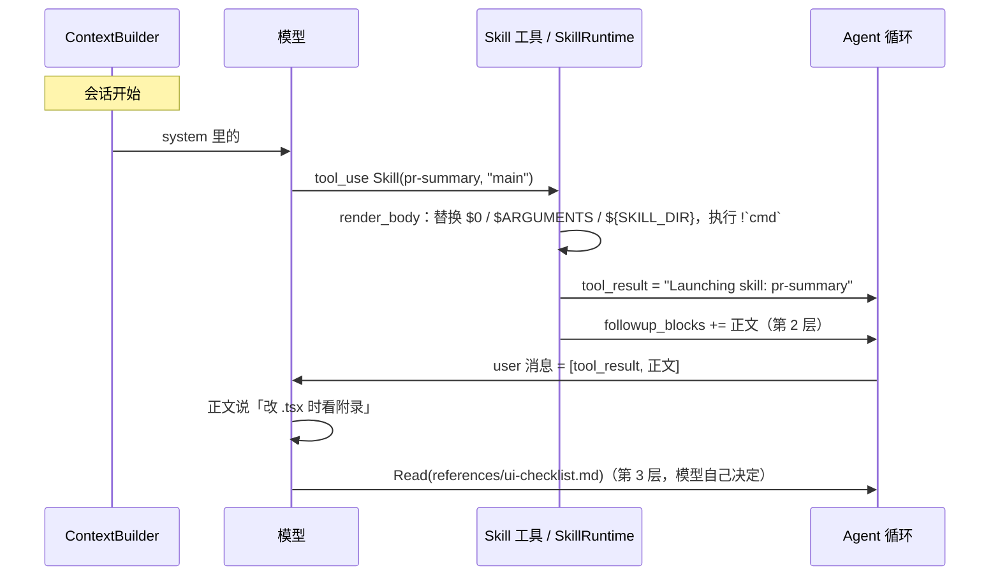

# 渐进式加载 Skills

> 对应原站：[渐进式加载 Skills](https://labuladong.online/zh/ai-coding/coding-agent/skill/)（会员内容；本章为独立原创重写）

> **一句话结论**：skill 是一份分三层、按需进上下文的说明书。目录（名字 + 一句描述）常驻 system；正文在模型调 `Skill` 工具、或你敲 `/skill-name` 时作为一段普通文本**追加**进对话；正文里提到的附录文件，模型要用时自己去 Read。装五十个 skill，只为当下用到的那一个付 token。

## 装了四十多个 skill，上下文为什么没被撑爆？

你 `~/.claude/skills` 下有四十多个 skill。[用 Skills 定制你的 AI 工作流](../p1-tools/12-skills.md)统计过：SKILL.md 正文合计五十多万字符，常驻的描述只有一万两千多字符。

你可能会问：既然只放描述，模型怎么知道正文里写了什么？

它不需要知道。它只需要知道「什么时候该去拿这本说明书」。这就是渐进式加载（progressive disclosure）：先给目录，点名了再给正文，正文里说「详见附录」，需要时再去翻附录。

这一章把这三层装进 mini-cc。顺带实现第 1 章欠下的一笔账：**prompt 型命令**。`/help`、`/clear` 这类命令一个 token 都不发给模型，而 `/your-skill` 恰恰相反，它把一整份说明书塞进上下文。

## 先跑起来看看

离线 fake 模型（`examples/ch20.json`）。一个 git 仓库，当前分支 `fix/login-btn` 改了 `LoginButton.tsx`。两个 skill：

- 项目级 `.mini_cc/skills/pr-summary/`：正文里有参数 `$0`、预处理命令 `` !`git branch --show-current` ``，以及一个 `references/ui-checklist.md` 附录。
- 用户级 `<home>/skills/release-note/`：`disable-model-invocation: true`，只能你手动调用。

```console
❯ /skills
/pr-summary    project  自动  调用 0 次  把当前分支相对基线分支的改动写成 PR 描述。触发：写 PR 描述、总结这次改动
/release-note  user     手动  调用 0 次  写发版说明
❯ 帮我写个 PR 描述
◇ system  项目说明 0 个文件、git 快照
◇ system  日期 2026-10-21
● 这正好有个 skill，先加载它。
⏺ Skill(pr-summary main)
✔ Skill -> Launching skill: pr-summary
● 按 skill 的步骤，先看改动面。
⏺ Bash(git diff --stat main...HEAD)
✔ Bash ->  LoginButton.tsx | 2 +-
   1 file changed, 1 insertion(+), 1 deletion(-)
● 改了 .tsx，skill 说要过一遍 UI 检查清单。
⏺ Read(.mini_cc/skills/pr-summary/references/ui-checklist.md)
✔ Read ->      1        # UI 检查清单
       2        - 375px / 1440px 两档截图
       3        - 暗色模式  …(+1 lines)
● PR 描述：

**动机**：登录按钮在窄屏下溢出。
**改动**：LoginButton.tsx 改为固定宽度 + 文本省略。
**验证**：375px / 1440px 两档截图对比；暗色模式已检查。
❯ /release-note v1.3.0
  ⎿ 已加载 skill release-note（192 字符）
● v1.3.0 发版说明：
- 修复：登录按钮在窄屏下溢出
❯ /context
system[0]       1278 chars  You are mini-cc, an interactive coding a
system[1]        239 chars  # Environment
system[2]       1364 chars  # Memory
system[3]        497 chars  # Skills
reminders        422 chars  2 个 <system-reminder> 块
messages        2015 chars  10 条消息（不含提醒）
last request     100 tokens
```

三层各露了一次面：

1. `system[3] # Skills`，497 字符，是**目录**。里面只有 `pr-summary` 一行，`release-note` 是手动专用的，不在目录里。
2. `Launching skill: pr-summary` 之后，模型拿到的是渲染过的**正文**（下面单独贴出来）。
3. 模型读 `ui-checklist.md` 是它自己的决定。正文里只给了这个**附录**的路径，没有内容。

`Skill` 调用时追加进上下文的那段正文（`render_body` 的真实输出，路径前缀换成了 `$DEMO`）：

```text
Base directory for this skill: $DEMO/proj/.mini_cc/skills/pr-summary

# PR 描述
当前分支：fix/login-btn，基线分支：main
1. `git diff --stat main...HEAD` 看改动面
2. 按「动机 / 改动 / 验证」三段写
3. 改动涉及 .tsx / .css 时，先过一遍 $DEMO/proj/.mini_cc/skills/pr-summary/references/ui-checklist.md
```

`` !`git branch --show-current` `` 变成了 `fix/login-btn`，`$0` 变成了 `main`，`${SKILL_DIR}` 变成了绝对路径。

## 原理：三层，三个时机



图注：第 1 层在 system，会话内不变；第 2 层**追加**在调用点，之后一直留在历史里；第 3 层就是普通的工具调用。

打个比方，这像一家店的菜单、菜谱和食材柜。顾客（模型）先看菜单，上面每道菜一行字；点了哪道菜，厨房才把那道菜的菜谱拿出来；菜谱上写「酱汁见柜子第三格」，做到那一步才去打开柜子。

这个比方在一处不成立：顾客看菜单时知道自己想吃什么，模型看目录时是在**根据你的请求猜**该点哪个 skill。所以目录里那一句描述，写的不是「这个 skill 是什么」，而是「什么时候该用它」。这和第 12 章记忆索引、第 17 章 agent 类型的 description 是同一个道理。

**回到主线**：渐进式加载是本系列里最典型的「在有限上下文里尽可能高效完成任务」：常驻层只付目录的钱，正文和附录按需付费。说穿了，就是 system 里多一段清单，被点名时往 messages 末尾追加一条文本。

## 动手

### 1. 发现与目录：`mini_cc/skills.py`

skill 放在 `<home>/skills/<name>/SKILL.md`（用户级）和 `<cwd>/.mini_cc/skills/<name>/SKILL.md`（项目级，同名覆盖用户级），frontmatter 读 `name`、`description`、`disable-model-invocation`。和 Claude Code 的 `~/.claude/skills/` 是同一个格式，你的 skill 拷过来就能用（`!`cmd`` 和参数语法是子集）。

目录生成：

```python
def listing(skills, budget_chars, usage=None):
    items = sorted((s for s in skills if s.model_invocable), key=lambda s: s.name)
    desc = {s.name: s.description[:MAX_DESCRIPTION] for s in items}          # 单个最多 1536 字符
    line = lambda s: f"- {s.name}: {desc[s.name]}" if desc[s.name] else f"- {s.name}"
    for s in sorted(items, key=lambda s: (usage.get(s.name, 0), s.name)):    # 用得最少的先砍
        if sum(len(line(x)) + 1 for x in items) <= budget_chars:
            break
        desc[s.name] = ""
    ...
```

三条规则都来自 Claude Code 的 skills 文档（[Skills 那章](../p1-tools/12-skills.md)整理过）：

- 手动专用的（`disable-model-invocation: true`）不进目录，模型根本不知道它存在。
- 每个 skill 的描述最多保留 1536 字符。
- 目录有总预算，超了就从**最少被调用**的 skill 开始砍描述、只留名字。

你可能会问：为什么砍描述而不是砍整个 skill？

因为名字还在，你仍然可以 `/name` 调用它，模型偶尔也能从名字猜出用途。代价是模型「不知道什么时候该用它」，这正是你有时觉得「装了某个 skill，它就是想不起来用」的原因之一。预算我按「上下文窗口的 1%、4 字符折 1 token」换算成字符（1M 窗口约 4 万字符）；1% 来自文档，换算系数是我自己定的。调用次数存在 `<home>/skills-usage.json`。

目录挂在 `system_sections` 上，前面有一段说明（`GUIDE`）：

```text
When a request matches a skill, invoke it BEFORE starting the work; its full instructions will be added to the
conversation. Do not guess a skill's contents from its name. Files a skill mentions (references/, scripts/) are
not loaded: Read or run them when needed.
```

「Do not guess a skill's contents from its name」这一句很重要。没有它，模型看到 `pr-summary` 这个名字，常常觉得「我知道 PR 描述怎么写」，然后直接写，你在 skill 里定的三段式就白写了。

### 2. 正文：渲染，然后追加

`render_body` 做三件事：

```python
text = skill.body.replace("${SKILL_DIR}", str(skill.dir))
text = text.replace("$ARGUMENTS", args)
text = _POS.sub(lambda m: parts[int(m[1])] if int(m[1]) < len(parts) else "", text)   # $0 $1 …
text = _CMD.sub(run, text)                                                             # !`cmd` → 输出
if args and not had_placeholder:
    text = text.rstrip("\n") + f"\n\nARGUMENTS: {args}\n"
return f"Base directory for this skill: {skill.dir}\n\n{text}"
```

- **参数**：`$ARGUMENTS` 是整串，`$0`、`$1` 是按空格拆开的第几个。正文里没写占位符但你传了参数，就在末尾补一行 `ARGUMENTS: …`，不让参数丢掉。
- **`` !`cmd` ``**：在本地先执行，用输出替换占位符。正文里的「当前分支」就这样变成了实时值。任何一条失败，整个调用失败，返回原因。说明书依赖的事实没拿到，宁可不加载，也不要给模型一份残缺的说明书。
- **`Base directory for this skill:`**：这个前缀是 Claude Code 的原文。你此刻正在用的 Claude Code，每次加载 skill 后追加的那段文字就是这样开头的。它告诉模型附录的相对路径从哪里算起。

`SkillTool.run` 的最后两行是本章最关键的设计：

```python
ctx.followup_blocks.append({"type": "text", "text": body})
return ToolResult(f"Launching skill: {skill.name}")
```

工具结果只有一句 `Launching skill: pr-summary`（也是 Claude Code 的原文），正文作为**一段普通文本**，跟在这一批 `tool_result` 后面，同一条 user 消息里。为此 `ToolContext` 加了 `followup_blocks`，循环在一批工具调用结束后把它们追加在所有结果之后（API 要求 `tool_result` 块排在 user 消息最前面）。

你可能会问：正文直接放进 `tool_result` 不是更简单吗？

更简单，但有两个隐患：

- **会被当成工具输出清理**。第 14 章提过，API 有服务端的上下文编辑 `clear_tool_uses`，会清掉旧的工具结果。工具输出被清掉无所谓，说明书被清掉，模型就忘了规矩。
- **语义不对**。工具结果是「事实」，说明书是「指令」。模型对两者的信任度本来就不同，放在一起会让指令显得像是某个工具吐出来的数据。

Claude Code 在本机 jsonl 里也是分开的：`tool_result` 是 `Launching skill: <name>`，紧接着一条带 `isMeta: true` 的 user 消息放正文。mini-cc 把它们放进同一条 user 消息的两个块，效果相同，又不打破 user / assistant 交替。

还有一点：正文是**追加**的。前面的历史一个字节都没变，prompt cache 照常命中。这是第一条不变量在 skill 上的体现。

### 3. 附录：什么都不做

第 3 层不需要代码。正文里写「改动涉及 .tsx 时先过一遍 `references/ui-checklist.md`」，模型做到那一步自己 Read。测试 `test_render_args_dir_and_commands` 守着「附录内容不在正文里」。

`scripts/` 同理：模型用 Bash 执行脚本，进上下文的只有输出，脚本源码不进。这是附录比正文更省的地方。

### 4. prompt 型命令：`/skill-name`

第 1 章的 `CommandRegistry.dispatch` 找不到命令时，先看看是不是 skill：

```python
skills = getattr(app, "skill_rt", None)
if cmd is None and skills and name[1:] in skills.skills:
    return app.run_skill_command(name[1:], arg.strip())
```

`App.run_skill_command` 渲染正文，再把它作为**这一轮的用户消息**发给模型：

```python
self._run([{"type": "text", "text": body},
           {"type": "text", "text": f"<command-name>/{name}</command-name>\n<command-args>{arg}</command-args>"}])
```

`<command-name>` 标记让模型知道「这一轮是用户敲命令触发的，说明书已经加载好了，不用再调 Skill 工具」。Claude Code 的 `Skill` 工具描述里也有一句「If a `<command-name>` block is already present this turn, the skill is loaded」，说的就是这个。

所以第 1 章那句话现在完整了：`/clear` 一个 token 不花，`/release-note` 把 192 字符的说明书塞进了上下文。两者长得一样，走的是两条完全不同的路。

`disable-model-invocation: true` 的 skill 只能走这条路：模型调 `Skill(release-note)` 会被拒（「can be invoked only by the user」）。适合有副作用、或者你不希望模型自作主张触发的流程，比如发版。

### 5. 压缩之后：正文原样挂回

skill 正文是第 14 章「不该交给摘要」的那一类东西：它是精确的指令，被概括成「用户在用 pr-summary skill」就没用了。`SkillRuntime.invoked` 记录本会话调用过的每个 skill 的渲染结果，`compact._reattach_skills` 在压缩后原样挂回（每个最多 2 万字符）。Claude Code 文档的说法是每个 skill 最多 5000 token、合计最多 25000 token，只保留开头。所以 skill 里最重要的指令要写在最前面。

## 测试

`tests/test_ch20_skills.py`，9 个：

- 发现用户级和项目级 skill；手动专用的不进目录；预算不够时用得少的只剩名字。
- 渲染：`$0`、`${SKILL_DIR}`、`` !`cmd` ``、无占位符时补 `ARGUMENTS`；附录不自动加载；预处理命令失败则调用失败。
- 模型调 `Skill`：system 里只有目录；`tool_result` 是 `Launching skill: …`，正文是后面的文本块。
- 手动专用 / 不存在的 skill 被拒；`/release-note v1.2.0` 展开成带 `<command-name>` 的用户消息；压缩后正文挂回；`/skills` 列表。

```console
$ cd /Users/liz/liz/agent-learn/code/mini_cc && uv run pytest -q
........................................................................ [ 37%]
........................................................................ [ 74%]
.................................................                        [100%]
193 passed in 13.32s
```

## 和真实 Claude Code 的差异

- **目录的位置**：Claude Code 的目录是一个 `skill_listing` 类型的附件（你本机 jsonl 里有，字段 `content / skillCount / names`），mini-cc 放在 system。两者都是会话内稳定、不破坏缓存。
- **frontmatter**：Claude Code 还支持 `when_to_use`、`allowed-tools`、`model`、`context: fork`（在 sub agent 里跑）等字段；mini-cc 只认三个。`model` 字段在 Claude Code 里会让那一轮换模型，缓存读不到，这是它唯一会破坏缓存的地方（[Skills 那章](../p1-tools/12-skills.md)）。
- **插件**：Claude Code 的 skill 可以来自插件（你这个会话里有 `team-flow:*` 这样带命名空间的 skill）。mini-cc 只有两个目录。
- **项目级 skill 的命令**：mini-cc 加载项目级 skill 时直接执行 `` !`cmd` ``，没有像第 15 章的项目 `.mcp.json` 那样先问你（练习 2）。

## 对照你的环境

- 你在全局 CLAUDE.md 里写的「常驻层只回答走哪条轨，不回答怎么做（复述 skill 内容 = 每个 session 重复付费）」，就是本章三层模型的使用准则：路由表放常驻层，步骤放第 2 层。
- 你的 skill 描述普遍写得像「触发：『写周报』『填周报』…」。这是对的：描述是给模型的触发器，不是给人的简介。目录超预算时最先丢的就是它。
- 你的 `ui-pixel-align` 把量测脚本放在 `references/measure.js`。按本章的分层，它是第 3 层：执行时只有输出进上下文，源码不进。

## 常见坑

1. **描述写成「这是什么」而不是「什么时候用」**。模型在你提出请求的那一刻，只能靠这一句判断要不要加载。
2. **正文放进 `tool_result`**。会被当成工具输出一起清理，语义上也成了「数据」。
3. **把附录内容内联进正文**。第 2 层一旦加载就一直留在历史里，正文越长，之后每一轮都在为它付费。
4. **修改前面的消息来「更新」skill**。只能追加；改历史会让 prompt cache 和 thinking 块一起失效。
5. **`` !`cmd` `` 失败了还继续加载**。模型拿到一份缺了关键事实的说明书，会自己脑补那部分。

## 练习

1. 支持 `allowed-tools` 字段：skill 加载后，这一轮里模型只能用列出的工具。用第 5 章的 `extra_checks` 实现，想想 skill 运行结束的边界在哪里。
2. 项目级 skill 第一次执行 `` !`cmd` `` 前要你批准，并像第 15 章一样按内容指纹记住。为什么用户级 skill 可以不问？
3. 开放题：Claude Code 的 skill 可以设 `context: fork`，在一个 sub agent 里执行，只把结果带回来。把第 17 章和本章接起来：什么样的 skill 适合 fork？它和「正文进主上下文」相比，各自省了什么、丢了什么？

## 延伸阅读

- Claude Code skills 文档：<https://code.claude.com/docs/en/skills>
- Agent Skills 格式说明（Anthropic）：<https://www.anthropic.com/engineering/equipping-agents-for-the-real-world-with-agent-skills>
- 本系列：[用 Skills 定制你的 AI 工作流](../p1-tools/12-skills.md)、[Coding Agent 的命令系统](01-cli.md)、[支持 compact 压缩上下文](14-compact.md)
- 上一章：[支持图片输入](19-image.md)；下一章：[让 Agent 先规划再动手](21-plan.md)
