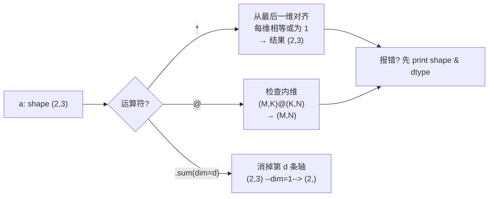

# Tensor 的常用操作

> 原文（免费）：[Tensor 的常用操作](https://labuladong.online/zh/ai-coding/basics/pytorch-basics/) —— 建议先读原文，本页是我的笔记

**一句话结论**：Tensor 就是「带 shape 和 dtype 的多维数组」；写 ML 代码 90% 的 bug 都是 shape 对不上，所以每做一次运算前先在脑子里推一遍 shape。

## 核心要点

1. **三个属性看全貌**：`shape`（每条轴多长）、`ndim`（几条轴）、`dtype`（存成什么数，默认浮点是 `float32`）。`.item()` 把单元素 Tensor 变回 Python 数字。对前端同学的类比：shape 就是 TS 里的「数组类型 + 每层长度」，只不过 PyTorch 在运行时才检查。
2. **标量 / 向量 / 矩阵 / 高维只是 ndim 不同**：0D、1D、2D、3D……没有本质区别，都叫 Tensor。
3. **索引规则一句话**：逗号分隔各条轴，整数「选中并消掉这条轴」，切片「保留一段、轴还在」。所以 `x[0]` 是 shape `(3,)`，`x[0:1]` 是 `(1, 3)`——这是后面无数 bug 的来源。
4. **`*` 永远是逐元素**：对应位置相乘，shape 不变。
5. **Broadcasting（广播）**：从**最后一维**往前对齐，每一维要么相等、要么其中一个是 1（或缺失），缺的那方被「虚拟复制」。原文强调它不会真的复制内存，只是计算效果等价。
6. **`dim` = 要消掉哪条轴**：`sum(dim=1)` 把列这条轴压扁、每行得一个数；`dim=-1` 是最后一维。`max(dim=...)` 同时返回 values 和 indices。
7. **reshape 与 permute 是两件事**：reshape 改「每条轴多长」（元素总数不变、内存顺序不变），permute / `.T` 改「轴的排列顺序」（轴的含义换位）。
8. **点积 vs 矩阵乘法**：点积 = 逐元素乘再求和；`@` 规则是 `[M, K] @ [K, N] → [M, N]`，**内维 K 必须相等**，它就是「一批点积」。神经网络的线性层、注意力、logits 全是 `@`。



> ⚠️ 补充（本机实测，torch 2.14.1）：
> - 广播失败时的报错长这样：`The size of tensor a (3) must match the size of tensor b (2) at non-singleton dimension 1`——想「按行」乘一个长度 2 的向量，要先 reshape 成 `(2, 1)`。
> - `permute` 之后 Tensor 不再连续（`is_contiguous()` 为 False），此时 `.view(3, 4)` 会报 `view size is not compatible with input tensor's size and stride`，而 `.reshape(3, 4)` 能成功（它必要时会复制）。原文只讲了 reshape，没提 view；在别人的代码里看到 `.contiguous().view(...)` 就是这个原因。
> - `sum(dim=1, keepdim=True)` 保留被消掉的轴为长度 1（`(2,3) → (2,1)`），方便接着广播回去。原文后面神经网络一章就用了这个参数。

### 📝 作者是怎么讲的

- **开场先认读者的困惑，再一句话去神秘化。** 开头直接承认后面会冒出 Tensor、shape、矩阵乘法一串名词，「很容易懵」，紧接着用「说白了就是多维数组」把门槛压下去。借用：写 skill 或文档时，第一段先说出读者卡在哪，再给一个大白话定义，比先列术语表好读。
- **每个知识点都是「先跑一段，再解释输出」。** 每节都是先给一个可改可运行的 Notebook 片段，看到 `shape: (3, 3)` 之后，才回头解释 shape、ndim、dtype 是什么。读者先有了观察，解释就有了抓手。借用：写 webapp 的排障文档，先贴一段真实命令和输出，再逐行讲。
- **用最朴素的数据，只变一个维度。** 数据始终是 1～9 这样的递增整数，标量、向量、矩阵、三维逐级叠加，每一步只多一条轴。数据本身不制造额外认知负担，读者的注意力全在「形状怎么变」上。
- **概念挂在后续用途上。** 开篇就说明「后面的机器学习和 LLM 教程会用到」，讲索引、广播、矩阵乘法时也配简单的实际场景，不是孤立的 API 罗列。这让一篇工具章有了存在理由。
- **局限：** 这是一篇偏「手册式」的章节，问题链很弱，基本是按 API 平铺。所以本笔记补了 `view`/`reshape` 这类会踩坑的对比，用「为什么这里会报错」把平铺的知识串起来。

## 回到主线

这一章本身不涉及上下文，但它是读懂 LLM 的「语法」。LLM 吃进去的上下文，在模型里就是一个 shape 为 `[batch, seq_len, hidden]` 的 Tensor；「上下文窗口有多大」本质是 `seq_len` 这条轴允许多长，注意力里那次 `[seq_len, d] @ [d, seq_len]` 的矩阵乘法，正是上下文越长越贵的根源。最后一步把隐藏状态 `@` 一个词表矩阵得到 logits，就是「预测下一个 token」——见 [LLM 是怎么预测下一个 token 的](../p0-core/04-llm-token-prediction.md)。

## 对照你的环境

- 你的 ML 练习项目 `/Users/liz/liz/agent-learn/code/ml` 已经装了 torch（实测版本 2.14.1）和 numpy，原文所有 notebook 片段都可以 `cd code/ml && uv run python -c '...'` 直接跑，不用装 Jupyter。
- 我在那里实跑的验证片段（离线、无需 API）：

```python
import torch
p = torch.tensor([[20., 30., 40.], [15., 25., 35.]])
print(p * torch.tensor([[0.9], [0.8]]))      # 每行一个折扣：(2,1) 广播到 (2,3)
s = torch.tensor([[12., 18., 10.], [20., 16., 14.]])
print(s.max(dim=1))
```

真实输出：

```text
tensor([[18., 27., 36.],
        [12., 20., 28.]])
torch.return_types.max(
values=tensor([18., 20.]),
indices=tensor([1, 0]))
```

- TS 视角的速记：broadcasting 有点像「把短数组 map 到长数组的每一行」，但规则是从右对齐，不是从左；如果你习惯 `rows.map(r => r.map((v, j) => v * d[j]))`，那正是 `p * d` 在 `d.shape == (3,)` 时做的事。

## 自测题

1. `x` 的 shape 是 `(4, 3)`，`x[:, 1]`、`x[:, 1:2]`、`x.sum(dim=0)` 的 shape 各是多少？
2. `a.shape == (5, 1)`，`b.shape == (3,)`，`a * b` 能算吗？结果 shape？`a @ b` 呢？
3. 有一个 `[天, 门店, 商品] = (2, 3, 2)` 的销量 Tensor，想得到「每家门店两天合计、按商品分」的表，写出一行代码并说出结果 shape。

<details>
<summary>参考答案</summary>

1. `(4,)`、`(4, 1)`、`(3,)`。整数下标消掉轴，切片保留轴；`dim=0` 消掉行这条轴。
2. `a * b` 可以：从右对齐，`1` vs `3` → 3，`5` vs 缺失 → 5，结果 `(5, 3)`（这就是「外积」的广播写法）。`a @ b` 不行：`(5,1) @ (3,)` 内维 1 ≠ 3。
3. `sales.sum(dim=0)`，消掉「天」这条轴，结果 `(3, 2)`：3 家门店 × 2 种商品。

</details>

## 相关章节

- 下一篇：[机器学习的基本概念](./02-ml-basics.md)（特征矩阵 `X` 的 shape 就是 `(n_samples, n_features)`）
- [什么是拟合](./03-ml-fitting.md)：第一次用 Tensor 批量算预测和 MSE
- [手写神经网络](../p6-nn-llm/01-ml-neural-network.md)：`relu(X @ W1 + b1) @ w2 + b2`，全是本章的操作
- [LLM 是怎么预测下一个 token 的](../p0-core/04-llm-token-prediction.md)
- [动手跑通 LLM 推理的全流程](../p6-nn-llm/05-inference-process.md)
