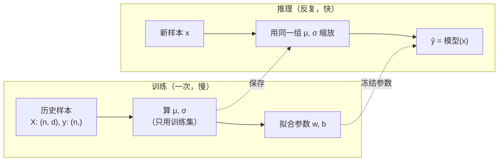

# 机器学习的基本概念

> 原文（免费）：[机器学习的基本概念](https://labuladong.online/zh/ai-coding/machine-learning/ml-basics/) —— 建议先读原文，本页是我的笔记

**一句话结论**：机器学习 = 不手写规则，而是给程序一堆「输入 → 答案」的历史样本，让它自己定出规则里的参数；术语（样本 / 特征 / 标签 / 训练 / 推理）只是在给数据和过程分角色。

## 核心要点

1. **两种写程序的方式**：传统编程是人写规则（「每公里 3 分钟」）；机器学习是人只写规则的**形状**（`ŷ = wx + b`），具体数值 `w, b` 从数据里学。
2. **数据的角色**：一行是一条**样本**（sample），全部样本是**数据集**；喂给模型的属性叫**特征**（feature），要预测的答案叫**标签 / 目标**（label / target）。记号：输入 `x`、真实值 `y`、预测值 `ŷ`（带帽子 = 模型猜的）。
3. **特征向量与特征矩阵**：一个样本的多个特征按固定顺序排成向量；全部样本按行堆起来就是矩阵 `X`，shape 为 `(n_samples, n_features)`，标签向量 `y` 的第 i 个对应 `X` 的第 i 行。这是后面所有代码的数据约定。
4. **按「要预测什么」分任务**：预测连续数值是**回归**（regression），从有限类别里选是**分类**（classification），只有两类就是二分类。
5. **按「有没有答案」分学习方式**：数据带标签 → **监督学习**；没有标签、只想找「谁和谁像」→ **无监督学习**，典型是**聚类**。分类问的是「属于哪个已知类」，聚类问的是「哪些彼此相似」。
6. **训练 vs 推理**：训练（training）= 用历史数据把参数定下来；推理（inference）= 参数冻结，新输入代进去算结果。原文的例子：训出 `w=3, b=5` 后，6 公里 → 23 分钟。
7. **特征缩放**：凡是要「算距离」的方法，单位大的特征会因为数值大而霸占距离（温差 10 贡献 100，振动差 1 只贡献 1）。通用形式 `x' = (x − c) / s`：平移不改差值，缩放把差值除以 s。
8. **标准化（Z-score）**：每一列 `(x − μ) / σ`，结果「均值 0、方差 1」，但不保证落在 [-1, 1]。**关键纪律**：μ、σ 只从训练集算，推理时沿用同一组值。



> ⚠️ 补充（本机实测，torch 2.14.1）：原文的标准化用的是**总体标准差**（除以 n）。但 PyTorch 的 `Tensor.std()` 默认是**样本标准差**（除以 n−1，即 `correction=1`），直接用会和原文 / 题目示例对不上：
>
> ```python
> x = torch.tensor([[20., 1000.], [40., 2000.], [60., 3000.]])
> x.std(dim=0)                 # tensor([  20., 1000.])      ← 默认 n-1
> x.std(dim=0, correction=0)   # tensor([ 16.3299, 816.4966]) ← 总体，和原文一致
> ```
>
> 用后者算出的结果正是原文示例的 `±1.2247449`。sklearn 的 `StandardScaler` 用的也是总体标准差；numpy 的 `np.std` 默认 `ddof=0`（总体）。三个库默认值不一致，是这类题最常见的「差一点点」错误来源。

### 📝 作者是怎么讲的

- **开场是一个对比：自己定规则，还是让程序从数据里学。** 用「根据配送距离预测送达时间」这个人人能想象的任务，摆出两种做法，后一种就是机器学习。定义是从对比里自然长出来的，不是先给的。借用：讲一个新机制（比如 hook），先摆出「不用它你会怎么做」，再引出它。
- **一张小表撑起全部术语。** 样本、数据集、特征、标签、`x`/`y`，全部指着同一张几行的配送表讲：「每一行是一条样本」「这一列是标签」。术语有了具体的落点，就不会飘。
- **同一套数据一路复用，复杂度逐步加一。** 先一个特征（距离），再两个特征（温度和振动）组成特征向量，再画成平面上的点，再排成矩阵 `X` 并链接回 Tensor 篇的 `(n_samples, n_features)`。每一步只多一个新概念。
- **用问题推进分类体系。** 讲完有标签的回归和分类后，追问「如果设备还没检查过、没有标签，又能做什么？」，自然引出聚类和无监督学习；再用「它属于哪个已知类别」对比「哪些样本彼此相似」两个问句区分分类和聚类。借用：用两个对照问句定义两个容易混的概念，比写定义更好记。
- **每个概念都留一个「后面会讲」的钩子。** 回归指向拟合篇，分类指向 KNN，聚类指向 K-Means。一篇入门章同时也是后续章节的目录。

## 回到主线

LLM 也完全落在这套术语里：**样本**是一段文本，**特征**是前面所有 token（也就是上下文），**标签**是下一个 token，任务是一个「词表那么多类」的**分类**；预训练是**训练**，你在 Claude Code 里每发一条消息都是**推理**。从这个视角看，「上下文」就是推理时你能塞给模型的全部特征——塞多少、塞什么，决定了它能不能猜对。Agent 工程做的事，本质就是**在推理阶段**管理这份特征（参数早已冻结，你改不了）。

## 对照你的环境

- 「训练时算 μ、σ，推理时沿用」这条纪律，和你在 webapp 里做埋点 / Datadog 指标时「口径先定、之后所有看板用同一套口径」是同一件事：口径（转换规则）一换，前后数据就不可比。
- 可以在 `/Users/me/agent-learn/code/ml` 里用 sklearn 自带数据集练手：`uv run python -c "from sklearn.datasets import load_iris; X,y=load_iris(return_X_y=True); print(X.shape, y.shape)"` —— 输出的 `(150, 4) (150,)` 正好对应本章的 `(n_samples, n_features)` 约定。

## 自测题

1. 「根据一个 PR 的 diff 行数、改动文件数，预测 code review 会给出几条 finding」——这是回归还是分类？特征和标签分别是什么？
2. 为什么标准化的 μ、σ 不能用「训练集 + 测试集」一起算？
3. 某一列在所有样本里取值都相同，标准化会出什么问题？该怎么处理？

<details>
<summary>参考答案</summary>

1. finding 条数是数值，通常当回归处理（严格说是计数回归）；特征是 diff 行数、改动文件数，标签是实际 finding 条数。若改成「会不会有 Critical finding」就成了二分类。
2. 测试集代表「未来没见过的数据」，用它算统计量等于让训练过程偷看了答案（数据泄漏），评估会虚高；而且上线后新样本根本没有「全集」可算。
3. σ = 0，除零得到 inf / NaN。常规做法是把该列标准化结果置 0（原文练习题就是这么规定的），或者直接删掉这个没信息量的特征。

</details>

## 相关章节

- 上一篇：[Tensor 的常用操作](./01-pytorch-basics.md)
- 下一篇：[什么是拟合](./03-ml-fitting.md)
- 回归求解：[最小二乘法](./04-ml-least-squares.md)、[梯度下降](./05-ml-gradient-descent.md)
- 分类：[逻辑回归](./08-ml-logistic-regression.md)、[K 近邻算法](./12-ml-knn.md)（特征缩放在这里最要命）
- 无监督：[K-Means 聚类算法](./16-ml-kmeans.md)
- 把 LLM 看成分类器：[LLM 是怎么预测下一个 token 的](../p0-core/04-llm-token-prediction.md)
