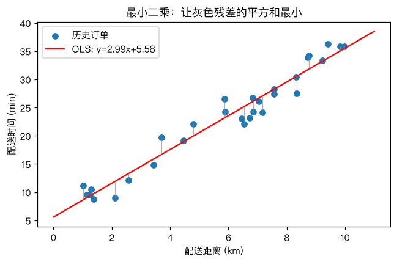
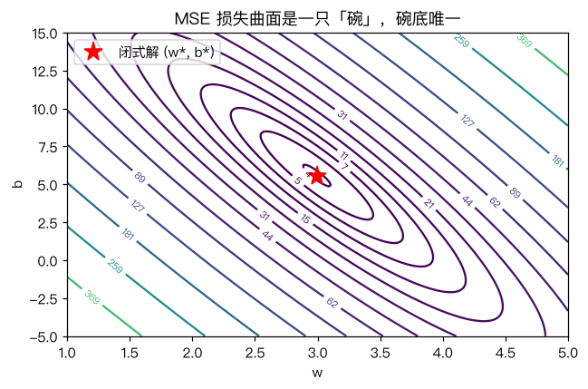

# 最小二乘法

> 对应原站：[最小二乘法](https://labuladong.online/zh/ai-coding/machine-learning/ml-least-squares/)（会员内容；本章为独立原创重写）

> **一句话结论**：线性回归的损失是一只「碗」，碗底那一点可以直接解方程算出来——这就是最小二乘法（Ordinary Least Squares，OLS），不需要迭代，也不需要猜。

## 能不能别再手动试参数了

[什么是拟合](03-ml-fitting.md) 里，我们是这么找参数的：写几组候选的 w、b，各算一遍均方误差（MSE），挑最小的那组。

你可能会问：候选是谁写的？是人。那换一批数据、换个业务，还得人再去猜吗？

这显然不是工程师能接受的做法。我们想要的是一个函数 `fit(x, y) -> (w, b)`，把数据扔进去，最好的参数自己出来。

对线性回归来说，这个函数真的存在，而且只有两行。

## 先跑起来看看

```text
❯ cd code/ml && uv run python -m classic.ch04_least_squares
ols_1d            : w=2.9947  b=5.5830  MSE=3.5079
normal_equation   : w=2.9947  b=5.5830
sklearn           : w=2.9947  b=5.5830
6km 的新订单预测  : 23.6 分钟
2 特征 lstsq      : w=[2.7164 0.3394]  b=7.2597
2 特征 sklearn    : w=[2.7164 0.3394]  b=7.2597
[figure] img/04-ols-fit.png
[figure] img/04-loss-bowl.png
```

数据是脚本生成的 30 笔配送订单，真实规律是 `时间 = 3 × 距离 + 5`，再加上标准差 2 分钟的噪声（见 [`delivery_data`](../code/ml/classic/ch04_least_squares.py)）。我们手写的三种解法和 sklearn 的 `LinearRegression` 算出来一模一样，而且离真实的 3 和 5 都不远。



图里每条灰色竖线叫残差（residual），就是「真实值 − 预测值」。最小二乘要做的，就是让这些竖线长度的平方加起来最小。

## 损失是一只碗

先把问题写清楚。给定 n 个样本 $(x_i, y_i)$，要找 w 和 b 让下面这个数最小：

$$L(w, b) = \frac{1}{n}\sum_{i=1}^{n}(w x_i + b - y_i)^2$$

举个例子，把 w 和 b 当成地图上的经纬度，L 当成海拔。在每个 (w, b) 处算一遍 L，画成等高线：



这是一只椭圆形的碗，碗底只有一个点。这件事很重要：**线性回归的 MSE 是凸函数（convex）**，没有第二个谷底，也就不存在「找错谷」的问题（这个问题留到 [局部最优与全局最优](06-ml-local-global-optima.md) 再说）。

你可能会问：碗底怎么找？

中学数学就够了：碗底那一点，往任何方向的坡度都是 0。对 w、b 分别求偏导，令它们等于 0：

$$\frac{\partial L}{\partial b} = \frac{2}{n}\sum(wx_i+b-y_i) = 0 \;\Rightarrow\; b = \bar y - w\bar x$$

$$\frac{\partial L}{\partial w} = \frac{2}{n}\sum(wx_i+b-y_i)x_i = 0 \;\Rightarrow\; w = \frac{\sum(x_i-\bar x)(y_i-\bar y)}{\sum(x_i-\bar x)^2}$$

第一式说的是：最优直线一定穿过数据的「重心」$(\bar x, \bar y)$。第二式说的是：斜率 = x 和 y 的协方差 ÷ x 的方差。x 涨的时候 y 跟着涨得越多，斜率就越大。

说白了，**最小二乘就是「导数等于 0」这一招**，只不过这只碗恰好简单到能把方程直接解出来。

## 多个特征：正规方程

真实业务不会只有一个特征。配送时间还和楼层、天气、时段有关。

把 n 个样本、d 个特征排成矩阵 $X$（n×d），再在右边拼一列全 1 给偏置用，记作 $X_b$；参数排成向量 $\theta = [w_1, \dots, w_d, b]$。预测就是一次矩阵乘法 $\hat y = X_b\theta$。

同样令梯度为 0，得到正规方程（normal equation）：

$$X_b^\top X_b\,\theta = X_b^\top y$$

这是一个 (d+1)×(d+1) 的线性方程组。下图是 `fit` 做的全部事情：

```d2
direction: down
a: "X (n×d)"
b: "拼一列 1\nX_b (n×(d+1))"
c: "XᵀX θ = Xᵀy"
d: "np.linalg.solve\n或 lstsq(SVD)"
e: "θ = [w..., b]"
a -> b
b -> c
c -> d
d -> e
```

回到主线：这一章的模型还不是 LLM，但「定一个损失、找让损失最小的参数」这个骨架，就是后面所有模型训练的骨架。LLM 也是在最小化一个损失（下一个 token 的交叉熵）；区别在于它的碗不是碗，没有公式解，只能一步步往下走——这就是下一章的梯度下降。

## 动手：三种写法

完整代码在 [`code/ml/classic/ch04_least_squares.py`](../code/ml/classic/ch04_least_squares.py)。核心就这几行：

```python
def ols_1d(x, y):
    xm, ym = x.mean(), y.mean()
    w = np.sum((x - xm) * (y - ym)) / np.sum((x - xm) ** 2)
    b = ym - w * xm
    return w, b

def ols_normal_equation(X, y):
    Xb = add_bias(X)                                  # 右边拼一列 1
    theta = np.linalg.solve(Xb.T @ Xb, Xb.T @ y)      # 解 (XᵀX)θ = Xᵀy
    return theta[:-1], theta[-1]

def ols_lstsq(X, y):
    Xb = add_bias(X)
    theta, *_ = np.linalg.lstsq(Xb, y, rcond=None)    # SVD，不显式构造 XᵀX
    return theta[:-1], theta[-1]
```

为什么要写第三种？`XᵀX` 会把矩阵的条件数（condition number）平方。特征之间高度相关，或者数值尺度差很多时，`solve(XᵀX, …)` 会丢精度甚至报奇异矩阵；`lstsq` 走 SVD，绕过了这一步。sklearn 的 `LinearRegression` 内部也是走 `scipy.linalg.lstsq`，不是正规方程。

我的观点：**生产代码里永远用 lstsq**，正规方程只用来理解原理。

测试和 sklearn 对齐到 1e-10（[`tests/test_ch04_least_squares.py`](../code/ml/classic/tests/test_ch04_least_squares.py)）：

```text
❯ uv run pytest -q classic/tests/test_ch04_least_squares.py
..                                                                       [100%]
2 passed in 0.53s
```

## 为什么偏偏是平方

你可能会问：误差取绝对值不行吗？为什么非要平方？

三个理由，按重要性排：

1. **可导**。$|e|$ 在 0 处有个尖，平方处处光滑，才能「令导数 = 0」得到闭式解。
2. **统计上说得通**。如果噪声服从正态分布，最小化平方误差等价于最大似然估计。
3. **大错罚得重**。差 10 分钟的罚 100，差 1 分钟的罚 1。

第 3 条是把双刃剑：一条录错的离群订单（比如 2 公里送了 300 分钟）会把整条直线拽歪。生活类比是「全班平均分」：一个人考了零分，平均分就明显掉一截；中位数则几乎不受影响。用绝对误差拟合（最小一乘），对应的就是中位数那一派，更抗离群点，但没有闭式解。

## 对照你的环境

你每天看的 Datadog 指标面板，「趋势线」「线性预测」功能背后基本就是一次最小二乘。下次看到 forecast 线被某个毛刺带歪，就知道是平方损失在放大离群点了。

## 常见坑

- **忘了偏置列**。不拼那列 1，等于强制直线过原点，结果会系统性偏差。
- **特征共线**。「距离（公里）」和「距离（米）」同时作为特征，XᵀX 不可逆，`solve` 直接报错。用 `lstsq` 或加正则（[过拟合与泛化](07-ml-overfitting.md) 里的岭回归）。
- **离群点**。平方会放大它们，先画残差图再相信系数。
- **把闭式解当万能药**。它只适用于「线性模型 + 平方损失」。换成逻辑回归、神经网络就没有公式解了。
- **n 很大时 XᵀX 本身不贵，但 n×d 的 X 可能放不进内存**。这时候要用分批的梯度下降。

## 练习

1. 用 `ols_1d` 证明：最优直线一定过点 $(\bar x, \bar y)$。在代码里验证 `w * x.mean() + b == y.mean()`。
2. 往 `delivery_data()` 里手动塞一条 `(2, 300)` 的离群订单，看 w、b 变了多少；再用 `sklearn.linear_model.HuberRegressor` 拟合一次对比。
3. （工程题）你们的 API 网关有「QPS → p95 延迟」的历史数据。用最小二乘拟合一条直线，预测 QPS 翻倍后的 p95。然后思考：这个外推在什么情况下会严重失真？（提示：排队论里延迟随利用率是非线性爆炸的。）

## 延伸阅读

- [numpy.linalg.lstsq](https://numpy.org/doc/stable/reference/generated/numpy.linalg.lstsq.html)
- [sklearn LinearRegression 源码](https://github.com/scikit-learn/scikit-learn/blob/main/sklearn/linear_model/_base.py)（搜 `lstsq`）
- 下一章：[梯度下降](05-ml-gradient-descent.md)——没有公式解时怎么办
