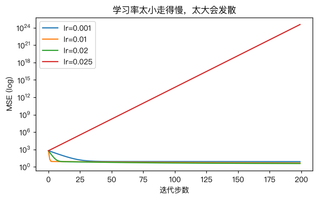
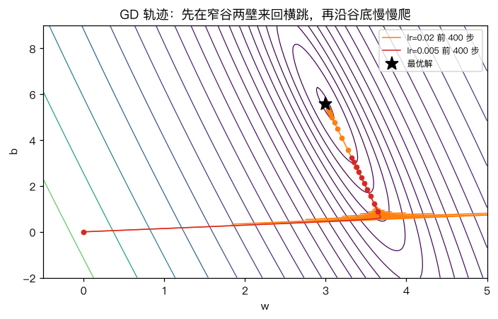

# 梯度下降

> 对应原站：[梯度下降](https://labuladong.online/zh/ai-coding/machine-learning/ml-gradient-descent/)（会员内容；本章为独立原创重写）

> **一句话结论**：梯度是损失对每个参数的偏导组成的向量，指向「上坡最陡」的方向；梯度下降就是反复沿它的反方向走一小步。它不需要公式解，只需要能算梯度——所以从逻辑回归到 LLM，训练都靠它（或它的变体）。

## 公式解不是总有

[最小二乘法](04-ml-least-squares.md) 能一步算出最优参数，靠的是「令导数 = 0」之后方程恰好能解。

你可能会问：换成逻辑回归、神经网络呢？

导数照样能求，但「导数 = 0」那个方程里有 sigmoid、有 exp、有成千上万个参数缠在一起，没人能把它解成 $\theta = \dots$ 的形式。

换个思路。在雾里下山，看不见山脚在哪，但脚底下哪边低总是能感觉到的。那就往低的方向迈一步，再感觉，再迈一步。

这就是梯度下降（Gradient Descent，GD）。它把「解方程」换成了「循环」。

## 先跑起来看看

还是第 4 章那 30 笔配送数据，我们知道最优解是 w=2.9947、b=5.5830。现在假装不知道，从 (0, 0) 出发往下走：

```text
❯ uv run python -m classic.ch05_gradient_descent
sklearn 最优解     : w=2.9947 b=5.5830
解析梯度 [-220.3096  -32.341 ]  数值梯度 [-220.3096  -32.341 ]
lr=0.001  epochs=2000   -> w=3.3243 b=3.2180 最终 MSE=4.595
lr=0.01   epochs=2000   -> w=2.9950 b=5.5805 最终 MSE=3.508
lr=0.02   epochs=20000  -> w=2.9947 b=5.5830 最终 MSE=3.508
lr=0.025  epochs=30     -> w=-158.7878 b=-20.8387 最终 MSE=8.91e+05
mini-batch SGD     : w=3.0273 b=5.0645 MSE=3.6248
标准化后 200 步    : w=2.9947 b=5.5830 MSE=3.5079
```

几个现象值得记住：

- 学习率 0.001：走了 2000 步还没到。
- 学习率 0.01：2000 步基本到了。
- 学习率 0.025：30 步就飞到 w=-158，损失 89 万——**发散了**。
- 把特征标准化之后，学习率可以开到 0.1，200 步就精确收敛。

下面一个个拆。

## 梯度：每个参数各自的「坡度」

对线性回归，损失是 $L = \frac1n\sum(\hat y_i - y_i)^2$，分别对 w、b 求偏导：

$$\frac{\partial L}{\partial w} = \frac{2}{n}\sum(\hat y_i - y_i)\,x_i,\qquad \frac{\partial L}{\partial b} = \frac{2}{n}\sum(\hat y_i - y_i)$$

把它们排成一个向量就是梯度 $\nabla L$。矩阵写法更短：$\nabla L = \frac{2}{n}X_b^\top(X_b\theta - y)$。

直觉上，$\hat y_i - y_i$ 是第 i 个样本「预测多了多少」。预测普遍偏大，梯度就是正的，参数往小了调；偏小就往大了调。每个样本按自己的 $x_i$ 加权投票，决定 w 该往哪边动。

更新规则只有一行：

$$\theta \leftarrow \theta - \eta\,\nabla L(\theta)$$

η（eta）叫学习率（learning rate），就是步长。

```d2
direction: down
a: "θ 初始化"
b: "前向：ŷ = X_b θ"
c: "损失 L"
d: "反向：∇L = 2/n · X_bᵀ(ŷ − y)"
e: "θ ← θ − η∇L"
f: "输出 θ"
a -> b
b -> c
c -> d
d -> e
e -> b: "没收敛"
e -> f: "损失不再下降"
```

这张图请记住它的形状：**前向算损失、反向算梯度、更新参数、再来一遍**。到了 [手写神经网络](../p6-nn-llm/01-ml-neural-network.md) 和 [反向传播](../p6-nn-llm/03-ml-backpropagation.md)，变的只是「反向」那一格怎么算。

回到主线：LLM 的预训练和微调，跑的就是这个循环——参数是几十亿个，损失是「下一个 token 的交叉熵」，梯度由自动求导算出，再加上 Adam 之类的花样（见 [优化器](../p6-nn-llm/04-ml-optimizers.md)）。模型「学会」的一切，都是这一行 $\theta \leftarrow \theta - \eta\nabla L$ 重复几十万次的结果。

## 动手：二十行的梯度下降

完整代码 [`code/ml/classic/ch05_gradient_descent.py`](../code/ml/classic/ch05_gradient_descent.py)：

```python
def mse_loss_and_grad(theta, Xb, y):
    r = Xb @ theta - y
    return float(np.mean(r**2)), 2.0 / len(y) * Xb.T @ r

def gd_linear(X, y, lr=0.01, epochs=1000):
    Xb = add_bias(X)
    theta = np.zeros(Xb.shape[1])
    history = []
    for _ in range(epochs):
        loss, grad = mse_loss_and_grad(theta, Xb, y)
        history.append(loss)
        theta -= lr * grad
    return theta, np.array(history)
```

梯度公式是我们手推的，推错了训练也会「跑」，只是跑不对。所以第一件事是**数值梯度检查**：每个参数加减一个 1e-6，看损失变了多少，和解析梯度比。上面输出里两者完全一致，这一步才算过关。

测试覆盖了四件事：梯度正确、能收敛到 sklearn 的解（误差 1e-6 以内）、学习率合适时损失单调不增、学习率过大会发散：

```text
❯ uv run pytest -q classic/tests/test_ch05_gradient_descent.py
....                                                                     [100%]
4 passed in 0.55s
```

## 学习率：步子迈多大



步子太小，下山要走到天黑；步子太大，一步跨过谷底落到对面更高的坡上，下一步跨得更远——这就是发散。

你可能会问：临界点在哪？

对这只碗，临界点由它最陡那个方向的曲率决定（Hessian 矩阵最大特征值 λ_max，学习率要小于 2/λ_max）。我们的数据里 Hessian 是 $\frac{2}{n}X_b^\top X_b$，算出来 2/λ_max ≈ 0.0234，所以 0.02 还能收敛、0.025 就炸了。实际工程里没人去算特征值，做法是从 1e-3 或 1e-2 开始试，看损失曲线。

## 窄谷：为什么要标准化



这张图是这一章最值得看的。橙色线学习率较大，它先在山谷两壁之间来回横跳，然后沿着谷底慢慢往最优点挪。

原因是这只碗是**又窄又长**的：w 方向很陡（距离的数值是 1~10，w 动一点预测就变很多），b 方向很缓。一个学习率要同时照顾两个方向：为了不在 w 方向发散，只能取小；取小了，b 方向就走得极慢。

标准化（每个特征减均值、除标准差）把碗变圆，两个方向的坡度差不多，一个学习率就都合适了。这就是输出里「标准化后 200 步」那行的来由。

生活类比：在一条窄长的峡谷里找最低点，你每一步只能沿「脚下最陡」的方向走，而最陡的方向几乎总是指向对面谷壁，所以你会在两壁间走 Z 字。把峡谷压成圆形盆地，最陡方向就直指盆底了。类比不成立的地方是：真实的高维损失里「峡谷」有几百万个方向，标准化输入只能缓解一部分，剩下的要靠 Momentum、Adam 这类优化器。

## 批量、随机、小批量

上面每一步都用了全部 30 条数据算梯度，叫批量梯度下降（batch GD）。数据有一亿条时，算一次梯度就要扫一遍全量，太贵了。

随机梯度下降（Stochastic GD，SGD）每步只抽一小批（mini-batch）样本估计梯度。估计有噪声，但便宜得多：

```python
for s in range(0, len(y), batch_size):
    j = idx[s : s + batch_size]
    _, g = mse_loss_and_grad(theta, Xb[j], y[j])
    theta -= lr * g
```

输出里 SGD 停在 w=3.03、b=5.06，参数离最优点有点远，但 MSE 只比最优高 3%。这是 SGD 的典型行为：**在谷底附近一直抖，不会精确停下**。测试里我们也只断言损失在最优的 1.05 倍以内，而不是参数完全相等。

我的观点：这种抖动不完全是坏事。在神经网络那种多谷的损失上，一点噪声反而能帮你从浅谷里抖出来——下一章就会看到「浅谷」有多麻烦。

## 对照你的环境

你调 Claude Code 的 skill 和 hook 的过程，其实就是一次「人肉梯度下降」：改一点提示词（更新参数）→ 跑几个 case 看效果（算损失）→ 判断往哪个方向再改（估计梯度）。每次只用几个 case 评估，就是 mini-batch：便宜但有噪声，所以别因为一次跑偏就大改。

## 常见坑

- **梯度符号写反**：变成梯度上升，损失越来越大。先做数值梯度检查。
- **学习率一把梭**：直接用 0.1 跑原始尺度的数据，发散了还以为是代码 bug。先标准化，再从小往大试。
- **只看最后一个 loss**：画出损失曲线，单调下降、震荡、发散一眼就能看出来。
- **SGD 期待参数精确收敛**：它不会，要么接受抖动，要么让学习率随时间衰减。
- **标准化用了测试集的统计量**：均值和标准差只能从训练集算。

## 练习

1. 把 `gd_linear` 改成「损失变化小于 1e-10 就提前停止」，记录 lr=0.01 时实际走了多少步。
2. 给 SGD 加上学习率衰减 $\eta_t = \eta_0/(1 + t/100)$，看参数能不能更接近最优解。
3. （工程题）你有一个负载均衡权重要调：三台机器的流量权重 $(a, b, c)$，目标是最小化「p95 延迟」。延迟没有公式，只能线上观测。梯度下降还能用吗？怎么在没有解析梯度时估计梯度？（提示：有限差分、每次只扰动一台机器；再想想线上实验的噪声和成本。）

## 延伸阅读

- [CS231n: Optimization](https://cs231n.github.io/optimization-1/)
- [Why Momentum Really Works (Distill)](https://distill.pub/2017/momentum/)——峡谷问题的可视化
- 下一章：[局部最优与全局最优](06-ml-local-global-optima.md)
