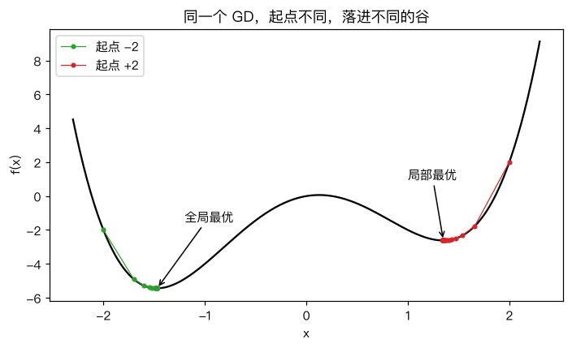
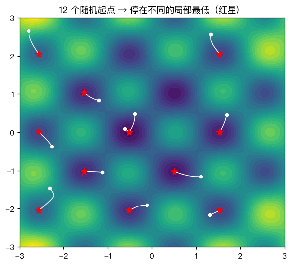

# 局部最优与全局最优

> 对应原站：[局部最优与全局最优](https://labuladong.online/zh/ai-coding/machine-learning/ml-local-global-optima/)（会员内容；本章为独立原创重写）

> **一句话结论**：梯度下降只看脚下的坡，梯度为 0 它就停；损失有多个谷底时，停在哪个谷由起点决定，不一定是最深的那个。

## 一直往下走，就能走到最低点吗

[梯度下降](05-ml-gradient-descent.md) 在配送数据上一路顺风：不管从哪出发，最后都到了同一个最优点。

你可能会问：这是梯度下降厉害，还是运气好？

是这只碗好。[最小二乘法](04-ml-least-squares.md) 里说过，线性回归的 MSE 是凸函数，只有一个谷底，往下走只能走到它。

可是神经网络的损失不是碗，是一片连绵的山地。

## 先跑起来看看

拿一个有两个谷的一元函数做实验：

$$f(x) = x^4 - 4x^2 + x$$

它在 x≈-1.47 有个深谷（全局最优，global optimum），在 x≈1.35 有个浅谷（局部最优，local optimum）。

```text
❯ uv run python -m classic.ch06_local_global
GD 起点 -2.0 -> 停在 x=-1.4730  f=-5.4442
GD 起点 -0.5 -> 停在 x=-1.4730  f=-5.4442
GD 起点 +0.3 -> 停在 x=+1.3470  f=-2.6186
GD 起点 +2.0 -> 停在 x=+1.3470  f=-2.6186
暴力网格全局最低   x=-1.4730  f=-5.4442
scipy BFGS 起点 2  x=+1.3470  f=-2.6186   <- 换了更聪明的局部优化器也一样被困
10 个随机起点: 3 个到了全局最低, 多起点取最优 x=-1.4730
```

同一个算法、同一个学习率，只是起点不同，结果差了一倍多。



## 梯度为 0 不等于到底了

梯度下降的停止条件是 $f'(x) = 0$。可满足这个条件的点有三类：

```d2
direction: down
a: "f'(x) = 0 的点"
b: "局部最小值\n四周都更高"
c: "局部最大值\n四周都更低"
d: "鞍点\n有的方向高、有的方向低"
e: "其中最低的那个\n= 全局最小值"
a -> b
a -> c
a -> d
b -> e
```

在 x=1.347 处，GD 看到的世界是：左边高、右边也高，梯度是 0。它没法知道翻过左边那座小山（x≈0.13 处的局部最大值）后面还有个更深的谷。

生活类比：蒙着眼睛下山，只能靠脚底感受坡度。走到一个小盆地，四面都是上坡，你就会以为到山脚了。这个类比不成立的地方在于，真人可以「先往上爬一段看看」；而纯粹的梯度下降从定义上就不会往上走——让它学会「偶尔往上走」，正是 [模拟退火](18-ml-simulated-annealing.md) 的思路。

输出里还有一行值得注意：scipy 的 BFGS 是比 GD 聪明得多的优化器（它会估计曲率），从 x=2 出发照样停在 1.347。**被困住不是因为算法笨，而是因为所有「局部」优化器都只用局部信息。** 测试里我们断言了手写 GD 和 BFGS 停在同一个点：

```python
def test_gd_matches_scipy_local_optimizer():
    for x0 in (-2.0, 2.0):
        ours, _ = gd_1d(x0)
        ref = minimize(lambda v: f(v[0]), x0=[x0], method="BFGS").x[0]
        assert np.isclose(ours, ref, atol=1e-4)
```

回到主线：LLM 的损失面是几十亿维的，凸不了。可它照样训练得很好——这本身说明「局部最优」在高维里没有一维时那么可怕（见下文）。对我们写 Agent 的人来说，这一章更有用的启发是：**任何「只看当前状态贪心地走一步」的循环，都可能卡在局部最优**。Agent 循环每轮也只看上下文里的东西决定下一步，所以才需要 plan、重试、换思路这些机制。

## 多维的样子

二维时更直观。下图是 $\sin 3x \cos 3y + 0.1(x^2+y^2)$，12 个随机起点各跑一次 GD：



白点是起点，红星是终点。每个起点都滚进了离自己最近的那个坑。

## 三种应对办法

**1. 多起点（multi-start）。** 最朴素也最可靠：随机撒 N 个起点，各跑一次，取最好的。

```python
def multi_start(xs0, **kw):
    ends = np.array([gd_1d(x0, **kw)[0] for x0 in xs0])
    best = ends[np.argmin(f(ends))]
    return best, ends
```

输出里 10 个起点只有 3 个到了全局最优，但取最好的那个就够了。代价是 N 倍算力。[K-Means](16-ml-kmeans.md) 的 `n_init=10` 用的就是这个办法。

**2. 加噪声。** SGD 的梯度本身带噪声，在浅谷附近可能被「抖」出去。

**3. 允许往上走。** 模拟退火以一定概率接受更差的解，第 18 章详细讲。

你可能会问：那神经网络训练时为什么不见大家用多起点？

因为在很高维的空间里，情况和一维相反。一个点要成为局部最小值，需要**所有**方向都是上坡；维度一高，这几乎不可能同时满足，大多数梯度为 0 的点其实是鞍点（saddle point），总有一个方向能继续往下。而且实践发现，大网络的各个局部最小值，损失值都差不多好。我的观点是：**一维、二维的图很适合建立直觉，但别把这个直觉原样搬到 LLM 上**。

## 动手

完整代码 [`code/ml/classic/ch06_local_global.py`](../code/ml/classic/ch06_local_global.py)。「标准答案」靠的是一维才付得起的暴力网格：

```python
def grid_min(lo=-3, hi=3, n=600001):
    xs = np.linspace(lo, hi, n)
    return xs[np.argmin(f(xs))]
```

```text
❯ uv run pytest -q classic/tests/test_ch06_local_global.py
...                                                                      [100%]
3 passed in 0.18s
```

## 对照你的环境

你给 Claude Code 写 skill 时会遇到同样的事：改了一版提示词，在手头几个 case 上效果变好，再怎么微调都不再变好——这是「局部最优」。真正的突破通常来自换一个结构（比如把一段规则从常驻层挪进 skill，或者拆出一个 subagent），相当于换了一个起点。

## 常见坑

- **以为 loss 不降了就是最优**：它只是到了一个梯度为 0 的地方。
- **固定随机种子后只跑一次**：结论可能只对这个起点成立。至少换几个 seed。
- **把一维直觉套到高维**：高维里鞍点比局部最小值多得多。
- **多起点没并行**：N 次运行彼此独立，天然适合并行。

## 练习

1. 用 `gd_1d` 从 -3 到 3 每隔 0.1 取一个起点，画出「起点 → 终点」的映射，找出两个谷的「吸引域」分界在哪。它和 f 的局部最大值有什么关系？
2. 给 `gd_1d` 加一个动量项（$v \leftarrow \beta v - \eta f'(x)$, $x \leftarrow x + v$），β=0.9 时从 x=2 出发能不能冲过山梁？
3. （工程题）你在做一个自动调参脚本：给 Agent 的 `max_tokens`、`temperature`、重试次数三个参数找最优组合，评估一次要跑 20 个用例、花 5 分钟。多起点、网格搜索、随机搜索各要多少预算？你会怎么选？

## 延伸阅读

- Dauphin et al., [Identifying and attacking the saddle point problem in high-dimensional non-convex optimization](https://arxiv.org/abs/1406.2572)
- [scipy.optimize.minimize](https://docs.scipy.org/doc/scipy/reference/generated/scipy.optimize.minimize.html)
- 下一章：[过拟合与泛化](07-ml-overfitting.md)
