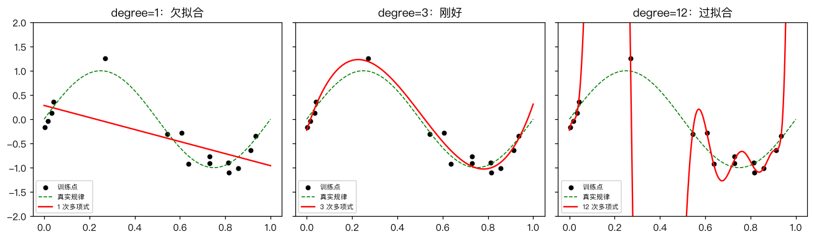
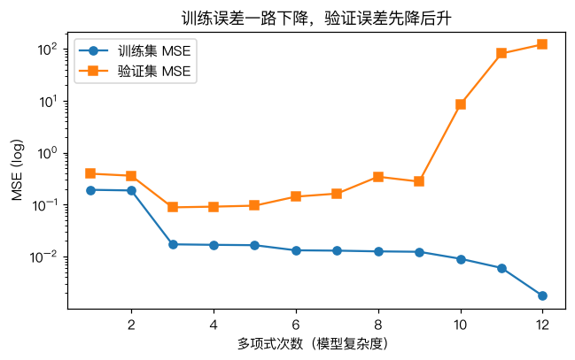

# 过拟合与泛化

> 对应原站：[过拟合与泛化](https://labuladong.online/zh/ai-coding/machine-learning/ml-overfitting/)（会员内容；本章为独立原创重写）

> **一句话结论**：模型是拿来预测没见过的数据的，所以要用没参与训练的数据打分。模型太复杂会连噪声一起背下来（过拟合），太简单又学不到规律（欠拟合）；正则化和交叉验证是两把最常用的尺子。

## 训练 loss 越低越好吗

前三章一直在做同一件事：把训练集上的损失压到最低。

你可能会问：既然目标是让损失小，那用一个更复杂的模型、把训练损失压到 0，不是更好吗？

考试的类比最直接。一个学生把历年真题连同答案背得滚瓜烂熟，真题能考满分；换一张新卷子，他就不会了。他「拟合」了真题，但没有「泛化」（generalization）到新题。

训练集就是历年真题。我们要的是新卷子上的分数。

## 先跑起来看看

数据：真实规律是 $y = \sin(2\pi x)$，加一点噪声，只给 15 个训练点。另外生成 200 个验证点，**不参与训练**，专门用来打分。模型是 1 到 12 次多项式回归。

```text
❯ uv run python -m classic.ch07_overfitting
degree  train_MSE  val_MSE
     1     0.1925     0.3936
     2     0.1871     0.3595
     3     0.0171     0.0884
     4     0.0168     0.0912
     5     0.0165     0.0953
     6     0.0132     0.1422
     7     0.0130     0.1626
     8     0.0125     0.3437
     9     0.0123     0.2774
    10     0.0090     8.4819
    11     0.0060    81.4042
    12     0.0017   121.9347
degree=12 无正则  max|w| = 2.01e+08
degree=12 alpha=1e-06  train=0.0129 val=0.1990 max|w|=33.5
degree=12 alpha=0.001  train=0.0321 val=0.0661 max|w|=11.4
degree=12 alpha=0.1    train=0.1217 val=0.2407 max|w|=1.1
5 折 CV: {1: 0.303, 2: 0.317, 3: 0.093, 4: 0.111, 5: 0.092, 6: 0.096, 7: 0.141, 8: 0.177, 9: 0.703, 10: 2.712} -> 选 degree 5
```

训练误差从 0.19 一路降到 0.0017，验证误差却在 3 次之后掉头往上，12 次时到了 121——比一条水平线还差得多。



左边一条直线，连「先升后降再升」的形状都表达不了，这是欠拟合（underfitting）。中间 3 次多项式基本贴着真实规律。右边 12 次多项式穿过了每一个训练点，代价是在点与点之间疯狂扭动，这就是过拟合（overfitting）。

## 一条 U 形曲线



这张图是这一章的核心：

- 训练误差**单调下降**。模型越复杂，越能贴合训练点——这是数学上保证的，因为高次多项式包含了低次多项式。
- 验证误差**先降后升**。前半段在学规律，后半段在背噪声。

最好的复杂度在 U 形的底部。问题是：**你在训练集上看不到这个底**，只有拿出没参与训练的数据才看得到。

```d2
direction: right
d: "全部数据"
t: "训练集\n拿来调参数 w"
v: "验证集\n拿来选模型：几次多项式？α 多大？"
s: "测试集\n锁进抽屉，最后只看一次"
d -> t
d -> v
d -> s
```

你可能会问：为什么要分验证集和测试集两份？

因为「拿验证集选模型」本身也是一种拟合。你试了 12 个次数、挑验证误差最低的那个，这个最低值是被你挑出来的，偏乐观。测试集从头到尾不参与任何决策，它的分数才是对新数据的诚实估计。

回到主线：LLM 的训练和评测有一模一样的问题。benchmark 题目要是混进了预训练语料（数据污染，data contamination），模型分数再高也只是「背过真题」。对 Agent 开发者来说也一样：你拿 5 个 case 反复调 system prompt，调到 5 个都过，这 5 个 case 已经变成了训练集，需要另一批没看过的 case 才能知道它是不是真的变好了。

## 正则化：给复杂度加个价

注意输出里那一行：12 次多项式不加约束时，最大的系数是 **2 亿**。为了穿过每个噪声点，正负巨大的系数互相抵消，曲线才会那样剧烈扭动。

岭回归（Ridge regression，也叫 L2 正则）的思路是：系数大本身就要罚。

$$L = \frac1n\sum(\hat y_i - y_i)^2 \;\to\; \sum(\hat y_i - y_i)^2 + \alpha\|w\|^2$$

α 是罚多重。它仍然有闭式解，只是在正规方程的对角线上加了个 α：

```python
def fit_poly(x, y, degree, alpha=0.0):
    X = poly_features(x, degree)
    xm, ym = X.mean(0), y.mean()
    Xc, yc = X - xm, y - ym                     # 中心化：让偏置不受惩罚
    if alpha == 0:
        w, *_ = np.linalg.lstsq(Xc, yc, rcond=None)
    else:
        w = np.linalg.solve(Xc.T @ Xc + alpha * np.eye(degree), Xc.T @ yc)
    b = ym - xm @ w
    return w, b
```

同样是 12 次多项式，α=0.001 时最大系数降到 11，验证误差 0.066，**比最好的无正则模型（3 次，0.088）还低**。α 太大（0.1）又压过头了，退化成欠拟合。

我的观点：实践中「选一个偏复杂的模型 + 调正则强度」通常比「精挑模型复杂度」更好用，因为 α 是连续的，好调；次数是离散的，跳一格变化很大。

## 交叉验证：数据少时的验证集

只有 40 个样本时，切出 10 个当验证集太奢侈，而且这 10 个选得好不好，结论可能完全不同。

K 折交叉验证（K-fold cross-validation）把数据切成 K 份，轮流拿一份当验证集，其余训练，最后取平均：

```python
def kfold_indices(n, k, seed=0):
    idx = np.random.default_rng(seed).permutation(n)
    folds = np.array_split(idx, k)
    for i in range(k):
        val = folds[i]
        train = np.concatenate([folds[j] for j in range(k) if j != i])
        yield train, val
```

每个样本恰好当一次验证。输出里 5 折 CV 选出了 5 次，3~6 次的分数都很接近——这也是诚实的信息：在这个数据量下，这几个模型分不出高下。

## 动手与对照

完整代码 [`code/ml/classic/ch07_overfitting.py`](../code/ml/classic/ch07_overfitting.py)。测试分别和 sklearn 的 `PolynomialFeatures + LinearRegression`、`Ridge`、`KFold` 对照，并断言了 U 形本身：

```text
❯ uv run pytest -q classic/tests/test_ch07_overfitting.py
....                                                                     [100%]
4 passed in 0.49s
```

## 对照你的环境

你的 Stop hook 和 guardrails 里，每条规则基本都来自一次具体的踩坑。规则写得越具体（「webapp 里 X 组件的 Y 属性不要用 Z」），越能精确拦住那一次的问题，但对没见过的场景越没用，还会和别的规则冲突——这就是规则层面的过拟合。你在 CLAUDE.md 里写的「常驻层是稀缺资源，每加一行先问漏了会返工吗」，本质上就是一个正则项：给复杂度定价。

## 常见坑

- **用训练集打分**：最常见也最致命。任何「模型很好」的结论，先问是哪份数据上的。
- **反复看测试集**：看一次、改一次、再看一次，测试集就退化成验证集了。
- **数据泄漏**：标准化、特征选择用了全量数据的统计量，验证分数会虚高。所有预处理只在训练集上 fit。
- **时间序列随机切分**：用未来预测过去。按时间切，验证集永远在训练集之后。
- **正则化罚了偏置**：偏置只是整体平移，罚它没有意义。上面的代码通过中心化避开了它，sklearn 的 `Ridge` 也是这么做的。

## 练习

1. 把训练点从 15 个增加到 200 个，重跑 1~12 次的表格。U 形还明显吗？说明「数据量」和「过拟合」的关系。
2. 用 `cv_mse` 对 12 次多项式在 α ∈ {1e-8, 1e-6, …, 1} 上做交叉验证，选出最好的 α。
3. （工程题）你给一个告警规则调阈值，拿上个月的 30 次故障记录调到「全部命中、零误报」。上线后误报很多。用这一章的语言解释发生了什么，并设计一个更可信的评估流程（提示：按时间切分、留出最近两周不看）。

## 延伸阅读

- [sklearn: Underfitting vs. Overfitting](https://scikit-learn.org/stable/auto_examples/model_selection/plot_underfitting_overfitting.html)
- [sklearn: Cross-validation](https://scikit-learn.org/stable/modules/cross_validation.html)
- 下一章：[二分类问题：逻辑回归](08-ml-logistic-regression.md)
